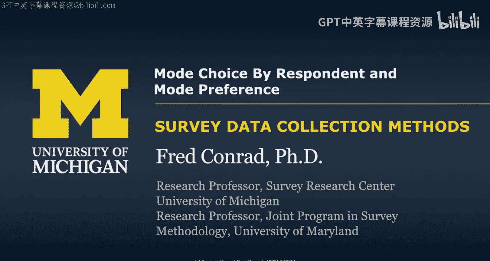
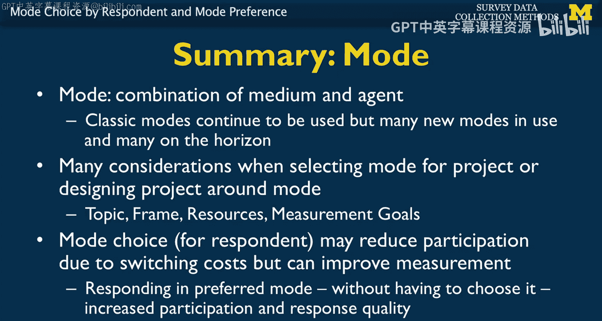

# 密歇根大学《调查数据收集和分析（2-6：方法、社调问卷设计、抽样、缺失数据、分析）｜Survey Data Collection and Analytics》 p06 5_1.3.2 受访者模式选择.zh_en -BV1fw4m1e7Zh_p6-

。So continuing with our discussion of mode， we'll focus now on mode choice by the respondent。

 so in a mixed mode study it sometimes makes sense to actually require respondents to choose how they provide their answers。

One concern is that giving them this choice might reduce participation and is。

Not something that was necessarily anticipated by methodologists。

 but has kind of been observed in a number of studies providing this kind of choice or requiring this kind of choice of respondents。

There's a good meta analysis by Medway and Fulton that looks just at a particular type of mode choice design in which respondents are mailed invitations or they're not really not respondents at this point。

 their' sample members are mailed invitations that include a paper questionnaire。

And a random subset of the sample members are offered a web alternative， this is the mode choice。

 so their invitation gives them a URL and indicates that if they would prefer to complete the questionnaire on the web。

 they can， means they'll have to manually enter the URL。

 so Mway and Fulton reviewed 19 studies of this form。

 so it's just this paper invitation with a paper questionnaire in which a subset of the sample members are offered a choice of responding by web。

And they found that across the 19 studies， the response rate was reliably lower overall when sample members were given a choice than in the male only condition。

The response rate was lower in 17 out of 19 studies and reliably lower in eight of them。

They suggest this could be the case for a number of reasons。

 one is what they call the paradox of choice， which Barry Schwartz， a social psychologist coined。

The idea there is that instead of improving the decision making process when decision makers are given choice。

 if particularly if they're given a lot of choices。

 this can actually kind of paralyze them and make it much harder to make a decision and make them less satisfied with the decision that they eventually make so Medway and Fulton suggests this is one possible explanation for the reduction in response rates that in the end responses don't do anything another is what they call switching costs so that the act of going from the paper questionnaire to a computing device to enter the URL results in a reduction in participation because people get distracted or they get attempt to enter the URL is frustrated and just somehow despite the best of intentions they never make that transition。

Moving to the web has different technical requirements and if the internet connection is down or there are usability issues。

 for example， the respondents aren't as capable using a computer or online applications as they are completing on paper that this too will lead to reduced response。

 so they have a number of possible explanations， so it could well be that choice comes with this particular cost。

Despite the reduction in response rate， it's possible that giving respondents a choice can actually improve the quality of their answers。

So a study by Conrad and colleagues tested this idea。

 the thinking was that they might just be more engaged and more committed to the task if they've chosen how they'll provide their answers。

So in their study， the sample members were invited to participate in one of four interview modes on their smartphones which happened to be iPhones in this study。

 the four modes were what they called human voice in which an interviewer read the questions over the phone and recorded the answers。

 automated voice which we earlier talked about speech IVR。

 that's what automated voice really was equivalent to in this study。

 so an audio recording of an interviewer read the questions and respondent spoke their answers and the system did its best to recognize their answers and automatically recorded them。

The third mode is human text in which a human interviewer sent questions by text message and respondents texted their answers。

And the fourth mode was automated text in which a computer texted questions and respondents texted answers。

So they were contacted in one of those four modes and then half of them were required to choose one of those four modes。

 so they could actually have chosen the mode in which they were contacted。

 or they could have chosen any one of the others。So there was also a comparison possible between those who were required to make this choice and those who were not given a choice。

And what they found was higher quality data by a couple of measures for the group that was required to choose。

 they found fewer rounded numerical answers which is generally considered to reflect a more careful thought if a question requires a numerical answer and the answer is10 as opposed to 97。

 the answer of10 seems to have been the result of a kind of rounding process instead of a more careful enumeration of whatever goes into the answer so that was one measure of improved quality。

 the other was less straight liing， straightlining the tendency to select the same answers across a number of questions that use the same response scale or give the same response options and the idea is that when respondents do straight line they're generally not giving as much thought as you would hope to the questions and just picking a single answer sometimes they're picking a single answer without any thought。

And there were fewer breakoffs that is there was a higher completion rate when respondents were given a choice than not。

There was also higher satisfaction in a post interview satisfaction assessment when respondents chose their modes and the mode that they happen to choose most often was automated text。

So this suggests that despite the reduction in response rates that seems to be inherent in mode choice。

 or at least the kinds of mode choice studies that have been done。

 there's a benefit in terms of data quality or response quality from requiring respondents to choose their mode。

It's worth noting that in this study by ConraD at all， which was focused on data quality。

 there was also a reduction in response rate among the groups that were required to choose the mode in which they answered。

 much as in the Fulton and Medway meta analysis， which involved a different combination of modes。

But the reduction in response rate was concentrated to certain mode transitions， in particular。

 those that involve going from an invitation to participate in an automated mode。

 automated text or automated voice to a human administered mode。

 human text human voice switches in those directions are likely to incur a delay because a human interviewer may not be immediately able to start the interview。

 whether it's by voice or by text， and so that delay may be what was responsible for the reduction in response rates。

But in any case， choosing a mode on a single device as opposed to receiving a paper invitation with a URL to complete by web requiring respondents to。

Physically transition to a computer and manually enter the URL。

 a single device really does minimize the costs involved in switching modes。

Moode preference is a little different than mode choice。

 mode preference refers to respondents kind of predisposition to participate in a particular mode。

 but they're not given a choice in studies of mode preference， but just as with mode choice。

 we can look at the impact of mode preference on response rates and on response quality。

ollson and her colleagues asked respondents what mode they preferred in a telephone survey that is in the telephone survey they asked what survey mode do you in general prefer if you received the request to do another survey like this one。

 would you prefer to participate in an in-person interview at your home？

An interview on your home phone， an interview on your cell phone。

 a paper survey sent by mail or a survey on the internet。And then about a year later。

 they invited the same respondents to participate in another survey。

And they randomly assigned respondents to a mail or web mode or actually a sequence of mail and web or web and mail。

Some respondents answered initially in the preferred mode that it just so happened they were assigned to a mode that they had a year earlier indicated was their preferred mode and some did not。

And what they found was that response rates were higher， at least in some modes。

 if the interview or the data collection took place in the preferred mode。

 so some evidence that being interviewed or having data collected in a mode that respondents prefer increases their likelihood of participating。

Turning to the impact of mode preference on response quality， a study by Smith at all。

 examined the amount of what's known as sating or mental shortcuts that respondents exhibit。

 actually in the data set generated in the Olen at all study。

The respondents were assigned to one of two questionnaire forms in which the item formats differed。

 so they either received a check all that apply item in which they they're essentially boxes and they can check as many as they want or force choice in which they had to say yes or no to every item in a list and they received an open question which they answered in their own words。

 but the response box was either big or small， and the idea is that the big response box implies that a longer answer is expected。

 at least this is how respondents seem to interpret that。

So the question is are they taking shortcuts are they checking fewer options in the check all that apply form than forced choice where they have to provide an answer for every option and are they less likely to provide open responses when the response box is big than not the evidence of satisfyising and the question is how does moon preference affect that。

tendencyendancy to satisfy to take these shortcuts。

And what they found was that if the respondents were not in the preferred mode。

 that as they were answering in a mode that they had previously indicated was not their first choice。

 they endorsed fewer options in the check all that apply form than the force choice form and they skipped the open format questions the open response question more when it contained a large box implying that longer answers were。

Expected than when it contains a small box， but when respondents answered in the preferred mode。

 the format had no effect on their answers， so it does seem that mode preference like mode choice reduces response rate。

 but also increases response quality。So to summarize our discussion of mode and what we mean by mode。

 one can think of mode as a combination of the medium and the agent， the classic modes。

 telephone interviewing， face to face interviewing and mailed out paper questionnaires or postal mail。

 the classic modes continue to be used， but many new modes are both in use and on the horizon。

There are many considerations for researchers to take into account when selecting a mode for a project or designing a project around a mode。

Including the topic， the sampling frame， the available resources， and the measurement goals。

Moode choice for respondents may reduce participation due to switching costs。

 but it can improve measurement， similarly responding in a preferred mode without having to choose it may both increase participation as well as response quality。

So in our next segment we'll talk more specifically about mixed mode surveys。

 there are several different designs and each has its pros and cons， so we'll turn to that next。

