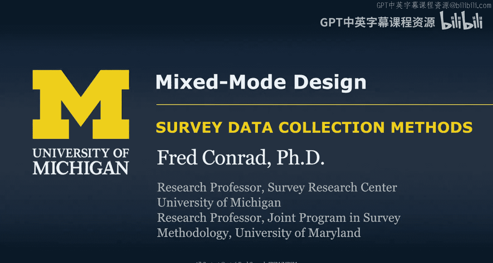
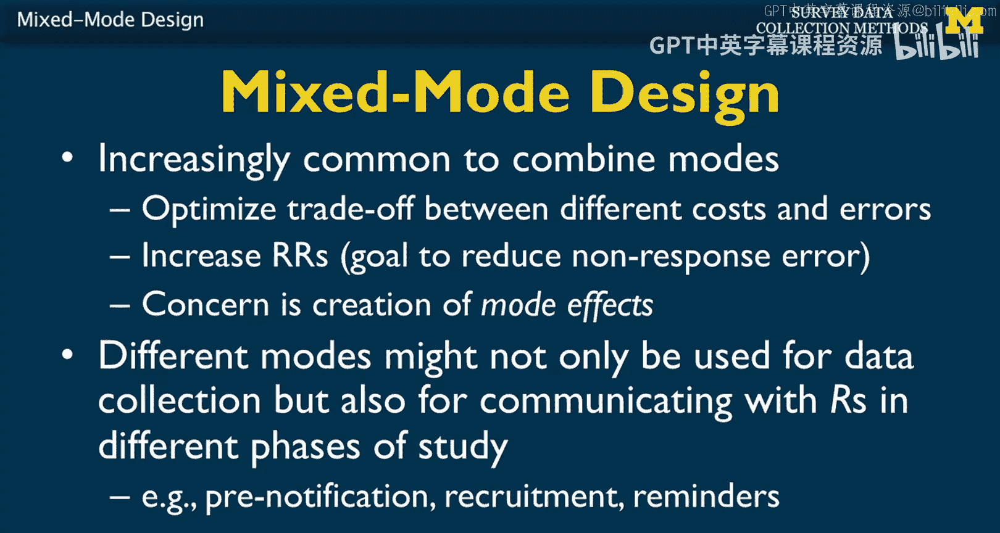
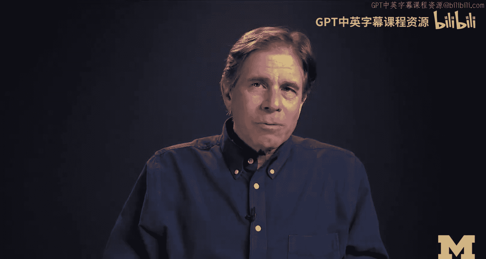
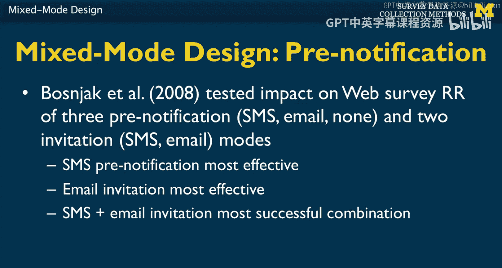
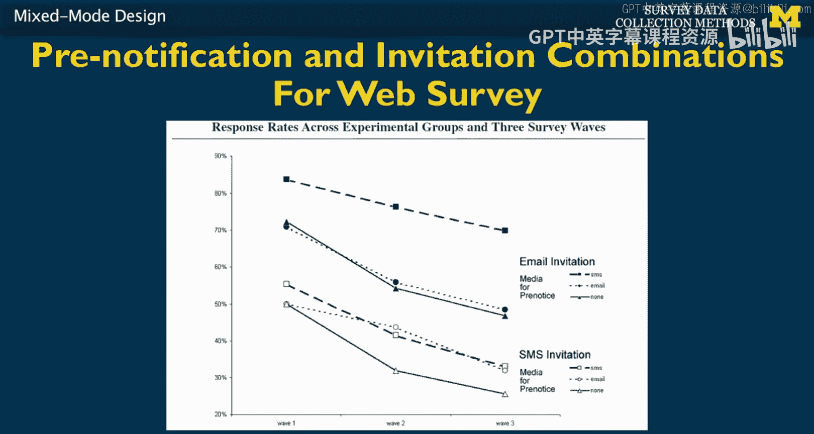
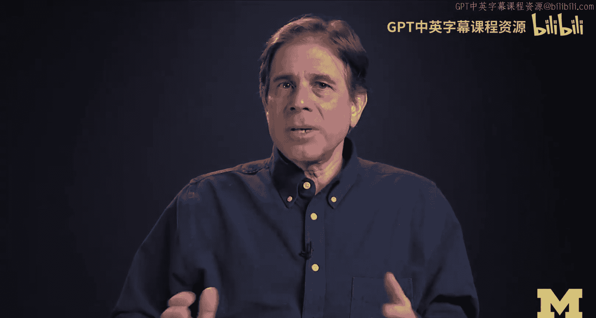
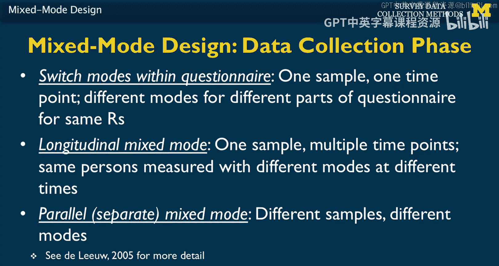

# 密歇根大学《调查数据收集和分析（2-6：方法、社调问卷设计、抽样、缺失数据、分析）｜Survey Data Collection and Analytics》 p07 6_1.4.1 混合模式设计.zh_en -BV1fw4m1e7Zh_p7-

We've spoken about a number of survey modes already。

 I've referred to some of them as the classic survey modes。

It's increasingly common to combine modes into a single survey or a single study。

 and these are known as mixed mode designs， so in the current segment we'll introduce a number of different mixed mode designs and then elaborate on the implications of these designs for survey error。

So the goal of mixed mode design， the goals are to one optimize the kinds of tradeoffs we've been talking about so far between different costs and errors to increase response rates。

 the goal being to reduce non-response error and as we'll discuss。

 lowering response rate doesn't necessarily reduce non-response error。

 but the two can be related and it's certainly desirable to reduce non-response。

 increased response rates。

So those are goals， but the concern is creating what are known as mode effects。

 which really are different estimates coming out of data collected from the same。

Sample generally in different modes， this is certainly a source of error and something one would want to minimize so different modes might not only be used for data collection but for the for communicating with sample members in different phases of the study so we know we call this precontact in which the sample members are alerted to the fact that an invitation is forthcoming recruitment in which they are actually invited to take part in the survey。

And then reminders after they've been recruited to make a decision about participating。

So let's discuss mixed mode designs that mix one mode for pre- notification and another for the data collection pre notification。

 as I said， alerts the sample member to an upcoming survey invitation。

 it's not actually the invitation the invitation will follow。

 but an example might be in a telephone interview or a survey in which the data collection is done by telephone interviews。

 the recruitment and pre notification are done face to face in some areas。

Or another example might be mail recruitment including pre notification for a web survey。

 a web only survey， which is actually a very common combination of recruitment mode and data collection so again the goals are to increase response rate by increasing the study's salience and if the pre- notification recruitment et cetera。

 happen to be in the same mode as the data collection。

 then we don't have to worry about mode effects。As an example of how pre notification can be conducted in a mode that differs from data collection。

 Bosniak and his colleagues tested the impact on response rate in web surveys of three pre notification modes。

SMS， email， or none。And two invitation modes， SMS or email。They found that overall。

 SMS pre notification was most effective that his response rates were higher when the pre notification was texted to respondents。

They found that the invitation， which followed the pre notification was most effective when it was sent via email。

And they found that the combination of an SMS pre notification and an email invitation was most effective overall so we can see that in the graph here。

 the line or curve that's highest， is that combination of SMS pre- notification and email invitation when it comes to mixing modes in data collection as opposed to between pre- notification or recruitment and data collection。

 there are a number of different designs and these have been well documented by Deleu in 2005 in an article I encourage you to read。

First is what is known as concurrent mixed mode designs in which there's one sample， one time point。

A single questionnaire， but the sample persons are interviewed or their data are collected in different modes。

A key aspect of this type of design is。Moode choice， giving the sample members。

 the respondents an option of how their data will be collected。

Sequential mixed mode is far more common， this refers to the situation where again there's a single sample。

 a single time point。But the sample members are recruited in increasingly effective but increasingly expensive modes if previous contact attempts are not successful。

 so this would be a case in which the recruitment or pre notification is intended to be in the same mode as data collection。

 but if the sample members don't respond or can't be contacted in， for example。

 a paper mailed questionnaire，Or for those who did not respond。

 there's a follow up in say a telephone interview assuming the sampling frame contains both addresses and phone numbers。

 and then for those who don't respond in a telephone interview。

 telephone contact a personal visit is made by an interviewer， so you can see that the idea to。

Maximize response rates while minimizing expense， so only using the most expensive mode。

 face to face interviews for those sample members who haven't responded to either a telephone interview or a paper mailed out questionnaire。

Other designs include switching modes within the questionnaire。

 so the most well-known example of this would be a face to face interview in which the interviewer turns the computer over to the respondent for the most sensitive questions。

 so Cassie or audio Cassie as we've discussed， so there were actually two modes in a single interview or for a single questionnaire。

Longitudinal mixed mode studies in which there is one sample。

 but their behaviors and attitudes are measured at multiple time points and the idea is that at one time more often the initial data collection is done in one mode and then the subsequent interviews are or data collection sessions are done in another mode。

 so you can imagine a face- toface interview to really engage and extract a commitment from households to take part in the longitudinal study and that with the followups being conducted by telephone。

And then parallel or separate mixed mode designs refer to situations in which there are actually different samples whose data are collected in different modes。

 but these are all combined into a single study， so multinational surveys are really the primary example of this approach in which it makes sense to use different modes predominantly in different countries and then integrate the data in the analysis and so in the next segment we will focus in more detail the first of those mixed modes。

 mixed data collection modes namely concurrent mixed mode data collection。

