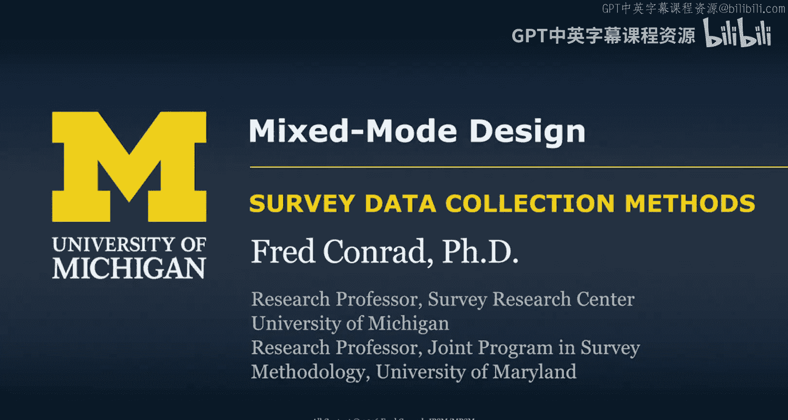
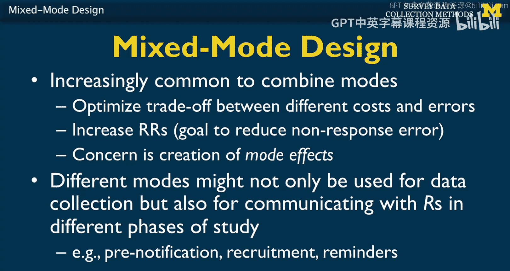
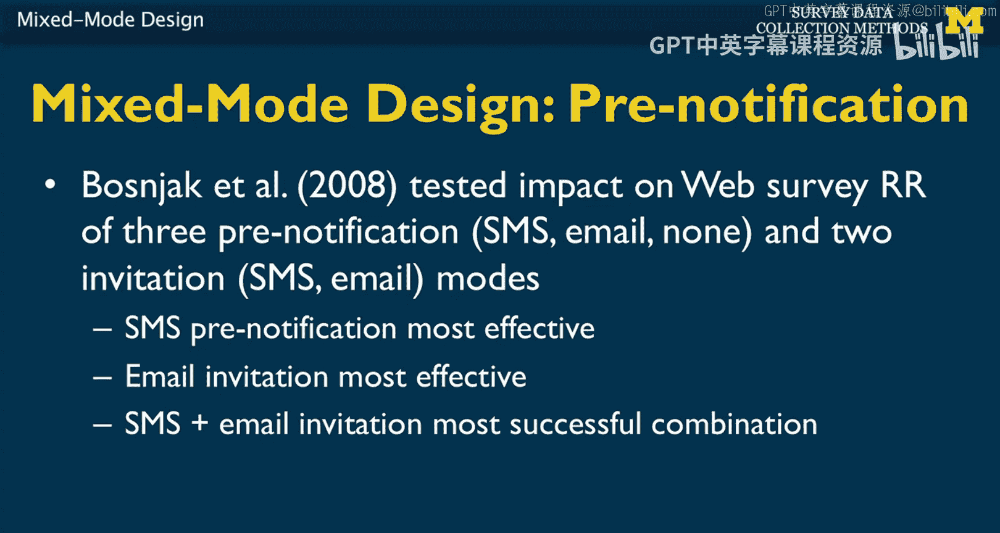
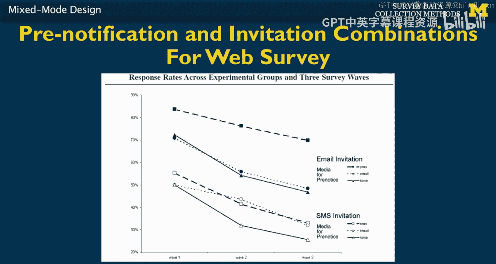
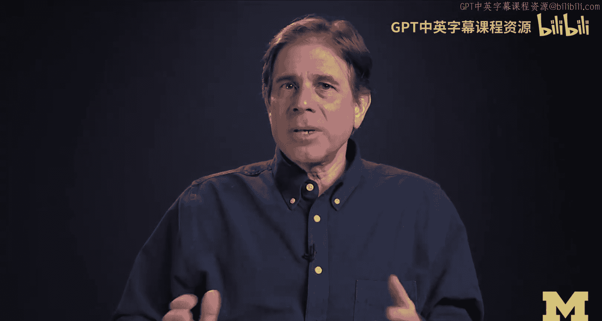
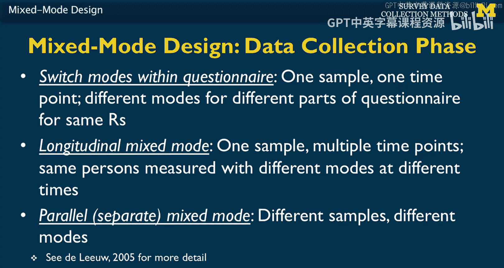

# 调查数据收集与分析：2-6：混合模式设计

## 📘 概述

在本节中，我们将学习**混合模式设计**。这是一种将多种调查模式结合在单一研究中的方法。我们将介绍几种不同的混合模式设计，并详细探讨这些设计对调查误差的影响。

---

## 🎯 混合模式设计的目标

我们已经讨论过多种调查模式，其中一些被称为经典调查模式。如今，将多种模式结合到一项调查或研究中变得越来越普遍，这被称为混合模式设计。

混合模式设计的主要目标有三个：
1.  **优化成本与误差之间的权衡**：平衡不同调查模式带来的成本和误差。
2.  **提高应答率**：目标是减少无应答误差。虽然提高应答率不一定直接降低无应答误差，但两者通常相关，降低无应答率总是有益的。
3.  **降低调查成本**：通过策略性地组合模式来控制总体开销。

然而，混合模式设计也带来一个主要担忧：**模式效应**。这指的是从同一总体样本但通过不同模式收集的数据中，得出不同估计值的现象。这无疑是一种误差来源，需要尽力最小化。

---

## 🔄 不同研究阶段的模式混合

不同的模式不仅可用于数据收集，还可用于研究不同阶段与样本成员的沟通。这些阶段通常包括：
*   **预通知**：提醒样本成员即将收到调查邀请。
*   **招募**：正式邀请他们参与调查。
*   **提醒**：在招募后发送提醒，促使他们决定是否参与。

因此，混合模式设计可以发生在这些沟通阶段与数据收集阶段之间。

### 预通知与数据收集的模式混合

预通知旨在提醒样本成员即将到来的调查邀请，而非邀请本身。例如：
*   一项电话访谈调查，其预通知和招募在某些地区采用面对面方式进行。
*   一项网络调查，通过邮寄方式进行预通知和招募（这是一种非常常见的组合）。

这种混合的目标是通过提高研究的显著性来增加应答率。**如果预通知、招募与数据收集采用相同模式，则无需担心模式效应。**

关于预通知模式与数据收集模式不同的一个研究示例如下：Bosnjak及其同事测试了三种预通知模式（短信、电子邮件、无预通知）和两种邀请模式（短信、电子邮件）对网络调查应答率的影响。

他们发现：
*   总体而言，**短信预通知**最有效。
*   随后的**邀请**通过**电子邮件**发送最有效。
*   **短信预通知结合电子邮件邀请**的组合总体效果最佳。

---

## 📊 数据收集阶段的混合模式设计

在数据收集阶段（而非预通知或招募阶段）混合模式，存在多种不同的设计。De Leeuw在2005年的一篇文章中对此进行了详细阐述。

以下是几种主要的混合模式设计类型：

### 1. 并行混合模式设计
在这种设计中，存在**一个样本、一个时间点、一份问卷**，但样本成员的数据通过**不同模式**收集。这种设计的一个关键方面是**模式选择**，即给予受访者选择数据收集方式的权利。

### 2. 序贯混合模式设计
这是更常见的设计。同样针对**一个样本、一个时间点**，但样本成员会按照**有效性递增、成本也递增**的模式顺序进行接触。如果前一种接触尝试不成功，则启用下一种模式。

例如：
1.  首先尝试成本较低的**邮寄问卷**。
2.  对无应答者，进行成本较高的**电话访谈**（假设抽样框同时包含地址和电话号码）。
3.  对电话访谈仍无应答者，则采用成本最高的**面对面访谈**。

这种设计的理念是：在最小化费用的同时最大化应答率，仅对前序模式无应答的样本成员使用最昂贵的模式。

### 3. 问卷内模式切换设计
最著名的例子是**面对面访谈**中，访问员将电脑交给受访者，让其自行回答最敏感的问题（即使用**计算机辅助自填访谈**或**音频计算机辅助自填访谈**）。这样，在单次访谈或单份问卷中就使用了两种模式。

### 4. 纵向混合模式设计
针对**一个样本**，在**多个时间点**测量其行为态度。通常，初始数据收集采用一种模式（如面对面访谈，以建立信任和承诺），后续的跟踪调查则采用另一种模式（如电话访谈）。

### 5. 平行（独立）混合模式设计
指**不同样本**的数据通过**不同模式**收集，但最终整合到一项研究中的情况。**跨国调查**是这种方法的主要例子，在不同国家主要使用不同的调查模式是合理的，然后在分析中整合数据。

---

## 🏁 总结

本节课我们一起学习了**混合模式设计**。我们了解到，混合模式设计通过结合不同调查模式，旨在优化成本误差权衡、提高应答率并控制成本。我们介绍了模式在预通知、招募与数据收集等不同阶段的混合，并重点阐述了数据收集阶段的五种主要设计类型：**并行**、**序贯**、**问卷内切换**、**纵向**和**平行**设计。理解这些设计有助于我们根据具体研究目标和约束，选择最合适的调查策略。在下一节中，我们将更详细地探讨第一种数据收集混合模式——**并行混合模式数据收集**。