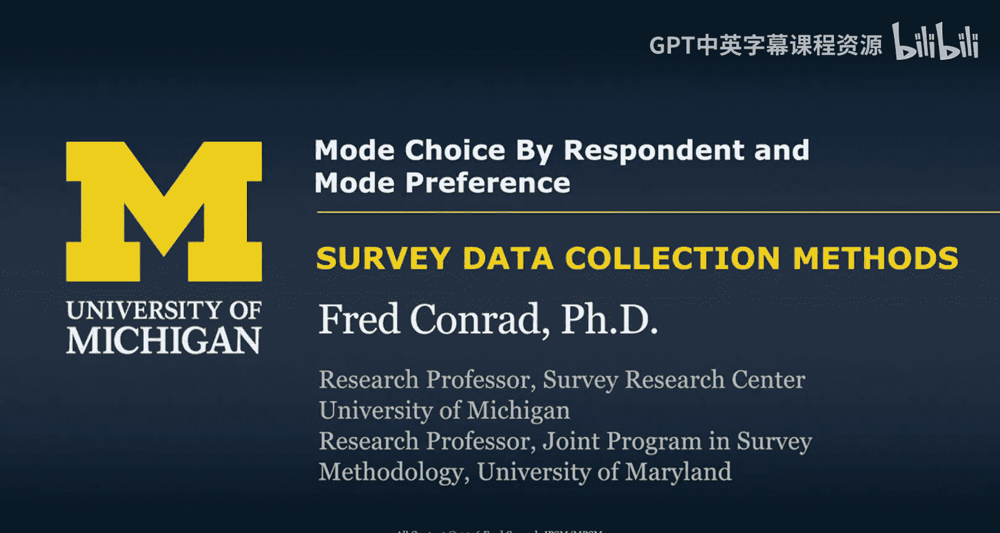
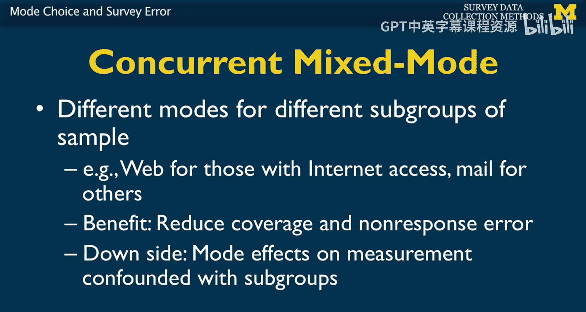
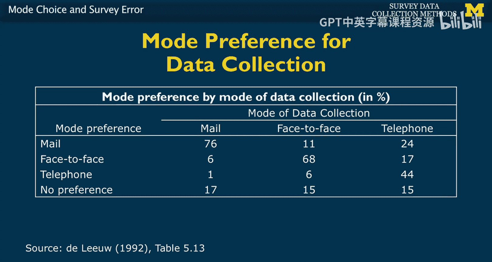
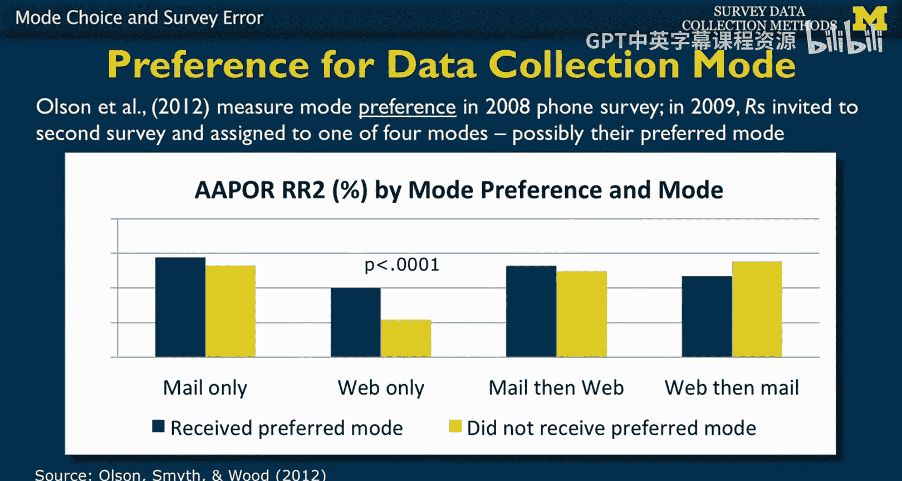
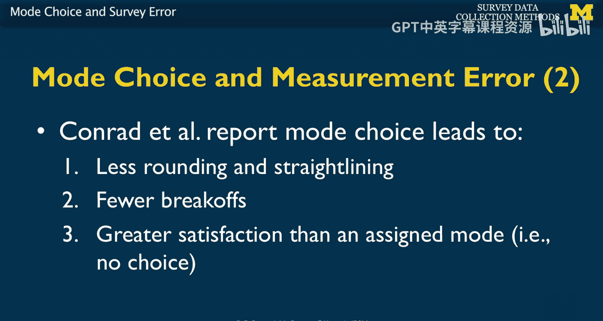

# 密歇根大学《调查数据收集和分析（2-6：方法、社调问卷设计、抽样、缺失数据、分析）｜Survey Data Collection and Analytics》 p08 7_1.4.2 并行混合模式.zh_en -BV1fw4m1e7Zh_p8-

So focusing in more detail on one of the designs， one of the mixed mode designs we just referred to concurrent mixed mode。

Again， the idea is that within a single sample， different subgroups are interviewed or their data are collected through different modes。

 so for example， one might collect data via the web from those with internet access and use mail for those without internet access。

The benefits are it should reduce coverage and nonresse error。

 the downside is that there may be mode effects on measurement they're confounded with subgroups and so it's hard to know if the differences you're seeing between modes are due to real differences between subgroups or are due to the modes themselves。

Mode preference is an important construct in concurrent mixed mode designs because one might aim to collect data from respondents in the mode or in a mode that they indicate they prefer。

But actually measuring preference is a little bit tricky because respondents tend to indicate that they prefer the mode in which their preferences are being elicited。

 so in this table from Deu，You can see that if respondents' mode preference was elicited by mail。

 they tended to report preferring mail compared to face to face and telephone interviews。

 but if their preference was elicited face to face。

 they tended to indicate they preferred face to face and if they were asked in a telephone interview what their。

Pred mode is they tended to indicate telephone。But mode preference does seem to have some consequences on participation。

Studied by Olson and colleagues。They measured mode preference in a 2008 telephone survey。

They asked respondents if they preferred phone， web， or mail， and then in 2009。

 respondents were invited to a second survey and assigned to one of four modes。

 possibly their preferred mode。As you can see the yellow bars indicate no mode preference that is their respondent's mode preference was not elicited。

 kind of a control group and the blue bars correspond to the respondents whose preference was elicited。

 the Y axises response rate here if the respondents were interviewed or if their data were collected via web in the second survey and they had indicated a preference for web。

 then they were reliably more likely to participate。

 so the blue bar is significantly higher than the yellow bar in web only that is when respondents indicated they preferred web and were interviewed by web they participated at higher rates mail seems to be kind of robust to mode preference so if respondents were interviewed by mail response rates were high no matter what mode they had indicated a preference for。

Moode preference is important in this kind of design， as I indicated。

 it's not the same as actually allowing respondents or requiring respondents to choose a mode。

 so mode choice is kind of a stronger version of collecting data from respondents in a mode that they not only show up preference for。

 but actually take the initiative to select。

an important meta analysis was conducted by Fulton and Medway because it had been reported in a number of studies that giving respondents a choice while believed to increase response rate was actually resulting in lower response rates so Fton and Mway looked across a number of studies that paired。

A male invitation with either a male questionnaire。

 that is the male questionnaire was included in the invitation letter or completing by web that is the invitation letter contained a URL that respondents could enter into computer and respond by web。

 so they looked across 19 studies that use this type of mixed mode。

Design in which half of the respondents were given this choice between mail and web and the other half generally were only offered a mail。

Mailed out paper questionnaire so what they found was that in eight studies response rate was reliably lower with a choice than without a choice and in nine other studies the effect was in this direction。

So overall， there's pretty strong evidence that giving respondents a choice。

 requiring them to choose between mailed paper questionnaire and web actually lowered participation。

Only in two studies did the pattern go in the opposite direction that is and only two studies did response rate increase when respondents were given the choice。

The explanation that Fulton and Medway suggest is that。This kind of choice increases complexity。

 making both options less attractive。And it creates a break in the response process if respondents。

decide to switch modes and that break can reduce the number of starts so a respondent who intends to enter that URL into a computer may never actually get there and so that's the explanation they've offered a kind of operational extension of this that they also suggest is that by sort of pushing respondents to the web they may encounter connectivity problems or usability problems that they wouldn't have encountered with if they'd only been able to respond by paper。

嗯。So there does seem to be an impact of choice， at least of this type on non response。

But that doesn't mean there aren't advantages for measurement error or for measurement by requiring respondents to choose the mode in which their data are collected。

Conrad et all argued that choice， especially when it's easy to implement。

Especially if for respondents to choose a convenient mode should improve performance。

They contact respondents on smartphones in one of four modes， what they called human voice。

 which is basically a telephone interview， human text or SMS。

 in which an human interview were sent or texted survey questions and respondents texted their answers。

Automated voice in which a recorded。Voice was played over the phone app and respondents spoke their answers and automated text in which a computer texted questions and respondents texted their answers。

TheReponents were required to choose one of these modes。

 and they could choose the mode that they were contacted in。

Essentially what they found was an advantage for measurement， less measurement error。

 less rounding and straightlining， so these are two measures that have been。

Considerred indicative of what's called satisfying。

 which is kind of taking mental shortcuts to reduce effort so rounded numerical answers10 tend to indicate maybe less complete less thorough thought about the answer so saying 100 rather than 97 may well reflect a kind of least effort strategy or an attempt to reduce effort by the respondent straightlining refers to selecting the same response option when a series of questions all use the same response scale and the idea is that if respondents are giving the same answer to。

All of these questions， they probably aren't fully considering their answers。In any case。

 when respondents chose their mode of data collection， they exhibited less rounding。

 less straightlining， so less satisfying by these two measures。

Moode choice also reduced breakoffs that is abandoning the interview midstream。

And it increased satisfaction than when respondents were assigned the mode that is when they weren't given a choice。

 so in the next segment we'll talk about the more common type of mixed mode design sequential mixed mode studies。

