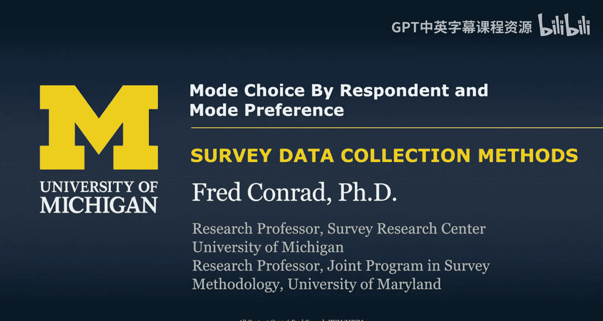
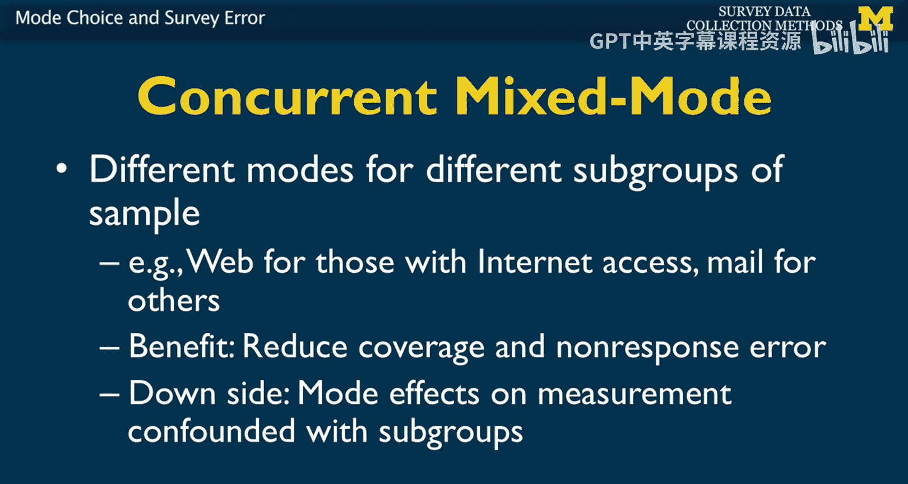
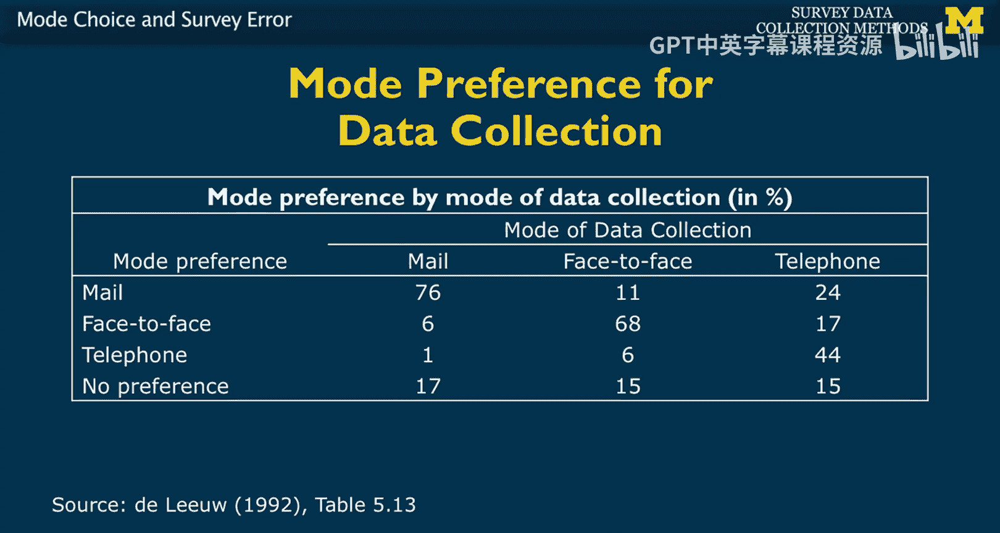
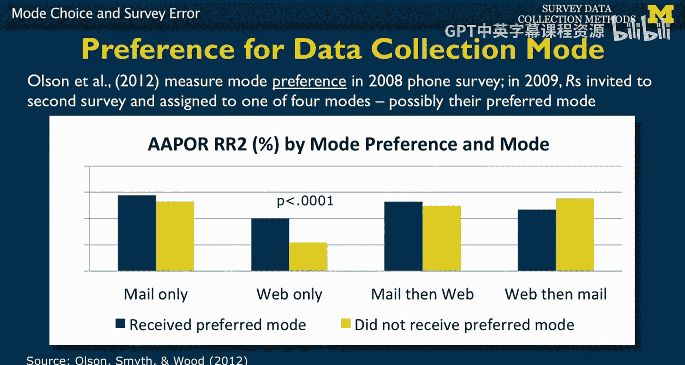
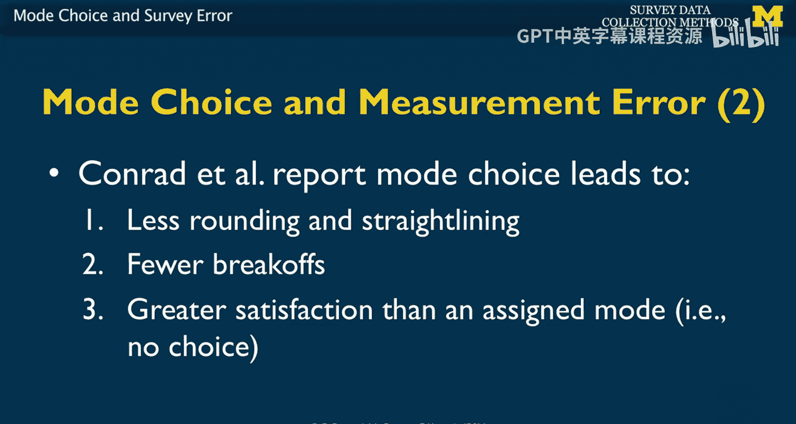

# 调查数据收集与分析：2-6：并行混合模式设计 📊

在本节课中，我们将深入学习混合模式调查设计中的一种具体类型——**并行混合模式**。我们将探讨其基本概念、潜在优势与挑战，并分析模式偏好与模式选择对调查结果的影响。

---

## 并行混合模式设计概述

上一节我们介绍了混合模式设计的整体概念，本节中我们来看看其中一种具体设计：**并行混合模式**。

并行混合模式的核心思想是：在**同一个样本**中，不同的子群体通过**不同的数据收集模式**接受访问或提供数据。

例如，调查者可能对**有互联网接入**的受访者使用**网络调查**模式，而对**没有互联网接入**的受访者使用**邮寄问卷**模式。

这种设计的主要公式化目标是：
**总样本 = Σ (子群体₁ × 模式₁) + Σ (子群体₂ × 模式₂) + ...**

其潜在优势在于，它有助于减少**覆盖误差**（某些群体被排除在调查之外）和**无回答误差**。然而，其缺点是可能存在**模式效应**，即不同模式本身可能影响测量结果。这些模式效应与子群体差异**混杂在一起**，使得研究者难以判断观察到的差异是源于子群体间的真实差异，还是数据收集模式本身造成的。

---

## 模式偏好的作用与测量

在并行混合模式设计中，**模式偏好**是一个重要概念。调查者可能希望按照受访者**偏好的模式**来收集数据，以期提高参与度和数据质量。

但实际测量模式偏好存在一定难度，因为受访者倾向于表示偏好**正在询问其偏好的那个模式**。

以下是一个来自De Leeuw研究的示例数据表，说明了这种“询问模式效应”：

*   当通过**邮寄**方式询问模式偏好时，受访者更倾向于报告偏好**邮寄**访谈。
*   当通过**面对面**方式询问时，受访者更倾向于报告偏好**面对面**访谈。
*   当通过**电话**方式询问时，受访者更倾向于报告偏好**电话**访谈。

尽管如此，模式偏好似乎确实对参与度有影响。Olson及其同事的研究发现，当受访者在后续调查中**被分配到的模式与其之前表达的模式偏好一致**时，响应率会更高。例如，偏好网络调查的受访者，在被邀请进行网络调查时，其参与率显著高于未被询问偏好的对照组。

---

## 模式选择的影响

模式偏好不等同于**模式选择**。模式选择是更强的一种形式，它要求受访者**主动选择**其希望使用的数据收集模式，而不仅仅是表达偏好。

一项由Medway和Fulton进行的重要元分析发现，在许多研究中，给予受访者在**邮寄问卷**和**网络调查**之间选择的权利，**反而降低了总体响应率**。在分析的19项研究中，有8项显示提供选择会可靠地降低响应率，另有9项也呈现相同趋势。

他们对此现象的解释是：
1.  **增加复杂性**：选择本身增加了决策的复杂性，可能使两个选项都显得不那么有吸引力。
2.  **中断响应过程**：如果受访者决定切换模式（例如，从打算填写纸质问卷改为上网填写），这个转换过程可能造成中断，导致他们最终未能完成调查。
3.  **引入技术障碍**：推动受访者使用网络模式可能让他们遇到连接性或可用性问题，而这些问题在单一的纸质模式下不会出现。

然而，这并不意味着模式选择没有好处。Conrad等人的研究指出，模式选择（尤其是当选择易于实施且能选择方便的模式时）可以**改善测量表现**。

在他们的实验中，受访者被要求从四种智能手机访问模式（人工语音、人工短信、自动语音、自动短信）中选择一种。结果发现：
*   **减少测量误差**：选择模式的受访者表现出更少的“取整”回答（如回答100而非97）和“直线”回答（对所有问题选择相同选项），这两种行为常被视为**敷衍作答**的指标。
    *   敷衍作答代码示例（概念性）：`if (all_answers == identical) { flag_satisficing = TRUE; }`
*   **降低中断率**：减少了调查中途放弃的情况。
*   **提高满意度**：与被动分配模式的受访者相比，主动选择模式的受访者满意度更高。

---

## 总结

本节课中我们一起学习了**并行混合模式设计**。我们了解到，这种设计通过为不同子群体分配不同模式，旨在优化覆盖范围和减少无回答。然而，它也带来了模式效应与群体差异相混淆的挑战。我们深入探讨了**模式偏好**的测量难题及其对参与度的影响，并分析了**模式选择**这把双刃剑——它可能降低响应率，但也可能通过赋予受访者自主权来提升数据质量和满意度。

下一节，我们将探讨另一种更常见的混合模式设计：**序贯混合模式**。