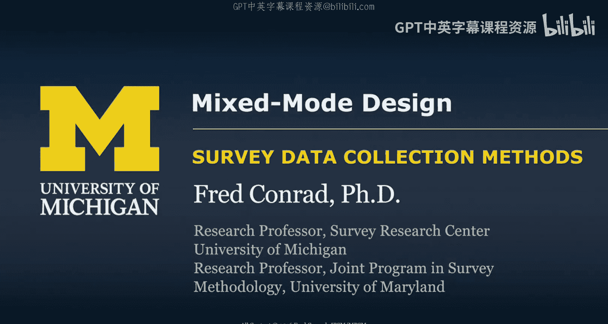
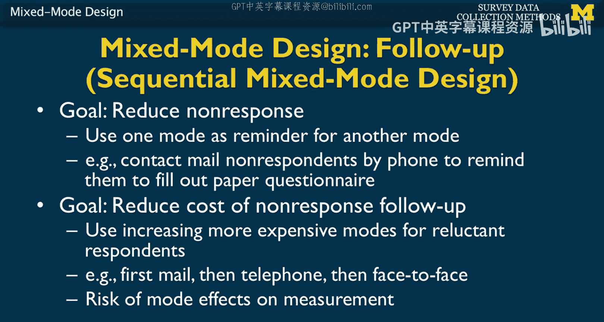
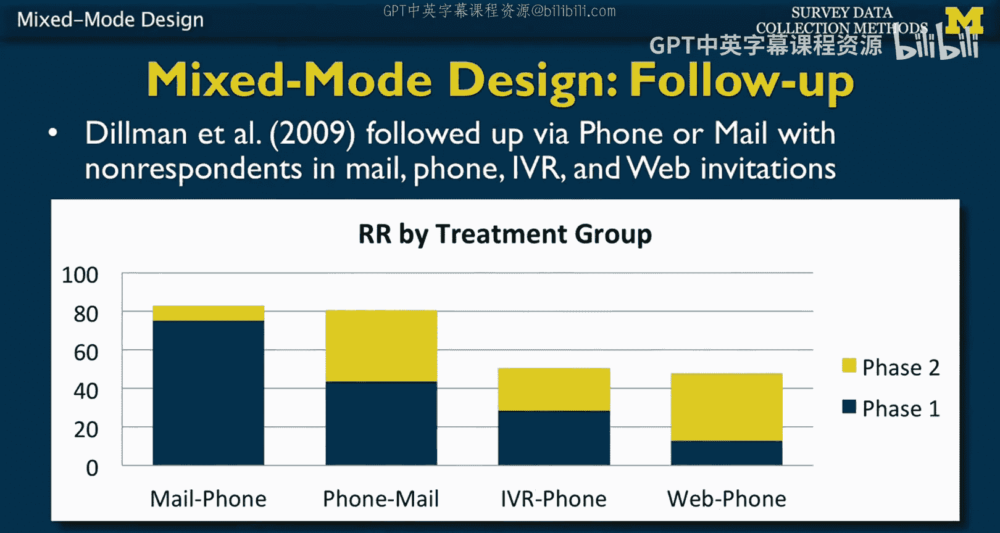
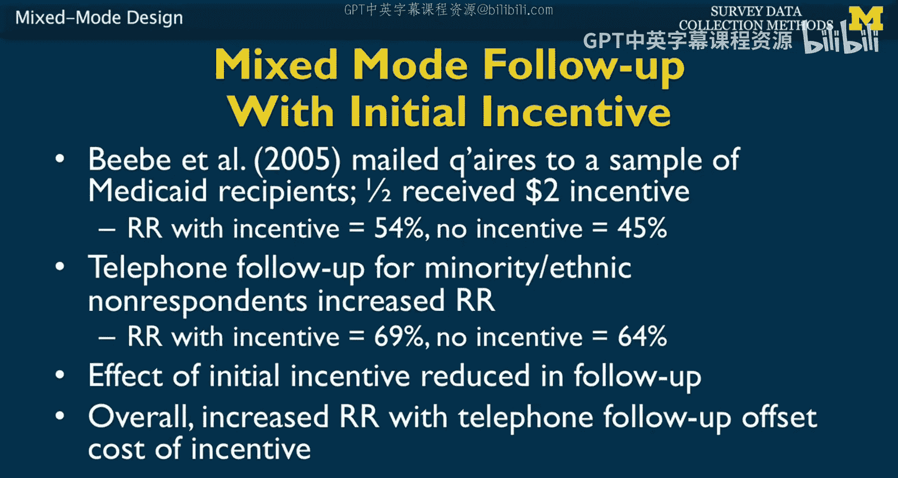
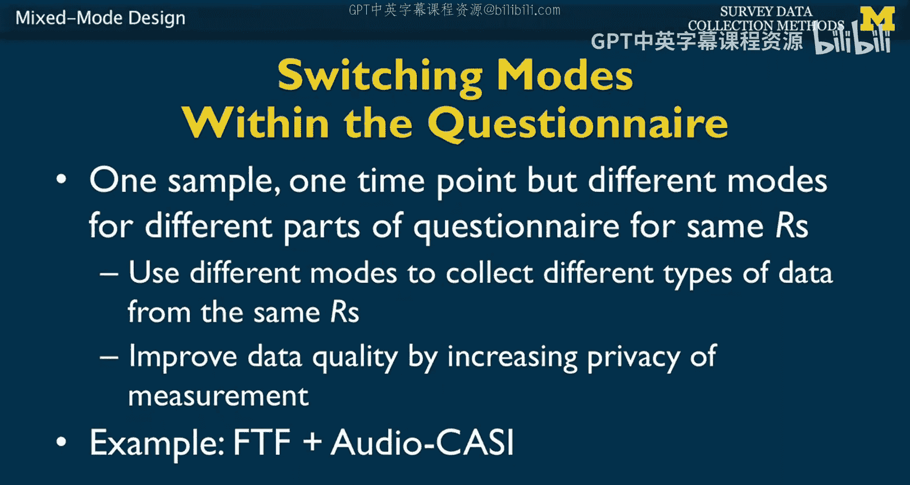
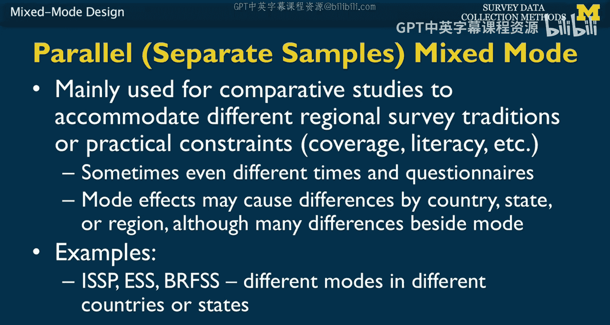

# 密歇根大学《调查数据收集和分析（2-6：方法、社调问卷设计、抽样、缺失数据、分析）｜Survey Data Collection and Analytics》 p09 8_1.4.3 序贯追踪混合模式.zh_en -BV1fw4m1e7Zh_p9-

Hi， in this segment we'll look in more detail at sequential mixed mode designs。

 which are also known as mixed mode follow ups。

Again， the goal is to reduce non-response， so by using one mode as a reminder for another mode。

 importance of the study may be intensified， examples include contacting respondents who were originally invited to participate in a mail questionnaire by phone。

 contacting by phone to remind them to fill out the paper questionnaire。

And related goal is to reduce the cost of non-response follow up by doing the initial contact in the least expensive mode possible and then following up with increasingly expensive mode so that the most expensive mode is just used for the most resistant sample members。

The downside is that the risk of mode effects is really there because it's really hard to separate out the effects of mode from the substantive responses in these cases。

This is a study by Dllman in which he followed up via phone or mail with respondents who were initially invited to take part via mail phone IVR。

 which is interactive voice response， which in this case meant that a recorded voice presented the question and respondents used telephone keypad to。

Enter their answers and web invitations。If you look at the。

Blue bars and compare those to the yellow bars you can see that additional cases。

 additional participation was produced by a followup in a different mode。

 so those who were initially invited by mail actually responded at quite a high rate about 75% following up by phone with those who didn't respond increased the response rate to slightly above 80% similarly those who were invited by phone responded at about 45% and inviting the non-respondents by mail also increased overall response rates to about 80% one thing that's a little unusual here is that the response rates are higher for mail than for phone Dllman and his colleagues attribute that to the fact that the initial mail interviews the initial mail invitations contained a $2 in。

Whereas phone interviews promise an incentive upon completion so that's just not a strong an incentive for respondents so the phone initial response rate was lower than the male initial response rate for having to do with the kind of an asymmetry in the the way the。

incentive was offered， but you can see for other combinations of modes a follow up in a different mode also increased response rates。

 so the main finding is that offering mode sequentially can improve response rates。

 but the authors note that。

This didn't really resolve demographic biases due to nonresponse so that the same kinds of people are not responding across the modes。

 and that hints at a kind of disconnect between increased response rates。

 but no reduction in non-resse error。And then finally they note that mixing modes can mix mode effects so that the oral modes。

 phone and interactive voice response， respondents in those modes tended to give more positive responses on bipolar scales than when those scales were presented visually via mail or web。

 so that tends to be attributed to mode， there really isn't any other way to account for it。

 except for fairly complex arguments involving differential non-respon。

So an increase in response rate， probably not a reduction in nonres bias and introduction of a mode effect are really the outcomes。

A related study by Millaren Dllman attempted to increase web response rates to a level equivalent to mail response rates on the assumption that We has many desirable properties and we'll talk about web surveys in more detail in the next lesson what they did was they compared mail to a choice of mail or web and among many other combinations to offering web with what they called email augmentation in which they followed up the web invitation with an email message that included a link to the web survey so what they found was that offering the choice of mail or web didn't improve response rates similar to the findings from the Fulton and Medway meta analysis that we just mentioned。

And if anything， it reduced response rates。But they did find that when they invited participants to sample members to participate by web and then followed up followed up those who didn't respond by email with a link to the web survey that the resulting response rate for web respondents was indistinguishable from the response rate for mail respondents。

 so ass an example of how a mixed mode follow up web invitation invited by web invited to take part in web with a follow up by email。

Increased response rates for the web mode， in this case to a level comparable to mail。

 that kind of being the gold standard。We've mentioned incentives a number of times。

 they do play a role in a study by Bebe and his colleagues。

 they looked at the role of incentives specifically。

 they mailed paper questionnaires to a sample of Medicaid recipients。

This is a type of health insurance in the US。S， half received a $2 incentive in the envelope。

The response rates with the incentive were substantially higher，9 percentage points higher。

 54% versus the group with no incentive whose rates were 45%。

They then focused on nonresse for minority ethnic members of the sample and tried to increase response rates for those subgroups with a telephone follow up。

If these respondents had received an incentive in the initial invitation。

 then with a telephone follow up their response rate was 69%。

 but if they hadn't received an incentive in the original invitation。

 the follow up response rate was 64%， so the initial incentive reduced。

The effect of the initial incentive was reduced in the follow up。

It was the difference was between 54% and 69% for those who。

Had received the incentive that's a difference of 15%， but for those who not received an incentive。

 the followup was that much more effective was about a 20% difference。

 19% difference so overall response rate there's an increased response rate with the telephone followup which offset the cost of the incentive just want to say a word or two about some of the other designs that we mentioned earlier。

 mixed mode design， so one is switching modes within within the question such as one sample one time point but different modes for different parts of the questionnaire so the best example is a face toface interview in which the interviewer collects information for sensitive topics through self-ad that is turns the computing device over to respondent who either see the question on the screen or hear the questions over headphones。

So-called cassie or audio cassie and longitudinal mixed mode surveys in which one sample is measured at multiple time points。

 but the same sample members are measured with different modes at different time points。

 so for example， starting the starting the data collection in one mode and then switching to generally a cheaper mode once the sample members。

 the households have committed to participating in a longitudinal study。This reduces costs。

 so for example， if the initial mode is face to face and then for subsequent waves by telephone。

 this reduces cost， telephone is cheaper than。Then face to face interviews。

But it does confound time and mode effects on measurement， so for example。

 if there are differences between the initial interview。

 which we'll say in this example is conducted face to face and followup interviews subsequent interviews conducted by phone。

 it's hard to know if the differences are due to the passage of time。

 or whether they're due to the different modes。Examples of longitudinal studies that use this kind of mixed mode design are the panel study of income dynamicss conducted at the University of Michigan。

 and the current populationopulation Surve， the primary Labor Force Survey of the US conducted by the Bureau of Labor Statistics in the US。

And then parallel or separate samples for being measured with different modes。

 mainly used for comparative studies to accommodate regional survey traditions or practical constraints。

 differences in coverage or literacy so in one region or country penetration， for example。

 of internet may be quite low and quite high in another country in this multinational study。

 that would be a reason to use different modes， literacy may vary。

 so a visual mode in which questions are presented textualally might not be acceptable for one country or region。

 but might be fine in another where literacy is higher。嗯。

There may even be different questionnaires used in the different regions。

 so mode effects may result and it's again hard to know they' if these differences between countries or regions are due to mode or due to the many other differences between the populations in these regions。

嗯。Examples are the International Social Survey Program， the European Social Survey。

 and the Beoral risks Factor Sur system， they all use different modes in different countries or states。

That concludes our discussion of mixed mode designs in the next segment we'll turn to nonresponse and nonresponse error。

 which is an important source of survey error that we've alluded to a number of times and we'll just go into somewhat more detail to kind of set us up for the rest of the course。

