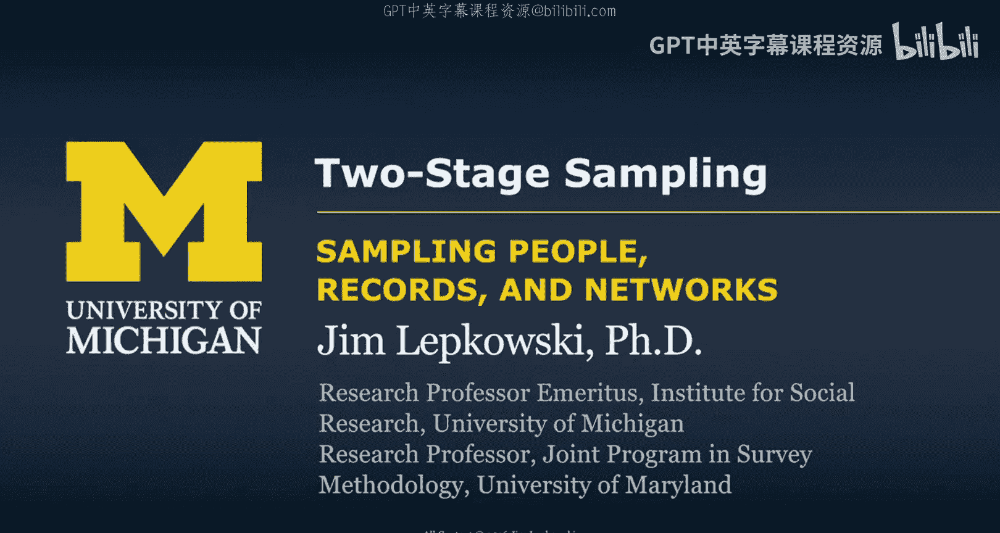
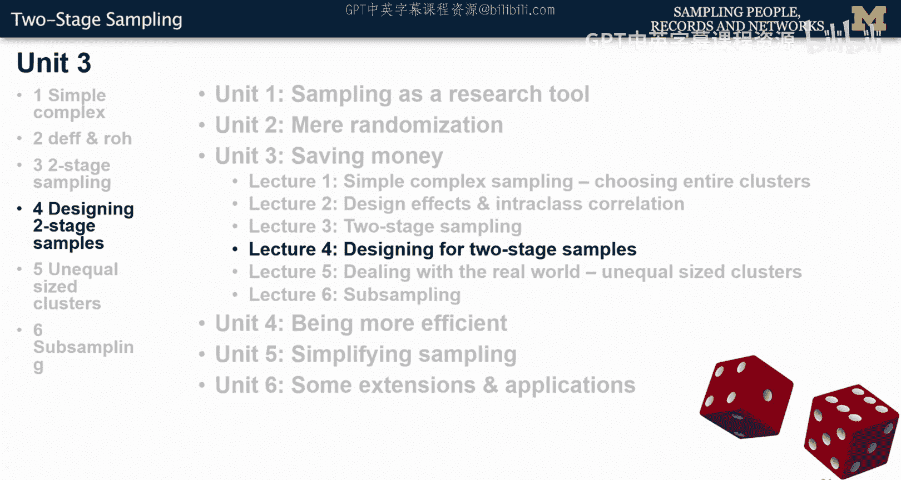

# 密歇根大学《调查数据收集和分析（2-6：方法、社调问卷设计、抽样、缺失数据、分析）｜Survey Data Collection and Analytics》 p100 21_3.3 两阶段抽样.zh_en -BV1fw4m1e7Zh_p100-

Welcome again to sampling people， records and networks and our discussion in unit 3 on cluster sampling or saving money and using clusters to do that。

We've moved on now to our third lecture on two stage sampling。

 where we're going to be discussing what happens when we don't take all the elements。

 So it's complex sample， it's clustered。But it's been simple。

 The clusters are still equal in size for this when， we will move to unequal sized clusters。

 as we said in lecture 5。But they is still equal in size。 But now。

 instead of taking all the elements within each， we take only a subset。

 And that's what we mean by the two stage First， a sampling in the first stage of the clusters and a sampling in the second stage of the elements within the clusters。

We're going to talk about four topics here on how the samples are selected。

What impact then has on sampling variance， the design effect。

 So that's a review of similar kinds of topics weve had。

 But then what effect this sub samplingamp has on design effects。

So let's go back to our representation for our cluster population now。

 the one involves the 18 blocks of eight housing units each and we'reestimating some characteristic for these housing units。

And we're going to be doing our cluster sample now in two stages。In the first stage。

 we're going to draw a sample of clusters。 So selected six blocks first of the 18。

 We have the list of 18。 We do a simple random sample of 6 without replacement。

To avoid getting the same one more than once now there's some technical issues here that we're going to ignore in this that have to do with the sampling variance。

 I'm going to give you a simplified expression for the sampling variance that's suitable for this。

 but it's not necessarily technically complete， but it's okay for our purposes。

6 clusters that there has selected。 And then what are we going to do。

 We're going to sub samplele housing units within each。And so we have one sample for the clusters。

 And now we have six additional samples for the housing units， one for each of the clusters。

 So in cluster 1， we do a sub sampleample， and we got the corners by chance。

 and cluster 4 that fell into our sample。 We got the four housing units shown there。 and so on。

 And those are random selections， separate independent random selections within each of the clusters。

Now for our purposes。The sampling variance of this kind of thing is the same as what we had before。

It's that one minus F over a 1 minus the sampling fraction divided by the number of random events in the first stage of selection times S sub a squared S sub a squared being the variability of the cluster characteristics。

 Now， we're going to compute for each of the clusters。 then， a me or proportion。

 whatever it is that we're measuring for for these clusters。 And look at the variability among them。

 just the same way we did before。 Now， as I said， technically， this is not complete。

 There actually is a second。Component of variance， as you would expect。

 because we're doing additional six random samples。

 and there's a component of variance that averages the variability across those that could be added in here。

 But it turns out that when we go to estimate this quantity。

 When we go to compute the standard error。 Now， remember our display here。

 I keep coming back to this， where we've now got a cluster population and a cluster sample and estimates from each of those。

 and we imagine our sampling distribution and its variability and a standard error。

 if we use in the computation of that estimated standard error and step 6， Lowcase S score。

 the same kind of between cluster variability that's based on the cluster sub sampleample results。

We get the right variance， and it incorporates into it the within cluster variability automatically。

Now it's just beyond the scope of what we're able to do here。

 both from a theoretical and practical point of view to describe that other than to say the following。

Remember that that S of a squared was built around P sub alphaphas or y bar sub alphaphas。

 the characteristic for the cluster based on the sample information。And when we do the subsamp。

 that P sub alphapha or that y bar sub alphapha， the thing that happens within each cluster has two sources of variability in it。

One source is the between cluster。Phenomena， the selection of the clusters。

 because we get a different value for the P sub alpha or the y bars sub alpha。

 depending on what clusters there。And the second source is the within cluster sampling。

When we draw a sample of elements and we get one subs samplele of four housing units in one。

 we could do a different subs samplele in that in that same cluster and get a different subs samplele of four elements。

 And so we could get different values of P of alpha， even for the same cluster。

 depending on the subampling that occurred。So lowercase S sub a squared there。

 the estimate from the data actually includes both。Between and within variance。As I say。

 beyond the scope of this course to go into that in any more detail than I just have。

 except to reassure you that between cluster variability。

 sample between cluster variability is sufficient to estimate the variance of the entire overall sampling distribution。

So let's go back to our classroom example， so we've been talking about the blocks and we can see how that works。

 but let's go back to the classroom example now， so the blocks we were sampling I know it wasn't people。

 but it was some kind of records perhaps for these housing units。

 it was some kind of data for the housing units， but maybe it was also for the people who were there in their aggregates in units called households。

But now， let's go to another example of cluster sampling a return to one in which we have 1000 classrooms in our school district of elementary school children。

 maybe they're in their first year， their second year。 And we've sampled Now， in this case。

20 of them。 So instead of doing 10， as we did before and take all 24 children。

 What we're going to do in this case is sample 20 of them and take 12 children in each。 Now。

 why would we do that。Well， because we know that that design effect is driven by how many， in part。

 how many elements we select per cluster。 If we do half as many kids per cluster。

 the design effect should go down。And indeed， if we were to do this and empirically examine the results。

 we would see design effects decreasing when we did this。So from the capital N。

 we've drawn a sample again of 240， but in this case， lowercase A is 20 and lowercase B is 12。

 we're taking a subsample。Here's the results now for the immunizations。 Now。

 you can see what I'm talking about。 We now have twice as many classrooms。 We have different rates。

 different fractions for these。 I put them on two lines。 That's the data we're working with。

 and we have a couple of classrooms here where everybody's immunized。

And the smallest is is about a third of them being immunized。 And the sum of the numerators there。

 just for this illustration is  a hundred and 60。 so that I've got the same result that I had before。

 It's just that I've got it spread across twice as many clusters。Well。

 the overall proportion immunized is still 0。67。 This is also this design is unbiased。

 the sampling process is unbiased for the proportion or the mean。 On average。

 if I did all possible cluster samples of 20 with 12 elements each。

 It complicated design and counting the number of samples it's a more complicated process。

 But on average， I'm going to get the right result across all of those possible samples。

And the sampling variance， as we just noted， would be calculated in the same way。

 treating the clusters now of 12 students per classroom。 I'd get the。

Immunization rate for each of the 20 classrooms。 And look at the variability of those around that 067。

 just as we did before， calculating an S sub a squared and then a1 minus F over a S sub a squared。

But now my sampling fraction is comprised of two parts。 lowercase A overcap 20 from 1000。02。

 and then 12 from 241 half。 It's the same sampling rate as we had before because it's the same sample size。

 A20 times lowercase A to 20 times lowercase B 12 is still 240。

So I've still got the same sampling fraction， but now I've divided it across these two stages in the sample selection。

But I've got the same sampling variance and the same standard error calculation that we've been doing that we did before。

I won't go through and do the calculation here if you want to。

 you can try it out and see what you get in the way of sampling variance and design effects。

 We're going to get a design effect though， which is a ratio of the actual variance to the simple random sampling variance for a sample of the same size。

Note in this case， the cluster sampling variance will be different than what we had from the previous take all case。

Here with the subampling or two stage sampling， we're going to expect that sampling variance to shrink because。

If the homogeneity holds up， I mean， that isn't going to change。

 That's the characteristic of the cluster， not of the sample clusters， but the clusters themselves。

But the simple random sampling rate stays the same。 It's still 240 cases。

 still the same proportion we had before of 。67。 and。

 and selecting many elements for clusters decreases our variances in this particular case。So。Still。

 the row value， which was fairly small in this particular case when we dealt with this before。

 about 0。03， It can be magnified by B。 In this case， B is 12 instead of 24。

 but is magnified less because of the nature of the design effect。

So one way to think about the design now is to see how it affects possible sampling variance。

 And remember， our sampling variance， our actual sampling variance。

 is the product of our design effect and our simple amount of sampling variance so that we can think about in this particular case a little bit about how that impact is going to change as we change the nature of the design and change the design effect。

 the design changing the nature of the design and the cluster sample case。

 as long as we keep that sample size the same， still has the same simple and sampling variance。

 but the design effect is modified。So any change to the design effect then is a change to the sampling variance。

 any change to the sample design components that affect the design effect。B。

 the subample size will change the sampling variance as well。

So manipulating sampling fractions between first and second stages to maintain overall sample size。

 which is what we've done， will reveal something about the nature of the design effect and the effective sample size as well。

 recall effective sample size is now can be now altered because our design effect is also changed。So。

 for example， suppose that we have our 20 classrooms and 12 elements each。

 What would I project the design effect would be in this particular case， Well。

 I have a formula for this that I can use。 recall that our homogeneity value was 0。

088 in this particular case。088。I don't expect that to change just because I'm now taking 12 kids instead of 24。

 The homogeneity in the classroom is the same。 It's going to be only 12 elements that you have available to measure that in terms of my design effect in row calculation。

 So I'm going to use that same homogeneity from the past study to project forward to the new study。

 that 。088 times 12-1 or 11 plus 1 gives me a design effect of 1。97， not 3。

 the design effect we had before。 but 21。97。And my effective sample size， if you recall。

 from the previous example， where we took all the design effect was three and the effective sample size was 79。

80。Here， I have lost about half of the information in my sample of 240 by doing cluster samples from 240 to 120 before。

 where I took all of the children with this level of homogeneity。 I lost two thirds of it。

 I went from 240 now to about 80。 So we're better off doing this。😔，But this is a little misleading。

We have to be careful here because now what we've done is increase our cost。

Cluster costs are bigger than element costs。And now what we've done is introduce more clusters。

 same number of elements， but more clusters。And those clusters cost us more money。

Because of the listing that it has to go with it and the travel that goes to them。

And so there's a disproportion of fact here on the on the cost。

 This is not the same cost design as when we took 10 clusters and took all 24 of the children and each of them。

But we we could， we could。All this just to see the nature and the effects here。

 where we have 30 classrooms and we take eight children， the same sample size， 30 by8 is 240。

The design effect now， again， projecting it forward，088， what we had for our homogeneity。

 magnified now by a sample size of 8 within each cluster 8-1 or 7 plus 1，1。62。

 and my effective sample size goes up to 148。Okay， I can see now what's going on。

 The design effect is going down。 The effect of sample size is going up。 Design effect is going down。

 My sampling variance for my cluster sample is going down。

Same sample size times this important of sampling sampling variance。

And so I'm getting an impact here that is shrinking sampling variance。

 but is costing me money in order to reduce the sampling variance。

I can increase the number of clusters and decrease the number of elements per cluster。

 but I increase my cost。So I'm going to have to keep that in mind as well。

 and we'll come back to talking about this in our last lesson here for this particular unit。

I could even go to the extreme and just take three kids for classroom。

 three students per classroom in 80 classrooms， and now I can see boy that design effect is shrunk to 1。

18 and my effective sample size is up over 200。Okay， well， this is okay。

 is a manipulation is just to illustrate what's going on here。

I do need to figure out a way to manipulate this。 I can't go on and do these calculations all the time in order to figure out where I should be。

 I need some way to balance the cost that I'm seeing。 The the cost is varying。 These three designs。

 plus the one we started out with with 10 classrooms and 24 elements each。

 Each cost a different amount。What should I do here， Which of these classroom sizes should I use。

 Which of the values of B should I use， What's the best mix for what I've got。

 And there's a model system that we've got to come to discuss that we'll do later on in our lectures here in this particular unit。

For now， though， let's move on。 We're going to take these two stage samples when we've been learning about design effects in row。

 and we're now going to apply it to let's think about designing two stage samples。

 What kinds of things do we need to do in order to do those designs。

 And then you'll see lecture 6 coming up。 We'll figure out what that B value is。

 What's the best A and B to work with any particular cost system after we consider some unequal size clusters in lecture 5。

 But our next lecture will be designing two stage samples。 Join me then。 Thank you。

