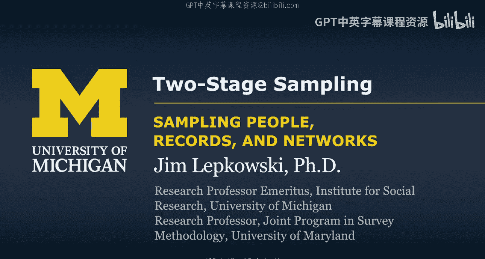
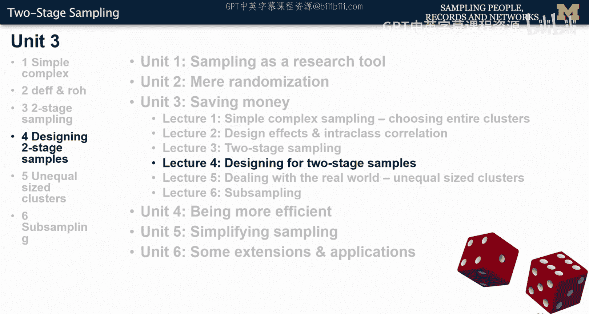

# 调查数据收集与分析：3.3：两阶段抽样 📊

在本节课中，我们将学习两阶段抽样。这是一种复杂的抽样方法，它结合了整群抽样和简单随机抽样的特点。我们将探讨其工作原理、如何影响抽样方差，以及如何计算设计效应。

---

## 概述

上一节我们介绍了整群抽样，即先抽取群组，然后调查群组内的所有元素。本节中，我们来看看**两阶段抽样**。在这种方法中，我们不仅在第一阶段抽取群组样本，还会在第二阶段从每个被选中的群组中再抽取一个元素子样本。这种方法可以在控制成本的同时，更灵活地设计调查。

---

## 两阶段抽样的基本过程

两阶段抽样的过程可以清晰地分为两个步骤。

以下是其基本步骤：
1.  **第一阶段**：从总体中随机抽取一定数量的群组（例如，街区或班级）。
2.  **第二阶段**：在每个被抽中的群组内部，再随机抽取一部分元素（例如，住房单元或学生）进行调查。

---

## 抽样方差与设计效应

现在，我们来分析两阶段抽样如何影响抽样方差。其核心公式与我们之前讨论的整群抽样方差公式相似：

**公式**：`抽样方差 ≈ (1 - f) / a * S_a²`

其中：
*   `f` 是总抽样比。
*   `a` 是第一阶段抽取的群组数量。
*   `S_a²` 是基于**样本数据**计算的群组间方差。

这里有一个关键点：`S_a²` 不仅包含了群组之间的真实差异，还包含了**第二阶段子抽样**带来的变异。因为即使对于同一个群组，抽取不同的子样本也会得到略有不同的群组均值或比例。幸运的是，使用这个公式计算出的标准误已经自动包含了群组内变异的成分。

---

## 实例分析：班级免疫率调查

让我们回到学校班级的例子，看看两阶段抽样的实际应用。假设一个学区有1000个班级（N=1000），每个班有24名学生。

*   **原方案（一阶段整群抽样）**：抽取 `a=10` 个班级，调查每个班**所有** `b=24` 名学生。总样本量 `n = 10 * 24 = 240`。
*   **新方案（两阶段抽样）**：抽取 `a=20` 个班级，在每个班内再随机抽取 `b=12` 名学生。总样本量保持不变，`n = 20 * 12 = 240`。

虽然总样本量相同，但设计效应会发生变化。设计效应的计算公式为：

**公式**：`设计效应 = 1 + ρ * (b - 1)`

其中 `ρ` 是群内同质性系数。假设 `ρ = 0.088` 不变：
*   原方案设计效应为 `1 + 0.088*(24-1) ≈ 3.0`。
*   新方案设计效应为 `1 + 0.088*(12-1) ≈ 1.97`。

设计效应降低，意味着**有效样本量**增加，抽样精度得到提升。

---

## 权衡：精度与成本

通过调整第一阶段群组数 `a` 和第二阶段子样本量 `b`，我们可以在保持总样本量 `n` 不变的情况下优化设计。

以下是不同 `a` 和 `b` 组合的对比：
*   `a=10, b=24`：设计效应 ≈ 3.0，有效样本量 ≈ 80。
*   `a=20, b=12`：设计效应 ≈ 1.97，有效样本量 ≈ 122。
*   `a=30, b=8`：设计效应 ≈ 1.62，有效样本量 ≈ 148。
*   `a=80, b=3`：设计效应 ≈ 1.18，有效样本量 ≈ 203。

可以看出，增加群组数 `a` 并减少每群样本量 `b`，可以显著降低设计效应、提高有效样本量，从而**降低抽样方差**。

然而，这并非没有代价。调查更多的群组通常意味着更高的**成本**（如差旅费、联络费）。因此，最优的抽样设计需要在**统计精度**和**调查成本**之间找到最佳平衡点。

---

## 总结

本节课中我们一起学习了两阶段抽样。我们了解到，这种方法通过在第一阶段抽取群组、第二阶段抽取群组内元素，提供了更大的设计灵活性。关键在于，减少每群的样本量 `b` 可以降低设计效应、提高精度，但同时会增加群组数量 `a` 从而可能推高成本。下一讲，我们将探讨如何为两阶段抽样进行具体设计。随后，在讨论了不等规模群组后，我们将学习如何利用成本模型来确定最优的 `a` 和 `b` 组合。