# 密歇根大学《调查数据收集和分析（2-6：方法、社调问卷设计、抽样、缺失数据、分析）｜Survey Data Collection and Analytics》 p101 22_3.4 两阶段抽样设计(上).zh_en -BV1fw4m1e7Zh_p101-

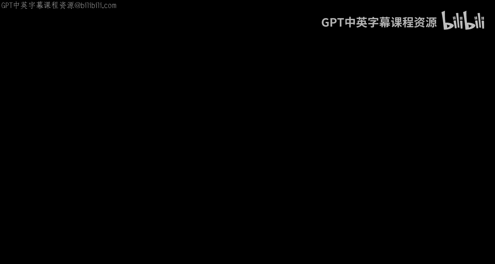

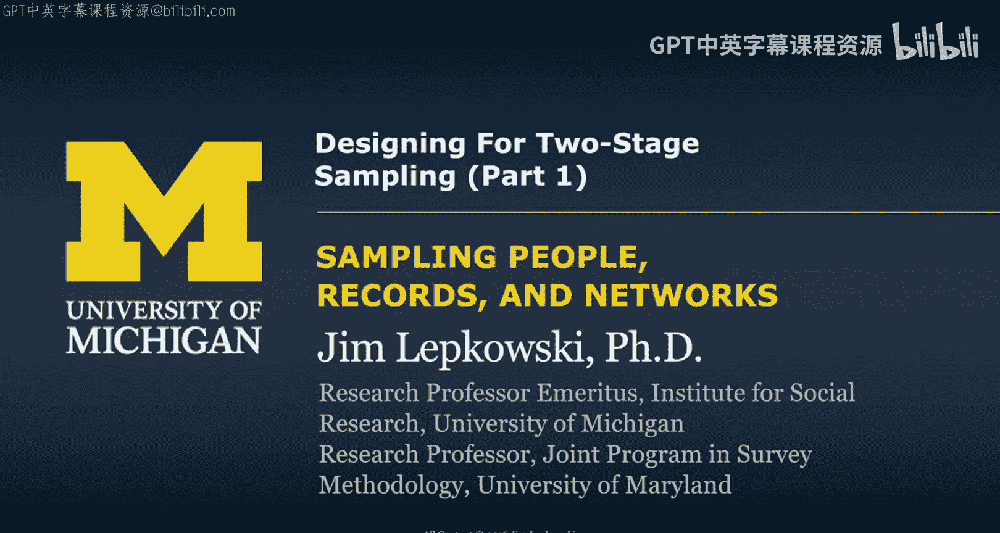

We've talked about cluster samples in a simple form where we're taking all elements within a cluster。

 a sample of clusters， and two stage sampling。It's time for us now to go and look at how we might design。

Such samples and will deal with the more complex the two stage sample in our design。

 What do we need to do to prepare ourselves to select a sample that will have certain properties that will meet the requirements of a client or meet our own expectations。

So we're talking about the design from this point of view of being able to come up with a way of selecting the sample that meets certain kinds of requirements。

And we're going to in this particular context， talk about three things then。

And these deal with design from the point of view of projecting what would happen under a particular approach。

So we'll be talking about projecting design effects for new designs。

 We're going to need to understand what the design effect looks like when we do the next study。

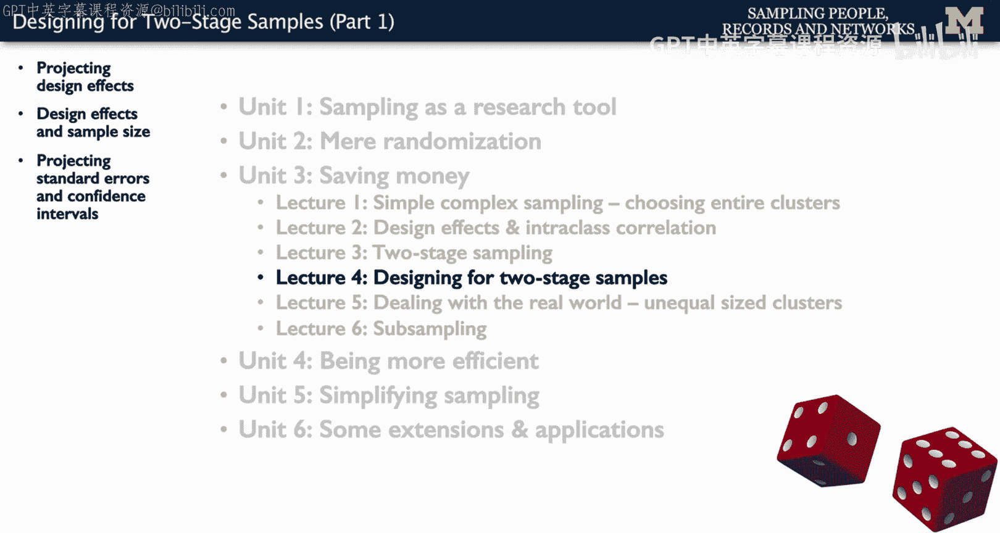

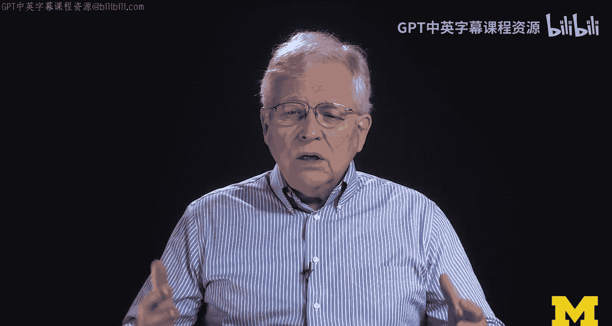

Then we're going to look at the design effects and their impact on sample size before we come back to talking about projecting standard errors and comp intervals for our designs。

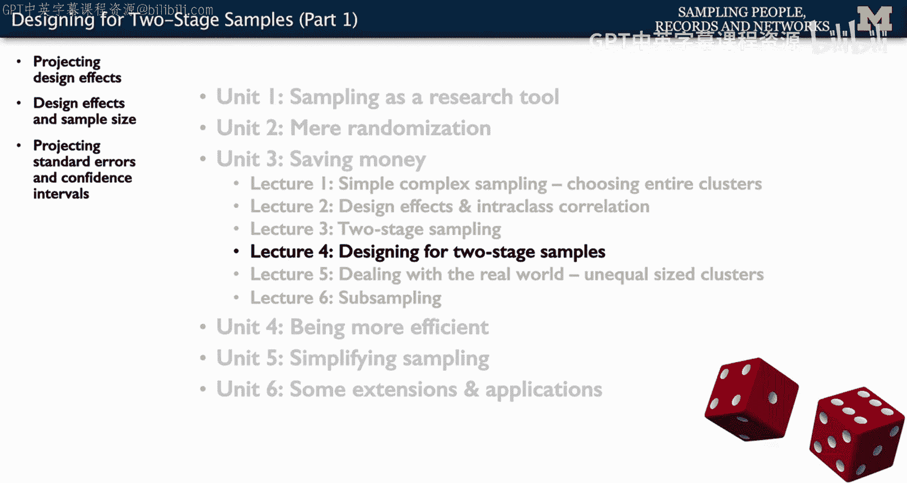

All of these things are part of this package， this set of considerations when we want to design a new sample for a new problem。

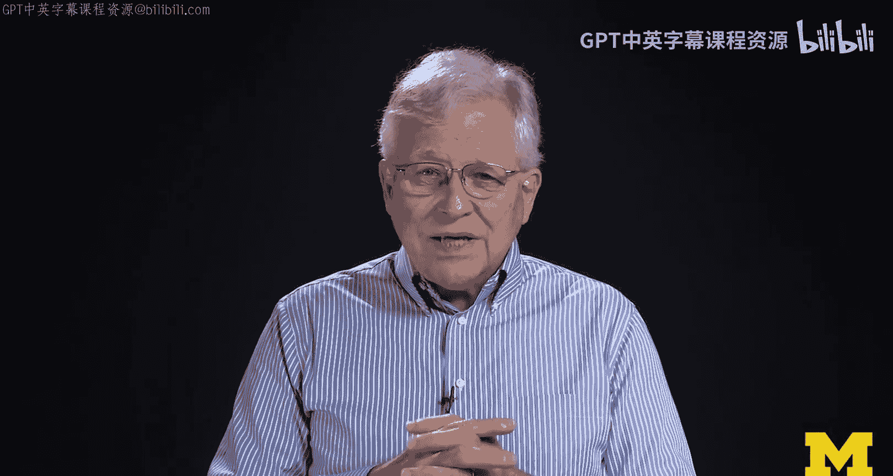

Now， what we've done up till now has been estimation。 We've mainly been estimating quantities。

 And I'm only going to concentrate here on estimating standard errors or variances。

 So if I talk about variances， as you know， I'm also thinking about standard errors。

 It's a simple transformation of square root function。And so when we had a two stage cluster sample。

 what we talked about doing was estimating the variance of a statistic。 In this case。

 a proportion for our current design， let's call it design 1。

And we would calculate that by using the available data to fit into the formula shown here。

1 minus the sampling fraction F， that combination 1 minus F， the finite population correction。

 divided by the number of random events in the sample in our case， A。

 actually it's the number of random events in our variance calculation， but lowercase A。

The number of clusters in the sample times S sub a squared。

 the variability of a cluster characteristic across the clusters。

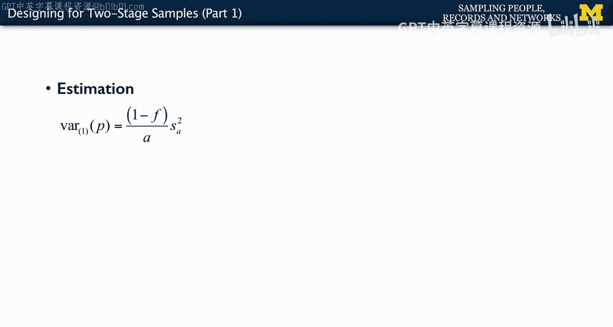

We won't go through the formulas， but we coupled that then as part of the estimation。

 that was enough。 We would take a square root and go down one path from that to calculate a standard air at a cough interval。

But we also did something a little bit different。 And that was to say。

 we also would like to understand the impact of the design on our outcomes。

 So let's compare it back to a simple random sample。The idea of building a design effect。

To do estimate a design effect， then what we're going to do is calculate from the same data。

 the variance of that same statistic in this case of proportion， for the existing data， design one。

 if you will， under simple random sampling assumptions。Now， for a proportion。

 it turns out that that variance calculation we looked at very briefly was 1 minus the sampling fraction。

1 minus F， that finite population correction， the whole thing altogether times p times 1 P over the sample size -1 from that existing design。

And then we combine those two things to come up with a design effect， a ratio。

 It's just an arbitrary definition， a way of doing the comparison we always put by the way of the standard definition。

 the simpleum sampling variance in the denominator。

 It's the base against which we're comparing the numerator。

 So it's a fairly standard way to do that kind of calculation。

 all using the existing data for our current sample design。And then finally， from that design effect。

 we said， well， we also know that there's something that drives it。

 Let's estimate that driving factor， that rate of homogeneity by taking that design effect-1。

 stripping out from the design effect， if you will， the base。

 the simple random sampling and only the added effect from the clustering。

 and then dividing that by B -1， taking out the effect of the subample size。

 the B from our existing design and dividing our design effect -1 by B -1。😊。

So we have a value now for homogeneity。Now， this is kind of a second。

Thread that we might follow the first was to get towards cofs intervals。

 That's the one that's most useful for us analytically。 But here。

 these are building up for the next step in the process。

 because what we're going to do is think about our next design。 We're going to build on this one。

 We may do a new application at a different population。

 We may go back to the same population at a different point in time。

 We may go back to the same population at a different point in time and change the sample design in some way。

 change the sub sampleample size， the number of clusters。 the overall sample size。

 But we're going to need to do then is projection。

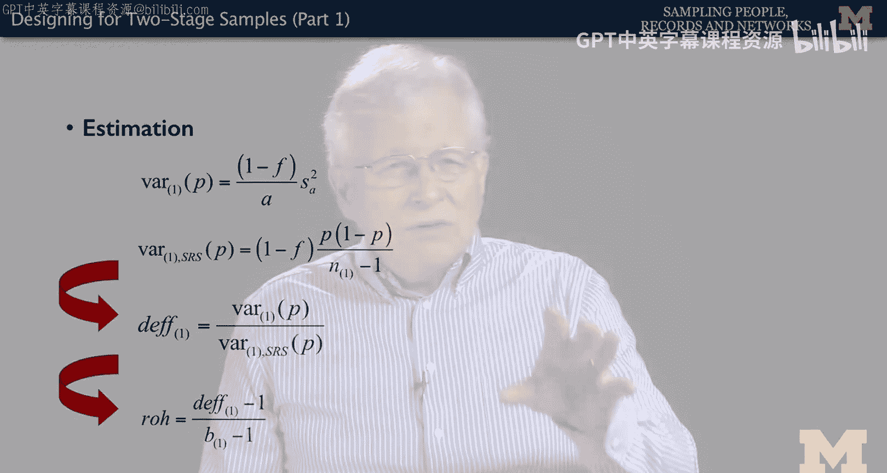

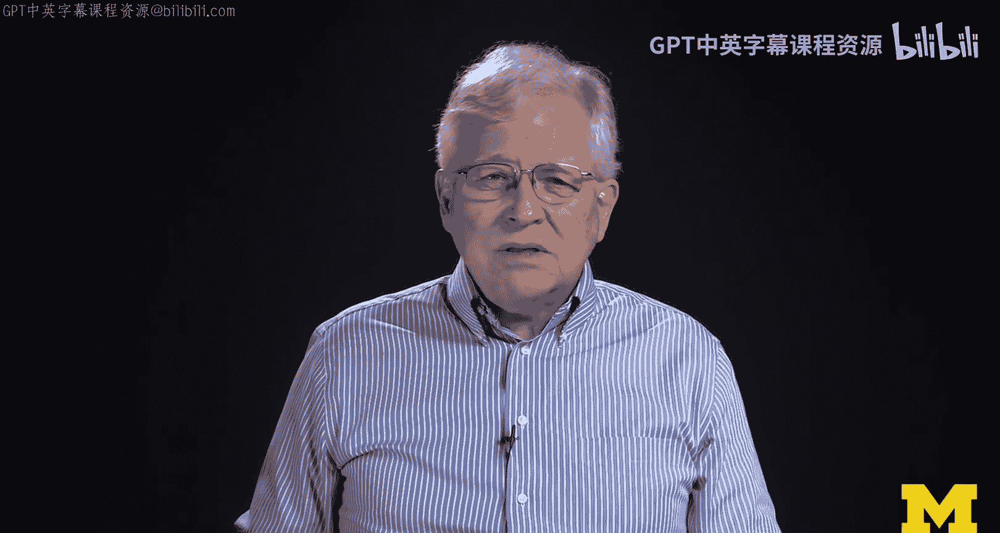

What is going to happen in a new setting without having drawn the sample。

 So this is an essential design feature that comes up in any in any number of applied math areas。

 whether it's in statistics And in this case， a branch of statistics dealing with surveys or in engineering in civil engineering or some other area。

 What's going to be the outcome， Well， what's the key outcome here。

There are two that are are primary in our thinking。 One is the mean， or in this case， the proportion。

 And the second is its standard error。 So what kind of standard error would we actually get if we change the design in order to do this process。

 What we're going to do is need to build up from the past information we have Our second thread starting with that row value。

 that rate of homogeneity， that rate of homogeneity becomes portable in a certain sense。

 It becomes the foundation， the building block upon which we're going to build our projection。

 We're going to use the row value that we've calculated from the past survey， to project。

A design effect。But now we're not calculating a design effect here as a ratio of variances。

 we're calculating a design effect as a combination of a simple random sampling variance。1。

A sub samplele size， B， sub 2， the one that we're going to use in our new design，-1 times row。

But we're not going to invent a new row。 We are going to borrow row from past data because we are using very similar clusters。

 Last time we use schools。 Now， we're using schools。 Last time we used blocks。

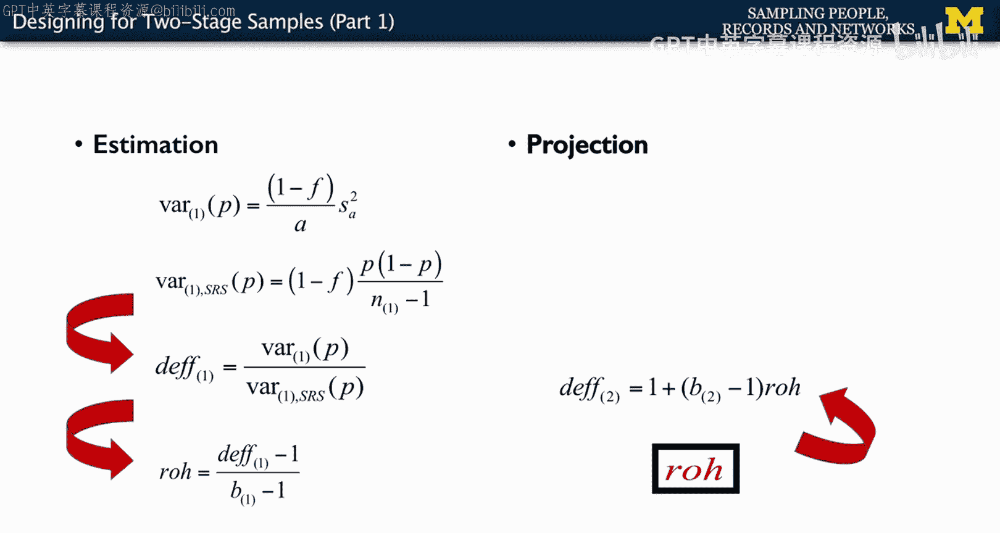

We're using blocks now。 Last time we used enumeration areas， we're using enumeration areas now。

And we're also measuring a very similar characteristic。

 row is specific to that variable so we can build a new design effect for that variable for that particular design。

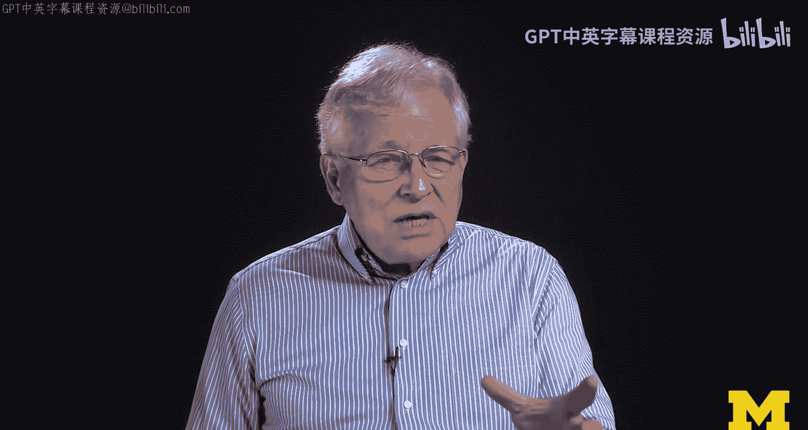

But we also know that if we were to calculate or have available a simple random sampling variance。

 we could use the combination of the design effect and the simple random sampling variance to project an actual variance to calculate an actual variance to come up with a numeric representation of our uncertainty are anticipated uncertainty under the new design。

 So we could calculate a simple random sampling variance。 Now here。

 this simple random sampling variance ignores the 1 minus F。

 I probably could have ignored it on the other side。

 But here just to simplify the calculations werere rounding the 1 minus f to 1。

 we're using a proportion again， P times 1 minus p giving us essentially our element variance。

 And we're dividing by the new sample size and sub 2。 So we've got a new subsample size。

 a new sample size an old value of row， and maybe a past value of the proportion or a new value of the proportion because we think that it's going to change in a particular way。

😊，And now we have the elements to build our final projected sampling variance。

 a sampling variance that tells us what uncertainty we can expect。

 especially when we couple it with a T statistic or a Z statistic to give us a 95% confidence interval。

 we're going to take that projected design effect。 and that projected simpler random sampling variance and take the product of the two to get our new variance。

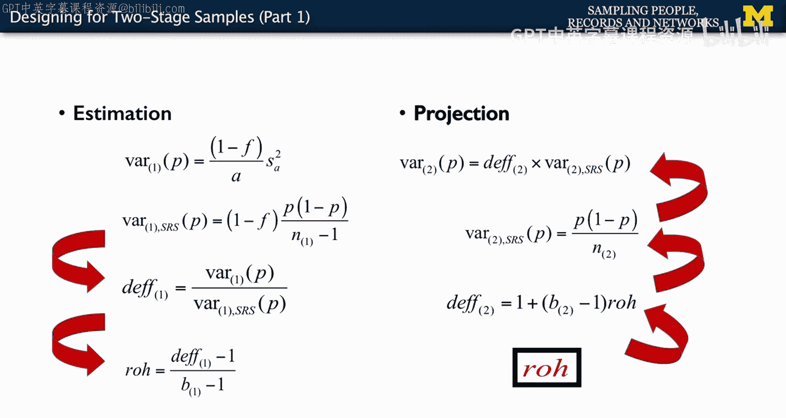

We're manipulating the same expressions that we did in the estimation process to build backwards。

 if you will， to project what that sampling variance would be。

Let's look at an example， we're going to look at two examples。

Recall that we had a sample before in which we had a。Sample size of 2。

400 observations in 60 clusters， each of 40 observations each。

And suppose that what's going to happen is that we're going to go back to the same population this time。

 but we do not have the resources to do what we did last time。

 We can only afford to do half as many cases，1200 of them。And in this particular case。

 we're going to get to the 1，200 by taking half as many clusters as before。

 Now that's one way to get to that half。Our alternative A here。

 cut sample size by cutting the number of clusters， our alternative B that we'll look at next。

 cut sample size by cutting the sub sampleample size。But the question here is what standard error。

 what sampling variance？Can we expect for our sample proportion P under this new design。

Now that's in contrast to our alternative design B， same reduced sample size 1，200。

 but now we're going to keep the same number of clusters。

 which implies now that the subsample size goes from 40 down to 20。What would happen in this case。

 Do we have sufficient tools to do this projection。

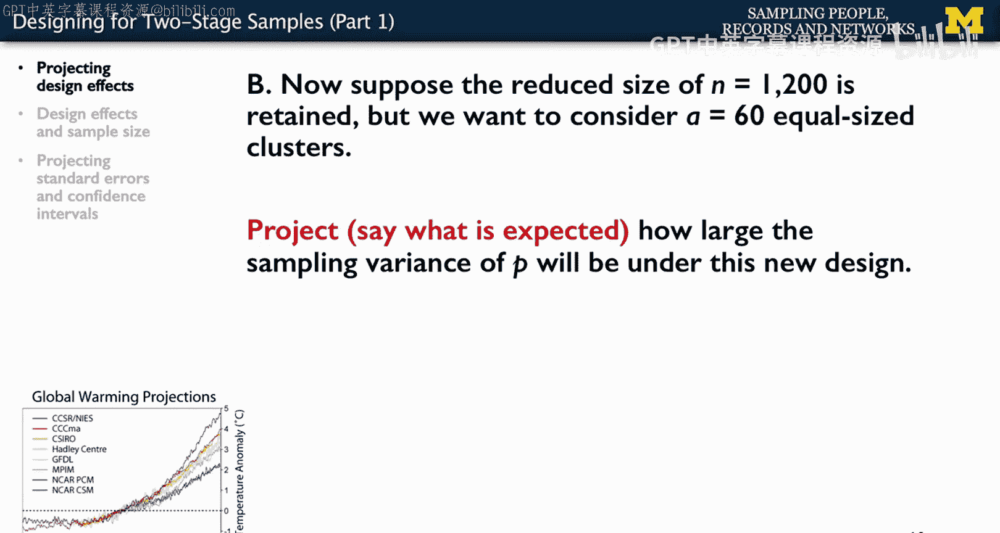

In a way， this is like what's going on with climate change projections。

 They're projecting what would happen under alternative models。

 We have one basic model here that involves the design effect， homogeneity and sub sampleample size。

 along with a simple random sampling variance that we can inflate or adjust for the clustering effect reflected in our design effect。

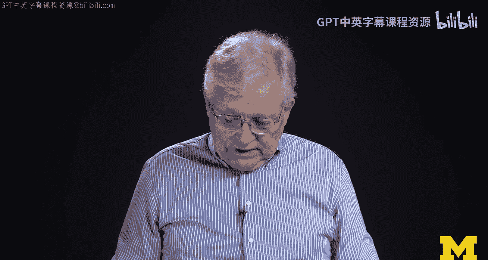

So how would we do this for a， What we're going to do is compute the simple random sampling variance。

 I suppose we could compute the design effect first， and then the simple random sampling variance。

 but we're going to have a new sample size， a proportion that we're going to have to make an assumption about in step 2。

 a design effect in which we're going to use a past value of row and our new subsample size or old subsample size in our case in step 2 for alternative A B is exactly the same as before it's 40。

 and then we're going to compute the product of the simple random sampling variance on the design effect to give us。

Our projected sampling variance under our new design。And for alternative B。

 we'd repeat these steps as well， replacing B equal 40 with b equal 20， but the same row value。

 the same proportion， and that would allow us to compare sampling variances between these two designs。

For design A， for example， with 1200 as our sample size and 30 clusters of 40 elements each our design effect in this particular case is 2。

179。 It's the same one that we had before， we haven't changed anything before。

 we're using the same value of row the same value of B。 So it's the same。

 So all we need to do in this particular case， then is compute a new simple random sampling variance。

 and ignoring the finite population correction， which we actually did anyway in that prior calculation in the illustration we had done before。

 We have p times 1 minus p0。4 the value we had before times 0。

6 divided by 1200 or a variance sampling variance of the proportion of 0。0002。

 The product of that with our design effect gives us a sampling variance of 0。0004358。

 we would take a square root to get a standard error， of course， But we'll stop there。

 because we're going to compare。This variance to the one under design B under design B。

 we have a design effect now that is different。 B is changed from 40 to 20。

 That design effect goes from 2。172。18 down to 1。575。

 It's not cut in half because we got the sample size in half。 The effect has been cut in half。

And so now， in this particular case， then when we multiply together this projected design effect，1。

575 under this new design by the simple end sampling variance， which hasn't changed。

 is still the same sample size and the same proportions we get a variance of 0。000315。

But we can compare these。And here's a table comparing what we had before in our original design，2400。

 That's that first row of numbers。Where we had 60 clusters of 40 elements each and a design effect of 2。

17，2。18， and a variance of 0000218。In our projected a version with 1200 cases in the sample and 30 clusters of 40 elements each same design effect as we've noted。

 but our variance is now twice as large， It's doubled。 That is。

 if we take the sample size and cut it in half by cutting the number of clusters in half。

 we double the sampling variance。 it goes the other way， too。

 If we were to take the sample size and double it by doubling the number of clusters。

 our sampling variance would decrease by one half。

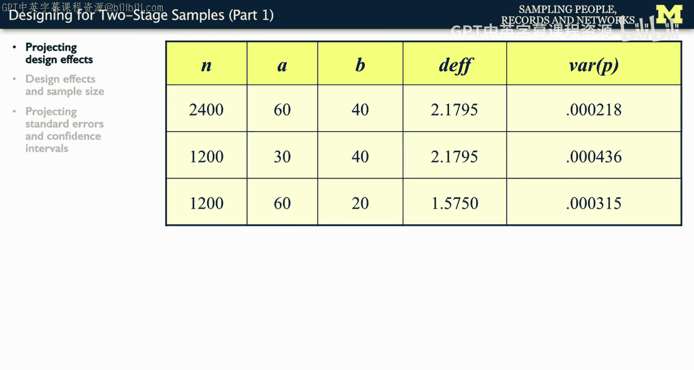

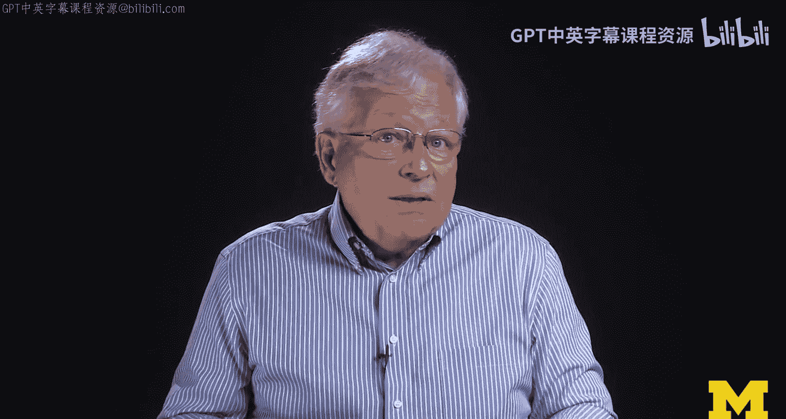

Okay， so that's one way to get our outcome， but the last。

 the other alternative design B to get there involves 60 clusters of 20 elements each cut the subsample size in half。

 but retain the same number of clusters， and now our design effect has gone down and our variance has changed。

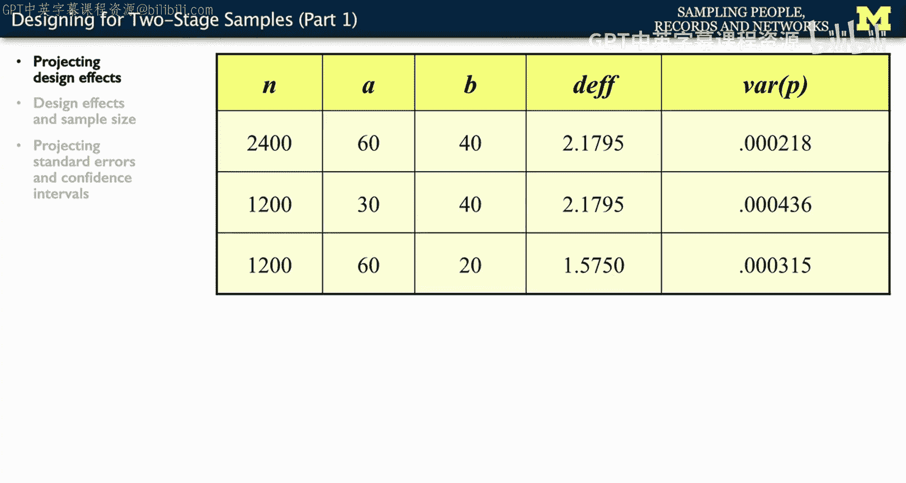

Now we can begin to see alternatives here with quantitative ways and compare them and make decisions about what's the best approach to use。

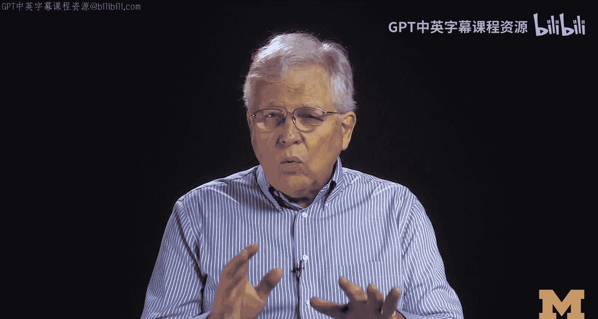

We're going to do a more refined version of this， because one of the key issues will be which of these designs should we use。

 Should we use one that has sub samplesles of size 40 or sub samplesles of size 20 or some other number。

 What's the best subsample size。As we look at alternative subample sizes。

 we're going to need to choose one that's appropriate。

 but we're going to look at that in lecture 6 Here。

 we have two more things to look at before we wrap up this lecture。1。

 the impact of the design effect on sample size and two。

 the impact of the design effect over these projected variances on coughf intervals and there width。

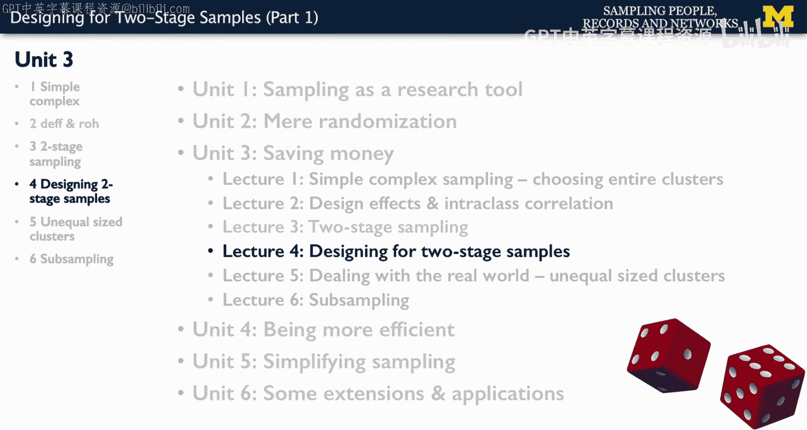

Let's look at those in the second part of our lecture4 on designing two stage samples。

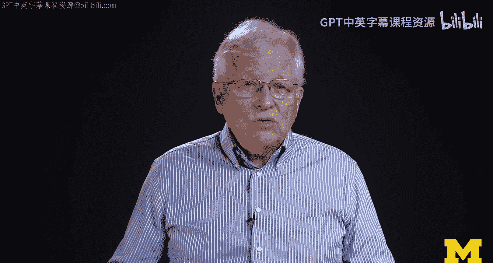

Thank you。