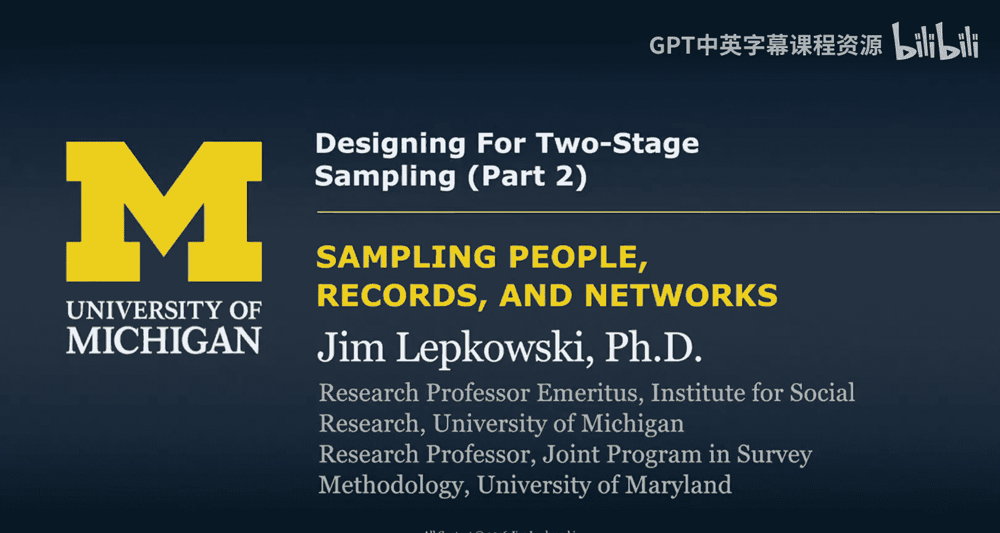
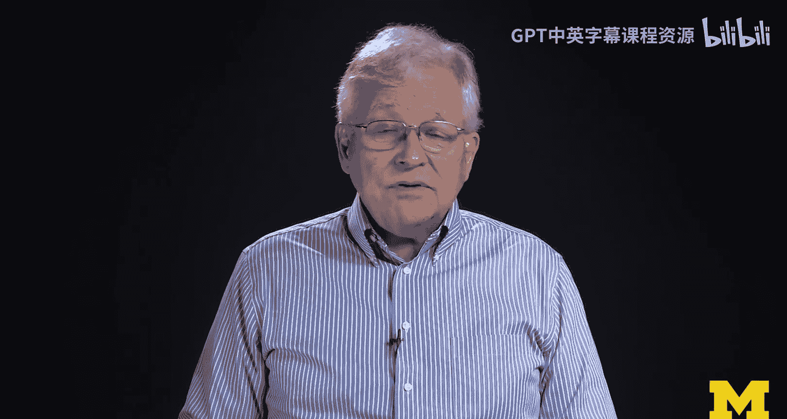
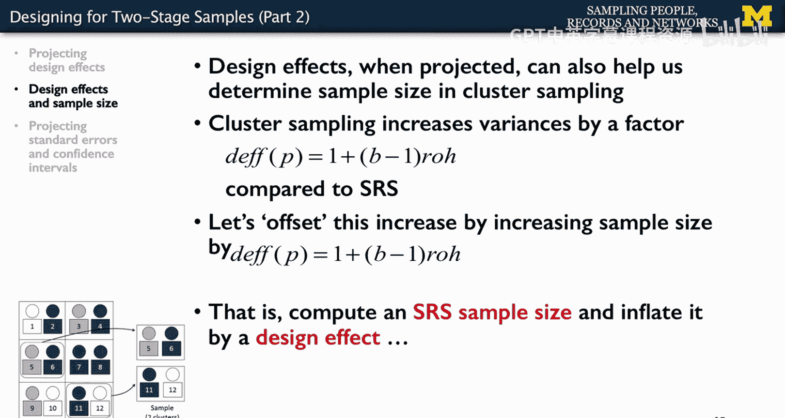
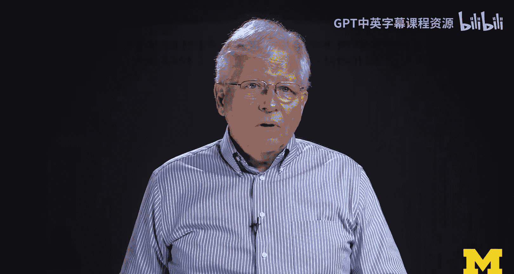
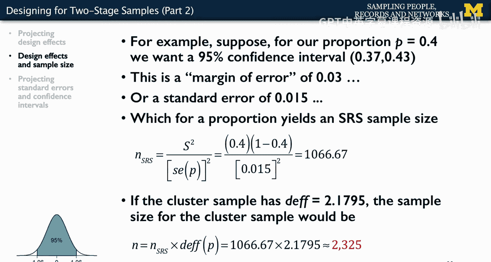
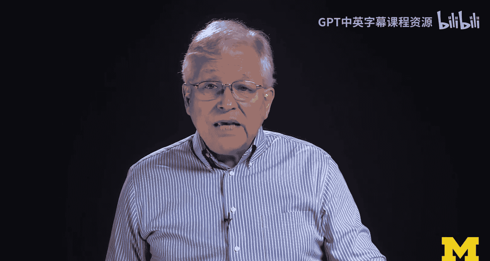
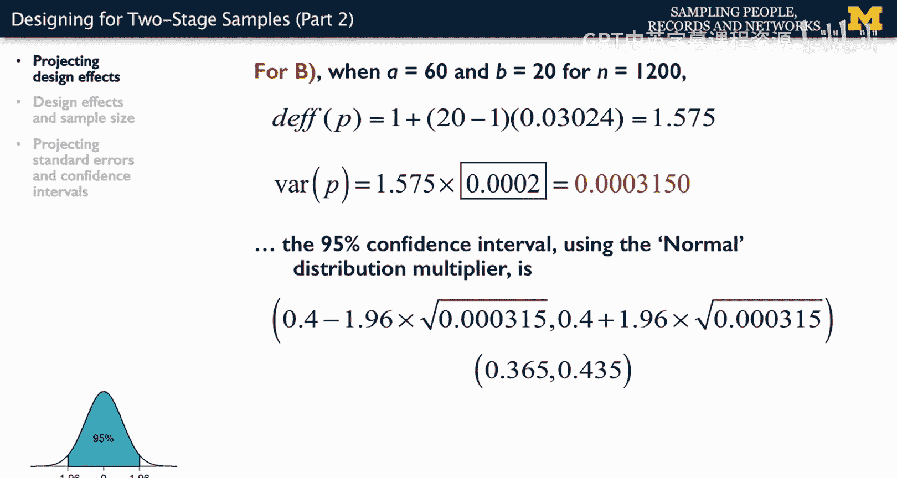
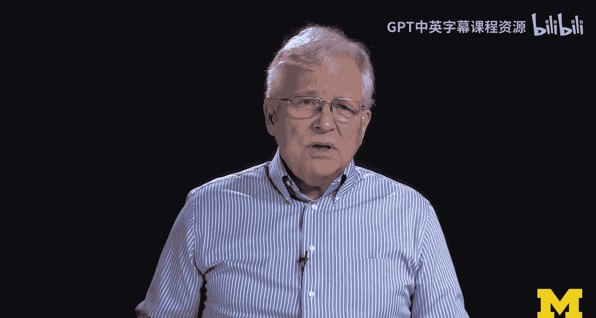
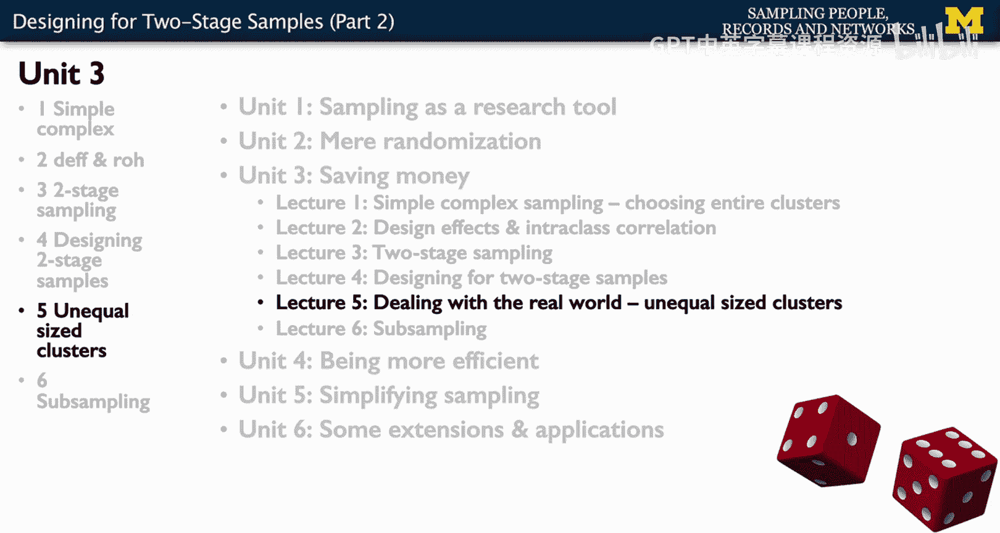

# 密歇根大学《调查数据收集和分析（2-6：方法、社调问卷设计、抽样、缺失数据、分析）｜Survey Data Collection and Analytics》 p102 23_3.4 两阶段抽样设计(下).zh_en -BV1fw4m1e7Zh_p102-

Welcome back as we continue our lecture 4 on designing two stage samples。

And going on to consider two additional topics，1 design effects and their effect on sample size and two projecting standard errors and cofs intervals together for new designs。

Now， design effects when projected， also can be used to help us determine sample size and cluster sampling。

 so there's not just their value， their utility in calculating standard errors。

 projected standard errors， but also it can have an important impact on our design by dealing with sample size。

So cluster sampling， as we know， increases variances by a factor。 That is that design effect。

 Our variances are going up by the factor 1 plus B -1 times R， And we now know how to project that。

 at least building on past information and choosing a value of B。

And so that design effect is a comparison to simple random sampling。Here's what we can do。

We can offset this increase by increasing the sample size。 That is。

 we're going to have larger variances because of this design effect compared to simple randomum sampling。

 And we can offset that by taking the cluster sample and inflating its sample size。That is。

 what we're going to do is start with a simple random sample。

 sample size and inflate it by a design effect。

Now， again， keep in mind that we are saving substantial money by doing cluster sampling。

 either because our list assembly costs are much smaller， We're only assembling lists of elements。

 for example， within selected clusters or or and or our travel costs are substantially reduced because we're only going to a sample of the clusters and not to all of them。

 possibly in a simple random sample that spreads our sample out across all of our clusters or much larger number than we might do in cluster sampling。

So suppose that we start where we did before for simple randomum sampling and say that we have decided in our design process that we're going after this proportion。

 we think it's around 0。4， and we want to have a 95% cops interval， us and the client。

 the client and our team have negotiated around this and decided that a 95% cops interval from 0。

37 to 。43 would be satisfactory。Now that comp interval， as we talked about before。

 translates into a margin of error， a plus or minus 0。03。 so we have taken the estimate the 。

4 and added 0。03 and subtracted 0。03。 that margin of error。

 and we know that margin of error is comprised of both a multiplier that we've derived from a theoretical distribution。

 a normal or a t distribution and a standard error。If what we're doing is 95% co intervals。

 and we've been using that normal distribution for that multiplier effect in our uncertainty statement。

 then we can take 1。96 or 2 and use that to work backwards from the margin of error to the standard error that's being implied。

That is， in this particular case，0。03 divided by 1。96， Well 。03 divided by 2。

 just to keep it round numbers that we we can readily do in our heads。

ItSays that we need a standard error0015 for this particular 95 per cent cocin。

 That means that if we're going to calculate a simple randomum sample now。

 we now know what that sampling variance should be。 It's going to be 0。015 squared。

All we need to do then is to couple that with our element variance S squared。

 So if you recall for a simple random sample， size， calculation。

Assuming that our population size is very large。 We're not going to going to worry about adjusting it here。

 We didn't do that before because we thought that we had a very large population。

 So we simply would take an element variance。 S squared and divided by a projected or desired sampling variance V sub d。

 But in our case， that v sub d is going to be that standard error squared。

 So you'll see here in the numerator for our S squared。

 We're going to use P times 1 minus P roughly an approximately it's satisfactory for these kinds of calculations。

 point4 times 06， and that's going to be divided by our 0。015 squared。 and gives us a sample size。

 Then simple random sample necessary sample size of 1066。67。 Now。

 let's not worry about rounding at this point up or down。

 Let's just keep that number with with the decimals。And add to this。

 a consideration that deals with the cluster sampling。

 We know that if we were to draw a cluster sample of this size，1066。

Our design effects would be such that our con interval would not be from 037 to 0。43， but wider。

Because we would have an inflation in the variance。

 So how are we going to bring those confidence intervals back into alignment。

 we're going to increase the sample size。By a factor of the design effect that with widening factor。

 Now it it's the design effect， not necessarily the square root of the design effect。So mechanically。

 then if the cluster sample was projected to have a design effect of 2。18，2。1795。

 just to keep that number there， the sample size for the cluster sample would be our simple randomum sampling sample size 166。

67 times that design effect。 and now I've rounded the sample size，2325 is our sample size。

All right， so we've got a way now to use the design effect to help us in understanding what we need to do in our cluster sample to counteract the effects of cluster sampling and obtain a sample size。

We can take this use of design effects and this projection process one step further。

 Now we've got this sample size。 We can look and see what a 95% confidence interval would look like for our design under an alternative set of assumptions。

 Now， in this particular case， what I'm going to do is if I were to use what we just did and work backwards。

 we're going to end up with the same co interval。 the ones that go from 0。37 to 。43。 But here。

 let's consider design B。 Remember design alternative B。

Where we had 60 clusters and 20 elements in each， a sample size of 1200。

 a projected design effect of 1。575，1。58。 And what we would do to get a comp interval from this kind of thing would be to use that design effect as an adjustment on our simple random of sampling variance。

 we already knew that that was 00002。 And we already calculated a variance then under this projection system of 0000315。

The 95% confidence interval then builds on this by taking our 0。

4 and adding and subtracting around 0。4 our margin of error to， well 1。

96 times the square root of that 0。000315。That remember now is the simple random sampling variance inflated to account for cluster sampling。

And we see our comp interval width goes from 0。365 to 0。435， very similar to what we had before。

 but remember this is a different design effect。 It's going to be a different outcome here than what we had before。

All right， there we have it。 So we've seen how to project standard errors and variances。

 We've seen how to project cof intervals for from our design。

 We've seen how to use projected design effects to calculate a sample size a simple random sample size adjusted for clustering。

Those are the basic features of the design process， there are others that are involved。

 but that's as far as we're going to be able to go in this particular course。

And what we're going to do now is turn to a topic Also in the realm of cluster sampling。

 We want to relax this constraint that the cluster sizes all have to be the same size。

 We're going to deal with unequal sized clusters in our next lecture。

Before we wrap up things by talking about subsample size as well。

So join us in the next lecture， lecture 5 in unit 3。

 where we will deal with the real world where we have unequal sized clusters。 Thank you。

