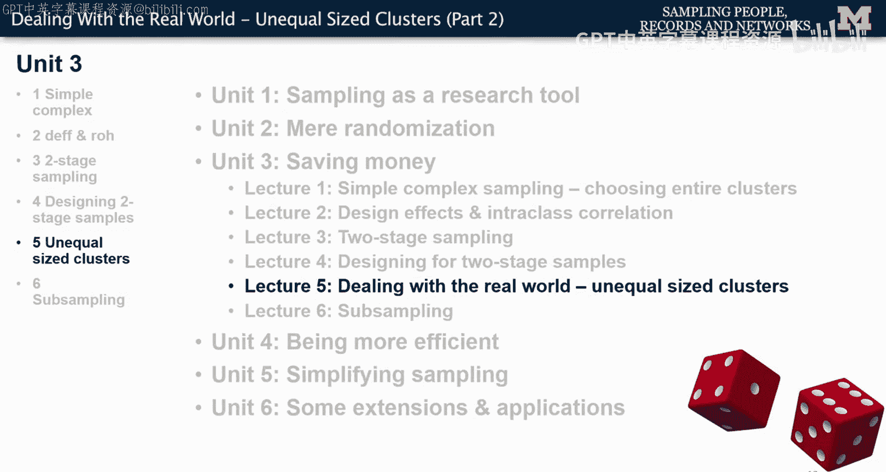

# 密歇根大学《调查数据收集和分析（2-6：方法、社调问卷设计、抽样、缺失数据、分析）｜Survey Data Collection and Analytics》 p103 24_3.5 现实问题处理：不等规模群组(上).zh_en -BV1fw4m1e7Zh_p103-

We've been talking about complex samples。But more the simple variety， the variety that deals with。

Cluters that are equal in size。 And we've dealt with two different issues there。 Basically。

 when we take those clusters that are equal in size， we sample them。

 and then we take all the elements within them。Or the sub sampling， the two state sampling。 And。

 and we've dealt with some of the elements not only for auto make those selections and their levels of precision。

 but also their design effects。Here in this part of unit three。

 we're going to look at in this lecture the issues concerning unequal size clusters。

 and we've sort of labeled this or we have labeled this dealing with the real world unequal size clusters because。

Those examples were a little artificial。 The remember the equal size blocks or the equal size classrooms。

 we know that's not the case in the real world。 What happens when those cluster sizes vary。

Now when we start talking about unequal sized clusters。

 we need to talk about them in the context of some examples where there's more variation than we might see in school size。

So classroom size， classroom sizes remain fairly similar。

 they don't usually go from a few to a few hundred。

But here we're talking about cases where these unequal cluster sizes can vary a lot more than that。

So we're going to talk about the nature of the problem。

 there's a problem that arises when these clusters are unequal size。

 unequal in size in our sample selection， we're going to talk about some sampling schemes for those and then talk about a solution that's called probability proportionate tos sampling or PPS and we're going to do PP two different versions of it in this discussion here。

 so we're going to deal with the basics of our problem and see if we can come up with a description of a method that deals with it。

Okay， so we're dealing with naturally occurring clusters。

 schools or classrooms we don't create those。 if I created then， they'd be artificial。 So by natural。

 I mean， those that are occurring out there in the real world。 and。

 and in that real world construction， we get this phenomena where we get differences between them。

 If I were to construct these things。 I'd try and construct them so that they were at equal means。

 the means were all the same， there'd be no variation between them。 Now， that would be a disaster。

 right， because what I would have to do to do that would be for the school children， massive busing。

 I'd have to bus these kids all over the place in order to get them to the point where they could have roughly the same immunization rate in each classroom。

 That's not what we're not talking about here。 I'm taking materials that are readily available。

 A list of classrooms。And then I'm doing my sampling using that material。

 I'm trying to keep the cost down。Of the sampling operation。

We've been talking about when we do the sampling then。

 also about sampling rates of these clusters that were kind of fixed rates。

 We would take a fraction of the classrooms。 We would take 20 of the 1000 classrooms，2%。

 And then we would take one half of the students within each of the classrooms。 Now。

 that works well when they're equal in size， but when they're unequal in size。

 we run into some problems。 And here's an illustration of it。

 This just a hypothetical list of a set of 12 hospitals。

I put them in two columns because the numbers get a little small for our first display。

 we'll do that later， but here are the sizes of the hospitals in terms of employees。

 So our task here is to sample the employees in these hospitals and let's say ask them about their satisfaction with their work environment。

And their satisfaction with the benefits that they receive， the work hours。

 the kinds of things that we're interested in studying because we want to assess how well our employees are doing in our particular hospital system。

 these are 12 hospitals from a hospital system in some state， in some province， across provinces。

 but they're all interlinked in some way。And so we can see here now that the number of hospitals varies So for each hospital。

 there's a count of the number of employees。 I've now called that capital B。

 capital B for the number of elements in the cluster。

 sub alphapha because it varies from alpha equal 1 to alpha equal 12。

 So the hospital number is the value of alpha that changes the B sub alpha is the size。

 we can see that these sizes vary from 602 of them have。

 but 60 employees to one of the hospitals having many times that number 1860。

 So we've got a big variation here in the size， probably 30 to1。

 and that gives us some pause because suppose what we decide to do is draw a sample。

 we've figured out that we can afford to do about 100 employees。

 and we're just going to do two hospitals just to keep it simple here now ordinarily in practice we want more hospitals than this。

 but we're going to do this sample by selecting。100 employees from two hospitals。

So we're going to group our data so that we can do more interviews in each hospital。

I added up the sizes。 there's 6000 employees across these 12 hospitals， so an average of 500。

 but they vary from 60 to 1860。Okay， so I'm going to do 100 from 6000。 That's my sampling fraction。

 Now， we haven't talked it in these terms before， but。

 but that's really what I've specified now by specifying that sample size and knowing what the population size is。

 I'm taking one out of every 60 employees there。 That's my sampling rate。

And we're going to do this by first selecting two of the hospitals。

And let's say we're going to do a simple random sample as we did before。

 we're going to generate two random numbers from one to 12。

And and take those two hospitals without replacement， that's a first stage rate then of one in six。

 one， six of them， two，12。So that means that if I've now said that I'm going to do 100 employees from the 6。

000 hospitals， that's the overall rate， that's the overall F。

And then I'm taking one six of the hospitals to get there。I've also forced something。

 Maybe I didn't realize it at first， but I forced something If I'm taking one sixth of the hospitals。

To get one 60th of the employees overall， I can only take one10th of the hot of the employees in each hospital to pull this off。

 Those two numbers，1，6 times 110th have to equal 1，60。 And what I did was I sort of。

Naturally thought about what's the overall rate 1 in 60。 Now， let's start at hospitals。

 take 2 from 12，1，6 of them that forces me to have one10th from each of the hospitals。 Okay。

 All right， that that sounds okay。 I， I can do some kind of sampling there by figuring out what  one 10th would be in each case and draw that sample as a simple random sample。

Except that there's a problem here。 Supposing at random， hospitals 2 and 6 are chosen。

And now what I'm going to do is take one10th of each of those hospitals。 Now。

 hospital 2 has 180 employees。 You can go back and check it。 So I'm going to take 18 from hospital 2。

 But hospital 6 has 360 employees。 I'm going to take 36 from them。110 of each。 And when I add him up。

 it's 54。It's not 100。Now， my sampling rate is still one in 60， but I'm not getting my sample size。

Even worse， suppose instead of 2 and 6， I got 2 and 10。

Now I have 18 employees that I'm going to get from the first hospital of 180。

And 186 from the second hospital of 1860。 Now， my sample size is 204。 I'm not even coming close。

 I'm coming half as large as what I wanted and twice as large as what I wanted just by chance。

 selection of the hospitals。The subample size varies in this case。

Sample administrations a little bit difficult。 I'm going to have to think about this if I only have one interviewer。

 Okay， I know that they're going to spend a half a day at the first hospital interviewing 18 employees。

Two days at hospital number six， but a lot more time。

 10 times as many days in five10 times as much time in hospital 10。So I don't like this。

 it's also impossible for me to make cost。I'm not， I'm going to be called upon to say for this sample design。

 what can we have in the way of information about our cost and I've got a sample size that varies by a factor of 4 to1。

This scheme has got some problems in it。 And the reason is because the hospital sizes vary。

 and I did something fairly naive about the sample selection。Now。

 the variation in the overall sample size is undesirable from the operational point of view and from the budget point of view。

It's also undesirable from the statistical point of view。

Recall that we calculated our means why bars by taking the sum of the characteristic we're measuring。

 In this case， maybe it it's a satisfaction score。 We asked them to rate on a scale from 0 to 10。

 How satisfied they are with their overall working conditions。

 And they give us a number from 0 to 10。 And we take the average of those numbers。

 And that's what we're looking at。 is that satisfaction measure。

But the n that we're dividing by will not be 100。 it's going to be 54 in one case。

 204 in another and different samples will get us different samples。

 the hospitals will get us different sample sizes。So okay， we're just going to divide by the 54。

 the 204 that makes the most sense， but the statistician now points out that look。

 that sample size is not n anymore， it's not 100， it varies。

 it's a random variable and when you do this when you divide by 54 in one case or 204 in the next one depending on which hospitals you got。

You're really getting an estimator that varies in the denominator。

 And now we've got a numerator why the satisfaction score summed up and in the denominator。

 the sample size。 the sample size is going to vary from cluster to cluster。 Well。

 I'm giving you that ratio estimator formula there。 we're not going to deal with it。

 We just don't have the the time to do that in this course。

Some of this will come up in a later course， but nonetheless。

 it changes the nature of the estimator and life gets more complicated。

 And we'll talk a little bit about that at the very end in terms of variance estimation。

 That's a tough one to deal with。Okay， so even more， what I'd like to do is control that sample size。

 I I'm not calling it X instead of n。 It's like why it's a variable。

 It depends on what sample I've got。It will provide administrative convenience if I can control it。

 and it will also improve the efficiency of my estimators。 That ratio estimator gets more efficient。

 It gets smaller variance for the same input of cost if I can reduce that variability in the nominator。

Now there's several ways to reduce that variability in denominator， one way would be to force it。

Take exactly the same number of elements per cluster。

 instead of doing two hospitals and taking one10th of the employees。

 I'm going to do two hospitals and then take 50 employees in each。

 Maybe that's what you were thinking about anyway。 Jim， why are you doing this's just take 50。

 And then you're guaranteed the sample of 100， No matter which hospitals you get。

 you take 50 in each， you've got your sample size， But there's a problem with that。

 that we need to go over。And the solution to that problem turns out to be this probability proportionate to size。

 There it is spelled out P sample selection。Okay， so we're back to two hospitals now。

 but now we're going to do 50 employees per hospital that are chosen。

 so we're going to get our sample size of 100 it won't vary depending on which hospitals there are。

 but here's the problem that we get。 We do not have equal chance selection of employees。

Those employees who are in small hospitals， their hospital has the same chance of being selected as the big hospitals。

But when we get there， we take a very large fraction of them。

 So if the hospital had only 60 employees。Their chance coming into the sample is almost one is 50 out of 60。

 Whereas when we got that hospital 10 that had over 1800 employees。

 their chance of being selected is much， much smaller，1 in 35，1 in 36。 So， you know，5，6，1 in 36。

 that's a big difference in sampling rates。So the probability of selection of the small hospital employees is bigger。

In other words， what we're going to do is over represent， on average， across all possible samples。

Employees in small hospitals。 Now， small hospital employees have varying satisfaction levels。

 They have higher satisfaction levels。 Then what I'm done is built in a bias。

 I'm now going to overestimate satisfaction level。By the nature of the sample design。

 So you can see my cake down there。 We're not dividing the cake up equally。 Well， yes， we are。

 We're sort of taking the the population of 6000 dividing it up into a groups of 50 that we're going to use in our sample。

But in fact， we're taking the same size slices from cakes the variant size。

 So it's got to be something that we repair here。 We can't live with this because we're going to build in a bias potentially for any characteristic that's related to hospital size。

Just illustrate the sampling rates here。 If we take the hospitals 2 of 12。

1 in 6 in the first line there in the first of F。 we're taking one6。

 and then we're taking 50 of 180 employees。 Now， if I multiply those things through and just sort of rearrange things to get that so that I've got a one in the numerator and a rate in the nominator。

 we're taking one of every 21，22 hospital employees in that hospital。 whereas as for hospital 10。

 which has 110 times as many employees。 It's one in 220。Much smaller rate。

 that's unequal probability of selection and anytime you see that。

That means that somebody's getting sampled at a much higher rate， they're being overreed。

 That was the term that I used。 So this variation in rates can be remedied。

 and we will talk about waiting in unit 6。But right now。

 if we don't do anything to compensate for it， we're going to over representpresent employees in small hospitals on average。

 They've got the same chance of coming。 their hospital has the same chance as the large hospitals。

 And I'm going to end up with a bias。So we have a dilemma here in terms of sampling these unequal sized clusters。

 we can have variation in sample size， or we can have variation in our sampling rates。

And have over representationpresentation and the need for waiting。

There turns out there is a better way to deal with this in terms of changing how we select the sample。

And let's take a little break from this discussion right now and talk about unequal size clusters。

 And then come back to this topic。 Let's come back and then talk about this alternative。

 which involves varying our sampling rates at the first stage， as well as the second。

 So join me for the second part of lecture 5。 Next。 Thank you。

