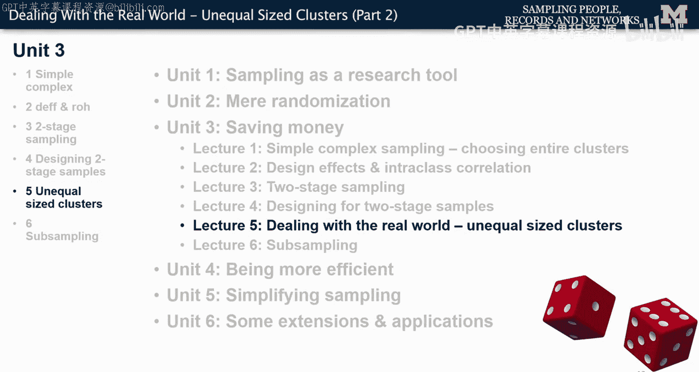

# 调查数据收集与分析：3.5：现实问题处理：不等规模群组（上）📊

在本节课中，我们将要学习如何处理现实世界中常见的“不等规模群组”问题。之前我们讨论的群组（如街区、教室）都是规模相等的理想情况，但在实际调查中，群组规模往往差异很大。本节将探讨这种差异带来的问题，并介绍一种名为“与规模成比例的概率抽样”的解决方案。

## 问题的本质

上一节我们介绍了等规模群组的抽样方法。本节中，我们来看看当群组规模不相等时会遇到什么挑战。

我们处理的是自然形成的群组，例如学校或医院。这些群组的规模并非人为设定，而是现实存在的，因此它们之间在规模上存在差异。为了控制抽样成本，我们通常会先抽取一部分群组，再从每个被选中的群组中抽取一部分个体。

当群组规模相等时，这种两阶段抽样方法运作良好。然而，当群组规模不等时，我们会遇到两个主要问题：**样本量的随机波动**和**个体入样概率的不均等**。让我们通过一个例子来具体说明。

## 一个医院系统的例子

假设我们有一个包含12家医院的系统，共有6000名员工。我们的目标是抽取约100名员工进行工作满意度调查。医院规模（员工数）差异很大，从最小的60人到最大的1860人。

如果我们采用简单的两阶段抽样：
1.  从12家医院中随机抽取2家（第一阶段）。
2.  从每家被选中的医院中抽取十分之一的员工（第二阶段）。

以下是可能遇到的问题：

*   **样本量失控**：如果抽中的两家医院规模都很小（例如60人和180人），我们最终只能得到约24名员工的样本。反之，如果抽中两家大医院，样本量可能远超100人。这给预算和现场执行带来了巨大困难。
*   **估计量复杂化**：由于最终样本量 `n` 变成了一个随机变量，我们计算平均值时使用的分母不再固定。这导致我们得到的估计量是一个**比率估计量**，其形式为 `ȳ = (∑y) / n`，其中 `n` 是变化的。这种估计量的方差计算会变得非常复杂。

## 尝试解决方案：固定群组内样本量

为了解决样本量波动的问题，一个直观的想法是：**固定从每个被选中群组内抽取的个体数量**。例如，无论抽中哪家医院，我们都从中抽取恰好50名员工。

这样确实保证了总样本量稳定在100人。但是，这引入了新的问题：**个体入样概率变得不平等**。

让我们计算一下：
*   对于一家只有60名员工的小医院，其员工被抽中的概率是：`(2/12) * (50/60) ≈ 0.139`
*   对于一家拥有1860名员工的大医院，其员工被抽中的概率是：`(2/12) * (50/1860) ≈ 0.0045`

可以看到，小医院员工的入样概率大约是大医院员工的30倍！这意味着在样本中，**小医院的员工被过度代表了**。如果员工满意度与医院规模相关（例如，小医院员工可能更满意），那么这种抽样设计就会系统性地高估或低估总体满意度，从而引入**偏差**。

## 面临的困境

至此，我们陷入了两难境地：
1.  如果保持两阶段抽样率固定，会导致**总样本量剧烈波动**。
2.  如果固定每个群组内的样本量，会导致**个体入样概率不均等**，从而可能引入偏差，后续必须通过复杂的加权来校正。

显然，我们需要一种更聪明的抽样方法，能够同时控制样本量并保证（或至少更容易实现）个体入样概率的平等。

本节课中我们一起学习了不等规模群组抽样时遇到的核心矛盾。我们看到了固定抽样率会导致样本量波动，而固定群组内样本量又会导致入样概率不均等。在下一节中，我们将介绍解决这一困境的关键方法：**与规模成比例的概率抽样**。这种方法通过调整第一阶段的抽样概率，为最终实现等概率抽样提供了优雅的解决方案。