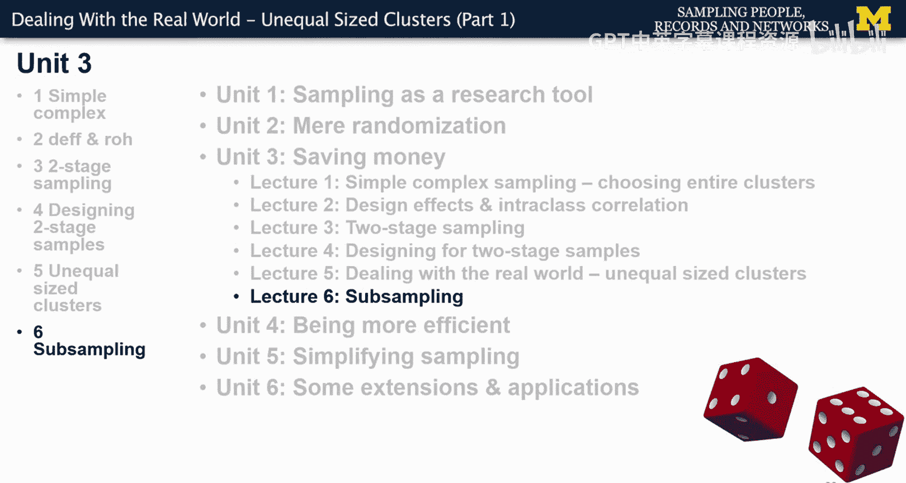

# 密歇根大学《调查数据收集和分析（2-6：方法、社调问卷设计、抽样、缺失数据、分析）｜Survey Data Collection and Analytics》 p104 25_3.5 现实问题处理：不等规模群组(下).zh_en -BV1fw4m1e7Zh_p104-

In our last part of lecture 5， we were dealing with a problem concerning。

Unequal size clusters and the mess it was making of our sample design。

 we were either dealing with more complicated estimators or because of variation in sample size or a nice clean sample design。

 but。The need to wait， the need to create weights to compensate， to avoid。

Bas in our samples in our estimation and as I said。

 we're going to come back and talk about waiting later。

 but here what we're going to do is continue in our discussion of dealing with the real world and sampling unequal size clusters in lecture5 by continuing on our discussion by looking at an alternative to these other schemes for dealing with unequal size clusters in our sampling in dealing with them through a sample selection mechanism in two stages that we're going to call probability proportionate to size or PP。

So what we require is a method that has some of the properties of the two things that we were just dealing with。

 number one， equal chance， one in 60 for all the employees。 that was an attractive feature for us。

 And so that Eppsom equal probability of selection method was attractive。 we want to retain that。

At the same time， we would like to retain the features of the alternative method where we had the same number of elements in each of the subamples。

So let's consider two clusters of two hospitals from our population of 12。

In which we're going to take 50 employees in each， and we've just set up kind of an algebra problem here。

A selection equation。 Our overall f is going to come in two parts。

 It's got to be one in 60 as our overall rate。 and it's going to be done in two parts。

 A probability of selection of the cluster。 P of alpha Alpha for the cluster。

 And then within sampling where we're taking 50 employees from those that are actually there。

 Now I don't。 It depends on which clusters are selected as to what that denominator is。

 So I've just put in capital B sub alpha。 It could be 50 from 60 could be 50 from 180 could be 50 from 1860。

But that's what we've just said by saying that it has to be equal chance。 That's the one in 60。

 And in two stages， I in the second stage， I want the same number of employees。

 the same number of elements from each of the clusters。That's the beginning。 Now。

 what should that piece of alpha be。So we'll do a little manipulation。

 We can do this to figure out what it would be， but it turns out that that first aid sampling fraction。

 if we look at that last expression there， the probability selection of the hospital。

 the alphapha hospital is going to be proportionate to the size of the hospital。

 B sub alpha over 3000。 That's what we'll get that equation to work。But wait a minute。

 how am I going to sample hospitals with varying probabilities。

 I know how to sample employees with varying probabilities across the hospitals。 That's easy。

 I just take the same number and then take it from however many are there。

 But how am I going to do something like this。Well， the the fractions work out this way。

 this kind of thing says that what we're going to do is take two hospitals with probabilities proportion to size and then take the same number of employees in each。

 That's what all of these equations refer to across two stages。

 we're going to get balance in the overall sampling fraction。For all the employees。

 they all have the same chance of being selected by doing it in two steps where the first step。

 we over sampleample big hospitals and undersle small， But in the second step。

 we over samplele employees in small hospitals and under sampleample employees in large hospitals。

And the product of the two always comes out to be our1 and 60。Well。

 I need an easy way to do this because that sounds complicated to me。 It's hard to keep track of。

 This is a bookkeeping problem。 We now have to keep track of probabilities of selection for the hospitals and for the employees within hospitals。

 but it can be managed。As long as we're careful and go through this slow link with with our available information。

 so let's go back to our list of hospitals here they are now， here's all 12 of them。

And do a PP sample。And I've added a new column here， the cumulative size of the hospital。

 so notice for hospital one， the actual size is 420， the cumulative size is 420。For hospital 2。

 the actual size is 1，80。 The cumulular size is 600。Oh， which is 420 plus 1。

80 for the third hospital。 its size， its its actual size is 120。 its cumulative size is 7，20。

600 plus 120。 We keep adding in the sizes successively till we get down to the 12 hospital。

 where its actual size is 240， and its cumulative size is 6000。

 which is the total number in our in our population。So here's the process。

 what we're going to do is generate a random number now， not not from one to 12。But from 1 to 6000。

And let's suppose that we select two random numbers from one to 6000。The first random number is 0，7。

02 Well，702，4 digit random number from 1 to 600，7，0，2，1，7，4，4 is the second one。

We're going to go through and find the first hospital on the cumulative sum。

 whose cumulative sum is greater than or equal to the first random number。

And then we're going to do the same thing for the second number。 Find the hospital。

 whose cumulative sum first exceeds as we're working our way down the list to that number。

That chooses hospitals three and seven。So you can see now I've lined up 702 with hospital 3 because 702 falls in the range。

 if you will， from 601， one more than hospital 2s， but it's included in hospital3 is up to 720。

And the 1744 falls in the range。 let's see， from hospital 5 to 6， from 1561 to 1920。

In the first case， there are 120 numbers from 600 to 720，6，01，602，603， and so on through 720。

120 numbers。 We chose one of them。But that means that I could have chosen any one of the numbers from 6。

01 to 720 upon that hospital。 The chance of that hospital with one random selection being selected is 120 from the 6000。

 off。 That's what we wanted。 is proportionate to its size。Using the cumulative numbers。

Similarly for hospital 6， there are 360 numbers that go from 1561， the one that's above hospital 5。

 from 1561 to 1720，360 from 6000。 That's its chances being selected。

 And we happen to get one of them，1744。So now we've made two draws。

 each with probabilities proportionate to size， which is what we wanted in the first stage。

 Now we can go to the second stage and take 50 at random from the 120 and 50 at random from the 360 in hospitals 3 and 6 respectively。

That has a danger， though。 We could end up selecting the same hospital more than once。

 We could have gotten the same random number or a random number。

 the same random number twice or the same random numbers from the same hospital。

So to avoid that problem， we're going to do a form of systematic sampling。

 something we'll come back to。 So just learn the mechanics right now。

 Let's start with that first random number 702。 Now。

 let's pretend now that this was selected not from 1 to 6000， but from 1 to 3000。

 The first half of the list。 We're going to get a selection from the first half of the list for our first one。

And then we're going to find the selected hospital as before。

 but then we're going to add 3000 go from the first half of the list to the second。To 3702。

 which gets us a different hospital。 In that case， hospital 10。

This is what's called systematic probability proportionate to size。

 We're dividing the list into two groups because we have two samples that we're doing the first half of the list from which we draw one at random。

 And the second half of the list from which we count the size of the。Group。

The list size divided by two to get the second one。And that gives us our two selections。

 then of hospitals 3 and 10。 and we will not select the same hospital more than once。

We only get one shot at each， one from the first half， one from the second half。

So in that particular case， then we now have our sample method in terms of not only being able to sample hospitals that are unequal in size。

With equal chance for the elements within them and get the same size subamples from each。

 But do this in a way that avoids getting the selection of a hospital more than once。

Systematic P selection。All right， that's， that's a little complicated。

 But I wanted you to understand this because this is what happens in the real world。

 It's a more complicated version of what we've been doing。

We're going to do one more topic here on subsampling。 I want to come back to that subsample size B。

 I know this's a little out of sequence， but it's kind of hard to put it in sequence because these are practical problems。

 and they don't necessarily fit together in some neat logical order。

 But we're going to talk about how to figure out how many elements to tape per cluster。

 Where do we decide on 50 per hospital。 Besides saying two hospitals of for a sample of 100。

 But Why2， Why not three or5 or something else。 Okay， that'll be our next topic on subsampling。

 Please join us in for our last lecture in unit 3 on cluster sampling。 Thank you。

