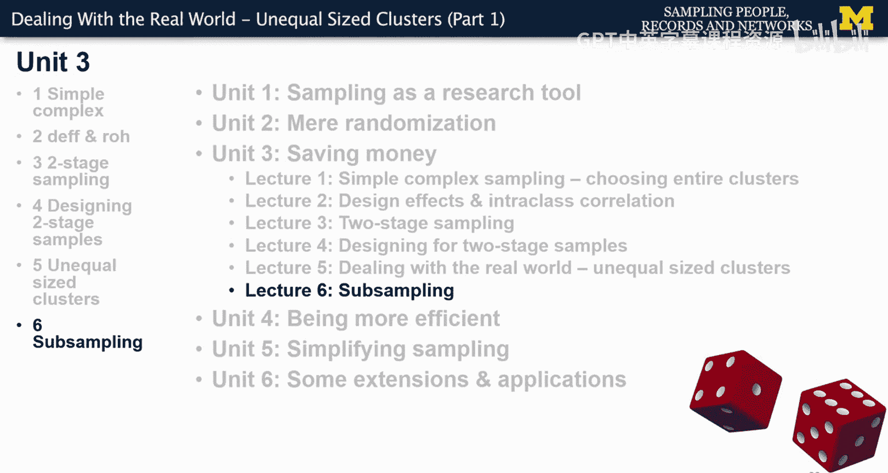

# 调查数据收集和分析：3.5：现实问题处理：不等规模群组（下）📊

在本节课中，我们将继续学习如何处理现实抽样中的不等规模群组问题。上一节我们讨论了不等规模群组给样本设计带来的复杂性，以及使用加权进行调整的思路。本节中，我们将介绍一种通过两阶段抽样机制来处理此问题的替代方案：**与规模成比例的概率抽样**。

## 核心目标与方法介绍

我们需要的抽样方法需同时具备两个理想特性：
1.  所有个体（如员工）拥有**相等的入样概率**（例如1/60）。
2.  每个被选中的群组（如医院）中抽取**相同数量的元素**（如50名员工）。

这可以通过一个两阶段抽样过程实现，其整体抽样比 **f** 由两个部分构成：
*   第一阶段：群组（医院）被选中的概率 **P(α)**。
*   第二阶段：在选中的群组内，元素（员工）被选中的概率。

整体抽样比需满足：
**f = P(α) * (b / B_α) = 1/60**
其中，**b** 是计划从每个选中群组中抽取的元素数量（固定值，如50），**B_α** 是第 α 个群组的实际规模。

通过数学推导可知，要使上述等式对所有规模不同的群组都成立，第一阶段群组的入样概率必须与其规模成比例：
**P(α) = B_α / 3000**
（假设总体规模为3000）

这意味着，在**第一阶段**，我们**过度抽样**大群组（因其 **P(α)** 更大），**欠抽样**小群组。而在**第二阶段**，为了补偿并实现最终每个个体的等概率，我们在小群组内**过度抽样**员工（因为 **b/B_α** 值更大），在大群组内**欠抽样**员工。两阶段的概率乘积最终恒等于 **1/60**。

## 与规模成比例的概率抽样实施步骤 🛠️

为了实际操作这种抽样方法，我们需要一个系统化的流程来抽取概率与规模成比例的群组。以下是具体步骤。

首先，我们需要一份包含所有群组及其规模的列表，并计算累积规模。

| 医院编号 | 实际规模 (B_α) | 累积规模 |
| :--- | :--- | :--- |
| 1 | 420 | 420 |
| 2 | 180 | 600 (420+180) |
| 3 | 120 | 720 (600+120) |
| ... | ... | ... |
| 12 | 240 | 6000 (总体) |

接下来，我们进行系统性的PPS抽样。

1.  **生成随机数**：假设我们需要抽取2个医院。我们生成一个在1到3000（6000/2）之间的随机数作为起点。例如，**702**。
2.  **定位第一个医院**：在累积规模列中，找到第一个其累积规模**大于或等于**该随机数（702）的医院。在本例中，是医院3（累积规模720）。
3.  **定位第二个医院**：将第一个随机数加上间隔 **K = N / n = 6000 / 2 = 3000**，得到第二个数 **702 + 3000 = 3702**。在累积规模列中找到第一个其累积规模**大于或等于**3702的医院。在本例中，是医院10。
4.  **完成第一阶段抽样**：至此，我们抽中了医院3和医院10。这种方法被称为**系统性与规模成比例的概率抽样**，它能确保每个群组最多只被选中一次。
5.  **进行第二阶段抽样**：在选中的每个医院内，使用简单随机抽样方法，分别抽取 **b = 50** 名员工。例如，从医院3（规模120）中随机抽50人，从医院10（规模假设为360）中随机抽50人。

通过此方法，我们实现了：大医院因规模大而有更高概率被抽中，但一旦被抽中，其内部员工的被抽中概率较低；小医院则相反。最终，所有员工的总入样概率保持一致。

## 关于子样本规模的思考 💡

在结束不等规模群组的讨论前，一个自然的问题是：如何确定每个群组内应抽取的元素数量 **b**？为什么是每个医院抽50人，而不是30人或70人？

选择 **b** 的大小涉及精度、成本与操作复杂度的权衡。较大的 **b** 意味着每个被调查群组能提供更多信息，但可能调查的群组总数会减少，这会影响样本对群组间差异的代表性。反之，较小的 **b** 允许我们调查更多不同的群组，但每个群组提供的信息量较少。

这将是我们在下一讲，也是第三单元关于整群抽样的最后一讲中，将要深入探讨的主题：如何最优地决定子样本规模。

## 总结

本节课我们一起学习了处理不等规模整群抽样的一个强大工具——**与规模成比例的概率抽样**。我们了解到，通过精心设计的两阶段抽样，可以同时实现**个体等概率入样**和**群组内固定样本量**这两个目标。关键步骤包括构建累积规模列表、使用系统PPS法抽取群组，然后在选中的群组内进行二次抽样。这种方法虽然计算上更复杂，但能有效应对现实世界中群组规模不等的挑战，是大型社会调查中常用的抽样技术。