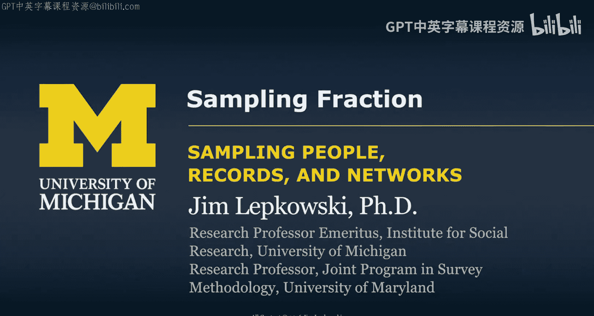
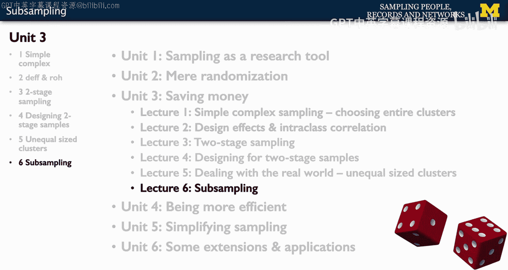
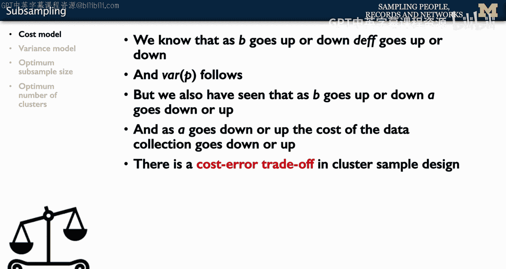
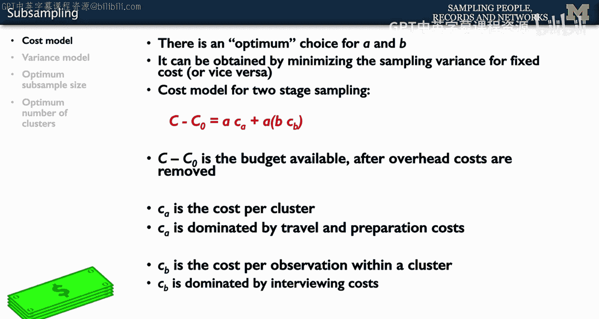
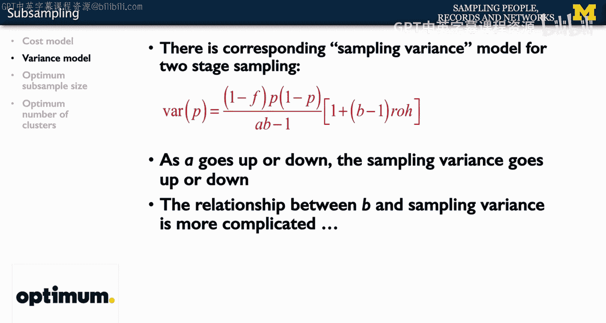
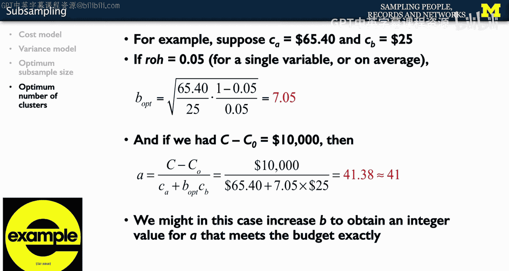
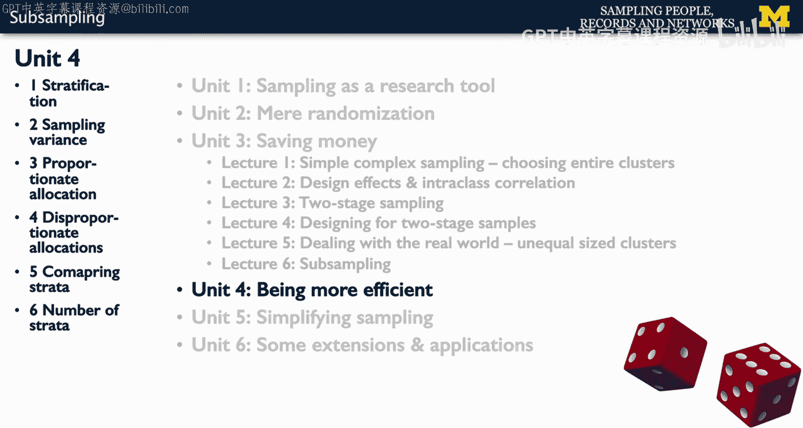

# 密歇根大学《调查数据收集和分析（2-6：方法、社调问卷设计、抽样、缺失数据、分析）｜Survey Data Collection and Analytics》 p105 26_3.6 抽样比例.zh_en -BV1fw4m1e7Zh_p105-

Welcome to the last of the lectures on cluster sampling on saving money in surveys， our unit 3。

 where we're going to be looking at an issue concerning a factor that drives all of our designs。

 the size of the sub samplele。

We were just looking at， for example， in lecture 4。

 what happens to our projected standard errors at different levels of B， the subample size。

 Where does B come from， What considerations ought to go into choosing a value of B。

 the subample size that's appropriate for our design。

We already know from that discussion that there is a part of this that will involve costs。

We know that as we change B， and if we have a fixed sample size or a fixed budget， as we increase B。

 the number of clusters has to go down and our costs go down。

But that means that as we're increasing B， our design effects are going up。

 but our costs are going down， they're going in different directions。

And as the design effects go down， as B goes down， then our variances go down。Alternatively。

 if we decrease B。Our design effects go in the opposite direction and our costs go in the opposite direction。

 We can increase the number of clusters and increase our costs。

 So there is a trade off a balance between cost factors。

 How many clusters to take and variances based on B and our model 1 plus B minus1 times row for our variances。

So what we're going to do in this particular lecture is deal with a cost model。

 We're going to get a little more sophisticated about specifying the cost structure of our process and a variance model。

 which we already know， although I'm going to express it in a more elaborate。

 more detailed way than we've done up till now。 and we're going to take the two of those and combine them to come up with an optimal subsample size。

 one that gives us good properties。 the best property that we can imagine would be that is' going to give us a sampling variance that is as small as possible among all choices of B。

 all possible subsample sizes。And then we're going to back out of this whole process out of that cost model。

 the number of clusters that we've got， and we have a little illustration to talk about in some of the features there that go with that。

Now， this is one approach to the problem， choosing to find the subsample size that is the best。

And at the very end， I want to say something about how one might construct a series of steps to do full two stage sampling design。

Built around now， this last step in the process， the subampling。Just to recall。

 projecting standard errors and cos and ruless for cluster sampling depended on a design effect。

 which depended on a value of B， un assumedumed value of row。

Estimating sample size for cluster samples， that depends on a B and a design effect as well。

 coupled with the simple random sample sample size。

But the point is that knowing B and row leads to a projected design effect and both of these kinds of consequences。

 So B is a key part of this。 And if we were designing our sample， we're interested in N， certainly。

 but we're going to have to start back at the point of deciding how many elements to take per cluster。

 So B is a driving factor here。Now we know that as B goes up or down。

 the design effect goes up or down as well。That's a direct effect。 And as a result。

 so does the sampling variance， because as B goes up， the design effect goes up。

 The sampling variance goes up in our cluster sampling case。

 As B goes down our design effect goes down， our sampling variance goes down。

 But we've also seen that as B goes up or down， A goes in the opposite direction。

 If we have a fixed sample size，1200。 and we change our B from 40 to 20 by changing B from 40 to 20。

 we have to increase the number of clusters to maintain that cluster size。 If we have a fixed budget。

 which is more often what we have a fixed budget a fixed amount of money to do our survey as B goes up。

 the number of clusters has to go down。 as we adjust relative to the total amount of money that's available。

So there is a cost error trade off that we've mentioned in cluster sample design。

 that's going on here between A and B， B being focused on variances。

 design effects and its impact on variances， A being focused on cost。

And so we need to choose the value of B and A as long as we don't exceed the budget。

What combinations of A And B are available， Is there one of those that's optimum。 Well。

 what would be the best if we have a bunch of A's and B's that we can choose in pairs that meet our cost constraint or our sample size constraint。

Then what else is there， Well， is there some combination of those that meets our budget constraint。

 meets our sample size constraint， but gives us smaller sampling variance。 As a matter of fact。

 is there one that gives us the smallest sampling variance among all those combinations。

 that would be optimum， Minise that sampling variance。So there is， it。

 turns out an optimum choice of A And B for any particular problem。

 but it's formulated in the context now of a cost structure and a variance structure。

 We already know the variance structure。 We don't know the cost model。So here。

 let's look at the cost model as shown in red on this slide。

 a cost model that has several components on the left hand side of the equation here is the overall cost that's available for data collection。

 I say budget available。 It's the budget available to collect our interviews。

 to process the data and so on。Now， it isn't the actual total amount of money that we might receive for our study。

 because our total amount of money that we receive often includes costs that don't depend on sample size。

 So the cost of the sampling statistician to design the sample probably doesn't vary a lot by sample size。

 so fixed input。The heat and light for our building。

 that probably isn't going to depend on sample size。

 There's going to be a range of sample sizes within which that's fairly constant。 So we're going。

 we're going to take out those more or less constant costs and have available funds for our data collection。

 We're going to take out overhead costs。 Secondly， then on the right hand side。

 there are two components there。And A times C sub a。And an A times B times C sub B。

 Now let's deal with the first one。A times C sub a A is the number of clusters that we're going to select。

 C sub a is the cost per cluster。That cost component for clusters primarily consists of travel。

 If we do indeed have widespread units that we've got to go to。

And preparation costs for the for the sample。 Now， the travel， by the way。

 includes not only the cost of transportation， but also staff time while they're traveling。

 and it can involve multiple visits to a cluster。 So if we were sampling school children and sampling them in schools。

 we're going to have to figure in multiple visits to the school for such things as contacting the principal to see whether or not they're willing to allow us to come into the school and do our data collection。

 possibly having to talk to the superintendent for the school district to make a decision about the process。

 going back to the principal and identifying a list of the classrooms that are there and making a selection of classrooms。

 going to each of the classrooms and visiting with the teachers。

 which might require a couple of visits。Also， going back and collecting data from the children。

 which might involve because of illness and absences and other kinds of things。

 multiple visits for the children， all that's buried in there。

 And those costs per cluster can be considerably larger than the cost for observation within a cluster。

That's what we're worried about。 that's a big component that can easily inflate our costs substantially。

 but we've got to keep it within the constraint to the extent that we do more clusters。

 we have less money to do things within clusters。The second component B times C sub B。

 C sub B is the cost per observation within a cluster。 It's dominated by interviewing costs。

 whether that happens to be asking questions or providing a self administered form or some other way of collecting the data。

And C sub B is multiplied by the number of observations。 B that we're going to use in our selection。

 And then that's multiplied across the clusters that we have。 All right， that's our cost model。

 it's not actually the way costs are recorded。 We don't actually record these。

 but it's a style an approach to cost modeling that fits in nicely with the variance model。

 because the sampling variance that we've got involves a sampling variance that has two components。

 a simple random sampling variance and a design effect。 Now。

 you'll recognize in this red formula here in square brackets on the right hand side at the end of the right hand side。

 our design effect One plus B -1 times row。

So there our variance depends on B， but the first term。

 which has the 1 minus F p times 1 minus p over n minus1 is written with A times B to represent n。

And is the number of clusters times the number of elements per cluster。

 And so here now we see our model includes our variance model includes not only the sub sample size。

 but also the number of clusters。We know that as a goes up， that variance is going to go down。

 If a goes down， we do fewer clusters then that that sampling variance could go up。

But it's more complicated than that because we also have B in that denominator。

 and we have B in the design effect。 So we need some way of combining considerations for this variance with the cost model。

 Now， one way we could do this is very mechanically We could choose alternative values of A and B。

 We could calculate the variance that goes with each combination and calculate the cost model and build a spreadsheet where we have a column of cost and we have a column of variances that go with them with driving A and B levels for each row each alternative。

 simulate what's going to happen。 And then we could watch and see as cost and variance that are going in different directions。

 is there a balance point where we get to a point where we've got the smallest variance among all alternatives。

😊。

That would be fine to do， As matter of fact， many people do that kind of thing today because spreadsheets are so easy to work with。

 But really， there was an earlier day when spreadsheets weren't as available and weren't available at all。

 And one just simply solve what's the balance between cost and error and finding an optimum。

 And there is an approach here。 They can take a fixed cost。 Let's start with a budget。

 we have so much money。 And we are now going to take that fixed money and see what's the small sampling variance we can get by varying A And B。

😊。

And that was done in general through a bit of calculus。 There's an algebraic approach to it as well。

 but it leads to the same solution。 The value of B。

 which minimizes the sampling variance is the one shown here in red。 Now。

 let's talk about it a little bit because that that looks like a mess。 right， It's got a square root。

 And it has three things inside of that square root， the C sub A， the cost per cluster， the C sub B。

 the cost per element and row。And they all operate in a way if we think about it that actually makes sense in terms of our design。

So， for example， consider C sub a， C sub a going up or down changes B going up or down as C sub a goes up。

 B goes up。 If our cost of getting to the cluster increases。

 Perhaps what we've got is a fuel shortage。 and the cost for fuel has gone up and that means that when we get there。

 what this says is and when we get there， you know。

 you should do more observations is' costing you more money to get there。

 do more data collection since it costs you more to get there。

C sub B operates in a very similar fashion。 C sub B。

 maybe our data collection costs involves administering a test a standardized instrument。

 and that standardized instrument has some kind of a fee associated with a per unit administration。

And suppose that fee has just gone up。 They've got more and more demand for this test。

 They're increasing the cost。 So now， all of a sudden， our instrument costs have gone up。

 our costs for doing a single observation within a cluster， on average have gone up。

 And this says if that's the case， when you get there， don't do as many observations。

 They're just more expensive for us， and we should do fewer。

So C sub A in the numerator and C sub B in the denominator makes sense。 They're telling us。

In a quantitative way here， how we should come out with respect to the number of observations per cluster。

And it's that ratio that's important。But there's that last factor that depends on row。

 And this one's a little bit trickier to deal with because row is in a functional form。

1 minus rh divided by row。Let's try out some values of row to see how it varies。

 Let's try a smaller value of row and a larger value of row and see what happens to that ratio。So。

 for example， if rh were 0。01， a small amount of homogeneity， then 1 minus rh over rh is 1 minus0。

01 divided by 0。01 or 。99 over 0。0199。In contrast to when rh is 0。05。 Now we end up with 0。

95 divided by 0。05 or 19。That is， as row increases， that factor goes down as if we。

 as we go from a variable that has a small amount of homogeneity to a variable that has a larger amount of homogeneity。

 What we're going to see is that the sub samplele size。Goes down。

 We should take fewer observations per cluster。 More homogeneity within a cluster。

 Take fewer observations within， which is what we think we should do anyway。

 Because with more homogeneity， each successive observation that we're getting from the cluster is giving us less and less new information because it's correlated with what's going on in earlier selections。

So that operates in the right direction。Okay， so we've got a single quantitative statement about the the value of B。

 Oh， wait a minute。 What about a， How do we get back to a， Well。

 now what we've done is derived a value for B。 We know our fixed budget going back to our cost model and our second bullet here。

 C minus c0 is that fixed budget that we've got。We know C sub A and C sub B。

 And now we also know B optimum。 that allows us to solve for a。

Because now C sub a plus B optimum C sub B is the actual cost per cluster the amount of money that' is going to cost to get to the cluster。

 to select it， to get everything organized， to get there in all the preparation。

 plus the cost of collecting the data within the cluster， taking B observations at cost C sub B。

And so if that cost is a certain amount then， and we only have a certain budget。

 if we take that budget and divide by that cost， we're going to have the total number of clusters that we need。

For example， I suppose that C sub A was $65 and C subB was 25。

 These are numbers that I have from a past study that I did where we calculated these costs based on budget considerations。

 and so the cost per cluster was about $65， the cost per element was actually pretty high in that particular case。

 $25。But nonetheless， we could use that if we knew a value of row and for a single variable。

 suppose row was 0。05。 Actually， in that particular study。

 we had a range of variables that we were using several variables that we were interested in。

 And it turned out that the average value of row was 0。05。

 and that's what we decided to use multipurpose designed something we're going to talk about in our next unit。

 And so we used an average value of row in that particular case。 and the combination of C sub A。

 C sub B and row 。05 led to a subsample size of 7。05。Now。

 that would say that what we should do then is take 41。

38 clusters for a budget of $10000 to do our data collection。41。38 doesn't work。

 We can't do fractions of a cluster。 But what we can do is round that to a number。 In this case。

 we rounded it down to 41。 And I would go back and recalculate a B that meant my budget。

Because the B value there， that 7。05。 Yes， it is the optimum。 But， you know。

 if I had to increase it a little bit， because I've decreased the number of clusters to meet my budget exactly。

 spend up every dollar that's available。 Then I'm still going to be close to the optimum because of that square root function。

 So if I have to increase to 7。17。15。 that's not a bad outcome。 I'm very close to the optimum。

 And it turns out that that optimum is very flat in that region around that 7。05。

 So even if I go to 7。2 or down to 6。95， I'm still very close to the optimum。

 And so I can meet my budget and be close to the optimum with this particular kind of a design。

So we've got something that meets our budget exactly with a fixed number of clusters。 Oh。

 but that B has a fractional part。 I don't worry about the fractional part。

 I don't round it because what I want is the average sample size per cluster to be that value。

 So in some cases， I might have take 8。 In other cases。

 I may take8 and only a few and and the rest take 7 as the size。

 as long as it average is out to that size。 There are things that we've not been able to talk about here and really won't have the opportunity to talk about about how to manipulate that to get an average subample size。

 So I don't worry about the decimal for B。 I do round it out of a。

Well， there we have it。There's our consideration for cluster sampling。 Now， now， let me， let me。

 as we start looking ahead to our next lesson， let me just go through some steps here before we we talk about our next lesson。

We're going to start by determining a value of B。We do that on the basis of row and C sub A and C sub B。

 so our building blocks say first find a value of row， then find our cost components， determine a B。

For a fixed budget， determine A。 Now we have our overall sample size， A times B。

Now we can go back and project our standard errors。

 sampling variances and standard errors under that value of B to get a design effect and a simple random sampling variance to adjust。

And thereby get cs intervals as well under our design。So。

All of the driving beginnings to this start with figuring out that subsample size。

 That is one strategy for doing this。 That's the one that I've chosen to give you here。

 There are other ways to do this， as well。But that gives us the basic ideas about designing our cluster samples。

 And remember， that was all about saving money。Well。

 that's all we have time to do about cluster sampling here。

 Our next unit is about stratified sampling。 What we've labeled here being more efficient。

 Ta auxiliary information that we've had in the frame available to us and using it in the sample selection in a way to give us a sample that's more representative。

 that has better properties that's more believable。

 something that's more acceptable to people by using that auxiliary information and not ignoring it。

And using that to have an outcome that might be more administratively convenient for us to do。

That's what we're going to look at in unit for when we talk about stratified sampling。

Please join us then as we move ahead with the lectures there。

 and I look forward to seeing you in unit 4。 Thank you。

