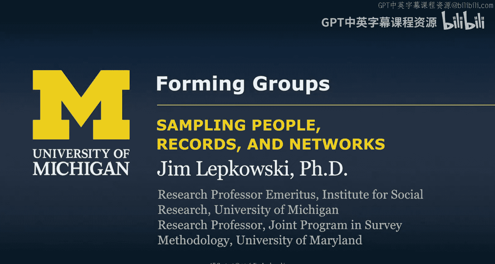
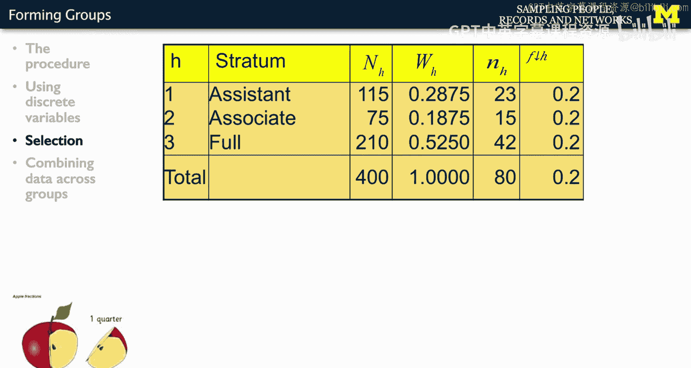
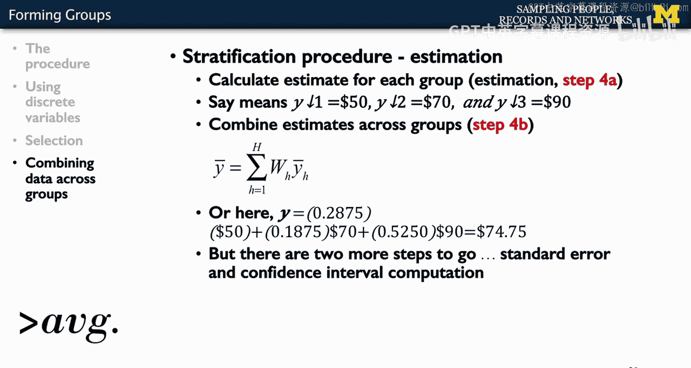

# 密歇根大学《调查数据收集和分析（2-6：方法、社调问卷设计、抽样、缺失数据、分析）｜Survey Data Collection and Analytics》 p106 27_4.1 分组方法.zh_en -BV1fw4m1e7Zh_p106-

Sampling people， records and networks in our discussion so far in the previous three units。

 we've been talking about increasingly sophisticated ways of selecting our samples。

And we're now starting the fourth unit， a unit on a topic that in the traditional treatment would be labeled stratification stratification of your sampling units。

As a process that can， for almost no investment of cost， some investment cost。

 but typically not a very large one。Give us more efficient samples。

 That is samples that have smaller standard errors that we can get。By just randomization alone。

 and certainly by randomization and strata and clustering， as we've talked about before。So welcome。

 welcome to unitt4 on Be more Eicient。The fourth of our six units。

 And here we're going to have a series of six lectures about the basic ideas of stratified sampling。

 Stratification is the idea。 Stratified sampling is the process。

And in our discussions we're going to talk about how to form groups， this is a grouping exercise。

 this is one where we form the groups ourselves。And the ways of forming the groups through an illustration。

 something about sampling variance， the precision of our estimates。

 having understood something about sampling variance than more on how we might do grouping to achieve greater gains and efficiency。

 gains in precision smaller sampling variances through alternative ways of forming groups。

Then how to allocate our sample across groups。Two lectures there。

 as well as then some issues concerning waiting with respect to stratification。In this lecture。

 the first of our six lectures on unit， we're going to talk about forming groups。

 and there are four basic things that we want to talk about here。 The procedure。

 the procedure of forming the groups。Using discrete variables。

 categorical variables would be a more common term today。

The selection that goes on and then how to combine things across groups to obtain estimates for the original population we started with。

For our purposes， let's go back to an illustration we've had before。

 where we have a list of individuals， a list of individuals in this case。

 persons who are members of the faculty of a university。

And we have in that list only a portion of which is shown here， the identification number。

 a sequence number for each element in the file， an ID number， in this case。

 an eight digit ID number， their division， their sex and their rank。That's what we know about them。

 And in our past sampling up activity， when we worked with this particular list frame。 Actually。

 we didn't use any of this background information。 All we did was use the labels。

 the the sequence number as a way to draw the sample here。

 what we're going to do is use deliberately and specifically the additional information that's available for every element in the frame。

We're not going to let it go to waste。 We'll call those additional variables， such as the division。

 the sex and the rank。 The auxiliary information that we're going to use to form groups that we will create before we make sample selection。

 But let me describe the process。 Then the stratification procedure will go through this in a series of steps。

 starts first with defining the population。 In this case， is the population of faculty。 Now。

 I've altered the list a little bit from what we looked at before。

 just to give us more round numbers， even numbers so that it makes things come out a little bit better。

 So I've actually added 30 elements to the list。 There's 400 faculty on our list now， rather than。

 I think before it was 370。But that's the population。 It's been redefined slightly。

 but it's the faculty at this university， and we have a frame， a list of the faculty members。

 We know that that frame may be deficient， It may be missing some faculty who have joined recently and not gotten into the list before it was produced for us。

 or there may be some faculty who are on the list who are no longer at the university。

 they've retired or they're deceased。So there are some flaws in the frame。But that is our our list。

 And on that list， we have auxiliary variables， things that we know about each element。

 each member of the of the frame before the sample is drawn。And in our case。

 we know a sequence number， an I D， rank， a sex and a division。 Now， this corresponds to our diagram。

 if you recall our scheme， our seven steps to understanding the statistical estimation process。

 The first two steps， defining the population and the frame。

 except what we're going to do is take that frame and is shown here。

 we're going to divide it into groups。 now not like we did with clusters where there were lots and lots of clusters。

 And then we sampled clusters to go into the sample。 here。

 what we're going to do is divide that frame， implicitly divideiding the population as well。

 but the frame into two groups， three groups or more。 and from each of the groups。

 we're going to draw a sample， all of the groups are going to be in our sample。

 Unlike with cluster sampling where only a subset of the groups are going to be in our sample。

So the population definition corresponds to step1， the frame to step two in our seven step sequence。

Well， then what are we going to do， We're going to divide the list into groups based on the auxiliary variables。

The division means that the variables that we're using for the subdivision。

 the auxiliary variables have to be discrete categories， or categorical， if you will。

 They must be known for every element on the list。 If there are some elements on the list for which we don't know the value of a particular auxiliary variable。

 we may need to assign them to a missing data category and count that as one of the categories。

 Everything has to be grouped， Everything has to be in a group and everything must be in only one group。

And then what we're going to do is count up the number of elements in each group。

 And we're going to call that capital N， because that refers back to the population。

 But capital N sub something， capital N subgroup and a fairly typical subscript for this kind of thing is the letter H。

 And I'll mention more about Y H a little bit later in the course。So here's our list。

 which has now been divided into three groups on the basis of rank。 The assistant。

 the associate and the full professors。 And we see in the last column of this table how many of each category there are。

 They sum to 400。 And this is our starting point。 If we want， we could form 3 separate files。

 rather than having it in one file， or we could keep them all in one file and only filter out the ones that we need for any given operation。

 But it's the same basic idea。There's another piece of information that we need for this。

 And that is， we not only need to know the number in each group。

 We also need to know the fraction of the population in each group。 do we need to know。 Well。

 maybe we don't need to know it， but it's a very useful part of the process utilized in a lot of the statistical notation that we're going to see。

 So we're going to follow that that particular approach is' actually not needed but it's one way of dealing with this。

 So we also need the fraction in each of the population that's each in each of the groups。

 So going back to our our list for our three strata assistant associate and full professors with the counts。

 the capital n sub H， there's also a capital W sub H。

 W sub H being the fraction in each of the groups。 So the assistant professors are almost 30% of the population of the frame 28。

75%。The associate professors are the smallest group，18。75%。

 and the full professors are the largest group， just slightly over half。That W sub H W for weight。

 we're actually going to use this as a waiting factor for combining things across groups when we're done。

 It's not the same thing as the weight that we're going to talk about at the very end of our six lectures here。

 as well as in unit 6。 It's a different kind of waitinging scheme。

 But this is a to combine the groups。 and we're going to combine them on the basis of their relative size。

 That is， we want to see in the end， anything we come out with。

 that a little over 50% of what we say about the population comes from the full professors。

A little under 20 per cent comes from the associate professors and so on。All right。

 So what we're going to do then now we form the groups。 We know how large they are。

 We have their relative sizes。 We're going to draw a sample from each group。

 looking all the way down to the third bullet from from the bottom。 drawaw a sample from each group。

 lowercase ends of H。 This is step 3 in our seven step process。

 And we're going to keep track in this particular case， not only of that sample size。

 but also the sampling rates。 These will be important for us for estimation as well。

Their sampling rates or their sampling fractions will use both terms interchangeably。

 The sampling rate， perhaps is a little bit more descriptive。 It's lowercase Ns of H。

 The number that are in the stratum that are in the sample divided by capital Ns of H。

 the number that are in the population or the frame that are in the stratum。

 and there will be three of those in our particular case， an F1 and F2 and an F3。

3 different sampling fractions，3 different sampling rates。 So in our particular case。

 I've allocated the sample of about 80， we're doing a 20% sample。 We're taking 80 from the 400。

1 in 5。And I've made the decision to allocate the sample the same way across each of the strata as it is for the total population or the total frame。

 In this case，20% cent of the first stratum is 23，23 of the 115 would be in the sample。

For the second stratum，15 of the 75， again，20% would be in the sample。 and for the third stratum。

42 or 20% of 210 would be in the sample。 So this is another part of the process。

 We have to decide how many in each of the strata and the sampling rates。

 help us keep track of what we're doing。 In this case， we see we've got very interesting。

Design， this would be an Epsom design。 If you recall that term equal probability of selection method。

 We have the same sampling rate in each of the strata。

 We're also going to refer to this when we talk about allocations as the proportionate allocation。

 We'll come back to that。 Let's not dwell on that right now。 But this is just the illustration。

What we're then going to do is take our sample。And sort of our step 4。 remember。

 our step 4 was one of estimation， but there are going to be two steps to the estimation process here。

 What we're going to do is calculate a mean for each of the groups。

 We draw our sample of 23 from the assistant professors。

 We obtain our data and perhaps what we're doing is measuring income。 We're asking them。

 what your total earnings from the university last year。 not at your family earnings。

 not the earnings from all sources， just how much did you earn from the university。

 because our record keepinging system may not show that exactly sometimes it comes from multiple sources。

 We just want to collect that information， And so here are the data for the three groups for assistant associate full professors。

 We see that the mean amount that they reported increases as the rank increases。

 and that's not unexpected， The associate full and professors have been there longer。

 They also have accumulated merit for their sake of their promotion promotion that merit。

It has led to increases in salary。And so we see differences across these groups。

 at least in the sample。Here's that data。 just to reinforce it。 Now， this is everything together。

 We keep squeezing things in from the right。 The number in the strata capital n sub H。

 the fraction in each of the strata capital W sub H。 The sample size in each of the strata。

 lowercase N sub H， the sampling fraction in each of the strata is 0。2。 And by the way。

 W sub H and F sub H。 We can see them both there。 They're not the same thing。 Are they。

 They're both fractions。 The first one is the fraction of the population。

 capital W sub H in each of the strata。 The second one F sub H is the fraction of the stratum that is in the sample。

And those are two different things we're going to have to keep track of。

 and it will be confusing at times as we work with this kind of a design。Okay。

 part B is then to take that result and combine them to get an estimate， let's say。

 in our case of a mean。 What we want to do is take the means for each of the groups and combine them。

 And we're going to combine them by the relative sizes of the groups， the capital W sub H。

 So we have a formula here in which we're saying， let's take the mean from group 150。

 multiply it by its fraction。2875， as I recall from that group。

 We're going to multiply those two together。 And then add to that the $70 for the second group times its fraction 0。

1875。 And then finally add to that。 Now accumulating sum。 The third mean。

 but multiply by its fraction 。525。😊，That will be our estimate of the mean。

 And what we're doing is taking the separate groups and。

Giving them a relative contribution to the overall estimate that is reflected in terms of the population distribution across the strata。

So in this particular case， if we do the calculation。

 we see that we end up with a mean of about 74000。 These are in thousands of dollars。 I'm sorry。

 I should have said that earlier。$74715 is our mean。

 which is very close to the actual population mean in this particular case。 So this is our average。

 This is our estimate。 It's obtained through this process。Now， of course。This is only step 4。

 We had steps 5， imagining the sampling distribution， Step 6。

 calculating a standard error from that sampling distribution and step 7， looking at a co interval。

 So we're not quite done with this process， even though we've pretty well filled out our table now and have in the very bottom right hand corner cell for the total the estimate of the population mean on the basis of our sample。

Now， this particular sample has a very nice property from the credibility point of view。

 This has more credibility than a simple random sample。

 From the point of view that we have controlled in our sample。

 The distribution across three important groups。 We know those groups differ in salary。

 We would have anticipated this from the beginning。

 But now what we've done is deliberately control it so that our sample looks like the population with respect to three important categories of our population where we think that that salary rate would vary。

 We're not allowing that to just fluctuate by chance in simple random sampling。

A simple random sample of size 80 could have been。Only assistant professors。

 It could have been only full professors， not only associate professors because theres fewer than 80 of them。

 but there are some peculiar distributions across these three groups that are possible in simpleanum Sa。

 not likely but possible that we have eliminated。We are only looking at sample designs that the sample follows the population distribution。

 This is what some people would think of。 we've used the term representative sampling before。

 This is probably as close to representative sampling as we're going to get with the techniques we're using。

 but we're not calling it that。 We're calling it stratified random sampling with proportionate allocation。

 And now you see what that proportion allocation means the sample distribution looks like the population distribution because we're using the same sampling rates across the groups。

Okay， so let's turn to those last two steps， two more steps to go。

 the standard error and the comp interval in terms of computation。

 but now we're poised to imagine all possible stratified random samples that have exactly the same characteristics as those that we just saw。

 imagine all possible samples that had three groups and from those three groups we drew exactly the same sample sizes that we were talking about in the previous displays。

What then happens to our sampling variance in something like this。

 And let's turn to that discussion in our next lecture as we look at sampling variance in the context of being more efficient and stratified sampling。

 Thank you。