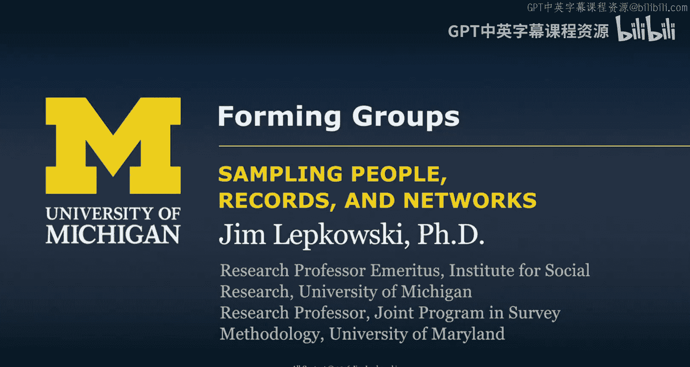
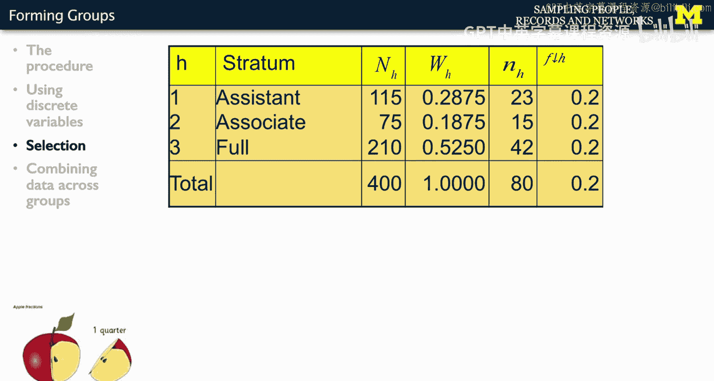
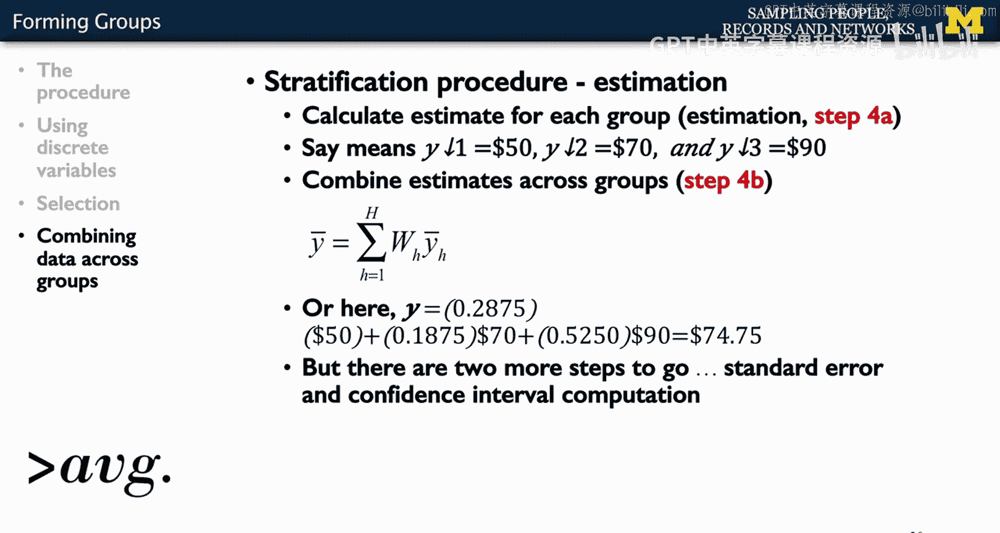

# 调查数据收集与分析：4.1：分组方法 📊

在本节课中，我们将学习分层抽样的核心概念——如何将总体划分为不同的组（即“层”），并从中抽取样本。这种方法能让我们以更低的成本获得更精确的估计结果。

---

## 概述与背景

在前三个单元中，我们讨论了选择样本的各种方法。现在，我们进入第四单元，这个单元的主题在传统上被称为“分层”。分层是一种抽样过程，它通常不需要投入很高的成本，就能让我们获得更高效的样本，即具有更小标准误的样本。

欢迎来到第四单元“提高效率”。我们将通过六讲内容来学习分层抽样的基本思想。分层是核心理念，而分层抽样是具体过程。

在讨论中，我们将涵盖如何形成分组、通过示例了解分组方式、抽样方差与估计精度、如何通过不同的分组方式获得更高的效率增益、如何在各组间分配样本，以及与分层相关的加权问题。

本节是第一讲，我们将重点讨论**如何形成分组**。这里有四个基本要点需要了解：分组的过程、使用离散（分类）变量、如何进行选择，以及如何跨组合并数据以获得对原始总体的估计。

---

## 分组过程详解

为了说明，让我们回顾之前的一个例子。我们有一个大学教职员工的名单。名单中包含了每个元素的识别号、序列号、八位数的ID、所属院系、性别和职称。在之前的抽样活动中，我们只使用了序列号标签来抽取样本。现在，我们将有意地利用名单中每个元素都具备的额外信息（辅助变量），例如院系、性别和职称，来在抽样前创建分组。

以下是分层过程的具体步骤：

### 第一步：定义总体与抽样框

首先，我们需要定义总体。在本例中，总体是大学的所有教职员工。我们有一个包含400名教职员工的名单作为抽样框。这个框可能存在缺陷，例如可能遗漏了新入职的员工，或者包含了已离职的员工。但这就是我们工作的起点。

在抽样框中，我们拥有每个元素的辅助变量信息：序列号、ID、职称、性别和院系。这对应着我们理解统计估计过程的七步法中的前两步。

### 第二步：基于辅助变量划分分组

接下来，我们将根据辅助变量将抽样框（从而也隐含地将总体）划分为多个组。这与整群抽样不同，在整群抽样中，我们只抽取部分群组进入样本。而在分层抽样中，**所有组（层）都将被抽样**。

用于划分的辅助变量必须是离散的或分类的，并且必须为名单上的每个元素所知。如果某些元素的某个辅助变量值未知，我们可能需要将其归入一个“缺失数据”类别。每个元素都必须且只能被分到一个组中。

然后，我们计算每个组中的元素数量，记为 **N_h**（h代表组别）。同时，我们还需要知道每个组在总体中的比例，记为 **W_h**。这个 **W_h** 将作为权重，用于在最终估计时合并各层的结果。

例如，如果我们根据“职称”将教职员工分为助理教授、副教授和正教授三层，我们就能得到每层的人数 **N_h** 和占比 **W_h**。

### 第三步：从每组中抽取样本

现在，我们从每个组（层）中独立抽取一个样本，样本量记为 **n_h**。这是七步法中的第三步。

我们还需要记录每个层的抽样率或抽样分数 **f_h**，其计算公式为：
**f_h = n_h / N_h**

在我们的例子中，假设总体样本量为80（即20%的抽样率），并且我们决定按各层在总体中的比例来分配样本量。这意味着每个层的抽样率 **f_h** 都是0.2。这种设计被称为**等概率抽样法**，在分层抽样中也称为**比例分配**。

### 第四步：计算组内均值与合并估计

抽取样本并收集数据（例如，询问他们的年薪）后，我们进入估计阶段。这里分为两个子步骤：

1.  **计算各层的样本均值**：分别计算助理教授、副教授、正教授三个层的平均年薪。
2.  **合并各层估计以获得总体估计**：使用各层在总体中的权重 **W_h** 来合并层均值，从而估计总体均值。公式如下：

**总体均值估计 = Σ (W_h * 第h层的样本均值)**

通过这种加权方式，最终总体估计值中，各层的贡献度与其在总体中的规模成正比。

---

## 分层抽样的优势

这种抽样方法有一个显著的优点：它提高了估计的**可信度**。通过分层，我们控制了样本在重要分组（如职称）上的分布，使其与总体分布一致。我们知道不同职称的薪水可能存在差异，分层确保了我们的样本在这个维度上“代表”了总体。

在简单随机抽样中，有可能（尽管概率很小）抽到一个极端不平衡的样本（例如，几乎全是助理教授）。分层随机抽样（特别是比例分配）消除了这种可能性，使样本分布与总体分布相似，从而通常能获得更精确、更稳定的估计结果。

---

## 总结与下节预告

本节课中，我们一起学习了分层抽样的第一步——**如何形成分组**。我们了解了分层的完整过程：从定义总体和抽样框开始，利用已知的辅助变量将总体划分为互斥且完备的层，记录各层的规模与权重，然后从每个层中独立抽取样本。

我们看到了如何通过加权平均的方式，将各层的估计值合并，从而得到对总体参数的估计。这种比例分配的分层设计，使样本结构能够反映总体结构，提高了估计效率。

当然，我们只完成了七步估计过程中的前四步。接下来，我们需要想象所有可能的分层样本构成的抽样分布（第五步），并在此基础上计算标准误（第六步）和置信区间（第七步）。**在下一讲中，我们将探讨分层抽样背景下的抽样方差，进一步理解其如何帮助我们“变得更高效”**。