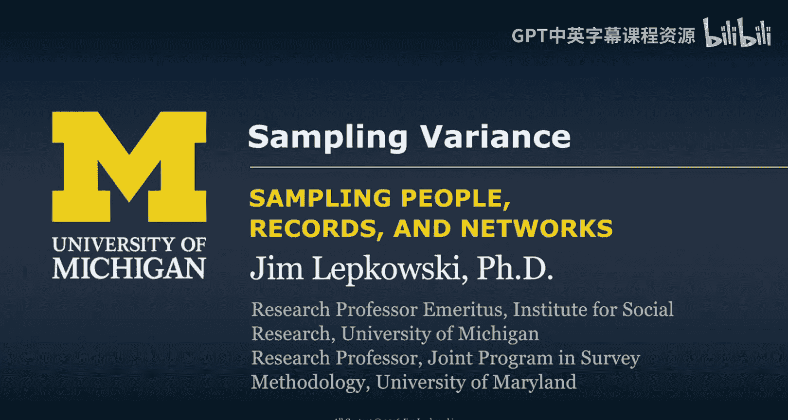
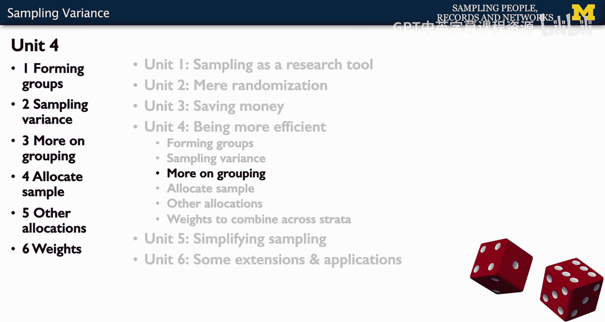

# 密歇根大学《调查数据收集和分析（2-6：方法、社调问卷设计、抽样、缺失数据、分析）｜Survey Data Collection and Analytics》 p107 28_4.2 抽样方差.zh_en -BV1fw4m1e7Zh_p107-

Sttraatified sampling。 We've seen how it can be put together the nature of stratified sampling in terms of the selection process。

 the allocation process。And here， what we're going to do is continue in unit 4 on being more efficient。

 talking about stratified sampling and going past forming groups now to talk about sampling variance。

 This is the second lecture for unit 4。 And we're going to look at what happens to sampling variances for stratified random samples。

 Now， as you can imagine what's going to happen is that as we stratify the sampling distribution will change。

 just like we had for cluster sampling， the sampling distribution changed。

 And we need to look and see whether or not that sampling distribution is more variable or less variable than what we were getting under simple random sampling。

 our base comparison。 that's what we used for comparisons for the denominator of design effects for cluster sampling。

So our premise here is that we've now taken our population， divided it and identified a frame。

 In this case，400 faculty。 if we continue that example， divided it into groups， In our case。

 three groups， I'm just showing two here。 And we drew a separate sample from each。

 And from each of those samples。 Then what we did was compute an estimate。

 We computed estimates for each group。 And then we combined across the two groups in this case。

 But in our particular illustration， three groups。Now。

 what happens to the sampling variance of the mean that we've computed by this process。

 And in theory， what you would expect is something very similar to what happened for the estimation of the means。

 We're going to go and compute a sampling variance within each of the groups within each of the strata and then combine them。

And so here we see that sampling variance。 Remember the general definition of sampling variance and do the algebra to derive the sampling variance of the mean in terms that we can use。

 and it will come out to be this。 It will come out to involve separate sampling variances within each group summed up across the strata。

 Oh but weighted。 But in this case， the weighting is not by W sub H。

 Remember that fraction of the population that's in each of the strata。

 But by the square of the W sub H。 Why the square。It's the square because we're dealing with variances。

 We're on the squared dimension。And we're going to have to take square roots to get standard errors。

 but we're dealing with variances。 everything gets squared here， including that weight factor。Now。

 that means that when we compute our estimate of this kind of thing。

 what we're going to do is compute estimated sampling variances within each of the strata。

 we're not no longer going to have capital VR of y bar sub H， but lowercase VR of Y bar sub H。

 ones above the other。 They're both multiplied by W sub H squared， but in one case。

 we get the estimated sampling variance in the second case because we've got data that we've had in the sample that we use to compute that sampling variance。

 we combine it to get the overall estimated sampling variance。

And what is this sampling variance within the straight of what are those sampling variances。

 it depends on how we drew the sample in our case。I didn't say。

 but let's assume that when I went to select that sample of 23 assistant professors。

 if you remember from our allocation discussed in lecture 1。

 when I've got that allocation from each of the strata。

 I'm going to treat that as a simple random sample。

 I'm going to do simple random sample of size 23 from Stratum 1 and and so on for each of the on the strata。

 That means that within each of the strata， we would compute sampling variances just like we did for simple random sampling。

 we need an indexing to keep track of it。 And so you'll see here in our last line。

 The variance of the mean for each of our strata， the variance of y bar sub Hs is one minus F sub H。

 just in case there's a different sampling rate in each of the strata divided by n sub H。

 the sample size 23 from statum 1 and so on。 times S sub H squared。

 We need to know the element variance within each of the strata。

 we need to take the 23 elements among。sample cases and compute the variability of the salaries for those 23 individuals doing exactly the same kind of element variance we did before。

 each value， y sub H minus the mean y bar sub H in the strata， but just we're doing three。

Sampling variance calculations， one for each of the strata。

 each of them based on a different element variance。

We thus need the within stratum variances in order to pull this off in order to be able to do this。

 So let's assume that we've done simple random sampling within each of the strata。

And we go back to our display， and we've done that calculation。

 We've taken the 23 sample cases for the assistant professors， and we've computed an S of8 squared。

1 hundred and 25。 We did the same thing for the 15 sample associate professors，250。

And for the full professors， the 42 in the sample， their average square deviations by that formula。

 the S of H squared is 500。 Notice that it increases as the salary level increases。 The Y R of H。

 So do those variances。 And there is oftentimes a relationship between the sampling variance and the mean。

 Actually， it's better to do the sampling standard deviation。

 the square root of those variances and the means there is a relationship that does show up in the real world in that particular case。

 So this is not an unusual case。So here， what we need to do is combine everything。

 and it's a little bit beyond the scope of what we're doing。 But I'm going to go through this anyway。

 We need to know a w sub H squared。 Well， we know the w sub H， the W sub H is 。2875 or the 01875。

 whatever it happens to be We also need to know the sampling fractions。

 Oh 1 minus the sampling fractions in each of the strata。 that's 081 minus0。2 in each of them。

 We going need the s sub h squares。 and we need the sample sizes。 So if we put all this together。

 I know this is kind of busy。 But I think you know what the elements are now， that the logic。

 what I'm really concerned with is that you understand the logic of this kind of thing that it flows from how the sample was selected for statum 1 the variance are estimated sampling variance of the mean now。

 which turns out in the end to be 3。453， has three components。

1 from each of the strata or for each stta， there is a w sub H。Squared a1 minus f sub H。

 an S sub H squared and a sample size。In the denominator。 And there。

 you've got the expressions for each of them all added together。

 all combined to give us the overall sampling variance，3。453。 Oh。

 we'll take the square root of that to get a standard air。 That standard air。

 we're going to use the coughf interval。 Let's recognize it。 Well we've just done our sort of step 6。

A and B， A was to compute the element variances within each of the strata。

 and B was to combine them with the Ws of H squared factor， adding them up across the strata。

All right， there's one more step to this。 right， There's a seventh step about the cons interval。

 This is our way of expressing our uncertainty about estimates。

 taking into account both the mean and that standard error and the distributional properties of that mean。

 In this case， that mean is going to be normally distributed。

 And we're going to use that in forming a conass interval。So here our last step 7， the cof interval。

 we're going to do by the same process we did before。

 We're going to use the mean plus or minus of margin of error。

 but that margin of error is driven by two factors， as you recall， the t value。

 We're going to use the t value here。 where we're going to count up the number of random events and subtract one。

 Well， in this case， we're going to subtract one in each of the strata。

 and then get that t value and use it times the standard error to form that margin of error before forming the coughf interval。

 Now， degrees of freedom。 How many random events are there in our sample。 There are 80。

 But there are 23 in stratum 1。 and in that particular stratum， we also computed a mean。

 and that mean alters the randomization that's going on there in terms of how many degrees of freedom we have。

 how many random events we have。 So we actually have n sub H 23-1 degrees of freedom from stratum 1。

N sub 2-1。 Let's see。 that was 15-1 or 14 from stratum 2。 and n subub 3。 That was our 42。

 and that was 42-1 or 41 degrees of freedom。 Overall， adding those up。

 We have n H N for 80 H3 or 77 degrees of freedom。 So we will look up the T value。

 which we've done here， which happens to be 1。991。 Not 1。96。 That's why we're using the T。

 It's a little bit larger because we've got some uncertainty about the quality of each of the S of H squared。

 What we're doing is counting up the stability factors for each of the S of H squared and adding them together and using that to pick out the T value。

😊，So the 95% comp interval takes that T value。Times the standard error and adds and subtracts it to the meat。

 And you can see the final result。 Our 95 per cent cop interval goes from 71。05 to 78。45。All right。

 Well， that's it。 Oh， no， not quite because we're wondering， as in cluster sampling。

 how does this relate to simple random sampling， So let's wrap it up here by talking about design effects and effective sample size。

 When we're talking about sampling variances， What is the variance。

 What is that variance that we got， that 3。458， whatever it was。

 And how does it relate to what we would have had for a simple random sample of the same size。 I。e。

 What's the design effect or depth。For a simple random sample。

 then the denominator is what we're lacking right now。

 We're going to take that same data and treat it as though it's a simple random sample。 It's not。

 It's 80 cases drawn from a stratified random sample。

 We're going to treat it incorrectly to calculate an estimate of the variance of the mean。

 And from a separate calculation， we have to calculate S squared。 We know F。

 we know the sampling fraction。 but we don't know the S squared。

 So we're going to take the 80 values and compute an S squared。 And here you see its 647。8。

And so now what we've got for a sample of size 80 from a population of 400。

 That's a sampling fraction of 0。2。 Our sampling variance of the mean under simple end of sampling is 6。

478。That's what we're going to then compare。 Oh， it's going to end up being in the denominator of our comparison where we're taking the actual sampling variance 3。

453。 I'm sorry， I misspoke that before， divided by 6。478。 Now。

 this is the opposite of cluster sampling。 We now have a design effect。

 less than one here with proportionate allocation and the particular circumstances we have in terms of the differences of the means across the groups。

 We have a reduction in variance by the simple expedient of using auxiliary information in our sample design。

And in a matter of fact， iss a pretty big one。 It's a 47% reduction in sampling variance。

Let's think about that in terms of that 47 per cent reduction and what it implies for our effective sample size。

 as we did for cluster samples。 Re there， what we did was we took the actual sample size and divided by the design effect。

 So here we're taking the 80 and dividing by 053。And we end up seeing that we've got effectively 150 cases in our sample。

We have actually 80， but effectively because of the efficiency gains we've obtained through stratified random sampling。

 proportionally allocated。 we actually have gotten。A larger sample effectively。

 we've got an additional 70 cases。 We have a 47% reduction in variance。

 but in terms of effective sample size， we've got a 70 case improvement。

 nearly doubling our overall sample size。Alternatively。

 that standard error is what we're really dealing with。 The standard errors are smaller。

 We don't get as much gain for the standard error as we did for the variance。

 Our standard errors are a 27 per cent gain， as shown here。So this is a big payoff to us。

 this is for us a clear evidence of what we should do when we do our sample selection is stratify。

Always stratify。 I'm going to say that。 It's a strong way to say it。

 But that's why I don't do stratified of simple random samples in practice。

 Stratification is straightforward and easy to do。 I'm always going to think about it and think about how to apply it so that I gain can afford avail myself of potential gains and precision。

Weca our distribution that shows the relationship between sample size as it increases on the horizontal axis and vertically the standard error。

 And we saw that for simple random sampling， that curve was declining。 not not linear。

 but a curveline relationship。 and we got gains in precision as we increase sample size for simple random sampling。

 And now what we've seen is that I put stratification on there。 It's a big arrow。

 It moves that whole distribution down。 If we do the right allocation。 not all stratified samples。

 as we'll see， Give us gains and precision， but it moves that distribution down。

We already know that clustering moved it up。Cluing moved it up。

 So we've got these two counteracting forces， if we will。 If we're going to do cluster sampling。

 we'd better stratify the clusters， not just the elements， but the clusters as well。

 And so we get gains in precision from stratification。 potentially。

 losses and precision almost uniformly from cluster sampling。 And then finally。

 we will talk about weight。 Here， we've got a。😊，No waiting， really。

 we've got the same weighting effect in each of the strata and waiting will， as we'll see later on。

 especially in unit 6， increase our variances unless it's directly tied to the phenomena that we're studying。

Okay。Sampling variance for stratified sampling。 Having understood what happens now with sampling variance。

 confidences intervals， all the rest of a design effects。

 let's go back and reconsider grouping and add a couple of factors before extending our our development of stratified random sampling。

 We'll do that in lecture 3 in this unit。 Thank you。

