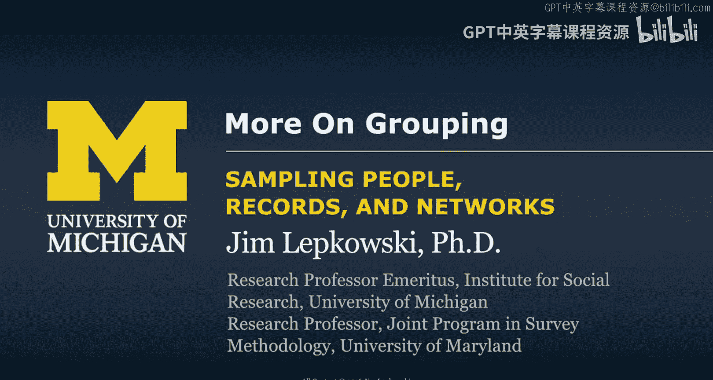
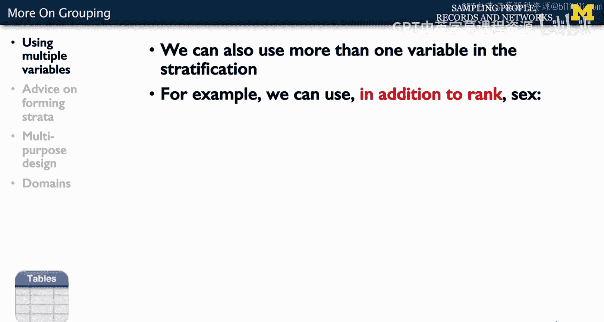
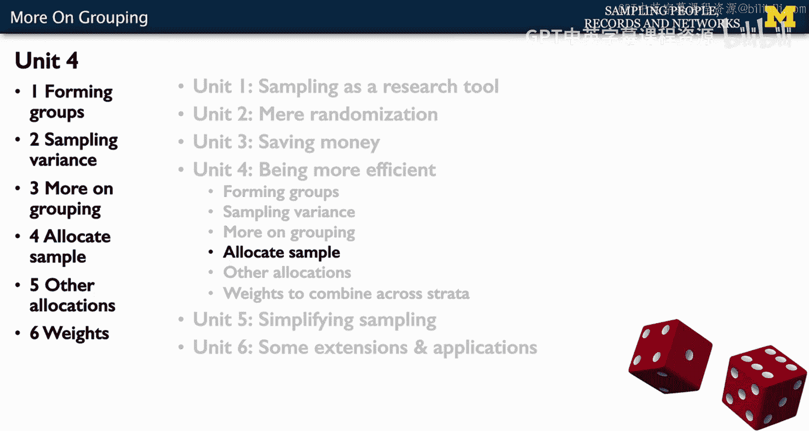

# 密歇根大学《调查数据收集和分析（2-6：方法、社调问卷设计、抽样、缺失数据、分析）｜Survey Data Collection and Analytics》 p108 29_4.3 分组策略进阶.zh_en -BV1fw4m1e7Zh_p108-

Welcome again to our unit on stratoifiedide sampling。

Being more efficient in our sample selection as we continue to talk about sampling people。

 records and networks。 And in our first two lectures。

 we're now in our third lecture on grouping a little more on grouping。

 we talked about forming groups in lecture 1。 But now we're talking about some additional features of grouping that we ought to be thinking about now that we've looked at sampling variance a little bit。

 We're going to， in this particular case， talk about four things。

 We're going to talk about how to use multiple variables in the grouping process。

 That's certainly possible and advisable。 Give a little more advice on on forming the st how how we should pick out variables to use as stratifiers。

A side note on multippose design in the middle of which we're also going to talk something about domains and have one particular application。

 So there's some terminology that I've just introduced there that we will talk about as we move into those latter two sections。

So first of all， it is possible to use more than one variable in the stratification。

 We had more than one。 We had rank。 We also have sex and division。

 We can use those in our stratification， much much in the way we would form a table， a cross tab。

 a cross tabulation of rank by sex in order to form our groups。

 So instead of having three groups based on rank only we can have six groups in which we have first。

 all of the female faculty， assistant， associate and full。 And then all of the male faculty， As。

 associate and full or however we want to mix them。 But those six groups as our strata。

Now we can see here we just gone ahead and done the allocation and we show the capital length of H for each。

 the number in each of the groups。Summing to our frame size。

 population size of 400 and the ws sub H for each of these as well。Now， why would we introduce this。

 Well， because we saw that one of the things we were getting was sampling variances where we were computing variances within each group and then combining them。

What we want to do then is to find ways that when we form the groups。

 we decrease the variance as much as possible。 We want to make the internal characteristic of the group as homogeneous as possible。

 That way， though sampling variances within a group are smaller。 and when we combine them。

 we get even more gains in precision。Now， if we're。

 so I'm talking here about the same thing we did for cluster sampling， homogeneity within the groups。

 homogeneity within the groups。Creates heterogeneity between the groups。

 So if what I can do by adding another variable is get even more variation in the mean salary across the groups。

I'm going to get my get greater homogeneity within the groups。

 and I'm going to get smaller sampling variance， Sam sample size。

 smaller sampling variance by allocating across more groups。 and smaller design effects。

 even more gains and precision。 we won't go through and do that calculation here。

 But you can imagine what it is。 This is a bit like in linear regression in which we have regressing an outcome variable on multiple predictors。

 Why do we have multiple predictors。 because each of them contributes to explaining variation in the outcome variable。

 That's what we're doing here。 The outcome variable is income。 That's what we're sampling。

 And each of these factors are like predictors in the model。

 And each explain more and more that variation， and we keep adding them in。

 So more variables is better。 More variables is better than more categories。

 But that's a little beyond the scope of what we're able to do。😊。

We also need to then do the sample size or the allocation across each of the groups。 The same thing。

 we won't use the same allocation。 We're now going to use an allocation that is based on the proportionate distribution we see here。

 And if anything， it will mimic what we did before。 it will sum to what we did before。

 But now we're going to have more groups。 Let's suppose that， again。

 we're continuing to do a sample of 20% of the elements，80 of the 400。

 And we allocate the sample of 80 across the groups is shown here in the last column。That allocation。

 if you go through， is 20 per cent in each case。 And so if you look at stratum 1 female assistant professors。

 and there are 40 of them，1 fifth of them，20 per cent is 8。 When we do female associate professors。

25 of them，1 fifth of them is 5 and so on。 So we're doing the same thing。

 that proportionate allocation just now with more groups。But in general， then。

 how should we form the strata， what we're doing is the best advice we can come up with is to say。

 look for things that make the groups internally homogeneous。Let me turn that the other way。

Let's try and make them as different as possible as we go across the groups。

 have big differences between the means of the strata。

 Sometimes that's an easier way to think about it。 Will there be bigger differences between males and females than if we don't use them。

 Yes， we know the salaries for females are lower than they are for males。 whatever the reasons。

In this case， there's actually some structural element because female faculty。

 there's a large share of them who are in certain areas such as nursing。

 where they're disproportionately represented there and the salaries are lower there。

 So there's some structural elements as well as some other kinds of things going on possibly with respect to discrimination。

 But regardless， our aim is to capitalize on that underlying social structural phenomena as much as possible and look for things that are going to give us groups that have big as big a difference between the groups as possible。

But that's essentially what we're doing in linear regression， as I mentioned before。

Another way to say this is that we're seeking to explain as much of the variance in the outcome variable or variables as possible。

 Now， here we've got one outcome that we are looking at income， but we may have more to consider。

 So what we're doing is adding to the auxiliary variables set and the number of strata by using more and more auxiliary variables in cross classifications。

By the way， that cross classification doesn't have to be done uniformly。

 We could collapse some of the groups if they're really small。And not have symmetry。

 So suppose that in our allocation， one of those groups。

 the female associate professors was so small that we couldn't really sustain a sample with it。

 We might very well collapse associate and full professors together for females so that we have five groups in the end。

3 for the male professors， but two for the female It's not to say that females don't deserve as many straight as the male。

 It has to do with the sizes of the groups。 And that's going to be determined by population distribution across those auxiliary variables we're using for stratification。

Now， just as an aside， this business about these auxiliary variables， where are we going to get them。

 where we're going to get the background information we need to form these。

 A lot of this could come from census or administrator reports or other surveys。

 Our understanding our knowledge about how those auxiliary variables relate to the outcome variables。

 which we don't have may come from other sources， It may come from other surveys。

 where we've got a good understanding about how salary relates to rank and to sex and to their division。

 which determines the differences between people who are in engineering and those who are in nursing。

And so in those particular cases， we're going to use that kind of information。

Our substantive understanding about what's going on in order to choose among those variables。

 we may also have past surveys in which we can calculate what。Differences there are。

 what per of the variance is being explained by different factors。

  different auxiliary variables in order to decide which of them are the most important。

 Explain most of the variances and the ones that we want to use in our stratification。

So shown in the lower left， it's this idea of this stratification。

 these differences between the group， homogeneous within differences between。

 we want to capitalize on these auxiliary variables to create that kind of stratification that is as stark and sharp a contrast as possible。

But there there's a corresponding part of this。 And that has to do with multipurpose surveys。

 And that is， I'm talking about multiple x variables in a regression model。

 multiple right hand side variables， Multi auxiliary variables informing the strata。

 But we also have to realize that in these surveys， we don't just measure one thing。

 Very few of the surveys that are being done， whether it's in government context or in private industry or in academic settings。

 very few of them deal with just one variable as an outcome。

 They have many kinds of things that they measure。 So， for example。

 we might have been doing this particular survey among faculty and records。

 but we might be doing a much larger household survey， households being collections of people。

 in a country。 and I've picked on a country in in the Persian Gulf。

 Some of you may need to look this up cutter。And in this particular country。

 maybe we're doing a national survey looking at such things as assets， building ownership。

 use of expatriate labor， expenditures on various kinds of food and housing and so on income health health care use。

 psychological wellbeing， social integration， a host of factors。

 some of which we're doing because this is our one chance to do it。

 let's get the data and do a multi-purpose survey， we're going to do health， but by the way。

 we better bring in the income items as well we're going to do social and psychological well-being because we think they're related to health and so we're going to include those as part of our survey。

 and so we have many variables in that same survey。The stratification then becomes more complicated。

 but it turns out that that scheme we just looked at。

 that proportionately allocated stratified sampling scheme。

Gives us gains in precision for almost all the variables in a multippose survey。

 It turns out to be a very good way to approach the stratification， not the only way。

 but it is a good starting strategy for thinking about these kinds of things as we go along。

There's another aspect to this。 if we're talking about dividing these up into groups。

 maybe I also want estimates for each of the groups。

 somepopulations for which separate estimates are required。

 Maybe we want a separate estimate for each of the ranks。

That means that we're going to have to have adequate sample sizes in each of them to make this work。

More often， this comes up in the context of geographic subdivisions。

 and I picked one that I'm particularly fond of， The University of Michigan where I work I live in the state of Michigan is very near the country of Canada。

 As matter of fact， is just 60 kilometersm down the road。 It's east of us。

 We're actually a little bit north of the southernmost portion of Canada here。

 Canada is divided into 10 provinces。 And this is important because what provinces represent are not just political divisions。

 They also represent important divisions within their governmental system。😊。

And they have a survey that they estimate unemployment for the entire country。 The unemployment rate。

 This is something that many countries do as a measure of the well being of their population。

 They measured on a regular basis， every month。And in their particular survey。

 they're making that measurement of well being based on a sample of， let's say 30。

000 households with probably75，000 people who are interviewed in those households in which they ask about unemployment。

And so that's the overall goal of the survey， we're going to divide our sample up into provinces because we think the unemployment rates differ across the provinces。

 matter of fact， they know that they do much higher unemployment in what they're called the maritime provinces on the Atlantic Coast where they have traditionally relied on fishing and other kinds of industries that are less stable in terms of their the economy and so unemployment rates tend to be higher as opposed to some of the more centrally located provinces that are more dependent on manufacturing and other kinds of areas and economic development areas。

And so what they do in their sample is if they distributed the sample proportionate like we've talked about。

 they would have actually very small sample sizes in the maritime provinces。

 which are geographically small and have small populations。 Their w some Hs are quite small。

That means that they wouldn't have large enough samples in the maritime provinces to produce separate estimates for each of the provinces。

 A domain estimate。 And so what they actually do is allocate the sample。Equally across the provinces。

 there are 10 provinces。 Every province gets the same sample size。

 Every province gets 3000 households。 Even the smallest gets 3000 households so that they get equally precise estimates。

 And if you focus on domains of study， this is a feature of stratification that we have to keep in mind。

😊，We can also do this for sociodemographic characteristics， age groups， occupation， income education。

 but most often we see this kind of thing with respect to geographic subdivisions。Sttraify by those。

 because we want separate estimates by them。 But then it begs the question。

 how large is the sample going to be in each of them。

 If we do it proportionately and if we don't do it proportionly， how far can we push it。

 Let's come back to that。 We talk a little more about allocations， in the end。Okay。

So when we have multiple potential stratifying variables just to wrap up here。

 come back to our issues about stratification。 How do we decide which one to choose。

 We're going to find the one that has the most variation in group size that explains the most variation in the outcome。

 it has the most variation in the means across the groups。

 but also explains the most variance across those groups。

The second consideration is how large should the strata sizes be。

 and that's going to have an impact on what we're doing as well。

And then if we're able to use only one or a subset of those。

 we're going to have the ones that have the bigger differences in income。

 are there such bigger differences in what we're doing？

So those are the kinds of considerations that we're putting into thinking about grouping now。

 or're being more and more sophisticated now that we understand more and more about how stratification works and what we can actually do for us。

We need to talk about that allocation problem， I want to come back to that example concerning Canada and talk a little more about that allocation for domain estimation purposes。

Before we go on and talk about a few other topics in stratified sampling。

 so that concludes our lecture three on grouping more about grouping。

 we're understanding more and more about how these groups ought to be formed as we understand more and more about stratification。

But we need to talk about as well， the allocation problem。 And that will be the next two lectures。

 The next lecture lecturec 4 will be on basics of allocation and then lecture 5 on more sophisticated kinds of allocation。

 And it's that combination of allocation and grouping that will teach us the most about how to use stratified sampling the most effectively in being more efficient。

 Please join me then for lecture 4 next。 Thank you。

