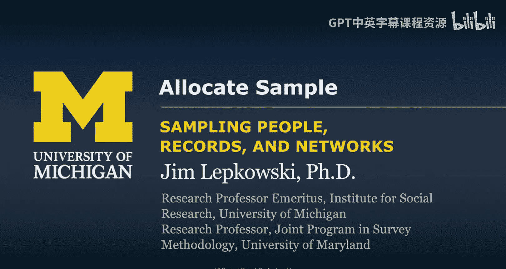
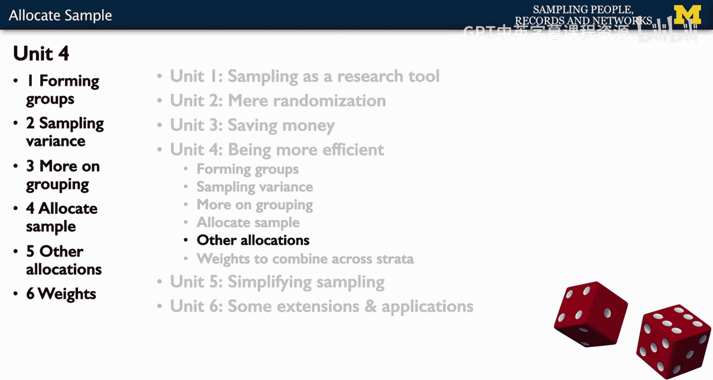

# 密歇根大学《调查数据收集和分析（2-6：方法、社调问卷设计、抽样、缺失数据、分析）｜Survey Data Collection and Analytics》 p109 30_4.4 样本量分配.zh_en -BV1fw4m1e7Zh_p109-

Welcome once again to our continuing series of lectures about stratified sampling as we're talking about sampling people。

 records and networks， our fourth lecture in this series。

 we're going to talk about sample allocation。 Actually。

 we're going to talk about sample allocation in this lecture and the next one。

 We're going to do one particular allocation， actually， the one we've already looked at。

 proportion allocation to understand some of its properties。

 and then we will alter it in the next lecture。With respect to proportion allocation。

 we're just going to talk about allocations in general then and the proportion of allocation before we wrap this particular lecture up。

Now， the stratified sampling approach has， as we've seen some advantages。

 I mentioned one about credibility。 it just makes more sense。

 it's more believable to people to say that when I drew my sample。

 I made sure that I had the right distribution across the frame。

 the population that it got replicated in the sample as well。 that's more acceptable， more credible。

 but we've also seen how that we can get gains in precision。

 depending on the allocation though and that's part of what we're doing in these two lectures on allocations。

There's also advantages here， we've talked about guaranteed representation of important domains。

 and there are some things about flexibility that we'll see here in allocations and administrative convenience that we can take advantage of。

But these， in order to understand these potential benefits of stratified sampling。

 depend on understanding something about the allocation as well。

We've been looking at a problem in which we have a basic sample size in our illustration with 400 faculty。

 we were drawing a sample of 80， and we chose a particular allocation。

 but many allocations are possible， many different sampling fractions。

 Fs of H are possible across those strata。So， for example。

 for our6 straightta as shown in the last line on this display。

 the allocations could have been take one from Stratum 1，1 from Stratum 2，1 from Stratum 3。

1 from Stratum 4，1 from Stratum 5 and 75， the balance from Stratum 6。

Or we could have taken two from Stratum 1， and one from each of the strata 2，3，4， and 5。

 and then the remaining 74 from Stratum 6。 and so on。 We can heap。

 There's lots and lots of possible allocations there。

It turns out that some of these allocations can be beneficial。

 and some can be harmful to our overall estimates。 Some can be beneficial when we want to do domain estimation。

 Some can be beneficial when we want to combine across estimates these estimates。

And the allocation that we did was related to the drawing in the lower left。

 This is sort of a population sized distribution of the states in the United States。

 California is a large share of the US population，10% among the 50 states。

 and Florida and New York are fairly large as is Texas in terms of their relative population sizes and others are very tiny。

 and they become very small on that map。As that population size varies， which it will。

 And it's outside of our control。's， it's something that's going to be there with respect to the auxiliary data that we have available。

 We can take advantage of that in order to get gains in precision。

 One way to do that that we've already seen was to use the allocation that we already did。

 The one that was the proportionate distribution。This particular distribution。

 we had a reason for using。 And that was because we actually got a gain in precision。

 taking the same percent or fraction of the elements in each of the six strata。

And we have a nice property to it too， that distribution， 8，5，4， 15， 10。

 38 across the6 strata also happens is achieved by taking the same sampling fraction in each of the strata。

Well， that seems straightforward。 It has nice properties with respect to the sample design。

 You're making the sample designers very happy。 But does that have any other payoff for us。 Well。

 actually， we saw that this kind of thing has a benefit that goes beyond it。 It gives us a balance。

 then between the sample and the stratum。 That is when we draw the sample in such a way that we have the same sampling fraction。

 Lowercase Fs sub H。 Lowcase ns of H over capital n of H is the same as lowercase F。

 the overall rate， lowercase n over capital n。 that's the technical detail of this。

 When that kind of thing happens。 there's something else that happens that goes with this。

 It generates a distribution in the sample that is across the strata。

 the same as the distribution in the population or the frame。😊，For example。

 for our stratum 1 where in the population， there were 40 of the 400 or of a w sub H of。1。

10% of the population resides or is in that particular stratum when we sampled at the same rate in stratum 1 as we did overall。

80 from 400 is overall，220% when we applied that rate， a 。2。

 we got 10% of our sample 8 from that particular stratum。Now。

 the sample distribution looks like the population distribution。 So by being epsom equal chance。

 we happen to also be proportionate。 And this is where that term comes from。 Now。

 I know this is confusing。 I want to come back to the use of proportionate in cluster sampling in just a second。

 But here， what we're talking about is the proportions we see in the population are replicated。

In terms of the proportions we see in the sample across the strata， proportionionately allocated。

 Now， we use this term before with cluster sampling， when we had unequal sized clusters。

 and there we were sampling the。The clusters with probabilities that were proportionate to their size。

 same idea， but applied in a different way。 So this term proportionate comes up in several different ways in the sampling context。

 and it's a broad label of things for our purposes。

 when you hear proportionately allocated stratified sampling。

 It's the kind we've just been doing the same sampling rates in each of the strata。

 The sample distribution looks like the population distribution。

So when we make the sample look like the population， the capital Ws of H。

 capital n sub H over capital n is the same as the sample fraction。

 lowercase n of H over lowercase n。And that it's the same thing then just to repeat as having the sampling fraction be the same in all the strata F the overall sampling fraction is replicated across each of the strata。

When we have either one of these， but if I have one， I have the other。

 that's where I get gains in precision。 This kind of design will give us design effects less than one for our outcome variables。

 Now， I'm going to make a very strong statement here， which is actually not true in all cases。

 but I want you to remember it。 So for teaching purposes。

If we do proportional allocations and we do multi purposepose design。 Remember。

 now proportion allocation could use one or more auxiliary variables to form groups and then allocate the sample proportionly across them by drawing an Eom sample。

 if we do that。When doing multipurpose sampling， we are going to get design effects less than one for all the variables。

Now， it's too strong a statement。 It's actually not true， but it's a good way to think about it。

 We're going to get some gains in precision for almost all the variables in our in our study。

 And that's a very powerful tool。 We won't find other allocations that do that for us in the same way。

 We'll see allocations that can beat stratified random sampling。

 proportionately allocated for one variable， but not necessarily for all of the variables or nearly all of them。

😊，Well， let's turn to talking about some of those other allocations now that we understand a base allocation。

 remember I did this for stratified random sampling。

atified stratified random sampling was there in the beginning because it was a basis against which we could compare the others。

 proportionionate allocation is very useful on its own right。

But it's also a basis for comparing other allocations to。

Let's turn to that in lecture 5 for unit 4 next。 Thank you。

