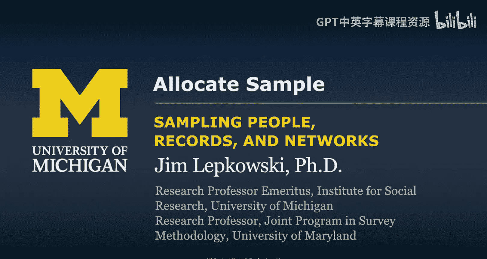
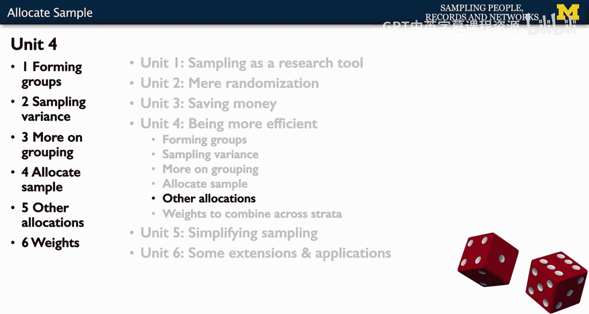

# 调查数据收集和分析：4.4：样本量分配 📊

在本节课中，我们将学习分层抽样中的一个核心环节：样本量分配。我们将重点探讨比例分配法，理解其原理、优势，并了解它如何作为评估其他分配方法的基础。

上一节我们介绍了分层抽样的基本概念和优势，本节中我们来看看如何将总样本量合理地分配到各个层中。

## 分层抽样的优势回顾

分层抽样方法具有多重优势。它提高了调查结果的可信度，因为样本在总体各层中的分布与总体本身一致，这更容易被接受。此外，通过合理的分配，我们还能获得更高的估计精度。分层抽样还能保证重要子域在样本中得到充分代表，并在管理和操作上提供灵活性。

然而，要充分实现这些优势，取决于我们对样本量分配的理解。

## 多种可能的分配方案

在我们之前的例子中，总体有400名教员，我们抽取了80人的样本。对于已划分的6个层，存在许多种分配样本量的可能性。

以下是几种可能的分配方案示例：
*   从第1至第5层各抽取1人，剩余的75人全部从第6层抽取。
*   从第1层抽取2人，从第2至第5层各抽取1人，剩余的74人从第6层抽取。

事实上，分配方案的数量非常多。不同的分配方案会对我们的总体估计产生不同影响：有些有益，有些则可能有害。某些分配在域估计时更有利，而另一些则在合并多个估计值时更有效。

## 比例分配法

我们之前使用的分配方法，与左下角图中美国各州人口规模分布的理念类似。加州人口占美国总人口的10%，德克萨斯、佛罗里达和纽约州也占相当比例，而其他州则很小。总体各层的规模（`N_h`）是客观存在且我们无法控制的，但我们可以利用这些辅助数据来提高精度。

我们采用的方法就是**比例分配**。这种分配方式有明确的理由：它确实能提高估计精度。具体做法是在每个层中抽取相同比例的个体。

### 比例分配的原理与性质

比例分配有一个很好的性质：我们为每个层设置的**抽样比**是相同的。抽样比 `f_h` 定义为层样本量 `n_h` 除以层总体大小 `N_h`。在比例分配下，每个层的 `f_h` 都等于总体的抽样比 `f`（即总样本量 `n` 除以总体大小 `N`）。

用公式表示即：
`f_h = n_h / N_h = n / N = f` （对于所有层 `h`）

当这种情况发生时，会伴随另一个结果：**样本在各层中的分布比例与总体中的分布比例一致**。也就是说，总体中某层的权重 `W_h = N_h / N`，等于样本中该层的权重 `w_h = n_h / n`。

例如，在我们的例子中，第1层有40人，占总体（400人）的10%（`W_1 = 0.1`）。总体抽样比为 `80/400 = 0.2`。将这个比率应用于第1层，我们得到样本量 `40 * 0.2 = 8` 人，恰好占样本总量（80人）的10%（`w_1 = 0.1`）。因此，样本分布复制了总体分布。

### 比例分配的优势

通过使样本在层间的分布与总体一致，这种设计能为我们关注的变量带来**设计效应小于1**的结果，即提高了估计精度。

这里需要强调一个教学上的要点（虽然并非绝对成立，但有助于理解）：**如果我们采用比例分配法来设计一个多目标调查，那么几乎对所有调查变量，我们都能获得设计效应小于1的增益。** 这是一个非常强大的特性。我们将会看到，其他分配方法可能在某个特定变量上胜过比例分配，但很难像比例分配这样，对几乎所有变量都普遍提升精度。

## 总结与展望

本节课中我们一起学习了样本量分配的基础，并深入探讨了**比例分配法**。我们了解到，比例分配通过在各层使用相同的抽样比，使得样本结构能够反映总体结构，从而普遍提升多变量估计的精度。它不仅是分层随机抽样中一种非常有用的方法，也是我们评估其他更复杂分配方案的基准。

下一讲（第4单元第5课），我们将以此为基础，探讨其他的样本量分配方法。

