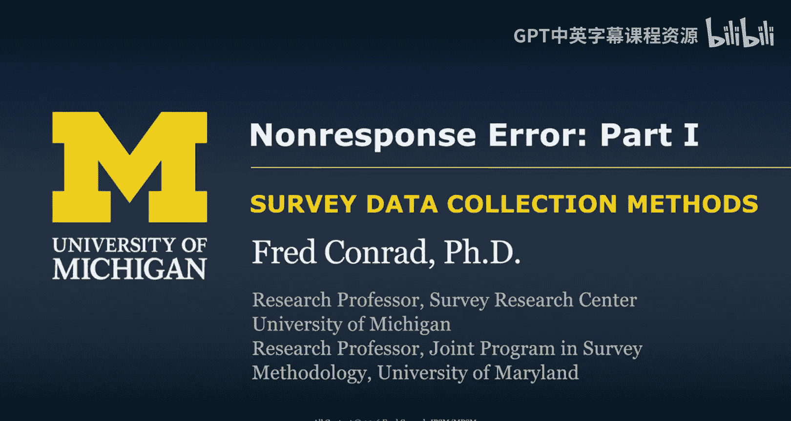
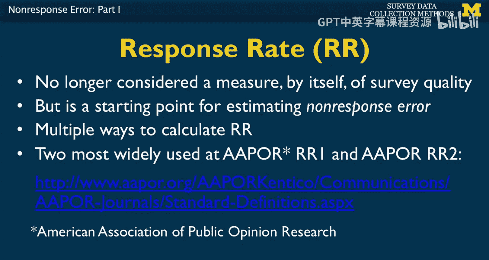
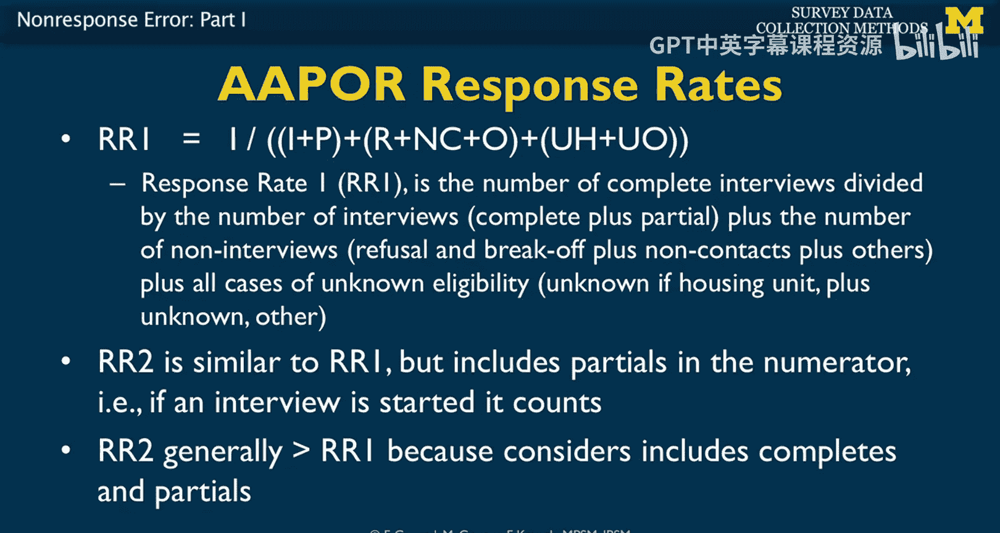

# 密歇根大学《调查数据收集和分析（2-6：方法、社调问卷设计、抽样、缺失数据、分析）｜Survey Data Collection and Analytics》 p11 10_1.5.1 应答率.zh_en -BV1fw4m1e7Zh_p11-

For our final topic in the first lesson， the introduction to the rest of the course will focus on nonresse。

 both the issue of response rate or really its complement nonres rate and nonresse error。

 they're not exactly the same thing。

With respect to mode， the key point is that response rates vary across modes。

 so generally face- toface interviews yield the highest response rates followed by telephone interviews followed by mailed out paper questionnaires and followed by web this is not strictly observed。

 lots of things can vary， for example， we saw earlier how providing a prepaid incentive in one mode and promised incentive in another mode flipped this pattern around。

 but this is generally the pattern that is observed by practitioners and in the literature。

Key point is response rates are not equivalent to nonres error and in the next segment we'll talk about that difference more right now。

 we'll just discuss response rates。So imagine what we're looking at is a data file from a survey where the rows are correspond to cases or。

Individual respondents， we have what is called frame data in this kind of panel on the left。

 which is information known about the respondent from the sampling frame and then interview data or the answers in this panel labeled interview data。

Notice that there are some blank blanks or these black boxes among the interview data where there's nothing where their data are missing。

 those are known as item missing data， this can occur for cases that are otherwise considered to be respondents so a respondent doesn't have to provide an answer to every case to be to every question to be considered a respondent。

At least by most definitions， but note that we have a number of cases rows where we have no data whatsoever。

 these are nonresponents and it's these cases that we're concerned with when we talk about nonresponse so unless we say specifically item nonresse。

 we're generally referring to cases for whom there is absolutely no data。

 this is also known as unit nonresse， the unit， the household。

 the sample member hasn't provided any data at all。

Response rates are certainly one of the best known statistics associated with a particular survey。

 generally considered a measure of survey quality。But response rates are no longer considered kind of a definitive measure of quality by themselves。

 but they're certainly a starting point for estimating nonresse error， which we'll， as I said。

 turn into in the next segment。For now， it's important to note that there are a number of different ways to calculate response rate。

There are a number of response rates that have been defined by AP or the American Association。

Of public opinion research。And they're listed in a document that can be found at this link here。

The two most widely used APPOR response rates are known as APPOR response rate 1 and APPR response rate two。

In order to understand those definitions we need to go through a number of the dispositions。

 kind of the outcomes of a case that AOR has enumerated and you'll see these variables essentially in the response rate calculations that we'll turn to next so RR stands for response rate I stands for complete interview P for partial interview are for refusals and breakoffs so refusal is a case that has been contacted。

 a sample member that has been contacted and refuse to participate。

 indicated they would not go further a breakoff refers to a case that agreed to participate and actually began the interview but terminated it after some point and so there's no data beyond a certain point so。

It's not exactly the same as missing data Bakoffs are treated as somewhere between generally between nonreents and respondents with missing data。

 N C stands for non contact。 So this is a case or sample unit sample member who was unreachable in whatever mode was available。

 say they never answered the phone or answer the the door or never。Repled to an email invitation。

Or click on a link。Other， so just another category cases that aren't otherwise handled。

 UH unknown of household is occupied， U owe unknown other。

 so the most important of these will become evident in a moment so the equation or formula for response rate one is the number of complete interviews I divided by a number that's going to be larger than that。

 so it's the number of complete interviews plus the number of partial interviews。

And then a term corresponding to the number of non interviews。

 refusals and breakoffs plus nonconts plus others that's this term here。

 and then a term for basically all the unknown cases cases of unknown eligibility So again it's it's the completed interviews divided by。

Almost everything else， interviews and partial interviews and those who couldn't be contacted and those who were contacted and refused and the other cases。

Response rate two is similar to response rate one， but it includes partial interviews in the numerator so a partial interview is treated as just as a completed case is treated and so what that means is that response rate two is generally going to be larger than response rate one because the definition of a response is both an interview that's completed and an interview that has been started but not necessarily completed in our next segment we'll focus on the difference between response rate or non-response rate and nonrespon error。

