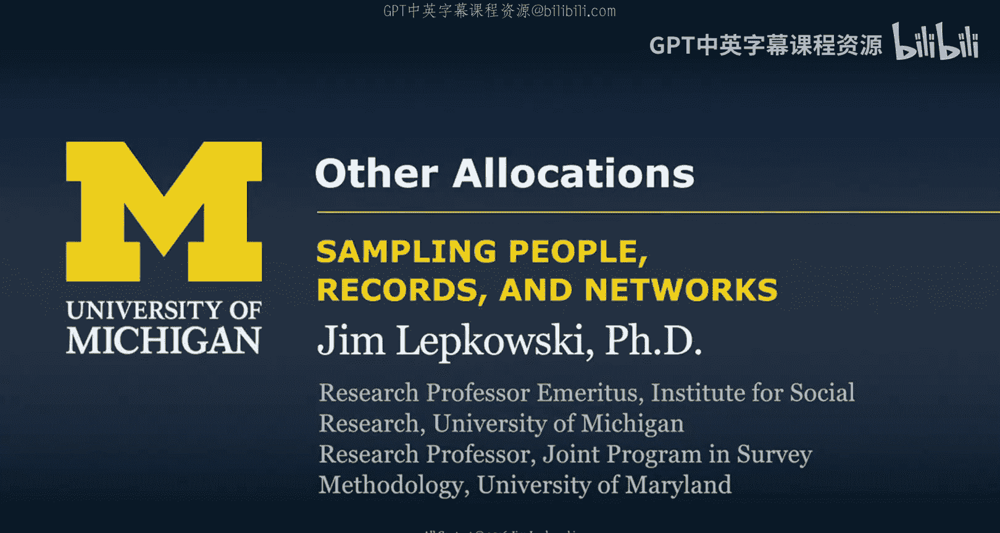
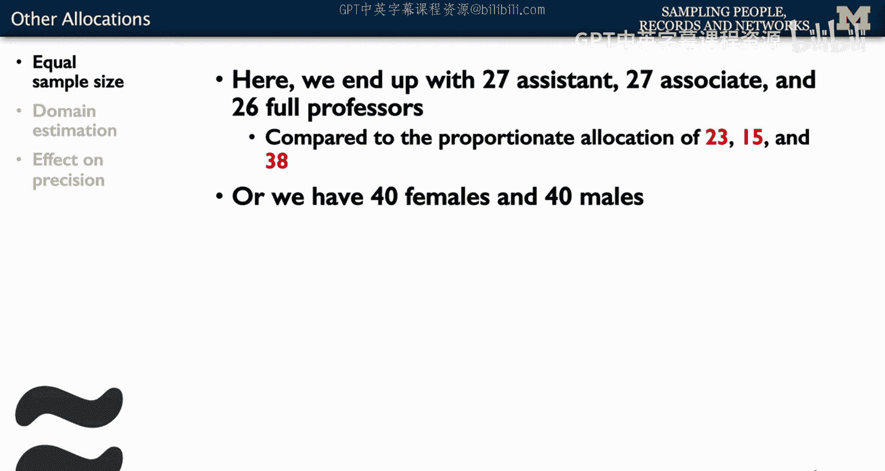
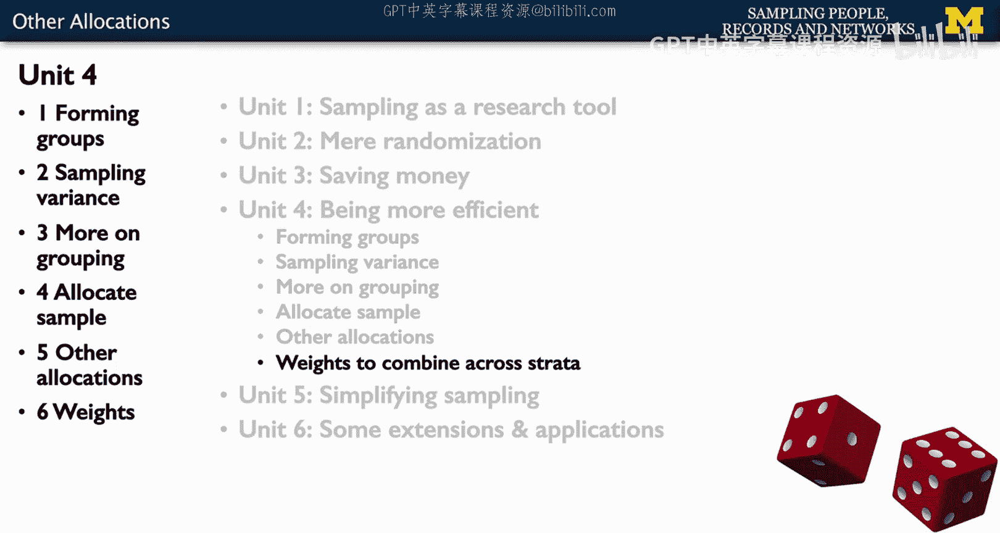

# 密歇根大学《调查数据收集和分析（2-6：方法、社调问卷设计、抽样、缺失数据、分析）｜Survey Data Collection and Analytics》 p110 31_4.5 其他分配方法.zh_en -BV1fw4m1e7Zh_p110-

We've seen in our last lectures how allocation can play a role in a number of things with respect to our stratified samples。

And in this lecture on sampling people， records and networks in our unit 4。

We're going to be looking at and stratified sampling some other allocations and seeing what their properties are。

In doing this， we're going to talk about three things。

 we're going to talk about an equal sample size allocation。About domain estimation。

 which often goes hand in hand with equal sample size allocation。

 and then the effect on precision of some other allocations。Let's start， though。

 by looking at another allocation beside the one we looked at in our last lecture。

 which was the proportion allocation。 But one that alters that to give us about the same number of sample elements in each of the strata。

 sort of an approximately equal to distribution in what we did before。

 So let's look at our six strata formed by。In our population of 400 faculty。

 grouping them by sex and then by rank， assistant， associate and full professor。

And an alternative allocation that gives us roughly the same number。

 The problem is that in a sample of size 80，80 is not divisible， you know， E by 6。

 And so what we're going to do in this allocation is approximately equal to。 If we could。

 we would have exactly the same number。 but I guess I blew it by not having a sample size that was an even multiple of 6。

But here we can see what the allocation looks like in that last column。

 we've got 13 or 14 in each of the groups。 and the sum of those is still 80。

 And that's the key part of what we're attempting to do here。

We are in terms of the individual groups now having small sample sizes in each of the groups。

 we probably would not want to form separate estimates in each of these groups。

 but there's an interesting property that we do have almost the same number of assistant associate and full professors。

 equal numbers there， compared to the proportion allocation where we had 23，15 and 38。 Now。

 we've got 27，27，26 across those three groups。

All right。 Well， that's beneficial because now we've got somewhat larger sample sizes。

 And if we wanted to compute separate estimates for each of those rank levels。

 we've got about the same number， and our precision should be about the same。

 if our standard deviations。 Our variances for our income are about the same。 Now they won't be。

 But nonetheless， this is a good allocation for producing separate estimates for each of those rank groups。

It's also going to give us 40 females and 40 males， little better sample sizes for males and females。

 halflf of our sample， female， halflf of our sample male。 Now。

 that's not necessarily because the population distributions that way。

 We have actually much smaller than than half only about 20% cent of the population happens to be female。

 But we're going to force it to be 50% cent in our sample were departing a long way away from the proportion allocation。

 recall for the proportion allocation。 Well， actually， you didn't see this。

 But if we go back and add these up。 there are 17 females and 63 males in that allocation。

 about 20% cent。 Our female。 And so in that proportion allocation。

 we wouldn't have enough females to compute a separate estimate。

 If we want we wanted to do was produce an estimate for females and males that were equally equal quality。

 equally precise。So by going with this。Disproportionate allocation， right。

 the the proportionate allocation， there's only one。

But it gives us a distribution that is useful for combining things across the strata。

 But this disproportionate allocation， unequal allocation across the strata in terms of sample sizes。

 it has better properties for other purposes。 For example， as I've mentioned。

 we get better estimates for small sized groups。 We've got only 17 females in the proportioned allocation。

 Now， we have 40。 We're going to get more precision for the females。 worst precision for the males。

 but still the same precision as for the females。That， by the way， gives us also good sample sizes。

 a good sample size allocation for comparing the different size groups。As long as the。

Standard deviations， those element variances within each of the groups are about the same。

 The equal sample size allocation is the best one for when we do comparisons。

 getting a small an estimate of the variance of the difference， right？ That's what a comparison is。

 What's the mean salary for females， What's the mean salary for males。

 What's the difference between them to get the smallest variance of the difference。

An equal allocation will provided we have equal standard deviations among the groups give us the best。

 smallest variance outcome for a given allocation。However， when we do this。

 if I also still want to combine the data， I have a problem。

 If I want to combine the data across assistant associate and full professors， I have a problem。

 I have a weight problem。 I'm going to have to resort to the capital Ws of H。

 or as we will see when we talk about waiting in the very end our last lesson here。

 a different way of expressing those weights， I'm going to have to wait the elements in a different way。

 because I have an over representation now of assistant professors and associate professors and an under representation of full professors。

 I have an under representation an over representation of females and an under representation of males in that equal allocation。

 and I'm going to need to correct that when putting things back together。Again。

 coming back to Canada， remember what I said about how in Canada with the 10 provinces and in their Labour force survey。

 they take the provinces and allocate to them the same sample size in each of the groups。

 including those small maritime provinces out on the right hand coast on the Atlantic coast。Now。

 by doing that， they're ignoring the population distribution in terms of the allocation of the sample。

 Here it is。38% of the population of the country。 A third of the population lives in one province。

 That's Ontario。 That's the one that's closest to us here in Michigan。

 But there's a there's another quarter of the population in Quebec。 and so on。

 There's several provinces that have more than their share，10 per cent。 And then there's a large。

 there are four of them that have that。 And the other six provinces all have much smaller shares。

 including one。 Prince Edward Island。 that has a very small share of the total population。

Yet the sample allocation is like a pie。 It's 10 equal size slices of this thing。

 And that looks very different。 And in order to take that pie that's equally divided into 10 slices and get results from each of those slices and then put it together to look like this distribution。

 We're going to have to do something。 We're going to have to take the the values for people who are in Ontario who are underrepresented in that sample。

😊，3000 households is 10%， not 38% of the total。 We're going to have to increase their contribution by a factor of 3 to 4 in order to get back to the population distribution。

And that kind of reallocation is necessary if we want to achieve two purposes。 Number one。

 get the best allocation for comparisons or in the Canadian context。

 what they're actually doing is providing equally precise estimates for every one of the straina because they have a confederation and is very important to them that all the provinces have the same contribution or benefit。

 if you will。 The the size of the sample across。These。National studies。

So they have a political reason for doing this， as well as a statistical reason。

 But when they've got all done computing and providing estimates for Ontario and Quebec and Prince Edward Island。

 they also produce a national estimate。 They put them back together， and they do that by await。

All right， so now we've got two allocations， right， we've got the proportionate。

 which we understand a little bit better and understand some of its benefits。

 It's good for combining things across groups， and we have the equal sample size allocation in which it's better for providing a domain estimates。

 separate estimates for each of the provinces or for comparing the provinces in terms of the outcome in that case。

 unemployment rate， but in order to put things back together， we have to wait them。

So two different purposes， we're going to have to sometimes make a compromise in the allocation。

 we couldn't do this for a country like the United States that has 50 provinces， 50 states。

 it's much too many for us to do this kind of thing and the sample sizes in each would be fairly small anyway。

 so there's different things that are done in those cases it's kind of a blend of proportionate and equal。

There are other allocations that we can use。 There's one that's called an optimum allocation or a minimum variance allocation。

 Remember， we ran into minimum variance before when we talked about cluster sample sizes。

 the number of elements we're going to take per cluster。

 And we talked about a way to choose that sub sampleample size that would minimize the variance of the mean。

 Well， there's a similar kind of thing that can be done here， among all those possible allocations。

 the proportionate， the equal sample size and all the other ones that are in between or beyond those two。

 which of those will give us the smallest variance。😊，Now， this is beyond the purposes of this course。

 It requires in terms of that allocation to look at the size of the strata and the variability within the strata and sometimes even the cost within the strata。

 Sometimes the cost may vary。 Maybe it's much cheaper to do the sample selection in one province than another。

 All of those things factoring together will lead to this minimum variance allocation。

 but it's really， as I say， beyond the scope of this course to deal with it。

 Just know that it's out there。 and know that it arises primarily in the study of a single variable。

 multipurpose allocation， this is not good for， because the minimum variance allocation is variable specific。

There's a minimum variance allocation for each variable， and it may differ across the variables。

 In that case， what are we going to use when we have to do a multipurpose study？

 Sometimes we may do the minimum variance allocation for one variable。

 because it's so much more important than all the others。 will still measure other variables。

 but we know that we're not going to get as precise a set of estimates for the other variables as we do for that one。

 But that kind of thing comes up more often when dealing with variables that have skew distributions such as income or expenditures or wealth。

 There's where you can get real gains and precision。

 but the minimum variance allocation doesn't arise often in social sociological and psychological studies。

 public health， medicine， other sciences。 it really works best in economics and finance。

 those kinds of areas where you've got some extremes in your distributions。

Let's consider just one more pass through this just to fix these ideas in our mind。

 let's consider a simpler example to see how allocation can affect sampling variance one more time before we wrap up and go on to our last lecture。

In particular， suppose that we had this distribution。 I'm going to go back to Qatar。

 I know I've introduced Qatar before， but it has a very interesting set of properties in his population distribution。

 there is a very large share of the population that are expatriot。

 They are not native to the population。 They are white and bluecol exatriots there who are working。

 And let's just suppose that this is this is a little bit of a departure from the actual distribution。

 supposeuppose there are a million people in Qatar。 Actually there are more than 2 million there。

 but a million people and 20% of them are native  Qatris。 The other 80%。

800000 of them are white or blue collar exatriots。And we happen to see distributions we know from past data for a characteristic we're measuring。

 say income that we've got very different variances between the strata， you'll notice in row 2 there。

 the S squared， the overall S squared， and then the S sub one squared S of two squared for each of the two strata are very different。

 and the means are very different。 Here's a good case for doing stratified sampling。

 We know the means are different。 a proportion allocation on again is gains in precision。

 So will other allocations potentially。So why don't we do the following exercise rather than trying to come up with a minimum variance allocation by some formula。

 which exists。 Suppose we just start with our proportionate allocation。

 We're going to do a sample of 12001200 from the 1 million Li there。

And we're going to do it proportionately。20% of our sample of 1200 should come from Stratum 1。

20% of 1200 is 240。 and the remainder from stratum 2。 What will the variance of the mean be， Well。

 there's our formula that we have for the variance of the mean where we take the square of the fraction of the population in the group times1 minus the sampling fraction divided by the sample size n sub H times the S of H squared。

 And we have those elements， And at least approximately in this case。

 Because the sampling fractions are fairly small，1200 from a million is so small。

 We can just round it。 We're not going to worry about it in this particular case。

 It just complicates the calculation。 But here， let's just take the essence of it。

 W sub H squared S sub h squared divided by n sub H for each of the two strata W1 squared S1 squared over n1 W2 squared S2 squared over n2 for Stratum2。

 And put in the numbers and do the calculation， and we see we get a variance of the mean。

Part case of about 1300， 1333。Now， that's the proportion in allocation。

 We expect to get gains in precision。 How large。 Well， it depends on our computation。

 what happens for simple random samples of the same size。

 Here's the simple random sampling variance for the same data。 Now， again。

 we've I put in the finite population correction here in the middle。 But we're going to ignore it。

 we're going to round it to one。 essentially， and our variance now comes out to be 1500。

 That is when we look at the design effect。 The variance of the given design relative to the variance of a simple random sample of the same size。

 This design effect turns out to be 089。' got an 11 per cent gain in precision by the simple expedient of proportion allocation。

But there are other allocations out there。 It may be that we think， well。

 what would happen if I under allocate to the one group and over allocate to the other。

 I'm going to do smaller sample to the native Qatris and more to the expatriates。

 What would happen to our variances。 And then we'll go the other way。

 We'll look and see what happens if we start shifting sample not away from the stratum 1。

 but into stratum 1 from stratum 2。 So allocation 1 goes to the direction of putting more sample into the expatriate part of the population。

 stratum 2 example 2 is an allocation that we've already looked at the proportionate。 and 3，4。

5 and 6 are putting more and more into that native Qatari group。

 including the equal sample size allocation in allocation 4。All right， so for the first one。

 what do we actually get when we get a variance of 2133。And we get a design effect of 1。45。

 Were losing precision。 Now， this is interesting。 with stratified sampling。

 we don't necessarily only get gains in precision。 We can lose。 So some of these are not good for us。

 depending on what's going on with respect to the distribution of the population sizes and the standard deviations or element variances across the strata。

Now we already know that we've got gains in precision for the proportions。

 so there we can see we're not only doing better than the first allocation。

 but we're actually doing better than simple random sampling。We're going in the right direction。

 Let's take more and more of the sample away from the expatriates and put it into the Qatari population。

 Can we get even better variances。 So for allocation 3， we see that we get a gain again of 1200。

 our sampling variances down to 1200， and our design effect is 0。8。 Gee。

 we're doing even better than the proportion allocation。 That one。

40800 in allocation 3 is actually the optimum。 It's the minimum variance allocation。

 if we were to put in all possible combinations。 that's the one that gives us the smallest variance。

 That's what we're referring to earlier in this lecture。 But then if we keep pushing it now。

 we keep pushing it now we have equal number in design 4。 equal numbers in the two straightta。

 we see that our variances of a sudden starts bumping back up。 This is the combined。

 it's a good allocation for comparing the two groups， but our design effect is back up to 0。

8 night's still better than simple random sampling。If we push it even further。

 the opposite of our proportion allocation in design 5， we see that we actually get the worst case。

 we get a doubling a variance。 It looks like a cluster sample。

But the allocation drives then this design effect。 and that's worth keeping in mind。

 These allocations。 There are many of them。 proportionionate gives us gains in precision uniformly across our variables。

 The equal allocation will give us good properties for comparisons。 sometimes gains of precision。

 sometimes not。 There is one that is best。 the optimum allocation。 In this case。

 we've seen what it is。 And so we see that there's a variety of things that we can do。

 and we have a decision to make about how to allocate our sample across the strata。

 and it will depend on our purposes。With these allocations that we've been looking at。

 there is a waitinging that's being done， awaiting at the stratum level。

 We're going to combine the stratum estimates to compute our overall result。

That strong level waiting is fine for us to think about conceptually。

 but it's not what happens when we use statistical software to analyze these stratified random samples。

 The statistical software that we use actually waits at the element level。

So what we're going to do in our last lecture is look at how that stratum level weighting can be converted into an element level weighting so that we can analyze these stratified samples using available software。

 which doesn't do what we've been talking about up till now。

 So let's look at that in our last lecture in unit 4 on stratified sampling。 Thank you。

