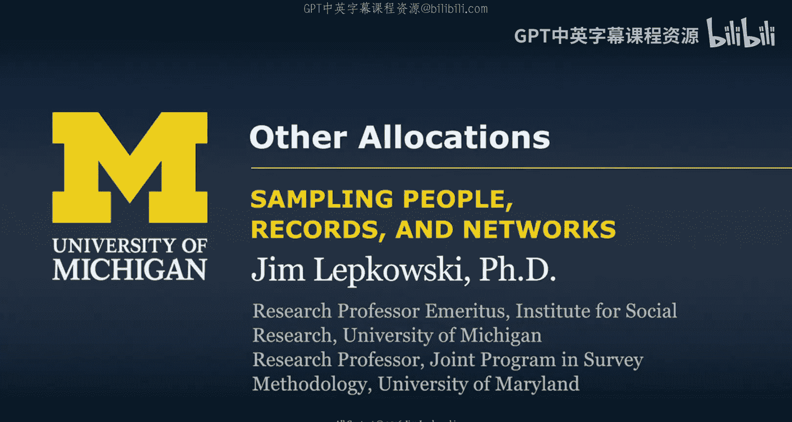
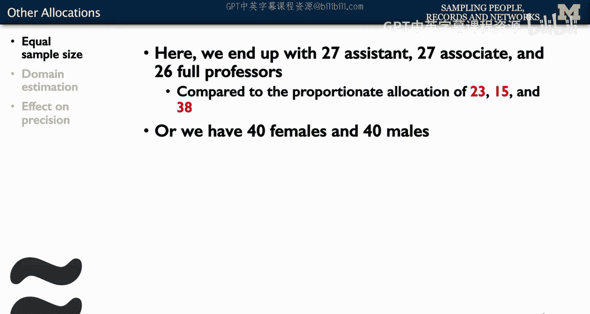
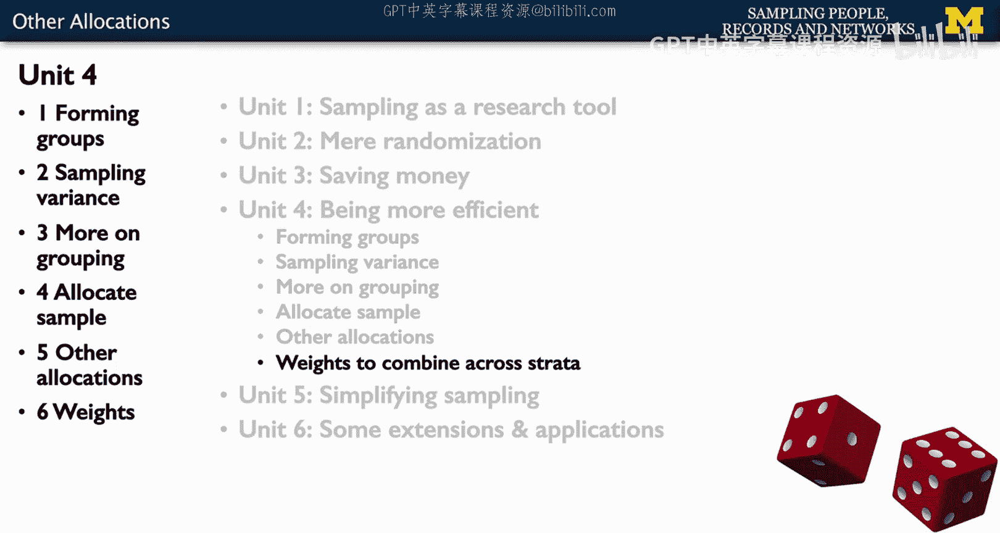

# 调查数据收集和分析：4.5：其他分配方法

在本节课中，我们将学习分层抽样中除比例分配之外的其他样本分配方法。我们将探讨等样本量分配、域估计的概念，以及不同分配方式对估计精度的影响。

## 等样本量分配

上一节我们介绍了比例分配，本节中我们来看看另一种分配方法：等样本量分配。这种方法旨在让每个层中的样本元素数量大致相等。

例如，在一个由400名教员组成的总体中，我们按性别和职称（助理教授、副教授、正教授）分为6层。如果我们希望总样本量为80，由于80不能被6整除，我们只能实现近似相等的分配，例如每层分配13或14个样本。这样分配的结果是，每个职称级别的样本量大致相等（27， 27， 26），男女性别样本量也各为40。

以下是等样本量分配的核心特点：
*   **优点**：为每个层（尤其是小规模群体）提供了更大的样本量，有利于进行层间的比较（例如比较不同职称或性别的平均收入）。当各层内方差相近时，等样本量分配能使比较差异的方差最小化。
*   **缺点**：当需要将各层数据合并以估计总体参数时，会产生权重问题。因为样本分布与总体分布不一致（例如，女性在总体中占20%，在样本中却占50%），需要对样本进行加权调整以反映总体结构。

## 域估计与分配选择

等样本量分配常与**域估计**的目标相结合。域估计是指为总体中的特定子群体（域）提供单独的估计值。

以加拿大的劳动力调查为例，该国10个省的人口分布极不均衡（例如安大略省占38%）。然而，调查采用了等样本量分配，每个省分配相同的样本量。这样做是为了确保每个省都能获得精度相当的估计值，这既是统计上的考虑，也有政治上的原因。

但是，当需要合并各省数据以生成全国估计值时，就必须对样本进行加权。例如，安大略省的样本代表性不足，其样本数据需要乘以一个大于1的权重因子（如3-4倍），才能正确反映其在总体中的比重。

因此，分配方法的选择取决于研究目的：
*   **比例分配**：适用于需要合并各层数据以估计总体参数的情况。
*   **等样本量分配**：适用于需要为各层（尤其是小层）提供独立、可比较的估计值，或进行层间比较的情况。
*   **折中方案**：在实际的多目标调查中，常采用比例分配和等样本量分配的混合形式。

## 最优分配及其影响

除了上述两种方法，还存在一种**最优分配**（或最小方差分配）。这种分配旨在最小化总体估计的方差，其公式考虑各层的规模（`N_h`）、层内方差（`S_h^2`）以及可能不同的调查成本（`C_h`）。

最优分配的样本量公式为：`n_h ∝ (N_h * S_h) / sqrt(C_h)`

然而，最优分配通常是针对单一调查变量计算的。对于多目标调查，不同变量的最优分配可能不同，因此其应用有限。它最适用于经济学、金融学等领域中分布高度偏斜的变量（如收入、财富）。

为了更直观地理解分配如何影响精度，我们来看一个简化的例子。假设卡塔尔总体有100万人，其中20%为本地人（层1），80%为外籍人士（层2）。已知两层的收入方差差异很大。

我们比较了从“向外籍层倾斜”到“向本地层倾斜”的6种不同分配方案（包括比例分配和等样本量分配），并计算了每种方案下总体均值的方差及其相对于简单随机抽样的设计效应。

结果发现：
*   某些分配（如方案1）的方差甚至高于简单随机抽样（设计效应>1），导致精度损失。
*   比例分配（方案2）带来了11%的精度增益（设计效应=0.89）。
*   存在一个**最优分配**（方案3， 分配为40:800），其方差最小（设计效应=0.8）。
*   等样本量分配（方案4）的精度虽优于简单随机抽样，但并非最优。
*   过度向本地层倾斜的分配（方案5）会导致方差大幅增加。

这个例子清晰地表明，分配策略的选择直接影响估计精度，需要根据层内方差和总体结构谨慎决定。

## 从层权重到元素权重

我们目前讨论的加权是在**层水平**上进行的，即将各层的估计值按总体比例（`W_h`）合并。然而，实际的数据分析软件通常在**元素水平**上进行加权。

因此，为了使用标准统计软件分析分层随机样本，我们需要将层水平的权重转化为每个样本元素的个体权重。这将是本单元最后一讲的重点内容。

## 总结

本节课中我们一起学习了分层抽样中的多种样本分配方法。我们了解到，**比例分配**有利于总体估计，**等样本量分配**有利于子群比较或域估计，而**最优分配**能在特定条件下为单一变量提供最高精度。分配选择需权衡研究目的、精度要求和实际限制。最后，我们指出了将理论上的层权重转化为适用于软件分析的元素权重的必要性。