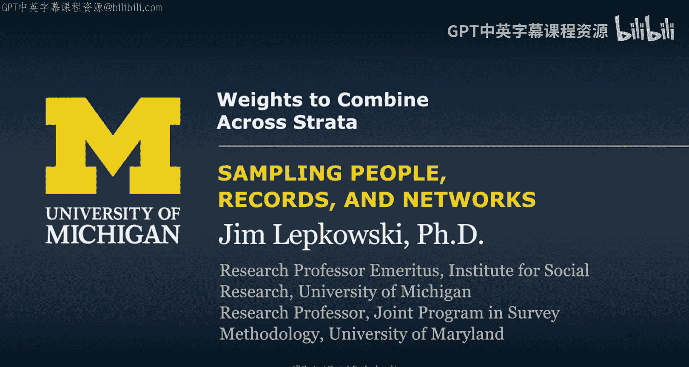
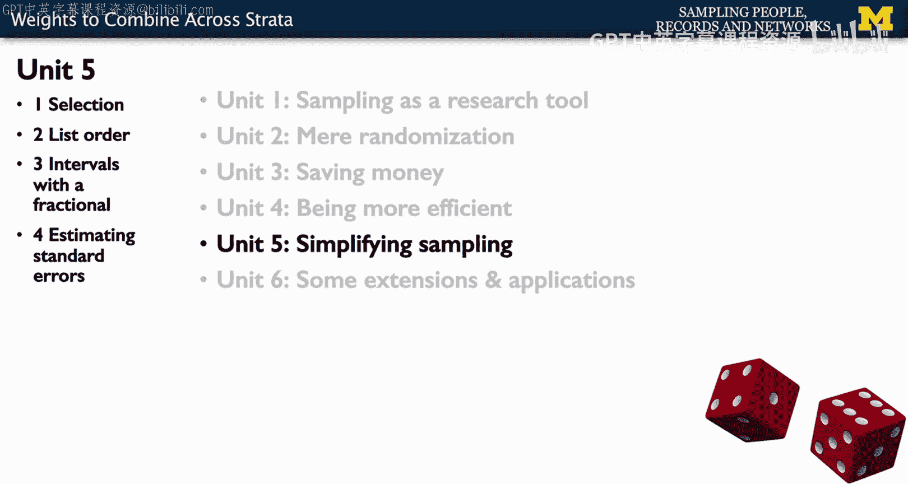

# 密歇根大学《调查数据收集和分析（2-6：方法、社调问卷设计、抽样、缺失数据、分析）｜Survey Data Collection and Analytics》 p111 32_4.6 跨层权重整合.zh_en -BV1fw4m1e7Zh_p111-

One of the things that I get asked about most often with respect to surveys and survey sampling。

 especially by people who analyze surveys， is about weights。

And as long as we're talking about stratified random sampling and the idea of weights that are used to combine results across strata。

 I thought it might be useful to also talk about how that can be converted and considered in terms of weights at an element level。

And the reason this comes up is because that kind of waiting at at the element level to combine our results across strata is how software handles it。

 and we should be prepared for that。 The software is not going to do what we've just described。

 It won't even compute the variances the way weve described。

 but we want to begin to get something of an introduction to the ideas behind waiting at the element level。

 as we're talking about stratified sampling。So let's consider then what we mentioned before that the weighting the sample is necessary。

 If what we're going to do is compare or combine across groups to get back to conclusions about the total population。

 Re in some of our distributions are allocations。 We had cases where we allocated much more of the sample to a group than its proportionate size in the population。

 And we talked about how， well， the weights， you know， those w sub Hs would correct for that。

 when we put things back together。 And that would be great if that's the way that the software expected the data to come。

 but it doesn't。And it's because we can convert that into another form into a second way of doing the waitinging that we need to consider this a little bit。

So in practice， when we're using statistical software， it's done using only one of the two ways。

 not the population weighting and the W sub Hs， but actually an element level weighting。

 And you see in the lower left， just a formula that deals with the weighted mean。

 We're going to come back to the weighted mean as we look at other kinds of。

Wting problems that come up in unit 6。So one weighting method that we've been talking about just to be more specific is we're going to weight the statta estimates by the size of the strata。

 so our y bar is a sum of the y bar sub H， the means in each of our strata。

 combined with the weight factor capital W sub H， the relative sizes of each of the strata。

Unfortunately， as I say， this is not done in the software。

 If the software were to do this kind of thing， it would need to know not only the the strata that we've got。

 Well， that would be natural。 And we're going to specify that when we do variance estimation。

 what stratum， each of the elements is in。 But also the Ws of H。

 we're going to have to give that in a separate string。

 And if we have a lot of strata could be very tedious to do。

 So the software is never gone in that kind of direction。What they've done is to wait by elements。

 because the waitinging by elements not only deals with the stratified sampling case。

 but a number of other cases where we have disproportionate allocations but generate it in a different way。

So。There is a way to get the same mean using element weights rather than the stratum weights。

And that can be done if what we do is use a weight。 I'm just going to give you the result。

 If we use a weight at the element level， that is capital length of H over lower case sense of H。

 that is。The population size divided by the sample size。 Oh。

 that is the inverse of the sampling fraction。 It's the inverse of the sampling rate within the strata。

 If we use that weight。We will get this and and weight each element now。 now， not each stratum mean。

 but each element within each st by that weighting factor。

 And we multiply each value by that weight and add it up and divide by the sum of those weight。

 We get exactly the same mean。That is an issue that we're going to need to consider in more detail and understand why these sampling rates。

 the inverse of sampling rates would give us the actual estimate that's obtained by using the stratum weights。

 we'll come back to this in unit 6 when we talk about waitinging as one of our three main topics in unit 6。

 But at this point， it's just we're keeping in mind stratified random sampling。

 we can compute our estimates by waiting at the stratum level。

 computing everything within the strata and then multiplying by the weights when we're computing the mean or by the square of the weight when computing the variances。

 but we can also do that same kind of calculation waiting as we've seen here by the inverse of the sampling rate within each of the strata。

But before we get to talking about weighting in unit 6。

 there's another sample design that we're going to talk about in unit 5。

 And that's one that's called systematic sampling。 Sometimes it's referred to in literature as pseudoran sampling。

It's a simplified kind of sampling。And with simplified kind of sampling。

 it helps us when we're dealing with clerically complicated kinds of sampling procedures to have something that is very easy to do a much more straightforward way of dealing with this。

 And so we're going to talk there about such factors as selection and list order and intervals and estimating standard errors for systematic samples。

 just to give us another tool in our kit of randomized selection and simple random sampling cluster sampling to save money and stratified random sampling to make ourselves more efficient and address such issues as domain estimation。

So please join me in unit 5 as we talk about systematic sampling and its applications。 Thank you。

