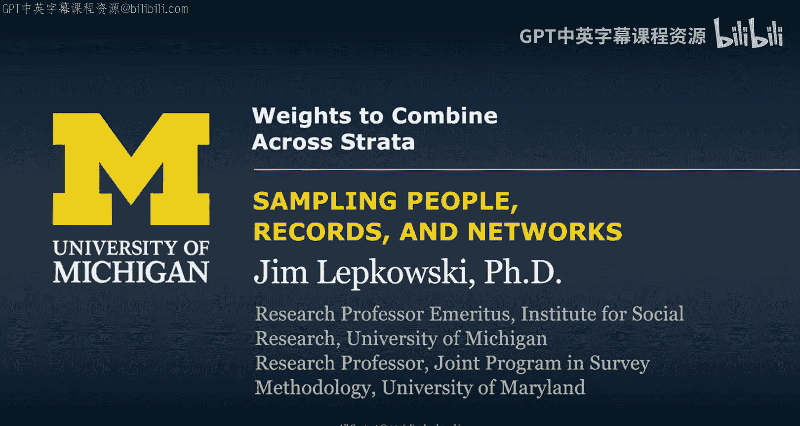
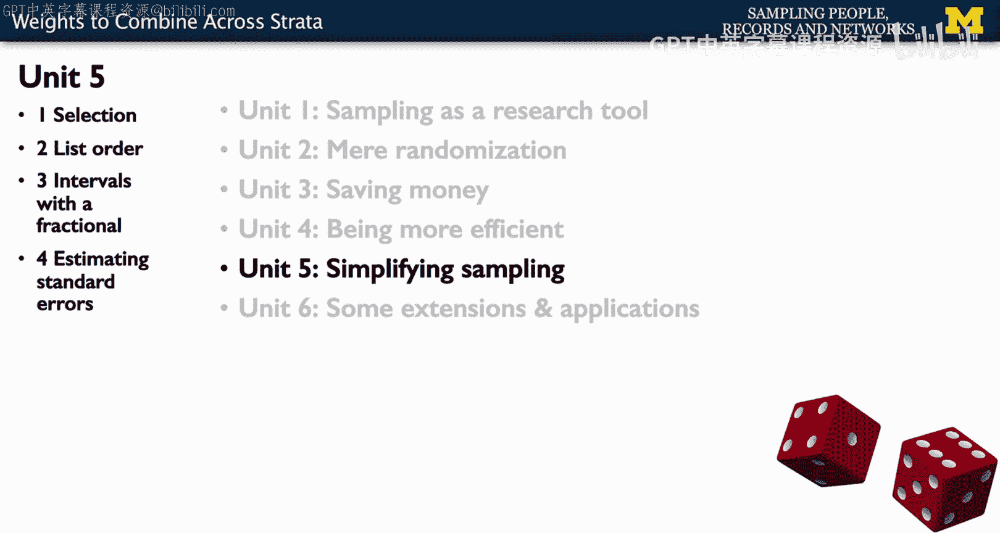

# 调查数据收集与分析：4.6：跨层权重整合 🔗

在本节中，我们将探讨分层随机抽样中的一个核心概念：权重。我们将了解如何通过权重将不同层（strata）的结果进行合并，并重点介绍软件在实际分析中如何处理权重——即元素级权重法。

上一节我们讨论了分层抽样中的分配与估计，本节中我们来看看如何通过权重整合各层结果，并理解软件实现的方式。

## 概述：权重的必要性

在调查抽样中，若样本在各层间的分配比例与总体中的实际比例不一致（即非比例分配），直接合并各层结果会产生偏差。权重的作用正是为了纠正这种偏差，使我们能够得出关于总体的有效结论。

## 两种权重方法

软件通常不直接使用我们之前描述的层权重法，而是采用元素级权重法。理解这两种方法及其等价性至关重要。

### 方法一：层权重法

这是我们之前讨论的方法。总体均值 `Y_bar` 通过加权各层均值 `y_bar_h` 来计算，权重为各层在总体中的相对大小 `W_h`。

其公式为：
**Y_bar = Σ (W_h * y_bar_h)**

然而，这种方法在软件中并不常用。要让软件执行此计算，需要为每个样本元素指定其所属的层，并额外提供每个层的 `W_h` 值。当层数很多时，这会非常繁琐。

### 方法二：元素级权重法

软件实际采用的方法是给**每个样本元素**赋予一个权重。这个权重是**其所在层的抽样分数的倒数**。

具体而言，对于层 `h` 中的每个元素，其权重 `w_i` 为：
**w_i = N_h / n_h**
其中，`N_h` 是该层的总体大小，`n_h` 是从该层抽取的样本量。`N_h / n_h` 即为抽样分数 `(n_h / N_h)` 的倒数。

计算总体均值时，我们将每个样本观测值 `y_i` 乘以其元素权重 `w_i`，求和后再除以所有权重的总和：

**Y_bar = (Σ (w_i * y_i)) / (Σ w_i)**

可以证明，通过这种元素级加权方法得到的结果，与使用层权重法得到的结果完全相同。

## 为何需要理解元素级权重

理解元素级权重至关重要，原因如下：
*   **软件标准**：主流统计软件（如R、Stata、SPSS）在分析复杂调查数据时，普遍要求提供元素级权重变量。
*   **通用性**：元素级权重法不仅能处理分层抽样中的非比例分配，也适用于后续单元将讨论的更多复杂情况（如无回答加权调整、事后分层等）。
*   **实践准备**：作为数据分析者，我们需要准备好以软件期望的方式组织和提供数据。

## 总结与过渡

本节课我们一起学习了分层抽样中整合结果的两种权重方法：层权重法和元素级权重法。我们了解到，尽管层权重法在概念上直观，但软件在实际操作中普遍采用元素级权重法，即给每个样本元素赋予其所在层抽样分数倒数的权重，两者计算结果等价。

在深入探讨更复杂的加权问题（这将是第6单元的主题之一）之前，我们将在第5单元先学习另一种实用的抽样设计：**系统抽样**。它是一种简化的随机抽样方法，在处理具有顺序排列的抽样框时非常高效。接下来，我们将讨论其选择机制、列表顺序的影响、抽样间隔以及如何估计其标准误。