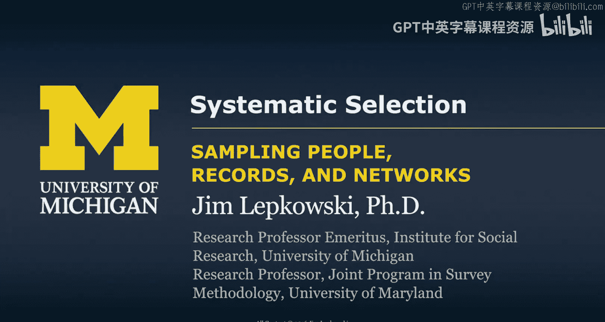
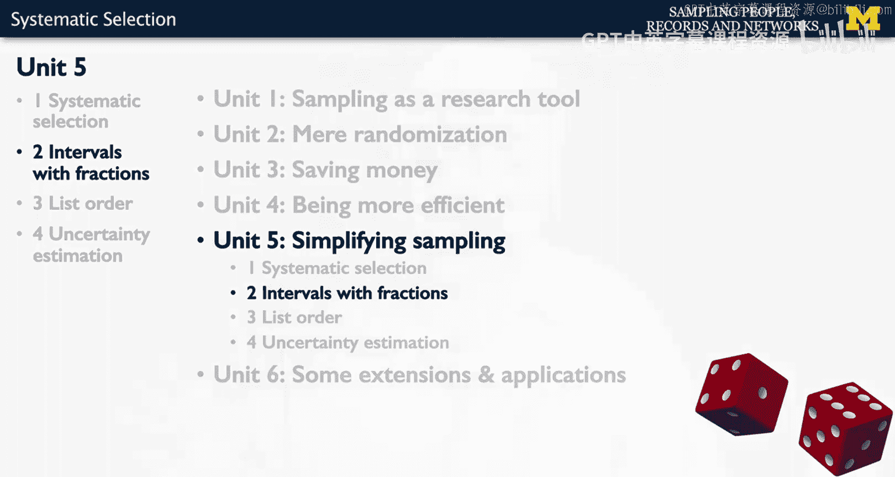

# 密歇根大学《调查数据收集和分析（2-6：方法、社调问卷设计、抽样、缺失数据、分析）｜Survey Data Collection and Analytics》 p112 33_5.1 系统选择法.zh_en -BV1fw4m1e7Zh_p112-

As we mentioned at the end of the unit 4。Sometimes we can simplify our sampling techniques to avoid some of the complexities that we've had。

That we've dealt with up till now。 And we can do that by using a technique called systematic sampling。

And so what we're going to do in unit 5 is a kind of simplified sampling。

 simplifying the selection process， but then we need to look at that process in more detail to understand how it works in practice。

There will be four lectures here。One on the process itself。

 a second on the intervals that are used in the systematic sample。

 a third on list order and a fourth on estimating the uncertainty。

estimating standard errors for these sample designs。

But here what we're going to do is focus on the systematic sampling process itself。Now。

 systematic sampling is a very simple method of making sample selection from a list taking every so many elements。

So suppose that what we had was a population of transactions， in this case， records。

 these are billing records from credit cards。And in this particular case there's a little bit of information about each of these。

 there is a date and a time reference number that's quite a few digits。

 a category when the bill comes in， it's classified with respect to the type of business or transaction that occurred。

 a subcategory and some additional credit card information and then the amount。

 the amount that's shown in the last column there。And so in this case。

 we may be interested in drawing a sample of these， even though we've got all of them。

 we may be interested in drawing a sample of them because we're going to apply some additional process to them to understand something about the nature of the billings that we're receiving。

 We may be drawing a sample in order to call the card holder and ask them questions about the transaction that is not part of this record。

 We may be calling a sample of individuals to talk about other kinds of purchases they might make with our credit card。

 other kinds of things that we need additional data that's not present with these transactions。

 So that's a reason for sampling these records and then dealing with them in a sample setting set that involve survey data collection。

So we could choose to draw the sample here in any number of ways first we could start with the first one and take every 10。

That's a systematic sample。 that's an easy counting that we can do。

 We just keep changing the leading digits so for example。

 with our particular case we could take the first case and then take the 11th case we've just added a digit to the left and then the 21st case we changed the leading digit from a one to a two。

 the 31st case， the 41st case and so on we're taking every 10th。Where do we stop， Well。

 we're going to stop when we have and selections and is our sample size。 Now。

 this list has capital n elements。 Let's suppose that in this particular case。

 this list had 1000 elements in it and that we decided we， we only needed 50 of them。Well。

 there's a problem then if we start， obviously， if we start taking every 10th。

 starting with the first one， when we get done with our sample。

 we only will have sampled from the first half of the list to get 50 selections， taking every 10。

 starting with the first， we get the first and the 11th and the 21st and so on。

 And if I do that 50 times， my last selection will be element 501。

That means that elements 502 to 1000 have 0 chance of being selected。 as do， by the way。

 choosing the first element to start elements 2，3，4 through 10。 elements 12，1314 through 20。

 there's a problem here， obviously， in doing systematic sample and always sampling and always starting with the first and then taking every 10th。

 we don't spread our sample out across the entire list。

 And if there's something different about the transactions in the first half of the list compared to the second。

 We've missed it。 So we need to spread our sample out over the whole list。

 We're going to need to very。The count。To account for the。

 we're going to have to scale this to the size of the list。

 And we should also vary the selection start。 There's no randomization in this。

 If I always start with the first one， that poor first transactions always going to be in all my samples。

 I once did a sample of students from a population registry in a registrar's office for university。

 and they had been doing this all along。 They had always been sampling by starting with the first case。

 their programmer had an algorithm。 They found in a cookbook in a set of algorithms for random sampling that was actually systematic sampling and always started with the first case。

 I pitied that poor student who was first in the list because they were in all the samples as long as they were first in the list。

We're going to vary that。 So we're going to do two things to modify this procedure。

 What we're going to do is not take every 10th， but every 20th。

 If there's 1000 in the list and we need to get our sample spread across the whole list。

 what we're going to do is take 1000 divided by 50 to figure out the interval。

 not not just an interval that's convenient 10， but an interval that fits the size of the list。

 So we're going to add to our consideration， then account， but our count interval may vary。

 depending on the size of the list。In addition， we won't start with the first。

 but if we're going to take our sample from the first every 20th。

 what we need to do then is possibly vary the list selection by starting with a random place。

 And among the first 20。 because that way， when we start in the first 20。

 and we choose one at random and we keep adding 20 to that now to get our sample selections。

 When we get done， we will actually have a sample of size 50 before we run off the end of the list。

Because of the the。Scaling that we've done with respect to the population size。 So back to our list。

 then in our list， our transaction list， we randomly choose to start with the fourth one。

 We've looked up a random number。 We've generated a random number from our software systems。

 and we start with that that random selection。 and we take the fourth， and then we add the interval。

 the 24th， and we add the interval， the 44th， and we add the interval and so on。

 And so we've got a very even division of our population distribution shown on the lower left hand side。

 a very even spacing of our sample selection such that we get a required sample size。 Oh。

 and we start at random。 There's a random element to this。

So we've adapted our selection process to the size of the sample and the size of the list。

 We've calculated an interval to make it more formal。 An interval。

 let's call it K that is equal to the population size divided by the sample size。 In this case。

1000 divided by 50 or 20。 And we choose the random start anywhere from 1 up to K at random。Now。

 conceptually what this is doing is dividing the population up into groups of K size K。

 So we've effectively now divided that list of 1000 into 50 groups of 20 each。

 We'll see this in a second。 and then taken one from each of those groups。

It's like stratified sampling， isn't it， Stratified sampling divides the population up into groups。

 Not they' necessarily all equal in size。 Here， all of our groups are equal in size。 All of size K。

 all of size 20。 And we take one element from each。Here's the conceptual representation。

 The columns are the possible samples， the label across the top of the columns that we see here， 1，2。

3， through 20 are the possible random starts that we have。

And then the rows are the sample selections。1，2，3， up through 50。

 And notice that if we had chosen to start at random with one。

 our first selection would have been one， then 21， then 41， and so on。 Once we start。

 that sample is fixed It's systematic in that regard。 Always when we start with one。

 we get the same sample from this population。 But if our random start was4。

 as we had talked about before，4，24，44 and so on。 that set of selections， is always the same。

Conceptually， what's actually been done here， is the equivalent of cluster sampling。 Every column。

 which is a possible sample， is a cluster。 It's a set of elements that always come into the sample together。

 That's what a cluster is。 It's a school where all of the students come in together。

 It's a block where all of the housing units come in together。 Here。

 it's a set of elements that always come in together because they've been systematically selected。

 And they're all the same size。 This is very interesting。

 Here is a case where we have clusters of equal size。 And there are 20 of them。

 And by choosing one of them is a random start starting point， a random start from one to 20。

 We've chosen one of the clusters。😊，So this is equivalent to cluster sampling。

 Each possible systematic sample is a cluster of lowercase and elements。Well。

 that means it's a little more。Context here。 than we had first thought it we thought it was just a simple caing procedure。

 but now we've scaled it to the population size relative to the sample size。

 and we've added a random of variation。 Let's talk a little bit more about some other features of systematic sampling in our next lecture by turning to talk about those intervals。

 Because sometimes in the interval， actually， most of the time。

 The interval will not be a whole number like that。 It won't be 20。 It may be some fractional part。

20。220。57100 with some fraction， some decimal fraction。 What do we do with that。

 when we do our sample selection。 And that will be our next lecture as we continue our discussion about systematic sampling。

 Thank you。

