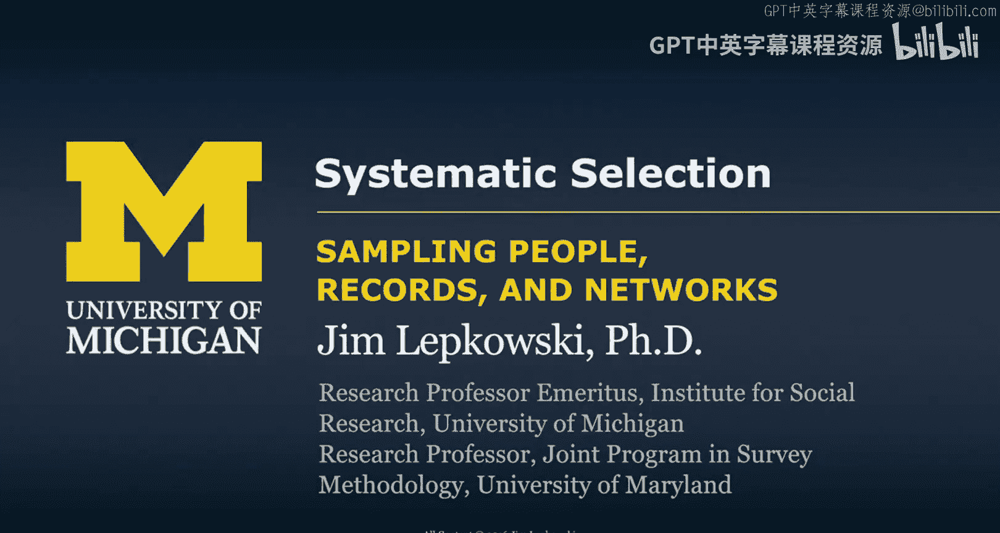
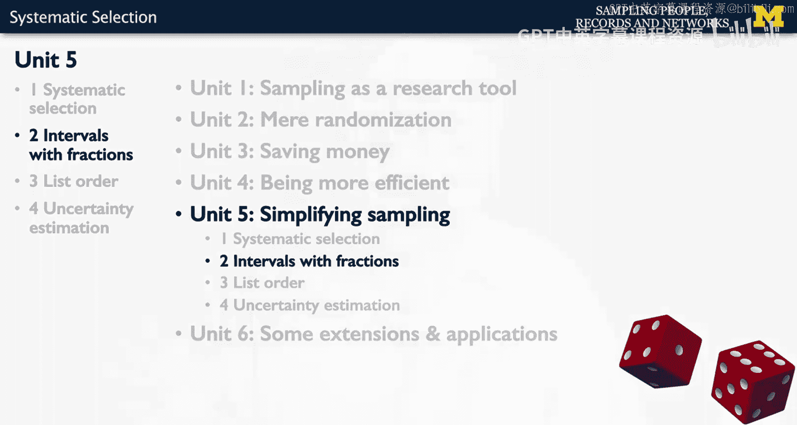

# 调查数据收集与分析：5.1：系统抽样法 📊

在本节课中，我们将学习一种简化的抽样方法——系统抽样法。我们将了解其基本操作流程、核心概念以及在实际应用中需要注意的关键点。

## 概述

在上一单元，我们讨论了抽样技术的复杂性。本节我们将介绍一种简化选择过程的方法：系统抽样法。这种方法通过从列表中规律性地选取元素来获取样本，操作简单，但背后有其特定的统计原理。

## 系统抽样过程

系统抽样是一种从列表中抽取样本的简单方法，即每隔固定数量的元素抽取一个。

假设我们有一个由交易记录构成的总体，例如信用卡账单。每条记录包含日期、时间、交易类别、子类别、信用卡信息和金额。虽然我们拥有所有记录，但可能仍需要抽取一个样本。例如，我们可能想通过电话访问持卡人，询问未记录在账单上的交易细节或其他消费信息，这就需要额外的调查数据收集。

我们可以用多种方式抽取样本。首先，可以从第一个元素开始，然后每隔10个元素抽取一个。这就是系统抽样，一种简单的计数方法。

## 初始方法的局限性与改进

然而，上述简单方法存在明显问题。假设列表共有 **N=1000** 个元素，而我们只需要 **n=50** 个样本。如果从第一个元素开始，每隔10个抽取一个，那么抽取50次后，最后一个被选中的元素将是第501号。这意味着第502至1000号元素完全没有被选中的机会。同样，由于从第一个开始，第2至10号、第12至20号等元素也永远不会被选中。

这种方法无法让样本均匀分布在整个列表中。如果列表前半部分和后半部分的交易存在差异，我们将完全错过后半部分的信息。因此，我们需要改进方法，使样本能够覆盖整个总体。

我们需要做两处关键改进：
1.  **调整抽样间隔**：根据总体大小和所需样本量计算间隔，而不是随意选择一个方便的间隔（如10）。
2.  **随机化起始点**：不要总是从第一个元素开始，而应从一个随机位置开始。

以下是具体的改进步骤：

首先，计算抽样间隔 **K**。公式为：
**K = N / n**
在本例中，**K = 1000 / 50 = 20**。这意味着我们应该每隔20个元素抽取一个。

其次，随机选择一个起始点。这个起始点应在 **1 到 K**（即1到20）之间随机产生。假设通过随机数生成器，我们得到的起始点是4。

那么，我们的样本将由以下元素构成：第4号、第24号（4+20）、第44号（24+20）……依此类推，直到抽满50个样本。这样，样本就能相对均匀地分布在整个1000个元素的列表中。

## 系统抽样的本质：整群抽样

从概念上看，系统抽样等价于一种特殊的**整群抽样**。

我们可以将总体列表想象成被分成了 **K** 个（本例为20个）大小相等的“群”。每个“群”包含 **n** 个元素（本例为50个），但分群的方式是系统的：
*   第一个“群”包含元素：1, 21, 41, 61, ...
*   第二个“群”包含元素：2, 22, 42, 62, ...
*   ……
*   第二十个“群”包含元素：20, 40, 60, 80, ...

当我们随机选择一个1到20之间的起始点时，实际上就是随机选择了这20个“群”中的一个，并将该“群”的所有元素作为我们的样本。因此，每个可能的系统样本（即每个“群”）就是一个“集群”，其内的元素总是被一起选中。

## 总结

本节课我们一起学习了系统抽样法。我们了解到，基本的系统抽样是从列表中规律性选取元素。为了确保样本覆盖整个总体且具有随机性，我们必须进行两项关键改进：**根据总体和样本量计算抽样间隔K**，并**在1到K的范围内随机选择起始点**。最后，我们从整群抽样的视角理解了系统抽样的本质，即每个可能的系统样本可被视为一个大小相等的“集群”。

在下一讲中，我们将探讨一个实际问题：当计算出的抽样间隔 **K** 不是整数（例如20.57）时，我们应该如何处理。这将帮助我们更深入地理解系统抽样的实际应用。