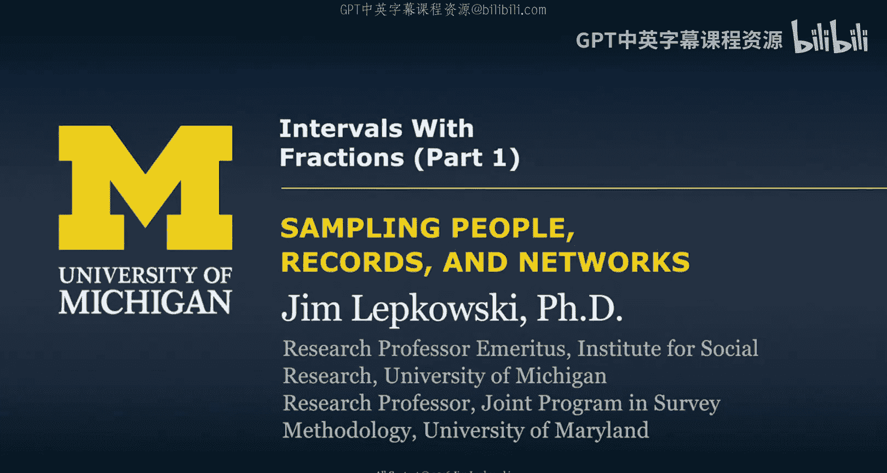
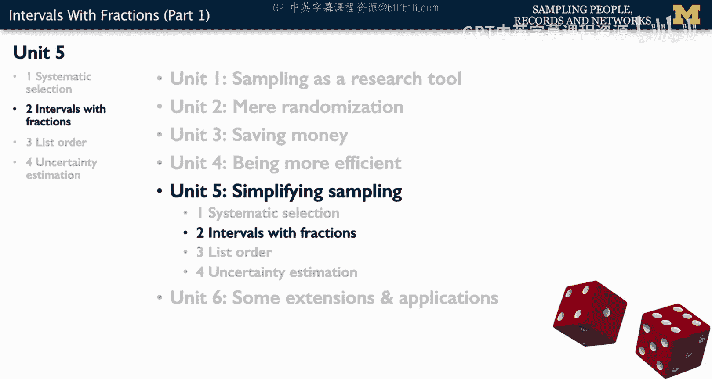
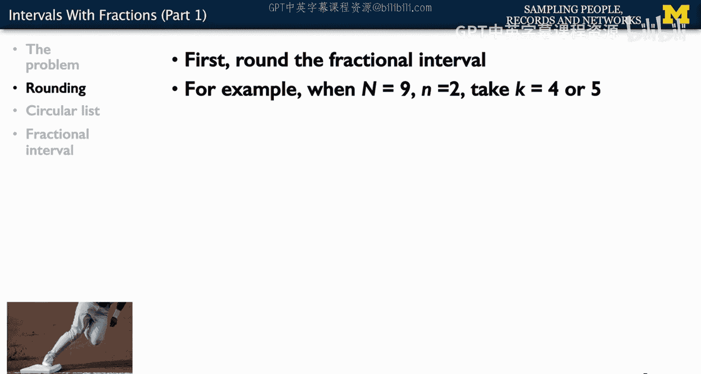
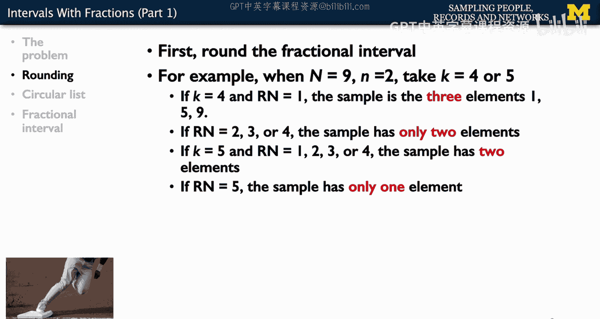
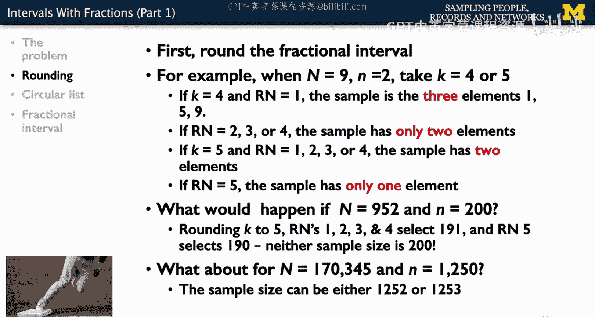
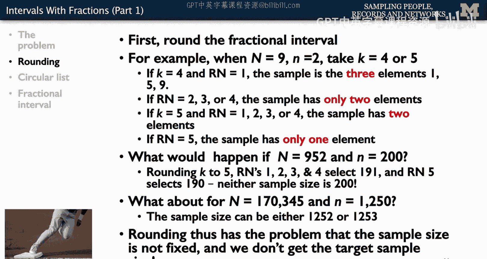
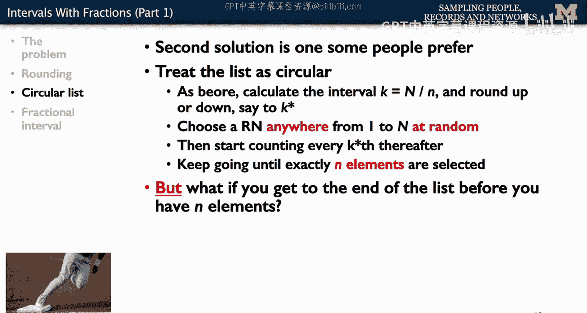
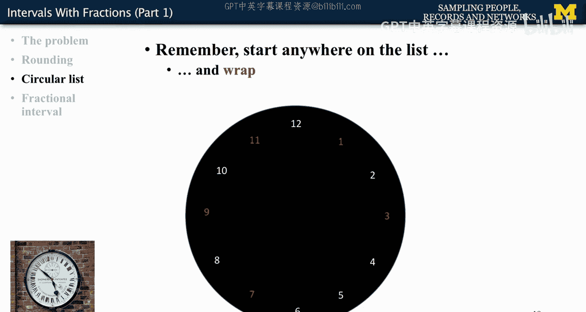
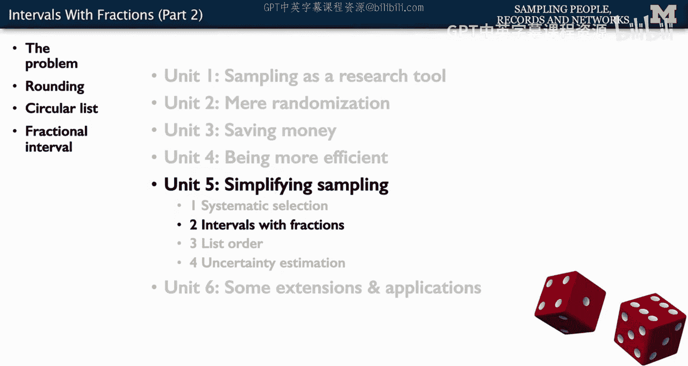

# 密歇根大学《调查数据收集和分析（2-6：方法、社调问卷设计、抽样、缺失数据、分析）｜Survey Data Collection and Analytics》 p113 34_5.2 分数间隔处理(上).zh_en -BV1fw4m1e7Zh_p113-

We've been talking about systematic sampling now as part of unitt 5。

Having discussed the basic principles of systematic sampling and the features that make it simple and applicable in many situations。

In this lecture， lecture 2 from unit 5， what we're going to do is discuss。The interval。

The sampling interval that we calculated before， except in our earlier illustrations。

 that sampling interval had a whole number。 There was no fractional part。

 and it's quite possible to get intervals when we take the approach that we looked at last time。

That involve a fractional part a decimal。

So what we're going to do is talk about the nature of that problem。

And then three solutions to that problem。And in this lecture。

 we will talk about rounding as a solution。And circular lists as a solution。

Then we'll take a break and we'll come back to talk about something that's called a fractional interval as a way of dealing with this particular problem。

But first， the problem。Our process is one in which we first determine a sampling interval by taking the population size。

 the length of the list。And dividing by the sample size to get an interval K。

 And then we choose a random number from1 to K as our starting point。

 And when we take that random number， we select that case。

 and then we add K to that random number to get the second selection。

 We add K again to get the third selection and so on。So， for example。

 if there were 12000 elements on a list， in this case， dwellings， housing units in a city。

 and we had a list of all of them， and we were doing a systematic sample of them of size 500。

Our interval would be calculated as K。Of 12000 divided by 500 or 24。

 We're going to take every 24 housing unit from the list。After a random start。

 and suppose our random number for that random start was 0，3。

 We look up a two digit random number between 0，1 to 2，4。And if it's 0，3。

 then we take the third dwelling， and then we add 24。To get the 27th。

 And we add 24 to that to get the 51st and so on。So that's the basic features of the problem。

 but what happens if in calculating that interval？The ratio of population size to sample size has a decimal。

 a fractional part。So for example， a very small population just to see it immediately of nine elements of which we're taking two。

Then our interval is 4。5。If we happen to have 952 elements。

 as I once had on the list and was sampling 200 of them。Then the interval is 4。76。

 It can be even more decimals。 For example， a list with 170345 elements， of which we are taking 1250。

 Well， there， the interval has three decimals to it。

 and we can get repeating decimals and other problems。

 But let's limit our consideration to one or two decimals。 Even if we have three or more。

 we may round to3 or round to two decimals there to work with。

But what are our alternatives for dealing with a situation like this， We could do an obvious thing。

 which is to consider among our alternatives the idea of rounding。

 rounding the interval to eliminate the fraction。So for example。

 when that population was of size9 and we took two， we could take an interval of 4 or5。

 We could take the 4。5 as the interval and round it up to five or simply trunccate it and round it down to four。

 we don't have to follow the usual rounding rules that are used in statistics and math and in science。

 we can simply move it up or down depending on our individual circumstances。

Now， I， I'm an American baseball fan and was been watching baseball past year。

 And this is not the kind of rounding that goes on there where they are rounding the bases。 Now。

 this is the kind。 and although it has that same feature。

 this is the kind in which we're choosing an integer。

Either the integer that precedes the decimal portion or one more than that integer。

So for this particular case， if we rounded， decided to round to 4 as an interval and chose as a random number one。

 then we would select the first and the fifth and the 9。In each case， we've added the interval。

 And when we got to the last one and we were adding the interval one more time to the  ninth。

 we realized we're off the end of the list。So there's only three possible selections there。

 On the other hand， though， when we've routed to an interval of size 4 and a random starts are 2。

3 or 4。2，3 or 4。The sample will have only two elements。It would be two and six。Or4 and 7， or 4 and 8。

So we now see that we've got our sample size variation when we round and it goes。In both directions。

 it doesn't solve the problem to round up in this particular case。

 If our interval is 5 and our random starts are 1，2，3 or 4。

The sample could have two elements chosen when those random numbers are random starts with 1，2。

3 or 4。 And if the random number were 5， then we have only one element that's chosen。

 So we get fluctuation between two numbers in the sample size。

Well， that kind of an approach。

Can be more complicated with larger kinds of problems， for example。

952 in the population and 200 in the sample。Here， if we round the interval。To be 5， that was a 4。76。

 And we rounded up to 5 random numbers 1，2，3， and 4 will' select now， not not 200， but 191。

And random number5 gets us one less。 We don't even get the exact sample size for this particular one。

And so the rounding problem can be more severe in certain circumstances。

Even when we have 170345 and a sample of 1250， our rounding of that interval that we had before could lead to 1252 or 1253 elements in the sample。

So rounding is a feasible solution， but it has two problems with it。

 One is that the sample size will vary depending on the random start， vary by one。

The second is that it may also not lead to the exact sample size that we were interested in or even being won away。

 We may be further away than that。

So with that。In mind that the sample size is not fixed and we don't get the target sample size。

 We ought to seek another solution。Ignoring rounding is an alternative is just being aware of the consequences of doing it。

whether we round up or round down， whether we get the sample size that we desire or a sample size that is one more or one less than we desire。

If that is acceptable in our particular framework then。In our context， in our problem。

 then rounduting is a perfectly valid solution。

But many people would prefer to see a fixed sample size。 They don't want to see it fluctuate。

 It could for budget reasons。 It could be for， for cosmetic reasons。

 You've told the sponsor they're going to get so many cases。 And instead。

 you come back with with a different number。

A solution that some people then would advocate is what's referred to as a circular list。As before。

 we're going to calculate an interval。 And when we have a fractional part。

 we'll round up or round down。To some interval， say K star。 So before， if we had an interval of 4。5。

 we could run down to 4 or up to 5。 Those would be our K star for that one。

But now when we go to choose our random start， we don't choose it from one up to the interval。

 we choose it anywhere on the list。Anywhere of the capital N elements on the list at random。

And then we start there and keep going until we have an element selected。 But。

 but there's the obvious problem that。We could get to the end of the list before we have our lowercase and elements。

But let me repeat that again。 We're going to make our selection with that random start and keep adding the interval。

 We only stop when we have our sample size。The required sample size。

 not the rounded up one and the one that we might get with the rounding where we go up or down。

 but the fixed sample size。

Now， think about this one like a clock as a solution here。 This is the the wrapping of the numbering。

 and we do this all the time。 So here's a 12 hour clock in my lower left image。

 there's a 24 hour clock， but we do it all the time。 as we get to the higher numbers。

 we just start rounding around。 So if it happened to be 11 o'clock at night and said or 11 o'clock in the morning and someone said to you。

 I'll be there in two hours。 you know， to。Add two hours。

 you're going to count up by one to 12 and then one o'clock。Well。

 the same kind of thing happens here when we're doing this kind of rounding。

 Suppose that in this particular case， we're going to choose an interval of two。

 we've got a population of 12。We're going to choose five of those elements， and our interval is 2。4。

 12 divided by 5。Suppose that we've decided to round our interval down to 2。

 and we choose our random start anywhere on the list now， not， not between one and 2。

 but anywhere from 1 to 12。So we look up a two digit random number from 0，1 to 1，2。

 And we've identified that， we begin the process。So suppose that our start was at seven。

 randomly chosen。Then we would add two to get to nine。And to that 9， we would add 2 to get to 11。

 But now when we add 2， we're off the end of the list。

 And so what we would do is wrap around to the next one。 That is one。From 11 to 1。

 And then we would add our interval again to get three。 We're done with our sample at that point。

So we have in our sample 7，9， 11，1， and 3。Random start of 7 interval of 2 and wrapping from the end of the list back to the beginning of the list。

Now， remember with this one， we can start anywhere on the list。

 But then when we get to the end of it， we wrap。

So circular list， just think about this as a giant clock。 And if we had a clock with。

900 elements on it。 it's the same thing When we get to the end of that list and our interval adding our interval to that last selection takes us beyond the end of the list。

We count， however many it takes to get to the end of the list。

 and then we resume our counting at the beginning of the list。

So if our last selection in a list of 900 was 8，90 and our interval were 20， we would count 8，91，2，3。

4，5，6，7，8，9， And then we would continue 9 and 0 to 900。 There's 10。 And then we count 10 more。

1 through 10 to get our selection， which is the 10th element。 Now， at the beginning of the list。Okay。

 now it's a little bit tricky because this is going to be confusing for some of us。Rounding。

We choose。One of two alternatives。We take our rounded interval。

 and we choose a random start between one and that interval， and then apply that to the list。

 We're going to start in the beginning and go all the way through until we get to the end。

 but we know that we may not get our exact sample size， and it may fluctuate by one。

Or instead of choosing the random start between one and the interval， the rounded interval。

 we treat it like this clock like this circular list。

 and we choose a random start from anywhere on the list from one to capital N。

And then we begin our process of taking that random start。

 And then the next selection is that random start plus the interval。

 The next one is the random start plus two times the interval and so on。

 And when we get to the end of the list， wrapping around at the beginning。Now。

Just one aside to note here。I've assumed that we know Capital end and is actually there in the list。

 Sometimes we do systematic sampling in settings where we don't have the full list assembled。 Sa。

 for example， we're dealing with a process in which there are people flowing through a a meeting point。

 a starting point， a stopping point， passengers getting off of an airline flight。

 people entering into a conference at at a single entrance。

 and we decide to take every so many subjects there。Well。

 we would have to gauge roughly how many subjects are going to go get beyond that flight or how many subjects are going to pass through our entry point in order to control our process and know what size sample we want。

But there， we wouldn't have a circular this problem， nor would we have this。

Fraactctional interval kind of problem where we're going to have fluctuation and sample size。

So we can do systematic sampling without knowing capital N。

 but the approach that we would take would largely be the one where we've got some rounded whole number interval that we're going to be using in a circumstance like that。

Well。There's two techniques。 There's one more that we want to talk about called fractional intervals。

 But before we go on to that， let's take a break and resume our discussion for lecture 2 after a little bit of a break。

Thank you。

