# 密歇根大学《调查数据收集和分析（2-6：方法、社调问卷设计、抽样、缺失数据、分析）｜Survey Data Collection and Analytics》 p114 35_5.2 分数间隔处理(下).zh_en -BV1fw4m1e7Zh_p114-

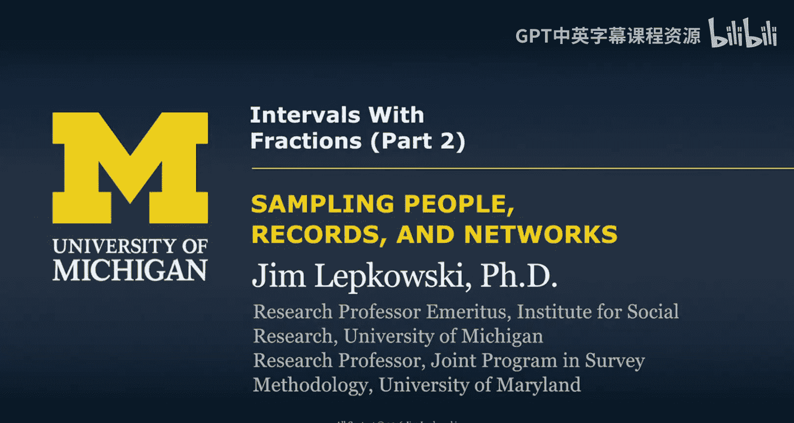

We now know that systematic samples depend on two features of our design。

 the interval and the random start。The two work together。

 Our random start can be between one and the interval or could be anywhere on the list。

 depending on the sampling technique， the systematic sampling technique， we're going to apply。

And we've been looking at some methods for dealing with the situation where that sampling interval has a fractional part。

 a decimal part that goes with it。

So we want to continue to look at these fractional intervals by talking about the approach that in dealing with this。

 we take the fractional interval directly this is the third alternative among the three that we're going to discuss for systematic sampling。

Now this one requires us to be both focused on a technique that we learn。

 and then we have some insight into how the technique works。

And we're actually just going to use the fractional part。

 we're not going to round it away in our interval， but we're actually going to use it in determining which elements are selected。

So let's say that we had a list that had 23 elements in the population and we're going to draw a sample of five。

So 23 elements， sample of 5。 our interval would be 23 divided by 5 or 4。6。Now。

 to choose our random start now， oh， we're not going to round that interval。

 and we're going to choose a random start that includes the decimal。So that random start could be 0。

1。Or 0。2 or 0。3。Point4。 Now， that sounds odd。 How can we start with a 。4 when there is no element 。4。

 We're going to have to do some rounding， but the rounding is done after we have calculated the selection。

And we include the fractional part in that calculation of the selection before we do any rounding。

 So all we're going to do is shift the rounding from the interval to the selection。

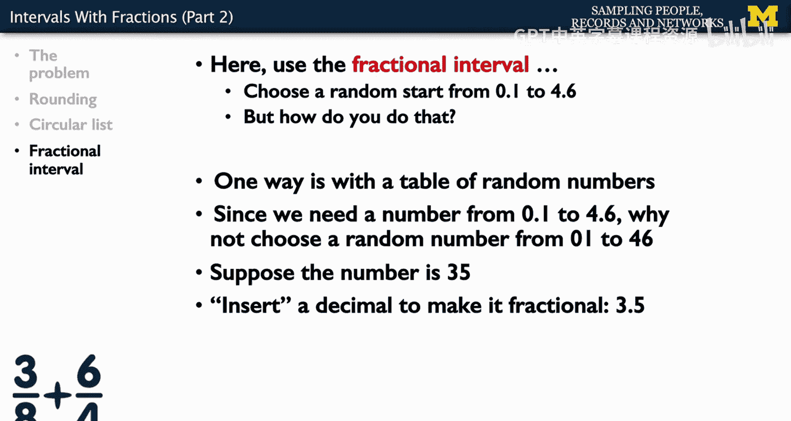

All right。 so let's start with a table of random numbers and choose a random number from 0。1 to 4。6。

Then we're going to have to think a little bit creatively about it。

 Our random number tables don't come with decimals inserted in them， but it doesn't matter。

 What we're interested in is any number from 0，1 to 4，6。

 where we're going to insert the decimal between the two digits。 We need a 2 digit number。

 Then from 0。1 to 4。6。Or one to 46。 and then we're going to insert that decimal。

Suppose that number that we choose is 35。

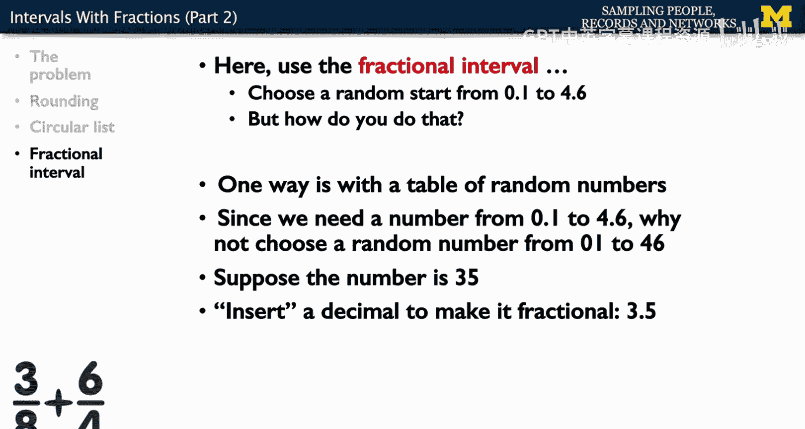

Or inserting the decimal， making it a fractional interval gives us an interval of 3。5。

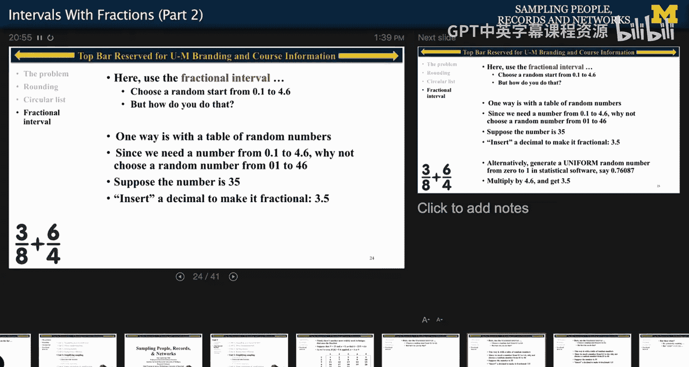

What are we going to do with that before we get to that。

 What are we going to do if we don't have a table of random numbers？ Well。

 we can go back to our system of generating uniform random numbers。

 things that we talked about when we talked about random numbers from 0 to 1 in the software package。

 And in this particular case， we've generated a uniform random number from our package。

 whatever it happens to be， and it happens to be 。76087。Well， that certainly doesn't get us started。

 We need a random number， not from 0 to 1 as that generator provides it， but from 0。1 to 3。5。

 Let's simply multiply 4。6。The interval that we have by that， that。Random start that 。76087。

 We get 3。5 again。And that's our random start。 So， so either way we're going to look it up in a table。

 implied decimal， or we're going to use a generator that gives us a number on the uniform distribution between 0 and 1。

 and then multiply that times the interval to get our random start for our process。

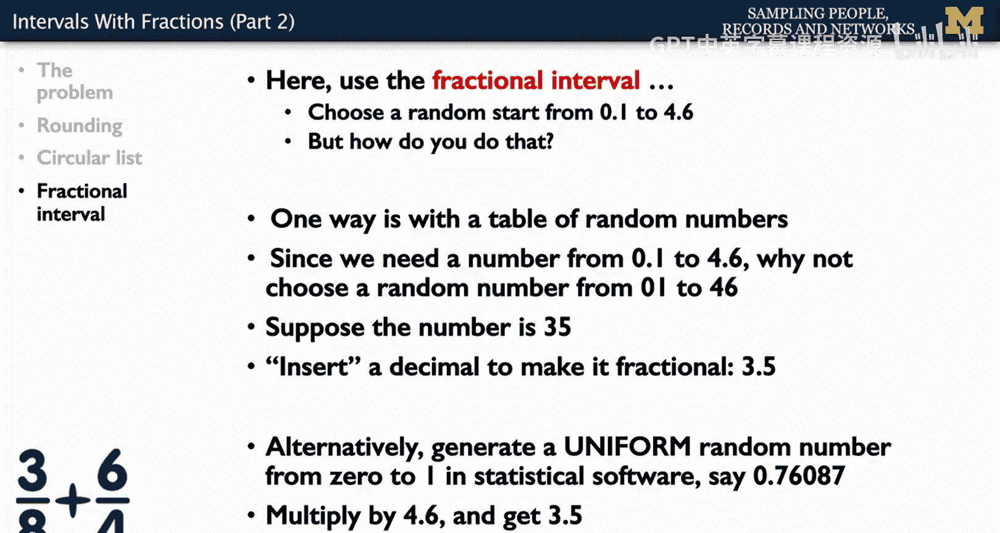

But wait a minute。 What do we do at that point。 Will， we continue。

 We're going to continue this process by doing the systematic counting now and not counting by whole number by 4 by 10 by 15。

 by 37， but counting by the actual interval 4。6。

So we start for the first selection with 3。5， and we count to 3。5 plus 4。6 to 8。1。

Now I know the fractional。Part is there， but we're going to leave it there。

 We're just going to use it all the way through before we do any rounding。Again。

 we're going to add the interval of 4。6 to what we just got to the 8。1 for our third selection，12。7。

Add it again one more time to 12。7， the 4。6 to 17。3。And at one more time。

 were not off the end of the list，17。3 plus 14。621。9。And one more time， oh。

 now we go off the end of the list。4。6 plus 21。9 is 26。5。 There are only 23 elements on our list。

 so we gone too far。 Our five selections then happened to be those that we got up until the time we went off the end of the list。

And so that oops factor says， yes， we're off the end of the list， but back up。

Because we now have as our selections 3。5，8。1，12。7，17。3 and 21。9。But wait a minute， we。

 we have these decimals remaining。 We're going to have to round them at this point。And a simple and。

From a probability point of view， acceptable way to do the rounduting is truncation。Trunation。

 just dropping the decimal， is's a form of rounding。

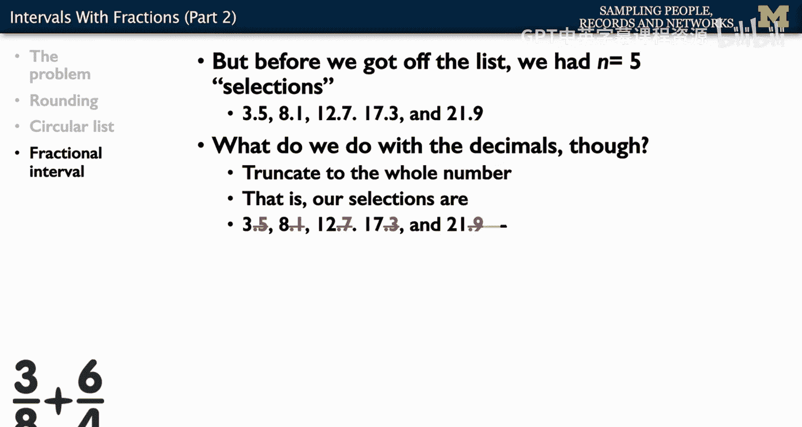

Our usual rounding rule is to round up or round down， depending on whether the decimal portion is 0。

5 or larger， rounding up or less than 0。5 and rounding down here。

 let's just simply strike that decimal in each of those cases so that our selections now become 3，8。

12，17 and 21。

Now we've got 3，8， 12， 17 and 21 selections。And notice something about them。

From 3 to6 is an interval of five。From 8 to 12 is an interval of 4， from 12 to 17， an interval of 5。

 from 17 to 21， an interval of 4。 Our interval is varying。

Depending on the rounding that's actually happened， Oh， the rounding。

 it's the accumulation of the decimal portion of the interval of that 4。6。

 And sometimes it causes us to go up by 5。 Sometimes it causes up us to end up having counted by 4。

 our interval varies across all possible random starts。

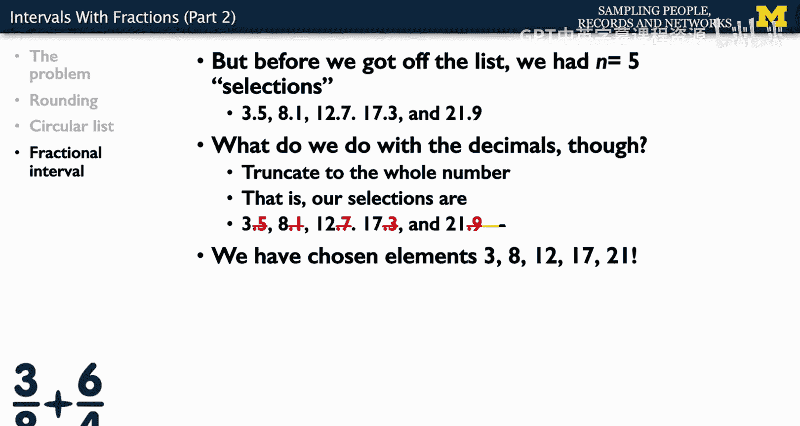

The interval， when we take all of these gaps between each of the selections and average them。

 will be indeed 4。6。Remember our conceptual representation for this in which we had columns that represented the different samples and rows。

 the different elements in the samples。Well， think about it this way here in this display。

 you'll notice the red numbers are those that are actually selected。

 The columns are the random starts。Now， let's move over to the random starts here。

 I didn't put them all on。 It's just too busy enough as it is， right， This is really hard to see。

 But move over to the column labeled 1。0 or 101 in red，0 and black。

And we'll notice that as we go down that column， we start with that element 1。0， and then add the 4。

6 to get 5。6，10。2，14。8，19。4。 And now we go through and simply drop the black digits to get our selections 1。

5，1014 and 19。And that's true of all the random starts from one， all the way up through 1。0 to 4。6。

 We got five selections， including the one that was initially our random start after we trunccate。

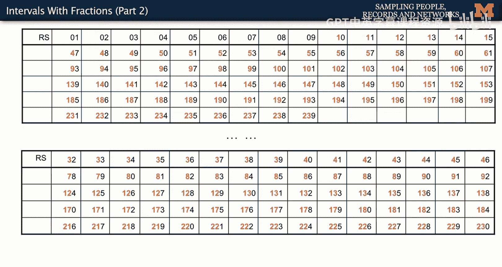

There is the problem of， well， wait a minute， what about those random starts that are less than one？

But in that case， if we drop the decimal， we get 0， there is no zeroth element。

 So we just continue on with the process。 So go to the column labeled 010。1。

Adding the interval is 4。7。 addinging the interval again is 9。3 and so on。

 And we can see that we get before we get off the end of the list。With truncation。

 we have five selections，4，9，13，18， and 23。

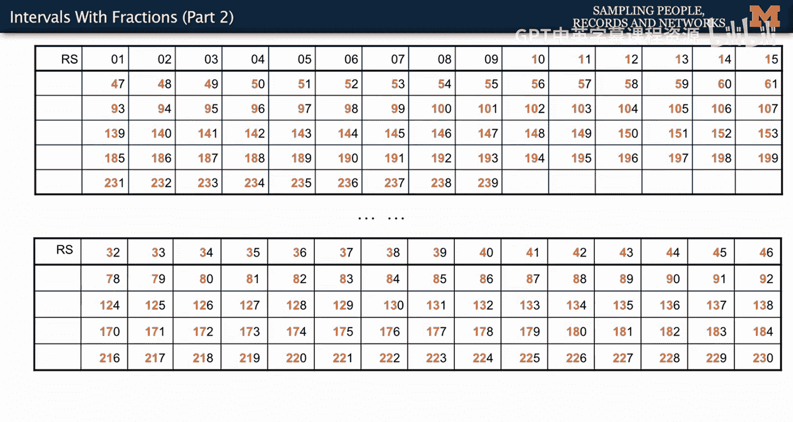

And that's true of all of those random starts from 0。1 to 0。9。 That is， we have  six numbers there。

 but one of them does not generate a selection， but the other five do。

That's the way the process would work in practice。So just to identify again one more time。

 in our case， we had a random start of 3。5。And that generated the 81 or 128。112。7，17。3，21。

9 truncating gave us our sample。 And if we had instead gotten instead of 3。50。5。

 one of thepostle random starts， we would still have the five selections，5，9，1418 and 23。

That we had before five selections， and be done。So every time we're going to get five selections back。

 there won't be any variation in the sample size。 It's always going to be a sample of size 5。

 and we seem to have solved the problem except for and we realize we've got this varying gap between the numbers。

 but once we've truncated doesn't matter。 we know that that gap on average will be the right one。

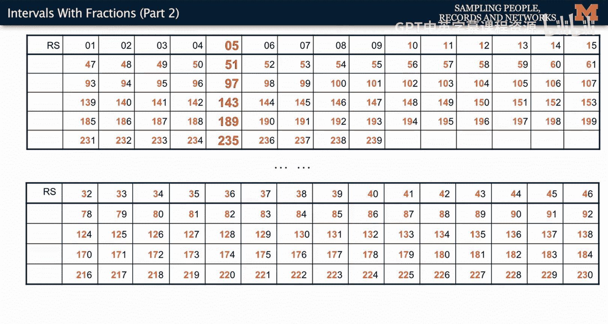

All right。 It seems like a reasonable solution， but it's a little bit confusing。

 What's really important here is whether or not every element in the list has the same weight。

 the same chance of being selected。So。Is every element in the list represented among this myriad of numbers now that we have。

 We've got lots and lots of selections that are occurring。 And when we do that truncation。

 do we get the right balance here， the right probability， an Epsom sample。

So here we could work backwards。 We could go through that list。

 and you may want to go back and do this and find all the instances where the first element is chosen。

You're going to have to find the 1。0， the 1。1， the 1。2 and so on through 1。9。

 where the truncation eliminates。The decimal portion。

It turns out the only way that element number one can be chosen in that scheme is if the random start is 1。

0 to 1。9， that is 10 to 19。 And there are 10 numbers there。

10 possible random starts to select element number one。That means that there are 46 random starts。

10 of which selected。 itss chance of selection is 10 over 46 or 1 in 4。6。

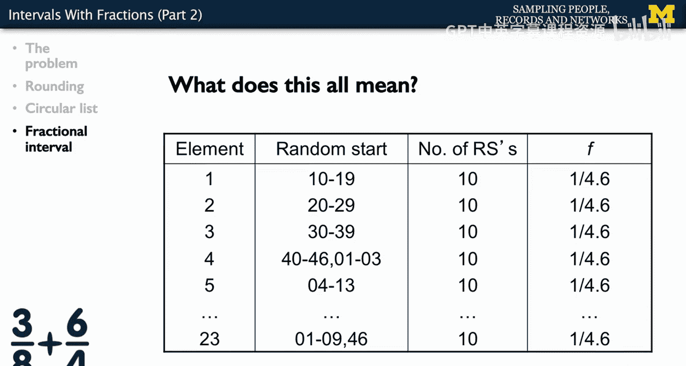

Or very importantly， one over the interval。The interval is actually the inverse of the sampling rate。

And so our sampling rate is one over the interval。And that's oftentimes how we express these things as we talk about these in the sampling realm。

 we're going to talk about a sampling rate of 1 in 4。6。

 which we now know we can implement through a fractional interval method to obtain exactly that sampling rate。

What about element 2， Well， it's the same thing， It's only the random starts 2。0 through 2。9。

 What about element 3， Same thing， There are exactly 10 random starts to get them。

 But now when we get to 4， there are two ways that the fourth element can come into the sample。

 Either the random start is at the end of the list，4。04。14。2 through 4。6。

 or if we go back to the beginning of the random starts。0。1，0。2 and 0。3， when we add the interval。

 and we truncate， we'll get us the fourth element。 And again。

 there's only 10 of those columns that will generate that fourth element in in one of our samples。

 same probability。For the fifth element。 now， this is a second generation one。

 This is one that can only be selected as one of the second selections provided the random start as any one from 0。

4 to 1。3。 But there are 10 of them。 And again， we get the the same result。

 We can go through and identify these selections all the way through with this kind of scheme。

 And identify 10 samples that every one is in。There is a little confusion here。

 Element 4 can come into the sample as a first selection。

 but element5 can come in as a first selection or a second。

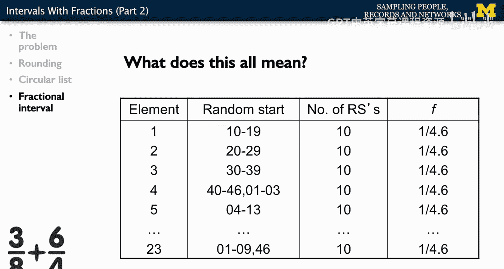

So that seems to be potentially confusing， but there's no problem with the probabilities with something like this。

So， again， the simple method is Epsom In this particular case， this fractional interval。

 This is a very widely used technique for systematic sampling with fractional intervals。

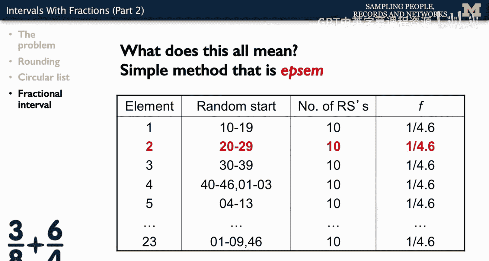

Well， there are some other techniques that we could do for dealing with a fractional interval。

 but they're beyond the scope of what we're doing， and they're not used as often they're used in particular circumstances or sometimes just by preference that someone would use them。

But we need to turn to another topic with respect to systematic sampling。

 We're going to talk about what happens if the underlying list has an ordering to it。

And what that implies in terms of the kinds of selections that we get。

 and we're going to consider several different kinds of list order and has an impact on the sample that we're going to talk about in our next lecture。

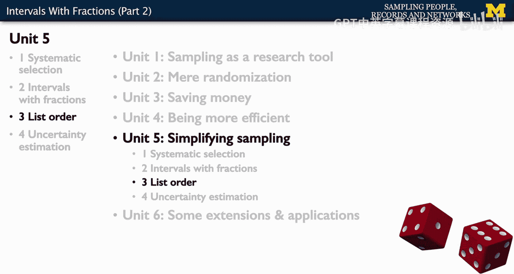

So please join us then when we talk in lecture 3 about list order in continuing our discussion about systematic sampling。

 Thank you。

