# 调查数据收集和分析：2-6：分数间隔处理（下）📊

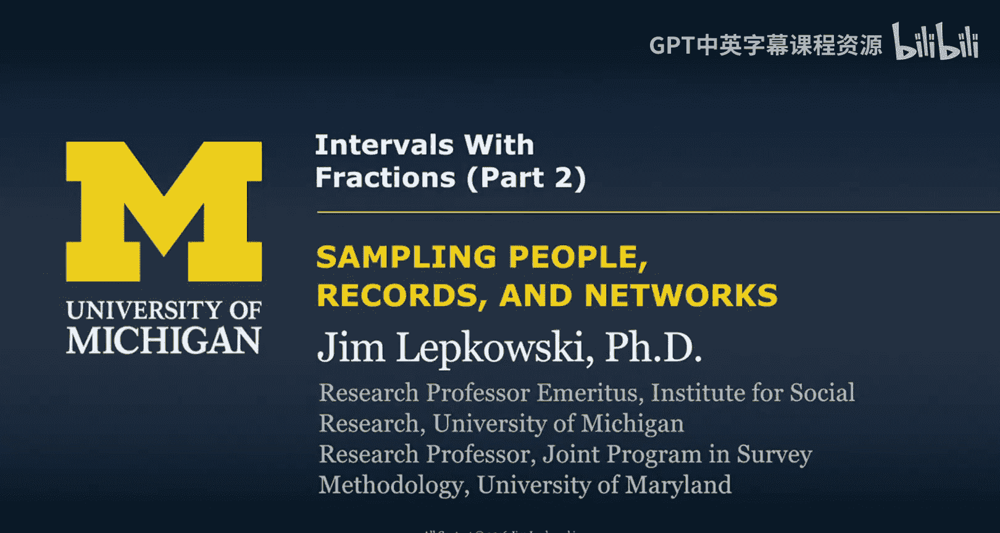

在本节课中，我们将继续学习系统抽样中处理分数间隔的第三种方法。我们将详细探讨如何直接使用分数间隔进行抽样，并理解其背后的概率原理。

## 系统抽样的核心要素

上一节我们介绍了系统抽样依赖于两个设计特征：**间隔**和**随机起点**。这两个要素共同作用。随机起点可以在1到间隔之间，也可以根据所采用的系统抽样技术，在列表上的任何位置选取。

我们一直在探讨当抽样间隔包含小数部分（即分数部分）时的处理方法。

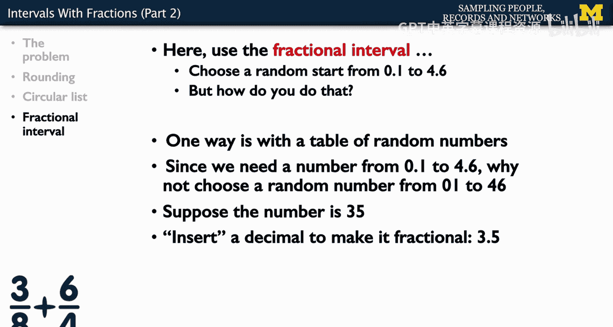

## 直接使用分数间隔法

本节我们将继续探讨分数间隔，重点介绍第三种处理方法：**直接使用分数间隔**。这是我们将讨论的三种系统抽样方法中的第三种。

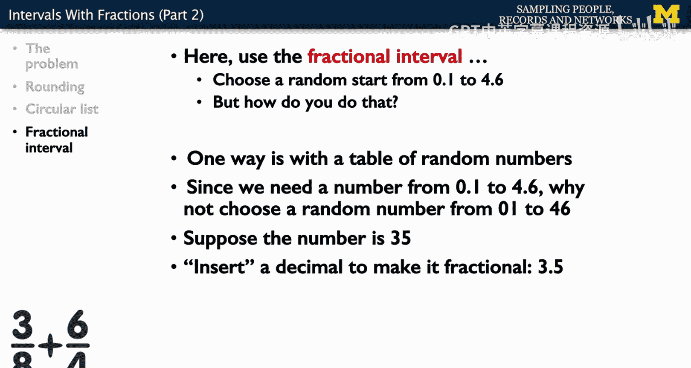

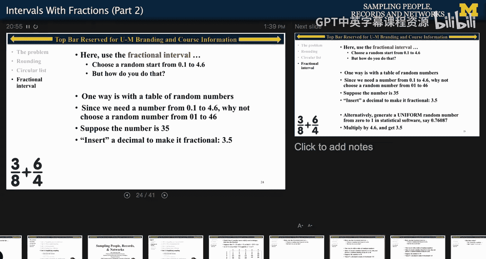

这种方法要求我们既要掌握一种技术，又要深入理解该技术的工作原理。我们将直接使用分数部分，而不是在计算间隔时将其舍入。实际上，我们将利用它来确定选择哪些元素。

假设我们有一个包含23个元素的总体，要抽取一个大小为5的样本。那么，我们的间隔将是 `23 / 5 = 4.6`。

现在，我们需要选择一个随机起点。注意，我们不会对这个间隔进行四舍五入，并且选择的随机起点将包含小数。因此，随机起点可以是0.1、0.2、0.3或0.4等。这听起来可能有些奇怪：当没有第0.4个元素时，我们怎么能以0.4开始呢？我们将需要进行一些舍入，但舍入操作是在我们计算出选择序列之后进行的。在进行任何舍入之前，我们会在计算选择序列时包含分数部分。我们只是将舍入操作从间隔转移到了选择序列上。

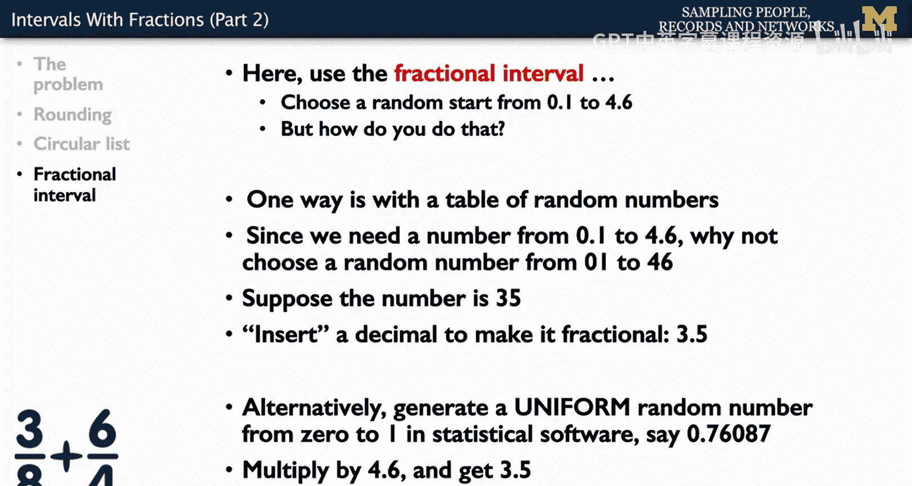

## 确定随机起点

首先，我们需要从一个随机数表中，选择一个介于0.1到4.6之间的随机数。我们需要创造性地思考一下：我们的随机数表通常不包含小数点，但这没关系。我们感兴趣的是任何从0.1到4.6的数字，我们将在两位数字之间插入小数点。我们需要一个两位数，范围从01到46，然后插入小数点。

假设我们选择的数字是35。插入小数点后，我们得到一个分数间隔的随机起点：`3.5`。

如果我们没有随机数表怎么办？我们可以回到生成均匀随机数的系统，即使用软件包生成0到1之间的随机数。在本例中，假设我们生成的均匀随机数是 `0.76087`。这显然不是我们需要的起点。我们需要一个介于0.1到4.6之间的随机数，而不是0到1。我们可以简单地将我们已有的间隔 `4.6` 乘以这个随机起点 `0.76087`，得到 `3.5`。这就是我们的随机起点。

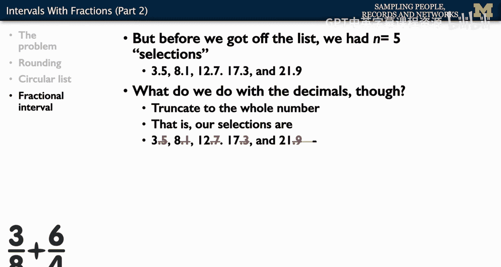

因此，无论是从随机数表中查找（隐含小数点），还是使用生成器生成0到1之间的均匀分布随机数再乘以间隔，我们都能得到抽样过程的随机起点。

## 进行系统计数与选择

接下来，我们继续进行系统计数。但这次不是按整数（如4、10、15、37）计数，而是按实际的间隔 `4.6` 计数。

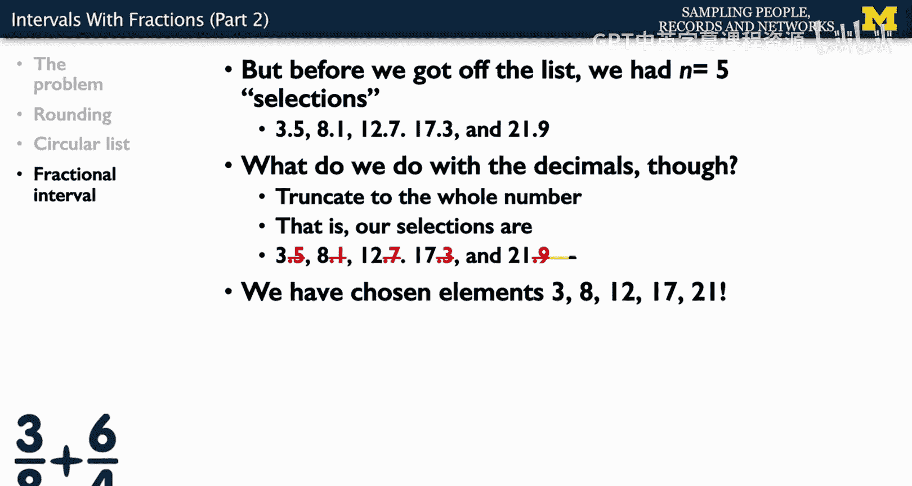

*   第一个选择：从 `3.5` 开始。
*   第二个选择：`3.5 + 4.6 = 8.1`
*   第三个选择：`8.1 + 4.6 = 12.7`
*   第四个选择：`12.7 + 4.6 = 17.3`
*   第五个选择：`17.3 + 4.6 = 21.9`

再进行一次加法：`21.9 + 4.6 = 26.5`，这已经超出了我们列表的23个元素。因此，我们抽取过头了。我们的五个选择就是超出列表范围之前得到的那些数字：`3.5`, `8.1`, `12.7`, `17.3`, `21.9`。

现在，我们仍然有这些小数。此时我们需要对它们进行舍入。从概率角度看，一个简单且可接受的舍入方法是**截断**，即直接去掉小数部分，这是一种舍入形式。

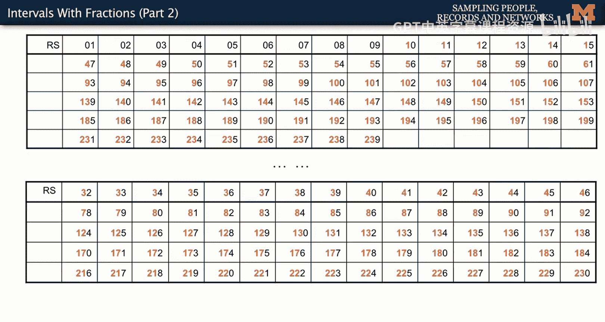

通常的舍入规则是根据小数部分是否大于等于0.5来决定向上或向下舍入。但在这里，我们只需简单地去掉每个数字的小数部分。因此，我们的选择变为：`3`, `8`, `12`, `17`, `21`。

## 观察与特性

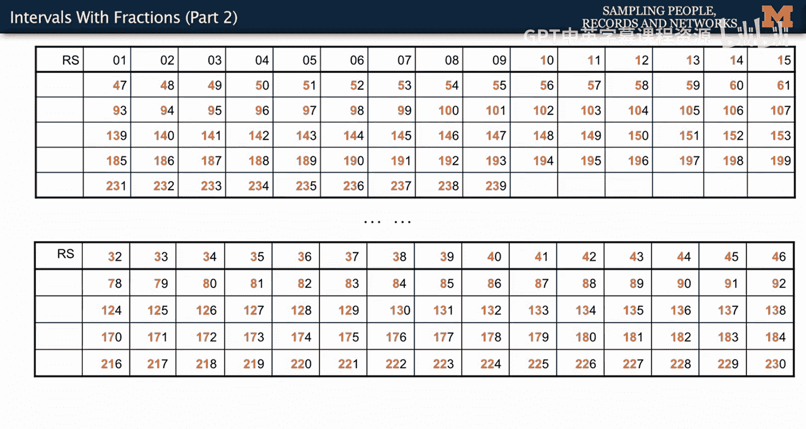

现在我们得到了选择：3, 8, 12, 17, 21。注意它们之间的间隔：
*   从3到8，间隔是5。
*   从8到12，间隔是4。
*   从12到17，间隔是5。
*   从17到21，间隔是4。

我们的间隔在变化。这取决于实际发生的舍入，实际上是 `4.6` 的小数部分累积的结果。有时它导致间隔增加5，有时导致间隔为4。对于所有可能的随机起点，间隔都会变化。

当我们取所有选择之间的间隔并计算平均值时，这个平均值将正好是 `4.6`。

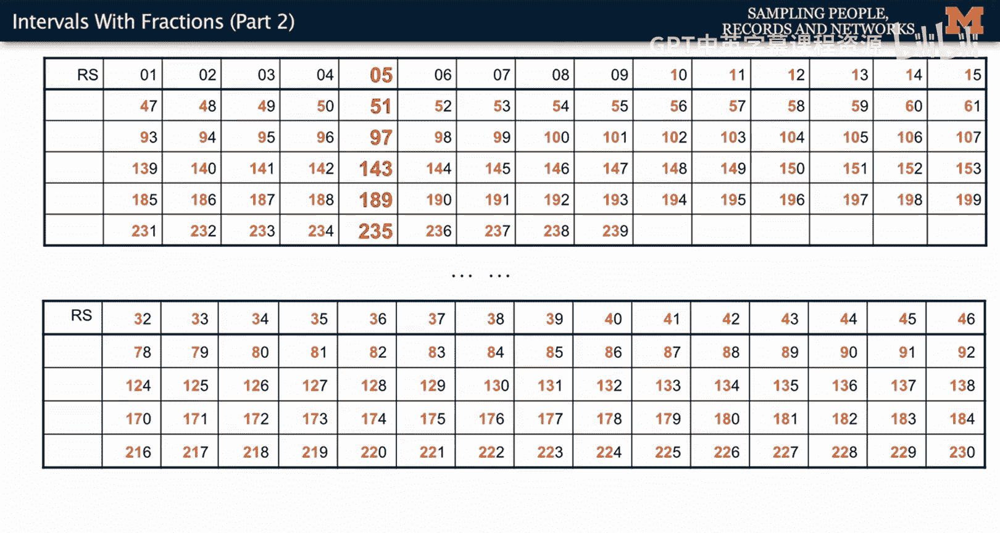

## 概率均等性验证

这似乎是一个合理的解决方案，但有点令人困惑。这里真正重要的是：列表中的每个元素是否具有相同的权重，即相同的被选中概率？

我们可以逆向验证。例如，元素1被选中的唯一方式是随机起点在 `1.0` 到 `1.9` 之间（即10到19）。这里有10个可能的随机起点。总共有46个可能的随机起点（从0.1到4.6）。因此，元素1被选中的概率是 `10 / 46`，即 `1 / 4.6`。

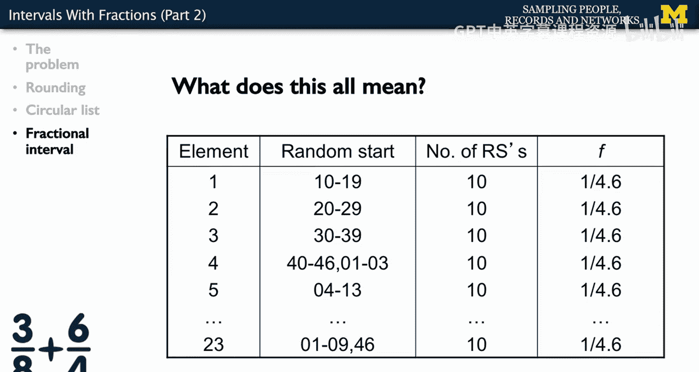

**非常重要的一点是：`1 / 间隔`。间隔实际上是抽样率的倒数。** 因此，我们的抽样率是 `1 / 4.6`。在抽样领域中，我们经常这样表述：我们知道可以通过分数间隔法来实现这个确切的抽样率。

对于元素2、3等，情况相同，每个元素都恰好有10个随机起点能选中它。对于元素4，它可以通过两种方式进入样本：作为第一个选择（随机起点为 `4.0` 到 `4.6`），或者作为后续选择（随机起点为 `0.1`, `0.2`, `0.3` 时，加上间隔并截断后得到4）。但总共也只有10种情况能生成元素4，概率相同。对于元素5，它可能作为第一个或第二个选择被选中，但总概率仍然相同。

这看起来可能有些复杂，但在概率上没有问题。每个元素被选中的概率都是 `1 / 4.6`。

## 方法总结与后续主题

因此，这种**直接使用分数间隔**的方法是等概率的，并且是处理分数间隔系统抽样时非常广泛使用的技术。

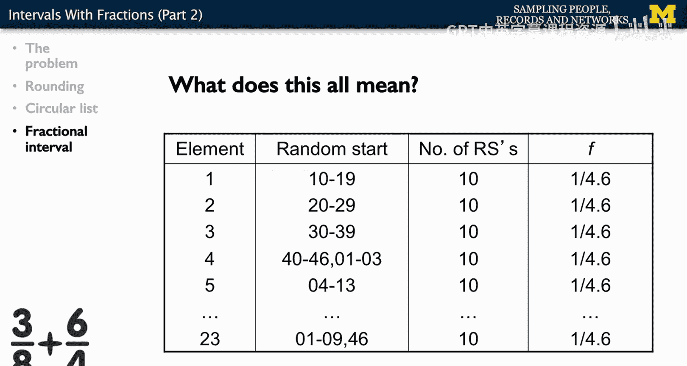

当然，还有其他一些处理分数间隔的技术，但它们超出了当前范围，使用频率不高，仅在特定情况下或个人偏好时使用。

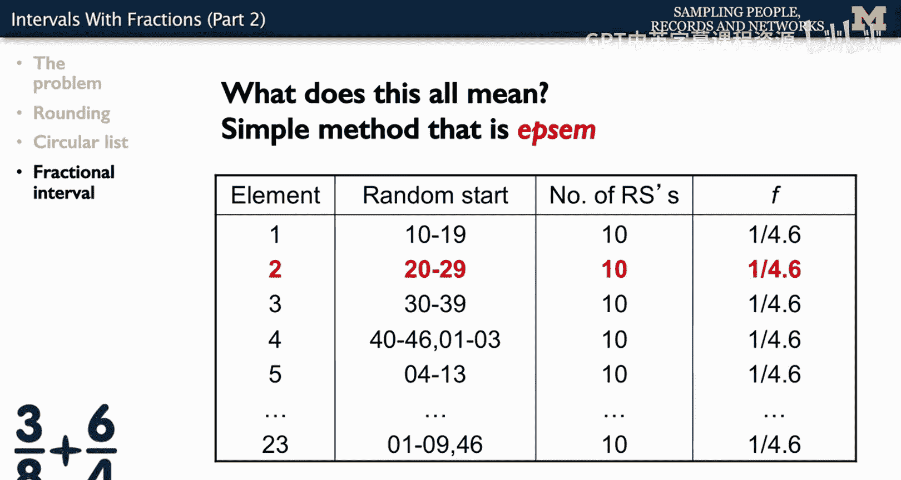

我们需要转向系统抽样的另一个主题：**如果底层列表本身具有某种顺序，会发生什么**？这种顺序对我们得到的样本类型有何影响？我们将在下一次讲座中讨论几种不同的列表顺序及其对样本的影响。

## 本节课总结

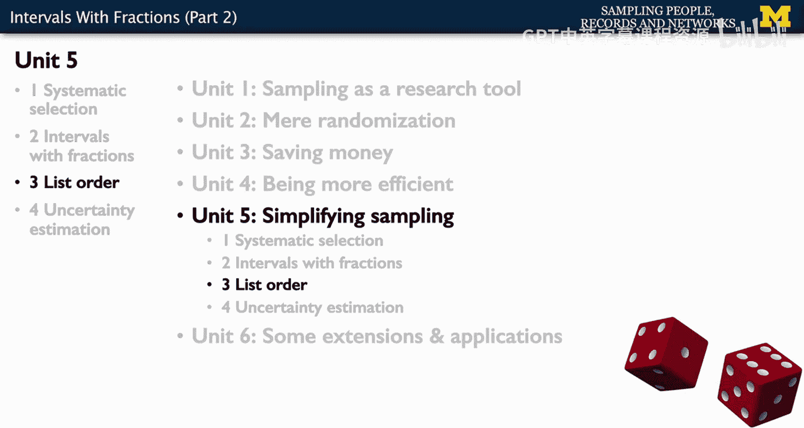

本节课中，我们一起学习了系统抽样中处理分数间隔的第三种方法——直接使用分数间隔法。我们掌握了其操作步骤：计算分数间隔、生成包含小数的随机起点、进行分数间隔的系统计数、最后对得到的序列进行截断舍入。更重要的是，我们理解了这种方法能保证每个元素具有相同的被选中概率，即 `1 / 间隔`，从而实现了等概率抽样。下一讲，我们将探讨列表顺序对系统抽样的影响。