# 密歇根大学《调查数据收集和分析（2-6：方法、社调问卷设计、抽样、缺失数据、分析）｜Survey Data Collection and Analytics》 p115 36_5.3 列表顺序影响.zh_en -BV1fw4m1e7Zh_p115-

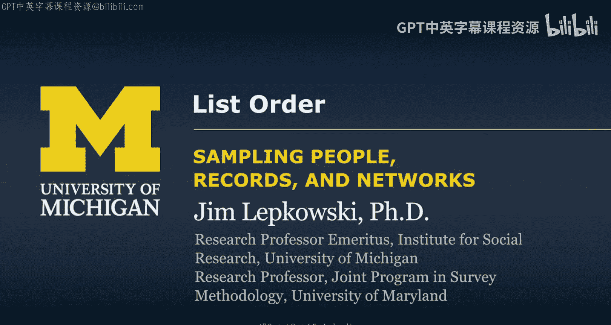

Systematic sampling appears on the surface to be such a simple procedure， just counting。

But then as we elaborated， try and apply it to different circumstances and begin to think about it。

 there are more and more complexities there than we realized as we examine the properties of the technique。

Here， what we're going to do in the third of our lectures on systematic sampling is talking about yet another aspect。

 So far， we've talked about the basic process and how it can be applied and what it looks like in principle。

 the conceptual framing in which we actually are drawing samples， a sample of a cluster。

 a cluster of cases that is all linked together by having the same interval and a common start。

And then we talked about fractional intervals as rising quite naturally in practice。

 and probably most of our intervals will be fractional in nature and how to deal with those。

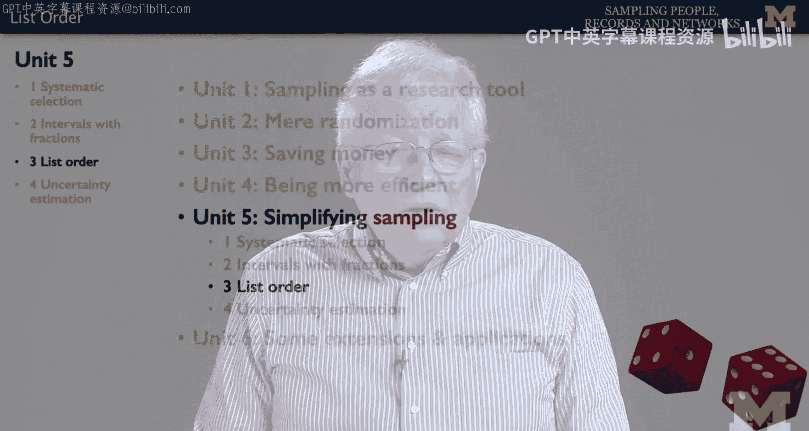

This。Lecture is about the list order。 That is， what is the order with respect to the characteristic that we're measuring of the underlying list。

 Now， we'll see why that matters。 It comes up as a potential benefit in what we're doing。

And so we're going to talk about this by talking about order plus selection。

 the combination of the selection process with the list order and what it gives us。

And then we're going to talk about underlying list orders。

 and we're going to talk about one in which the underlying list order is random。

 or we think it's random。Another in which the underlying list order is giving us effectively a stratified random sampling。

 one in which there's a serpentineina winding back and forth kind of order and what that may give us。

 Then we're going to talk a little bit about linear trend。

 which sometimes comes up as a reason not to use systematic sampling。

But as actually the overall perspective of the probability sample design。

 not really an issue to worry about。 And then finally， periodistity is of this order。

 And so let's see what each of these looks like as we， as we go along。So our。List order。

 combined with systematic selection， will give us some outcome that may be unexpected。So。

 for example， if the list order is at random， this， we might do by arranging the list in advance。

 we could go through an entire list and assign to each case we did once before in simple random sampling。

 assign a random number to every case that is from 0 to 1。

 a random number generated by our random number generator from the uniform distribution。

 a different number for every case。 And then once we've made that assignment， that new variable。

 we order the list by that random number。

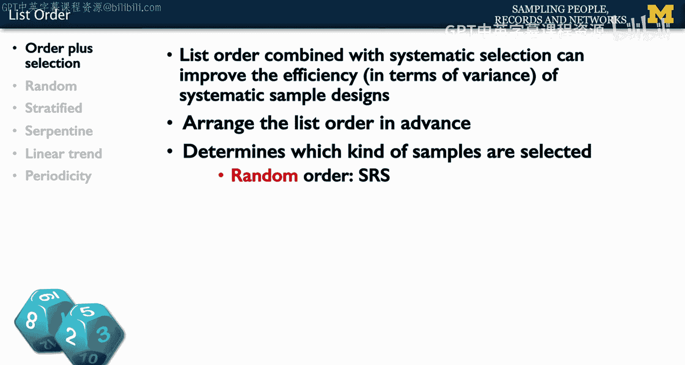

Now， the list is in random order， and we saw before that if we took the first lowercase N elements from that list。

 we had a simple random sample or any subset of them。

But if we were to do a systematic sample from such an ordered list。

 effectively what we're getting is then a simple random sample。

So a random order， sometimes referred to as simple random sampling。

 would define the process and give us something we're already familiar with， simple random selection。

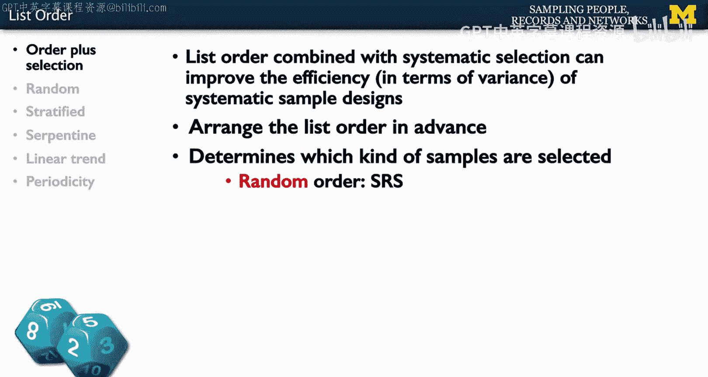

So going back to our list of transactions。In this particular case， our transactions。

 we didn't know it any particular order from them， but they appear somewhat haphazard in this case。

 It's not the case in here that they were randomly ordered。 This is the order they came in。

 They coming in actually in clock time in sequence。

 as each transaction occurs is added in the end of the list。

There's no reason to expect that there's any relationship between clock time and these transactions being generated。

 and let's say the amount of the transaction。There is no association there。

 That means that effectively， the list is in random order with respect to amount。

 And if that's the outcome variable that we were looking at。

Then we would have to acknowledge the fact that basically the underlying list order is giving us with systematic sampling from this ordered list。

 effectively simple random selection。

That will be beneficial when we talk about variance estimation in our next lesson。

Now it's also possible to change that list order and it may come to us in a particular order。

 or here we may deliberately manipulate it， arrange the list order in advance so that it corresponds to some categories of the cases that are in the list。

And this is what's going to give us a systematic arrangement that we're going to be sampling from groups of cases。

 groups of cases defined by a single dimension， so the first part of the list is female faculty and the second part is male faculty and we're first going to apply our systematic sample to the females and get that sample proportionate to its size and then apply it continuing on through the list with the same interval based on the random start that we had in the beginning to the males and get their representation in the sample。

 we're effectively getting stratified sampling here。

What' sometimes said is that this is a form of implicit stratification。

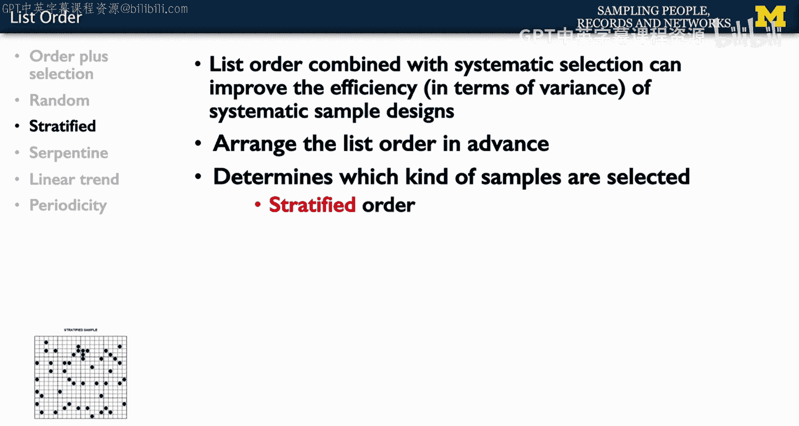

So for example， our list order， suppose it came to us in the order I'm showing here。

 this is our list of transactions now， and it happens to be sorted by subcategory alphabetically。Now。

 there's probably little relationship between the first subcategory and the second and the third in terms of the list order。

 it's just an alphabetic listing， so it goes from advertising services to air services to airline。

But nonetheless， what it's done is put together in the list。

 those cases that have the same subcategory。We're going to sample something from those and sample something from each one of them that is proportionate to its representation in the list by the systematic selection。

And we're going to get a good representation by subcategory。Effectively。

 we stratified by that subcategory。 Well， we may also decide to do a double kind of stratification。

 That is we first sort by category， and then within category by subcategory。 So here。

 business services that start with advertising services and banking services and conference and training and so on until we exhaust the subcategories for the business services category。

 and then we go on to the next two variables， sort by one and then within it。

 sort by a second variable。Almost like cross classification now now we've got a stratification implicit that is built around two possible variables。

 and if we thought that the amount was related to these。

 that business services would have a different amount than travel that advertising services have a different average amount of transaction costs different than banking services and so on。

 what we're effectively getting is the same idea as stratified sampling。

 when we apply systematic sampling to the list。

So we effectively then have stratified order and we could get gains in precision then。

Due to proportionately allocated stratified sampling， implicitly。

 we don't actually have to form the strata， They are formed for us by the sort order。

 and our allocation problem is solved。 Too。 We don't have to calculate an allocation。

 Our random start and our interval will determine how many are selected from each group。

And that will be true proportionate allocation， even when we get an allocation to a group that involves a fraction。

 so a group allocation under proportion allocation could be take 10。2 cases here。 Well， in practice。

 we're going to round that to 10 in the systematic sampling。

20% of our random starts will get us 11 and 80% of our random starts will get us 10 as the sample size from that particular group。

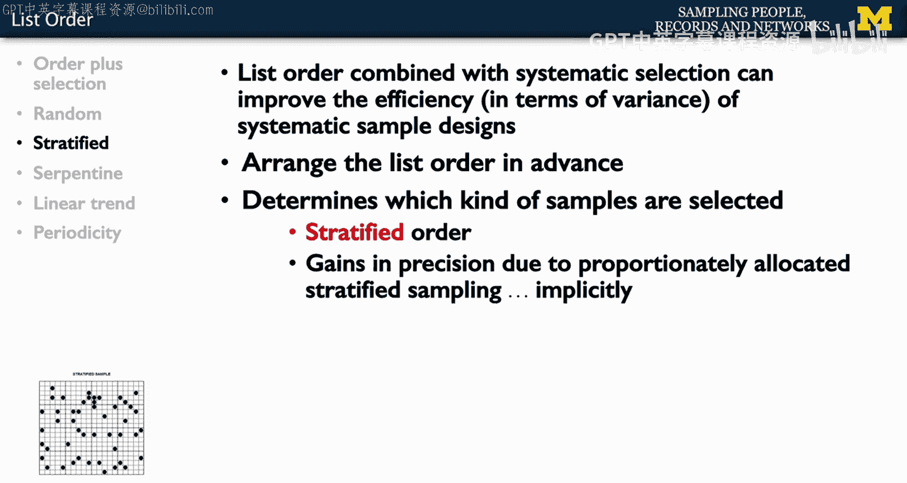

Okay， so here we actually have something that is a good substitute for stratified random sampling。

 proportionately allocated。 and many people use this kind of sample design for exactly this reason。

 they either have a list that came sorted in a particular order or they were able to manipulate the list and sort it by certain background characteristics by auxiliary variables that they would have used in stratification anyway。

 And then when they apply the systematic sample， they get the same basic result。

 implicit stratification。😊。

Sometimes though our list order is not as straightforward。

 it's not as apparent what the underlying list order is。

 we can consider another form of this that's used in practice。

 particularly with respect to geographic order。 So the serpentine in rows of hedges is sort of duplicated in our process。

 So suppose that we had sort of an aerial photograph of a street layout for a portion of a city。

And on the left hand portion of the city， we see a series of rectangular blocks。

 blocks created by streets on all four sides。 And on the left hand side。

 those blocks are rectangular in shape， about the same size。

 they may contain the same number of housing units。 And if this were an American city。

 that very well could have been a set of housing units built about the same time。

 about the same value in some kind of a development。On the right hand side， across the highway。

 so to speak， there's a newer subdivision， a newer grouping in which the streets have calleddeac。

 the streets end they dead end。 There are curves so that you're not looking down the long street of houses。

 It's more difficult to traverse through the neighborhood。

 making it pass throughs and traffic problems。 a little more controllable。

 sort of a scheme for traffic calming。And there would be housing units there， as well。

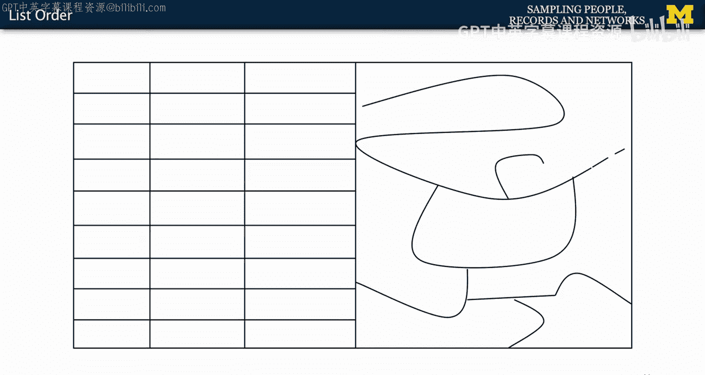

But what we have overall is a set of blocks。 And if what we were going to be doing is in sampling our persons first sampling the blocks and then sampling housing units on those blocks and then sampling persons for within the housing units。

 we could be sampling persons here fundamentally。 but we were going to start out with sampling。

 as we did in cluster sampling with the block as a way of grouping housing units and then persons。

So it turns out that these blocks are numbered。 They're numbered by a census operation。

 They're not numbered by our operation， although we could。 We could very well do this ourselves。

 And you'll notice a pattern to the numbering。 The numbering starts in the upper left with block number one and moves to the right to block number two to block number 3 to the right and then goes down to block number 4 and back to block 5 and 6 down to 7。

8，9 winding its way around the blocks within that older portion of the community。

And then when we're done through， there are  nine blocks in in each column。When we're done。

 we end up with block number 27， and we want to continue the numbering and we would continue the numbering into the blocks on the right hand side。

 and we would do it again In a serpentine fashion 28 leads to 29 to the right， up to 30，31，32，33。

34 and 35 might actually be created through some kind of imaginary lines and some subdivision as well。

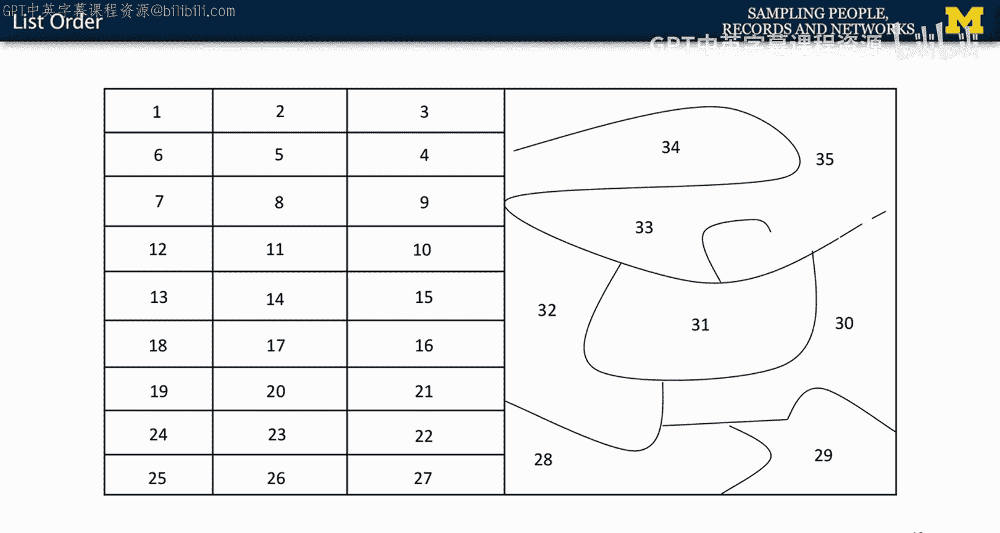

So altogether， we have 35 blocks here， and the numbering is a system that is winding through these。

 that if we were to take a systematic sample， our sample would wind through them。

 We would get an effective geographic representation of the blocks， in our sample。

Suppose what we're going to do is draw a sample of five blocks from these 35。Well。

 there's 35 blocks there。 That's our capital。 And， if you will。

 for our systematic sampling operation。 Our sample size is 5。

 We're going to divide 35 by 5 and have an interval of 7 and choose a random start。

 and suppose that that random start happened to be 4。

So we're going to take the fourth and the 11th and the 18th and now we see how they're covering the blocks across the geographic representation and they then extend into the final selection which is block 32。

 We're getting a representation of the entire area through the underlying list order of the geography。

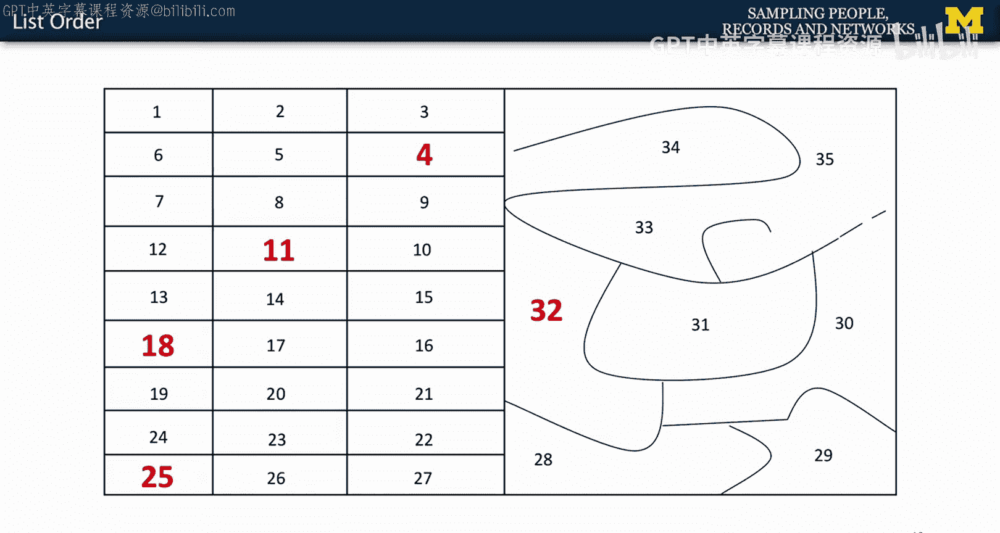

Now， that might make a difference。 It could be that the people living in the housing units in the older portion of the community。

 those housing units were built at an earlier period， They're smaller， their prices are lower。

 the people who own them have lower incomes， possibly lower educational backgrounds。

 they may have a set of attitudes related to their working environment。

 which may be more related to manufacturing or services。

 while those on the other side where the houses were built more recently。

 and they have larger lot sizes， larger gardens。There。

 the housing prices are higher and what we're implicitly doing now by this list ordering and systematic sampling is dividing this into two parts。

 an older portion and a newer portion， and we're getting representation from each proportionate to its relative size。

 as well as covering within each of them， their blocks in a representation that gives all of them an equal chance of selection。

Okay， serpentine ordering will come up and it's used effectively。 some census systems， for example。

 will number blocks or enumeration areas in exactly that kind of fashion。

 They will number them in some kind of serpentine fashion through a subdi and a across districts and so on。

 and one can take advantage of that by taking systematic samples from that already ordered list。

Based on the enumary number or a block number。Some orderings bother people。

 they create some problems for people， and one of those is a linear trend order in which the value that we're studying increases in somewhat of a linear fashion。

 may not be exactly linear， but it's steadily increasing or steadily decreasing。

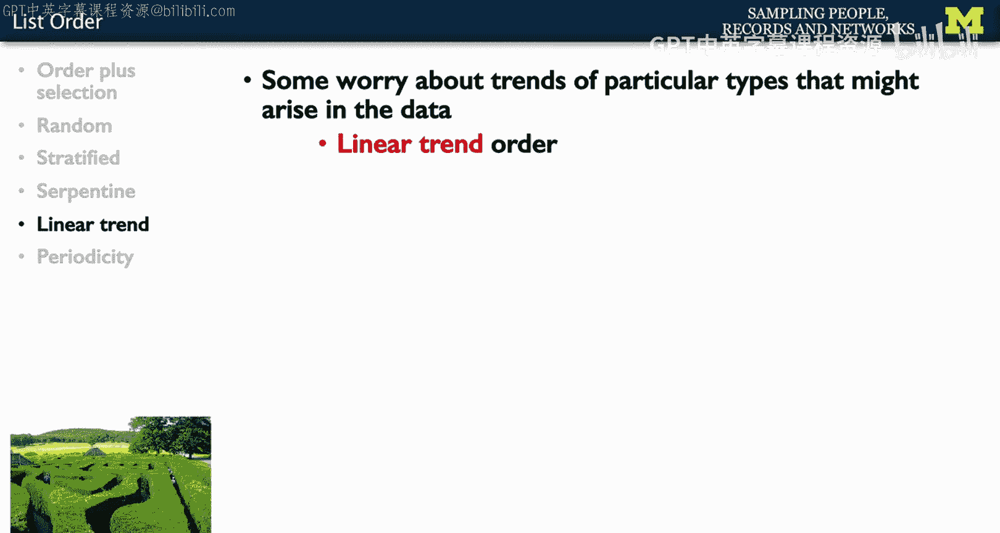

So for example， for our transactions here， I've sorted the list by the transaction amount。

And we can see that it's increasing as we go from top to bottom。

 And if one were to do to do a systematic sample from this particular list。

 there would be a concern raised that one could have a bias。You know。

 if your random start was if your interval was 20。And your random start was where the number is 1，2。

3， through 9。 We know that when we get done， the mean that we're going to have will be below the population mean。

 And if it happened to be 11，12 and so on through 20。

 we know that the mean would be larger than the population mean because of the underlying linear trend。

That bothers people in this kind of thing。 But it turns out that you get very strong gains in precision when you think about this in terms of the sampling distribution。

 the sampling distribution for this has very small variance across the means。

 typically with this kind of linear trend。 And you get substantial gains in precision， as you would。

 with some forms of stratified sampling。

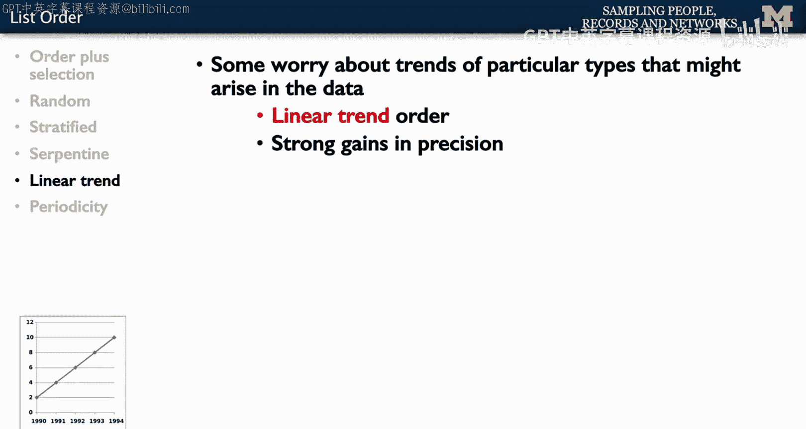

And so a linear trend。Yes， it's got a peculiar property that that， you know。

 you've got a lower random start or a higher random start around the middle。

 you will get values below or above the true population mean， but in principle。

It is a good feature to have。 But if you've got it， it's probably worth。

Thinking twice about whether or not you want to draw a systematic sample from linear trend before proceeding。

 You may want to do more than one random start， for example。

 and break it up so that you get a random start in the lower and the upper end of the interval。

 And that's beyond the scope of what we can do here。

 But linear trend does come up and some people object to doing systematic sample because of。

One more， one last one。 periodic trend。 Now， down below。

 I've got something of a complex process that has a cycle to it。And there's a period to that cycle。

 and it's going up and down。 And the concern that might arise here is that if you had this kind of ordering。

 the values are starting high and then going low and then going back up high。

 such as might be the case in our list where we've got them now in an order by amount that goes up and then comes back down and then goes back up in a case like that。

 if our interval corresponded to the period we would have a problem because there we're going to have the same kind of issue as with the linear trend。

 if it's at a certain point in the period， we're going to have a value that's above the mean。

 if it's another set of points within the period， it could be a value that's below the mean。

 And so that kind of thing can be problematic and generally， periodicity is a problem。

 the one wants to avoid and would not apply systematic sampling in these particular cases。

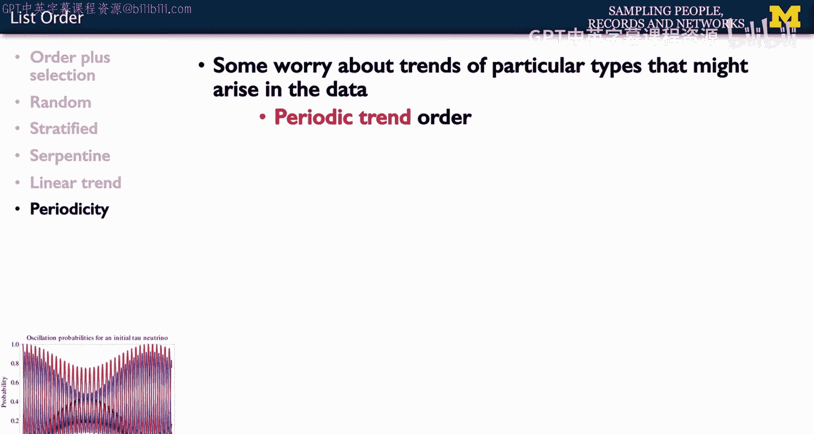

But remember now， list order is a beneficial thing because that list order。

 whether it's random or stratified or serpentine， helps define the nature of the sample。

 And if there's some order as such as stratified order or serpentine order。

 we're getting implicit stratification。 and we will get gains in precision。From。

The application of systematic samples to such ordered lists。

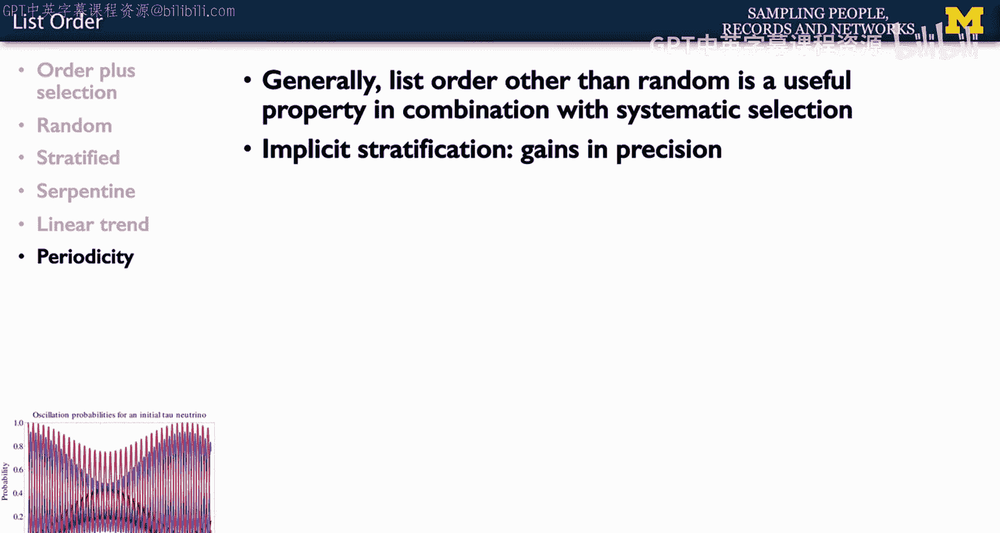

And that that ordering may be already built into the list， and we're going to recognize it。

 or it may be that we have to assume that it's present because we don't really know。 Remember。

 it's with respect to the outcome variable that we're measuring。

Or it may be imposed on the basis of auxiliary data that we have used to sort the list directly。

 However it comes about， we're going to think about the combination of systematic sampling and list order and what it gives us in terms of the sample。

And in many cases， we can get gains in precision because of it。Proportionate allocation。

 stratified sampling。But。There is a problem here， and it has to do with how I'm going to estimate variance。

 how I'm going to actually figure out what those gains and precision are。

And so what we're going to need to do is think about one more thing here。 And that is。

 how do I estimate sampling variances for this kind of thing， I just labeled an uncertain estimation。

 sampling errors， standard errors and comp intervals And we're going to calculate our standard errors here on the basis of what we think happened with a list order。

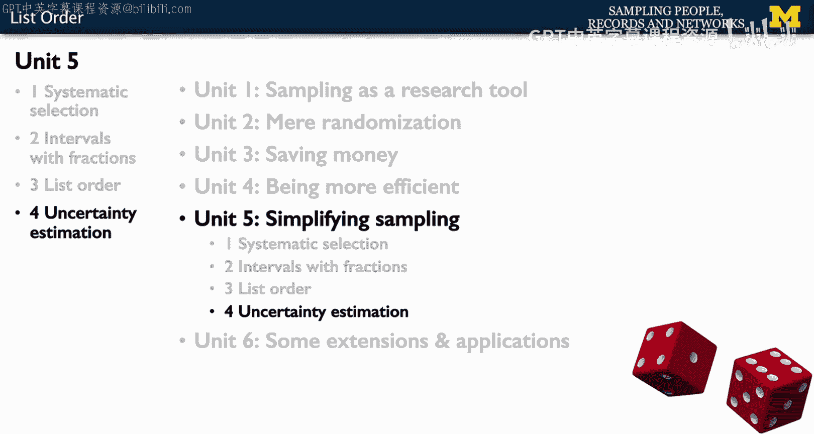

So let's turn to that as our last topic for systematic sampling。

 how we're going to estimate sampling variance as we'll go through a very simple example。

 as in lecture 4 of our unit systematic sampling to wrap up our consideration。 Thank you。

