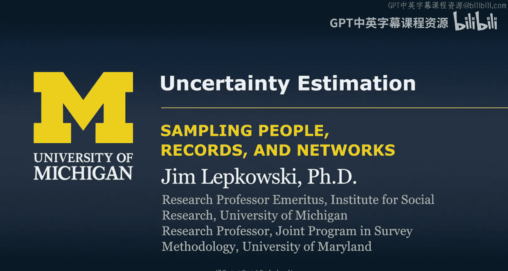
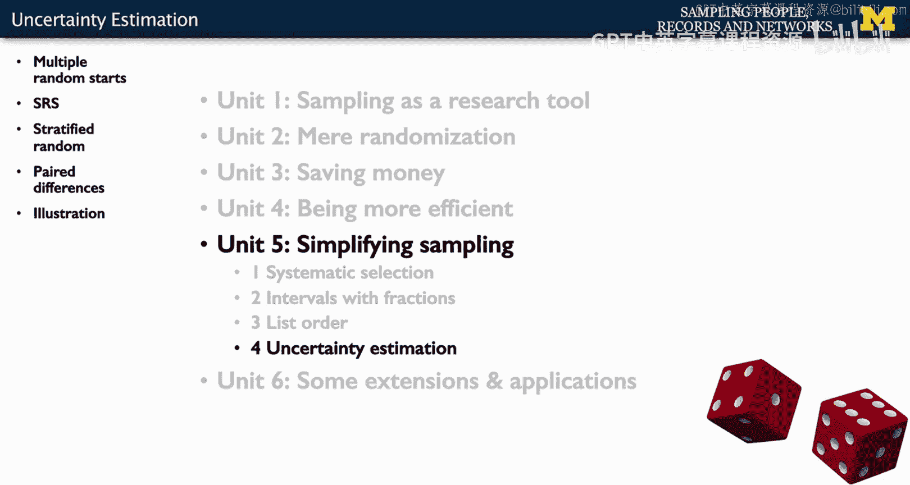
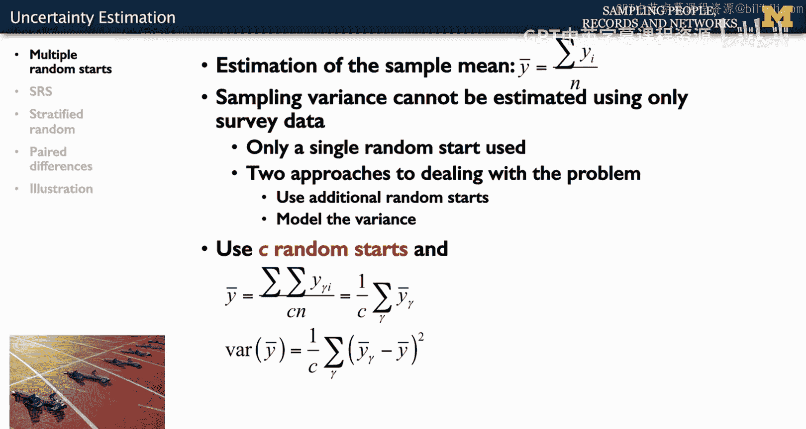
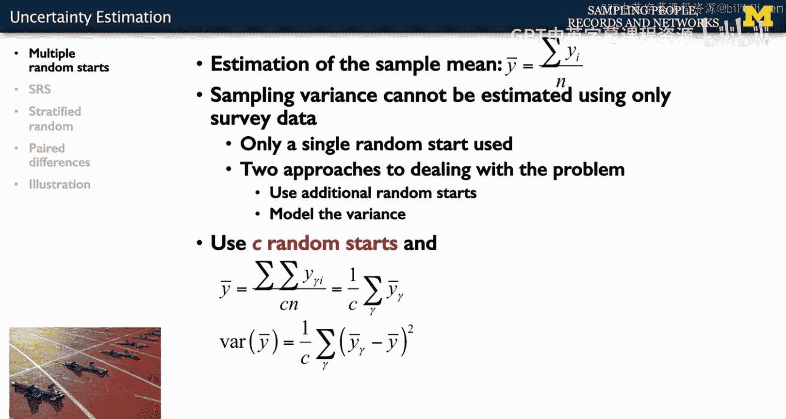
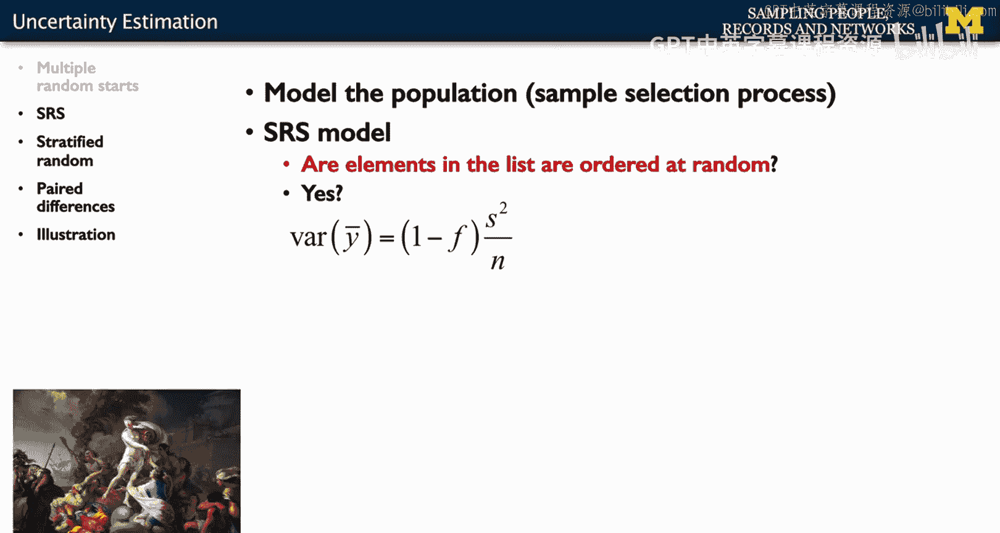
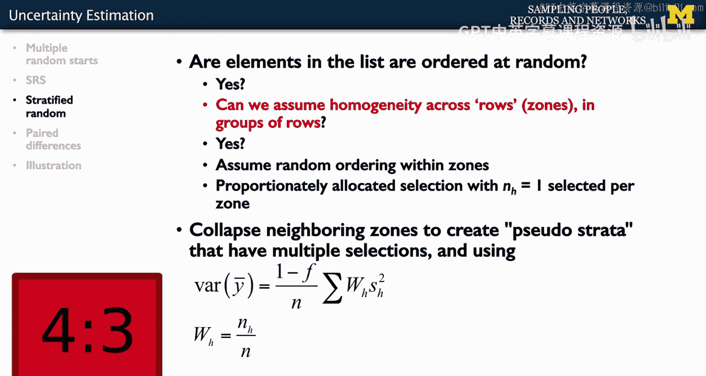
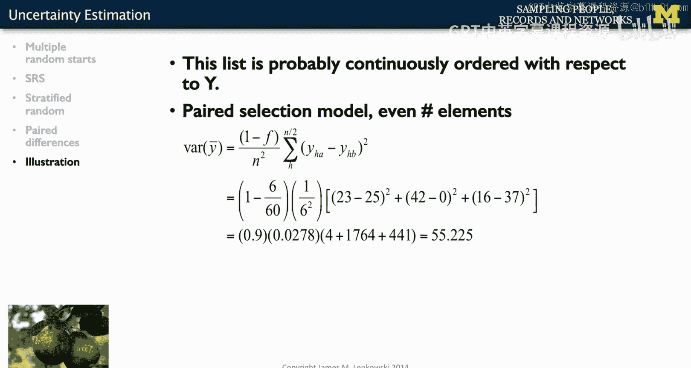
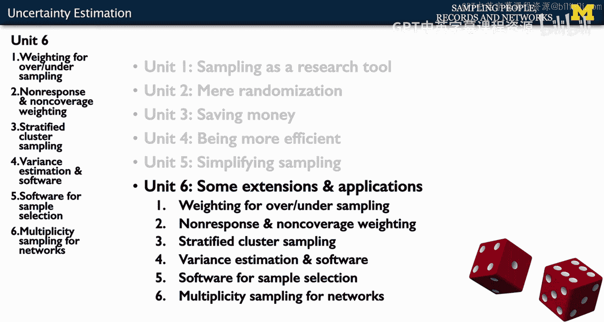

# 密歇根大学《调查数据收集和分析（2-6：方法、社调问卷设计、抽样、缺失数据、分析）｜Survey Data Collection and Analytics》 p116 37_5.4 不确定性估计.zh_en -BV1fw4m1e7Zh_p116-

When we've discussed sampling techniques such as simple random sampling or stratified random sampling or cluster sampling。

 we made a point of talking about how to calculate standard errors within that framework in which we talked about 7 steps of。

The process going from population to frame to sample and estimates， and the sampling distribution。

 and then standard errors estimated from the data and cops intervals built around those standard errors to give us uncertainty statements。

We should do the same thing here for systematic samples。

 except that what happens with systematic samples when we start talking about that uncertainty estimation is that the approach is built on the others。

It's built on the others in two ways in one of those。

 it is built on the others in terms of thinking about the sampling distribution and replicating in our sample the sampling distribution。

We're going to refer to that as multiple random starts， so I'll tell you more about that in a moment。

But then we also saw that systematic samples applied to lists with certain orders gave us effectively certain kinds of samples。

 so if the list order were simple random。That we had effectively then a simple random sample when we got done。

That would allow us to use simple random sampling as a variance estimation technique under the assumption of random ordering。

 similarly， stratified random。Ordering could lead to a stratified random。Vance's estimate。

There's a couple of other modifications， though， I'm only going to mention one of them。

 something called a pair difference， which is quite widely used in these kinds of circumstances。

 especially when the selection units are not just elements but happen to be clusters and we'll talk a little bit more about that when we talk about paired differences and then we'll go through a simple illustration just to put the calculations in context。

 make sure that we know how numbers would actually fit into certain kinds of calculations。

 So this is more about taking our conceptual framework and model and then applying it to our systematic sampling context for the purposes of variance estimation。

 standard error estimation co interval construction but we're not going to go through the full thing just highlight these particular topics and we'll rely on referring back to previous units as a basis for getting more detail about how they work。

All right， so suppose what we're doing is estimating a sample mean， a mean of our transactions。

 a mean of some other characteristic， and we happen to have done a systematic sample。

 and we recognize that because we have only a single random start。

We can't technically estimate variance because what we would then have would be one cluster selected from K clusters。

 If K were our interval。 Remember that that interval defines starting points。

 and each of those starting points has a fixed sample。

That goes with it。doesnn't mean when we've got fractional intervals that the samples don't have overlap between them。

 but that's not the point that once we get started。

 there's a fixed set of selections that go with a given column of our conceptual representation。

Technically， then it's a cluster sample where the clusters are equal in size provided we rounding the interval。

And then we not estimate variance， you can' estimate variance when you only have one。

So one way to deal with such a problem is to use additional random starts。

 Now this is going to complicate the operation。So instead of having one random starts from one to K。

 we have two random starts from one to K and we draw two samples。Now， when we're done。

 we can actually have two elements from the sampling distribution。

 which would allow us to calculate sampling variances。

 We could take the means from each of our two samples， from each of the random starts。

And calculate the mean of the means。 and then look at the variability of each of our sample means。

 sample 1 relative to the average of the two。 sampleple 2 relative to the average of the two。

And use that as an estimate of the variance of our sampling variance。So we're talking about using。

 though， more than two， we could use C random starts。

 seasons an arbitrary number could be 2 or 3 or 10。 The more random starts we have， the more。

Estimates we have more complicated our design is， but the more stable the variance。

 because now what we're going to be doing is getting separate estimates for each sample。

 And as we do that， our variance will be built on the total number of random starts。

 Our degrees of freedom will depend on how many random starts we have。 And if C is only2。

 we only have one degree freedom。We're going to have to use a very large T value for that。

 If we have 10， well， our T value will still be large for comp intervals。

 but it's smaller than if we only used， two random starts。

The basic idea， though， is， as follows， we would use multiple random starts and then calculate our mean by just taking all of our data and dividing it by the sample size for each of the random starts times the number of random starts。

 That's our overall sample size。 So if our sample size。

 we're going to be 50 for each of our random starts， and we did two of them。

 our overall sample size is 100。 If we did 10， our overall all sample size is 500。 regardless。

 we would calculate the mean by taking all of the observed values from all of the samples and dividing by the overall sample size across all of the different random starts。

Or what we could do is， as I indicated， calculate the mean for each of the random starts and then average those。

The sampling variance， estimated sampling variance， though。

 shown in the last line here on this slide is one in which we have a variance estimate that has the mean from each sample。

 Y bar sub I think it's a gamma there。 Well I should have introduced Greek， should I。

 but it's a subscript to den note different the mean from different random starts。

 And we're going to compare that mean from each of the random starts to the overall mean。

 which is an average of those square it added up。 And when we're done divide by C-1 times C。

So we've got a process in which we can calculate variances by replicating the sampling distribution。

By using multiple starts， as we might in in a race。But there's another broad approach to this。

 And rather than going through and attempting to identify multiple random starts。

 complicate our design， We're going to use just the one random start and then ask the question。

 what order are the elements in the list with respect to our characteristic of interest。

Are they at random that is， is there any reason to believe that there's a relationship between the list order and the characteristic of interest？

If we have no reason to believe there is such a connection between list order and the characteristic of interest。

And that may be because we've deliberately manipulated the list to create， to break that association。

 or because we have good reason to believe that the underlying list order is completely unrelated to the variable of interest。

 we have， effectively then， with systematic sampling a simple random sample。

And so now we would use simple random sampling to estimate the variance。

 And that's the expression that we were showing here。

 We're going to treat the sample size of lowercase N as though it were a simple random sample when。

 in fact， it was not。Unless our assumption。Is true。

 Or unless we've deliberately ordered the list in some random fashion。

So we don't have to worry about multiple random starts and multiple means and worrying about the complexities of increasing numbers of replicates。

 increasing numbers of random starts。 Here we have just the one random start。

 But under an assumption。 Now， an assumption means that we have a model in mind to the statistician。

 that assumption that the list order is random， gives us simple random sampling as an outcome。

 And we would use that kind of an expression for the variance。

But now， suppose that they are related。 There's something about the process in which the underlying order is not bouncing back and forth with respect to the outcome。

 It might be increasing and then decreasing and might be that there's a because of the categorization the sort order based on categories of some characteristic。

 some auxiliary variable for our data in the frame。

 We happen to have a group that might have a higher mean， followed by a group that has a lower mean。

 followed by a group that has a lower mean， followed by a group that has a much higher mean and so on。

 And those groups now are being represented in the sample， proportionate their size。

There's variation they're all being represented there as in stratified sampling。

And we are effectively getting stratified random selection in this process。

 There is a relationship there。If we're willing to take our interval。

 this dividing our list up into rows， if you remember that conceptual representation we looked at in the first lecture for systematic sampling。

And we're willing to assume that there's random ordering within each row， but the rows differ。

The means differ。 Then effectively， what we've got is a stratified random sample where we selected one element per row。

1 element per zone is it sometimes referred to as we go down a given column。

 and that defines our sample， and we could indeed use that to calculate our variances under some kind of stratified random formula。

 Now， this is beyond the scope of what we're able to do。

 But we just wanted to give you an indication of what can be done here。

 We face a dilemma here because there's only one selection per zone。

But the zones may be grouped in terms of our sort order to be all business services。

Followed by all travel。Or maybe theres as we pass from one interval to the next。

 there's a little mix of business services and travel， but nonetheless。

 there's basically a divide between business services and travel in our transaction example。

In case like that， what we may be able to do is have multiple selections in each of these categories and treat them as a stratum。

And then calculate our variances， and we would calculate the variance using a proportionally allocated stratified variance expression it's actually shown here we didn't go over this in our earlier material。

 but that's how it would be treated。

Sometimes the ordering though， is less discrete， it's more continuous， that is。

 we not only have established that there is some ordering with respect to our characteristics。

 so we're not going to do some random sampling。Then we're going to do some kind of stratified sampling。

 But the ordering is such that it's almost continuous。

 Remember a serpentine ordering going up and down and back and forth。

 And there's really some difficulty at times in drawing strict boundaries。

Within which we can calculate variances and then combine them across those groups。And so instead。

 if the ordering is more or less continuous， what we're basically getting is one selection from each row。

We can't estimate variances that way， but we could pair things up。

 we could collapse two neighboring rows to form a pair。A pair of successive selections。

 The first selection paired with the second。The third selection paired with the fourth。

The fifth selection paired with the sixth and so on。

 And there is an approach that involves variance' estimation for this circumstance called paired differences。

 pairing the success of rows。 Again， we give the formula here。

 We're going to illustrate its actual application in our illustrations is coming next。

It's not important to understand where this comes from。

 but simply that this kind of thing reflects the underlying implicit stratification of the list。

 It's an extension that we've moved from multiple random starts to simple random sampling。

 No relationship between list order and our outcome to yes a relationship。

 but it's done in terms of categories that were levels of a auxiliary variable we've used for the sort to one in which it's almost continuous ordering。

 There's some underlying ordering there， but it's very hard to draw boundaries where we would use a paired differences。

 expression。Just a small illustration。 Suppose that we had this sample here。

 This was a sample of a block selected from a much larger list， and six of the blocks were selected。

 We've got records on these blocks， and we happen to know the number of rental units and the number of total housing units on each of the blocks。

And we have collected the information for our sample of 6。 and we've got an index，1，2，3，4，5。

6 for our sample。 So we've got a very small sample here。

 And it turns out that when we originally selected the list。

 the list happens to be in more or less random order with respect to the blocks。

 There's no reason to expect any particular ordering in the list。 Well。

 regardless of the underlying order。 We're going to calculate first the mean。 for example。

 this is the mean number of rental units in our sample，23。83。

 we've added up the 6 values in the rental column divided by 6， a mean of 23。824。Now。

 what is the standard error of that mean， And in this particular case， the first question is。

 is the this random， If the answer to that is， essentially， we think it is。 Now notice。

 that's an assumption。Or it could be， yes， it is because we deliberately ordered the list of random。

Then in that case， we would use the simple random sampling variance formula。

 the 1 minus F S squared over n。 in this particular case， there were actually 60 blocks on the list。

 and we drew a sample of six of them。And so our finite population correction is 1-6 over 60，1-0。

1 or 。9。We're going to divide by n， which is 6。 and then compute an S squared。

 And there's a computing formula here for S squared。

 But the bottom line is that we end up with a sampling variance of 34。0，34。0。

 the square root of that is a little bit less than 6。

 And that's what we would apply to our mean of 24。 as a very small sample。

 but you get the basic idea。We have made an assumption or because of the list order that we deliberately manipulated。

 we've taken advantage of that manipulation to choose the simple random sampling model。Well。

 what would happen， though， if the or the lists were continuously ordered。

 Those blocks were ordered by block numbers that had been assigned in some kind of serpentine winding fashion throughout the segment。

 the neighborhood of 60 blocks。That's probably what happened in this particular case that someone had a list of the blocks。

 and they were in that order， and they simply did a systematic sample taking every 10th after taking a random start。

 The paired selection model would be most appropriate here。

 The pared selection model variance estimate is shown here in which there's a 1 minus F。1-6 over 60。

9。There is a division by the sample size squared，1 over 6 squared to 36。

 And then there are three paired differences。 The first sample value for rental for the for the first And then the second block。

 the difference of those squared。 So that's 23-21 from our 25 from our list or -2 squared is 4。

The third minus the fourth，42-0 squared。 That's a big number，1764。And then the final 1，16-37 squared。

 Now， this is just to illustrate the calculation。This would only be done if we thought that there was an underlying continuous ordering with respect to the number of rental units as we move from the beginning to the end of that list of size 60。

Now the calculation that it carries out here gives us a value of 55。2。

 that's a standard error of about 7。37。4， and so we're much larger here。

We would only apply this though if we were willing to make that assumption。

One thing we would not do is go through and calculate several different ways of doing the variance and choose the one that gives us the smallest value。

That would be like overfitting a linear regression。 We're sort of cheating on the model。

 It's better for us to make an assumption。 Sa what that assumption is explicitly。

 calculateulate the variance according to what that model said and then use that in our standard error calculation anov syndrome。

Okay， so uncertain estimation here， it's a matter of calculating a standard error。

 a matter of calculating a variance， but of the fourth techniques that we've used。

 one involving multiple random starts， the other three involving a model assumption， simple random。

 stratified random or pair differences， continuous ordering。

We're going to apply one of those to the data to obtain a standard error and thereby a comp interval。

All right， well that's all we have time to cover for systematic sampling。

 Our last unit will be some extensions and applications of some of these things。

 one of the topics that we talked about in previous units had to do with waiting particularly under stratified sampling。

 but we're going to return to that to talk about waiting now at the element level。

 as we did then for under and overs。

We're going to add to that some discussion about waiting for non response and non coverage and combining the over under sampling with the non response and non coverage waiting to get a final weight。

We also need to talk a little bit about stratified cluster sampling and then move into variance estimation built around stratified cluster samples。

 We won't say a lot about stratified cluster samples is putting together two of our techniques。

 but we will talk about variance estimation and the software that goes with it to estimate those。

That takes into account these design features as we've been doing。

And as long as we're talking about software， we'll have a brief lecture about software for sample selection。

 push the button。 What would we do in a piece of software to draw a selection。

 what code might we use and what does it actually give us And then finally。

 one last topic in our kind of extensions， What happens when we're dealing with networks and we sample them。

By either sampling elements in the networks or sampling nodes in the networks。

 we're either going to sample connectors between the elements or we're going to sample the nodes and their interconnections。

And there's a set of techniques and survey sampling referred to as multiplicity sampling that can be used in that particular case。

 where we have two illustrations to talk about there before we ramp up。

Join us then for our concluding unit。Extensions and applications as we wrap up our course on sampling people。

 records and networks。 Thank you。

