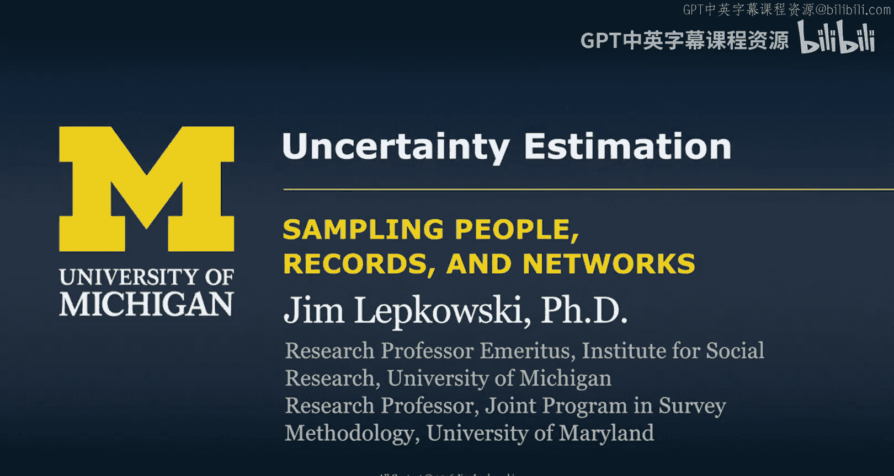
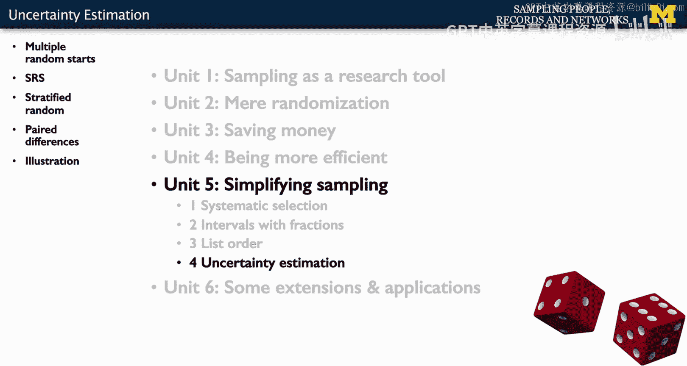
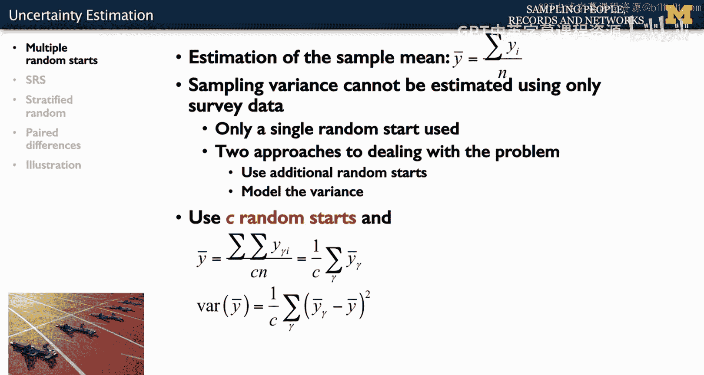
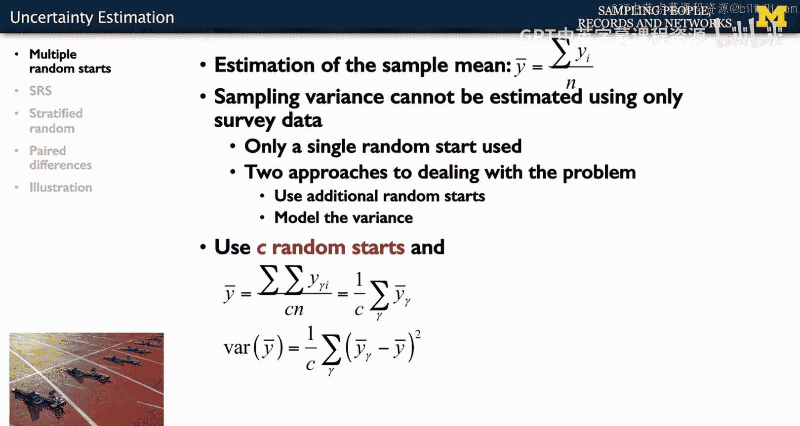
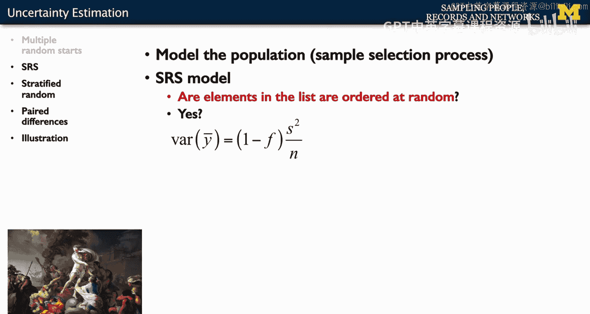
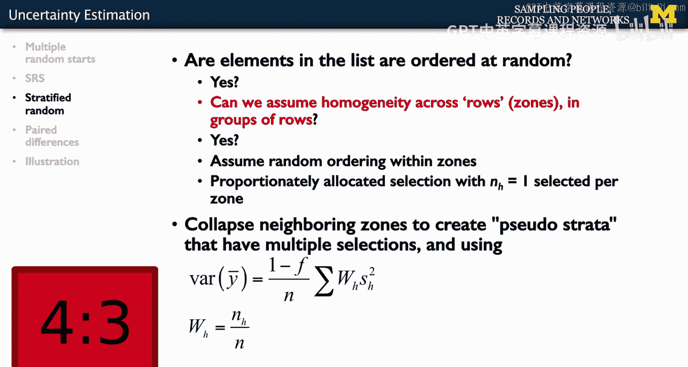
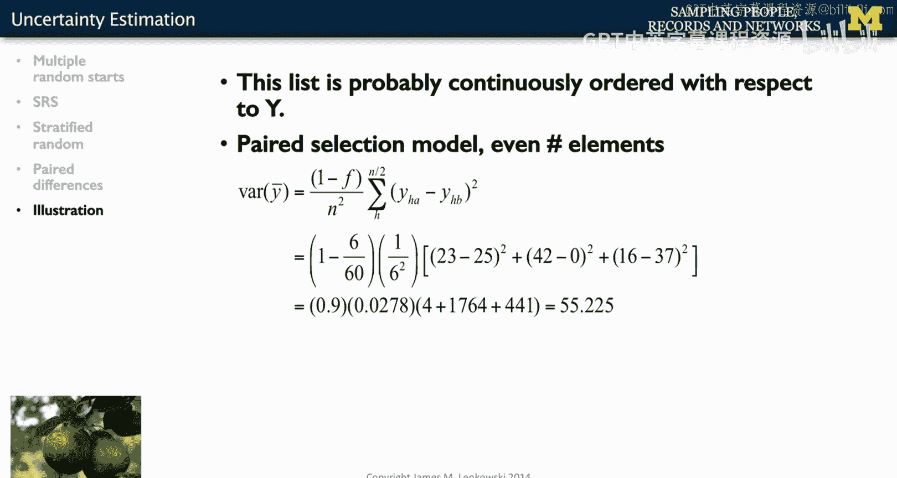
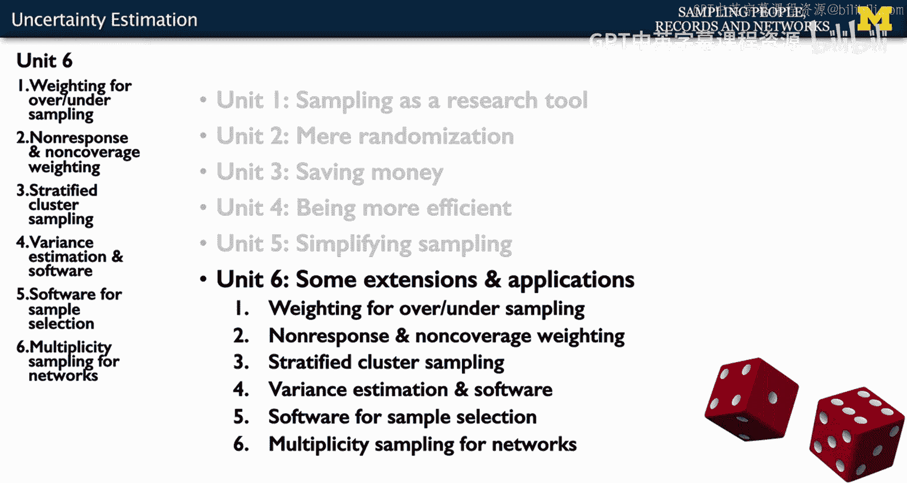

# 调查数据收集与分析：5.4：系统抽样的不确定性估计 📊

在本节课中，我们将学习如何为系统抽样方法估计不确定性。之前我们讨论了简单随机抽样、分层随机抽样和整群抽样，并介绍了如何在这些框架下计算标准误。这个过程通常包括从总体到抽样框、再到样本和估计值的七个步骤，以及抽样分布、从数据估计标准误和构建置信区间。对于系统抽样，我们也需要做同样的事情，但其不确定性估计的方法建立在其他抽样技术的基础之上。

## 多重随机起点法 🔄

上一节我们介绍了系统抽样的基本概念，本节中我们来看看如何估计其不确定性。当我们只有一个随机起点时，从技术上讲，我们无法估计方差，因为这相当于从一个由K个群组成的总体中只抽取了一个群（这里的K就是我们的抽样间隔）。每个起点都对应一个固定的样本集合。

为了解决这个问题，一种方法是使用**多重随机起点**。这会使操作变得复杂，但能让我们获得抽样分布的多个元素，从而计算抽样方差。

以下是多重随机起点法的基本思路：
*   我们不再使用一个从1到K的随机起点，而是使用C个（例如2个、3个或10个）随机起点，并抽取C个样本。
*   计算总体均值时，我们可以将所有C个样本的观测值相加，再除以总样本量（每个起点的样本量乘以C）。
*   我们也可以先计算每个随机起点样本的均值，然后再对这些均值求平均。
*   抽样方差的估计公式基于每个起点样本的均值与总体均值之间的差异。

使用的随机起点越多，设计越复杂，但方差的估计也越稳定。不过，自由度取决于随机起点的数量（C）。如果C仅为2，则自由度仅为1，在构建置信区间时需要非常大的t值。

## 基于列表顺序的模型假设法 📝

除了使用多重随机起点来复制抽样分布，还有另一种更广泛的方法。我们只使用一个随机起点，然后提出一个问题：列表中的元素顺序与我们感兴趣的变量特征之间是否存在关联？

**情况一：列表顺序随机**
如果我们没有理由相信列表顺序与变量特征之间存在关联（可能是因为我们故意打乱了列表顺序，或者有充分理由相信底层列表顺序与变量完全无关），那么系统抽样**实质上等同于简单随机抽样**。

在这种情况下，我们可以使用简单随机抽样的方差公式来估计方差。我们将样本量n视为简单随机样本的样本量，并应用相应的公式。这基于一个明确的模型假设。

**情况二：列表顺序存在分层**
现在，假设列表顺序与我们的变量相关。例如，由于列表中某些辅助变量的分类排序，可能存在均值较高的组，后跟均值较低的组，以此类推。在这种情况下，系统抽样**实质上等同于分层随机抽样**，我们从每一层（或每一“行”）中抽取了一个元素。

如果愿意假设每一行内部是随机排序的，但行与行之间的均值不同，我们就可以使用分层随机抽样的公式来计算方差。这通常适用于列表按离散类别排序的情况。

**情况三：列表顺序连续**
有时，排序不是离散的，而是更连续的（例如蛇形排序）。很难划定明确的分层边界。在这种情况下，我们可以使用**配对差异法**。

这种方法将相邻的两行（即连续的两个被抽中元素）配对。例如，第一个与第二个配对，第三个与第四个配对，依此类推。然后，使用配对差异的公式来估计方差。这反映了列表潜在的隐含分层结构。

## 计算示例 🧮

让我们通过一个简单的例子来理解这些计算。假设我们从一个包含60个街区的列表中，系统抽取了6个街区作为样本。我们收集了每个街区的租赁单元数量数据。

**样本数据如下：**
| 样本索引 | 租赁单元数 |
| :--- | :--- |
| 1 | 23 |
| 2 | 21 |
| 3 | 42 |
| 4 | 0 |
| 5 | 16 |
| 6 | 37 |

样本均值 `Y_bar` = (23+21+42+0+16+37) / 6 = 23.83

**1. 假设列表顺序随机（使用简单随机抽样公式）**
*   有限总体校正因子 `fpc` = 1 - (6/60) = 0.9
*   计算样本方差 `S²`
*   抽样方差 `Var(Y_bar)_srs` = `fpc * (S² / n)`
*   根据计算，得到抽样方差约为 34.0，标准误约为 5.83。

**2. 假设列表顺序连续（使用配对差异法）**
*   有限总体校正因子 `fpc` 同样为 0.9。
*   将样本配对：(1,2), (3,4), (5,6)
*   计算配对差异的平方和：`(23-21)² + (42-0)² + (16-37)² = 4 + 1764 + 441 = 2209`
*   配对差异方差估计公式：`Var(Y_bar)_paired = fpc * (1 / n²) * (Σ 配对差异² / 配对组数)`
*   代入计算：`0.9 * (1/36) * (2209 / 3) ≈ 55.2`
*   标准误约为 7.43。

可以看到，在不同的模型假设下，我们得到的标准误估计值不同。重要的是，我们不能为了得到最小的标准误而尝试多种方法并选择结果最好的那个，这类似于在回归分析中过度拟合。我们应该基于对列表顺序和变量关系的理解和假设，明确选择一个模型，并据此计算方差和标准误。

## 总结与下节预告 🎯

本节课中，我们一起学习了为系统抽样估计不确定性的几种方法：
1.  **多重随机起点法**：通过复制抽样分布来直接估计方差。
2.  **基于模型假设法**：根据列表顺序与目标变量的关系，选择不同的方差估计模型：
    *   **简单随机抽样模型**：假设列表顺序随机。
    *   **分层随机抽样模型**：假设列表按离散类别分层排序。
    *   **配对差异模型**：假设列表存在连续排序。

不确定性估计的核心是计算标准误和方差，我们需要根据实际情况和假设，选择上述四种技术之一应用于数据，从而获得标准误并构建置信区间。

好的，关于系统抽样的内容我们就讲到这里。在下一个也是最后一个单元中，我们将探讨一些扩展和应用，包括：
*   **加权**：结合分层抽样中的不等概率抽样以及针对无回答和无覆盖的加权，得到最终权重。
*   **分层整群抽样**：将分层和整群两种技术结合，并讨论其方差估计及相应软件。
*   **抽样软件**：简要介绍用于抽样的软件及其操作。
*   **网络抽样**：当处理网络（如社交网络）时，如何抽样元素或节点，并介绍一种称为“多重性抽样”的技术。

敬请期待我们的收官单元《扩展与应用》，共同完成本次关于对人员、记录和网络进行抽样的课程。谢谢。