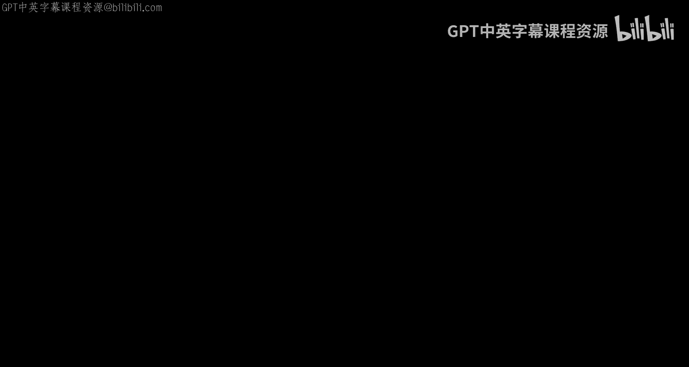
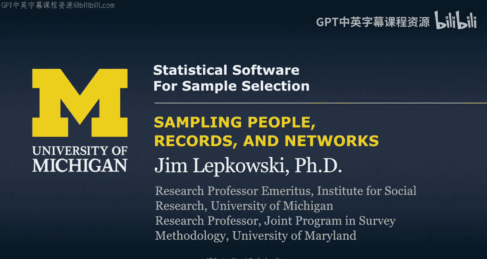
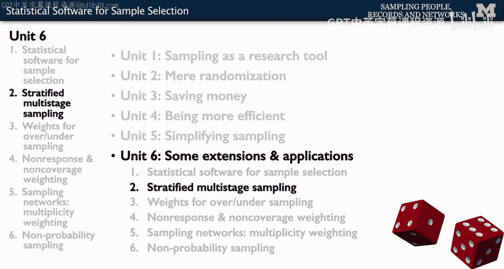

# 密歇根大学《调查数据收集和分析（2-6：方法、社调问卷设计、抽样、缺失数据、分析）｜Survey Data Collection and Analytics》 p117 38_6.1 抽样统计软件.zh_en -BV1fw4m1e7Zh_p117-

Welcome to the last unit on sampling People， records and networks。 My name is Jim Lepowski。

 and this is the sixth of six units that we're going to be doing concerning this particular topic。

We've been covering a variety of sampling techniques and principles of sample design through our first five units。

 But here what we're going to do is a few extensions and applications。

 It's a collection of topics that add on to the things that we've been looking at。

 We're not going to introduce anything new in the way of sampling techniques。

 but we will introduce new ways of looking at them。

 whether it's how to select samples using software or doing stratified multis stage sampling or waiting in a couple of different forms。

 sampling networks specifically and some waiting procedures that are sometimes described as multiplity waiting。

And then finally， something on non probability sampling， just a brief introduction to the topic。

As I said， this is going to be the first of the lectures here。 There are six lectures。

The first is on statistical software for sample selection。

And we're going to talk about a particular frame， a particular set of materials that we will use for drawing the sample。

 how we're going to put that into a statistical system。 In this case。

 we're going to be using the R statistical system。 Now if you don't know R， that's okay。

 this is merely to illustrate what it looks like， some of the things that you need to think about as you do sample selection using using software。

 and then we'll illustrate R on that single frame for four different sample designs。

 simple random sampling， as we've described it。 but I'm going to label that without replacement。

 simple random sampling with replacement， systematic sampling and probability proportionate to size。

There are other techniques that we've covered， but those are just the ones we'll do by way of brief introduction of this topic。

So our frame consists of a list of blocks。 These are census blocks。

 as we've talked about these materials before。 And for each of the census blocks。

 there are almost 1000 of them in our frame。 There's information there about the number of housing units that are there。

 How many of those housing units are owned by the occupant。

 How many of the housing units are rented by the occupant。

 And there's quite a bit of variation on these numbers as you go through them。

 So here's just the first 30 of the blocks in our frame with the basic information about renting and owning。

 Now， you don't need to look at this very carefully and see it in great detail。

 because this is just to remind us that there is a frame from which we're going to draw our sample。

 In our particular case， there are 975 elements in the population。

 And we're just going to draw a sample of size 20。 That is our sampling rate will be one in every 48 or 49 units。

 Now， I've put the full sampling rate here by taking 20 divided by 975 and converting that into a fraction。

That has one in the numerator。 That is。The numerator 20 is divided by 20， and the denominator。

975 divided by 20，48。675。And we're going to use that same sample size applied to the same frame。

 population size of 975， that same sampling fraction and do four different designs we will not cover。

 for example， stratified sampling and some other designs that we've discussed before。

 but just some of these basic ones to illustrate what happens when we do this with software。Now。

 with this particular software system， there are some features that are needed to get the data ready for sample selection。

 We need to bring the data into the system in the R system。

 we need to tell the system where the data are located as with many systems in this particular case。

 we are going to set the directory set working directory， set WD， ST。

 WD here just made up of a particular location on my machine where the sampling methods。

Folder contains the frame。The second step then is to open the data file in this particular programming language。

 there is a command。 read the data， in this case， read a table that takes the data through that function and puts it into what's called an object。

 Now， in this case， an object is just our frame。 And so you'll see in our statement there。

 What we're going to be doing is into the object frame putting in our data through the read table function。

 and that read table function specifies the file that we're going to look at for our data。

 That's the one that contains the 975 cases and three variables。

 there's a header there that will be the names of the variables we're going to use。

 and the separation between the different columns is through a tab function。

 But this is just an example of reading the data into such a system。

 whatever system you're using we'll have similar kinds of commands and operations。

And then once we've got it in， it's always important to do this。 View it。 Look at it。

 print it out In our particular case。 We're going to edit the frame， that object frame。

 just to make sure everything's in there， All 975 cases， The three variables， Nothing got corrupted。

 Nothing was， was changed in an unexpected way。 So inspection， checking our work。

Now we're ready to do a sample selection。 here's the process that illustrates the outcomes in this particular case in which we have listed the frame and are inspecting it Now in our particular frame。

 there's actually three variables there a sequence number。

 the number of renter occupied the number of owner occupied dwellings。

 and then there's also in the program， a numbering of each record in the file。All right。

 with this particular system， the R system， there are a series of packages。

 not everything is available at one time。 We need to load information load programs load particular commands for particular tasks and so with this particular system there are a set of packages that are loaded through a library system a library in this particular case there's a very nice package that has a wide variety of sampling techniques built into it called sampling。

 So we're calling that library we've already actually loaded that package and are now calling on the system to recognize that that library is something that it needs to have access to and ready to operate on and now we're ready to do our sample selection and the first will be simple random sampling and we've added the specification that this be without replacement。

 This is because in this particular package， simple random samples can be both without replacement。

And with replacement， something we haven't talked very much about with replacement sampling。

They make the distinction in the definitions that we've done so far。

 We didn't make much of a distinction there， but that's how they do it。

And the particular command that's used here is to take now from the package that's already been specified S。

 R， S W O， R， simple random sampling without replacement。

 That would be recognized now from that library as being a command。

And we're telling it that we have a sample of size 20 from a population of size 975。 Now， curiously。

 we have in reference the data。Does it know automatically to do that？ No， actually。

 what it's doing now is building a file， a new object。

 and that new object you'll notice that is this command is being its output is being put into a new object called Sam dot S R S W。

 O， R。 The sample for a simple round sample without replacement from a population of 975。

 a sample of size 20。So that that Sam dot SRSWR， the sample will be just a series of indicators of which cases are selected。

Then that needs to be applied to our data。 And there are many ways that this could be done in our or several ways anyway。

 But what we now need is to take our frame and convert it into a sample in particular。

 We're going to take the frame。 and we're going to apply a function called which to it that says。

 look in that file that said what sample we have the Sam Srs W R and look at it case by case。

 and any time that a case is a one。 what we want to do is find the corresponding element in frame。

 Now what's doing is basically aligning the two files record by record 975 long and any time it finds in Sam do SRS W R。

 a case where its value is one for1 rather than zero。

 It will identify the particular case in frame and write that into our sample。It's。

Something you need to understand about the R language in order to do it。 But basically。

 what's being done is draw the sample， identify which cases are in the sample。

 then go into the frame and extract them。 And that's this is the extraction statement。

So how do we see it， Well， we're going to list two things here。 First。

 I'm going to list the actual sample。 So here is the Sam dot SRS without replacement。

 And you see it's just a file that has a series of ones and zeros。 Now。

 these are aligned here with 37 elements。In each row。

 that just happens to be how much would fit on this particular screen。

 So it's in groups of 37 as we go along。 So starting with the first and then the 38th and then the 75th and so on。

 and embedded in this string of ones and zeros are sample cases。 And you can see them。 Now。

 these are the ones that were actually selected， not in the order that they were selected。

 Just the ones that were selected。So that what we do is take this file and using the which function in frame。

 applying it to frame identify the cases Well how do we know what the cases are Well we've printed out the sample do SRS without replacement here the selected cases is already extracted the 20 cases from the file and here they are。

 this happens to be in order by the original or ordering of the frame。All right。

 So simple random sampling without replacement。We could also do with replacement very similarly by using a slight modification instead of doing SRS W0 R。

 we do SRS W R same specification for the population size and the sample size that's placed into our object Sam dot SRS in this case。

 W R instead of W O R and then we apply the which function， if you will， to the object frame。

 telling it that whenever the Sam dot SRS W R is equal to1 or greater than equal to1。

 we're going to select， now that greater than or equal to one is important because what happens when we select with replacement is that a case can be selected more than once。

 and so we don't just have an indicator01， but we could have an indicator that is 0 not selected at all。

 one selected onces， two selected twice，3 selected three times and so on。 And so any time that。

indicatordator is greater than or equal to1 or greater than0。 We could have specified it that way。

 We're going to select the case。So here's again， the sample and as we inspect the sample in Sam SRSwR。

 that object where we put the sample， we can see that indeed， in our particular case。

 there's a different sample that's been selected across these cases。

 This is only the first 75 to 100 of these in this particular layout。 the other 975 there。

 I just didn't print all of them out。 but now we can see in red the selections。

 The very first case was selected， but just one time。

 there's another case selected in that first or once。

 but then there's also a case that's been selected twice。So that means that in the end。

 if this was the only case that was selected twice， we would have 19 cases in our file。

 the 18 cases selected once， and the one case selected twice。

Now this is going to pose a little problem for us if we want to keep track of that。

 but basically there's our sample， our sample， simple random sampling with replacement。

 but if we wanted to， we would need to merge in that factor and I just called it duplication we won't go through the code to do this but we're going to merge in that duplication factor as well so that we know which case was selected more than once in this case it's the third selection in the file。

So there we have it， we have our simple random sample with replacement one time for each case。

 that's without replacement selection is all about。

 and then with replacement where we can get duplicates in the selection as well。Well。

 you can now see there's a pattern to this。 We're going to have the same kind of thing with this sampling package。

In your particular package， you will have a different way of implementing these things。

 But when we do something， say， for example， like systematic sampling。 Well。

 the system is set up to do the selection for us and make it as easy as possible。

 in our particular case， we're now going to do a systematic selection。

 And the first thing that we're going to do。I give information to the system that tells it how to calculate an interval we're going to replicate or repeat our sample in this particular case with an indicator in our prob do cis that is something based on our sampling fraction。

 20 over 975。975 elements in the in the frame。 Now， it's not looking at the frame。

 It's just generating this particular object。You wonder why they don't say capital N here and lowercase N。

 But you know， it's a different language。 They're set up in different ways。

 These are packages written by individuals that are then assembled together and made available。

 So youve got to read your documentation carefully to be able to use these kinds of things。

So in this particular case， then we've created an object prob dot cis that contains the basic information about our sample but we need to pick the selection and here there is something called U systematic and we won't go through the details on what this is but we're going to use that particular function U systematic with probabilities the pi IK indicators inside the prob do cis to make our selection systematically and then put that into a Sam dot cis object a little more complicated right。

 it's a little harder to do unless you're used to working in this particular system and know how to implement this So you're going to have to read as I said documentation carefully but then we go back to the same operation in which we have a frame and we're going to use Sam dot cis equal to one indicating a systematic selection and then we've listed out the cases in here of actually highlighted in the first about 100。

This is two of the selections that are there。Note that our interval is 48。

75 and that there are gaps of 48 and 49 with this kind of a system。

 if you recall our systematic sampling with a fractional interval。

 and indeed the gap there between those two is 48。 The next gap might be 49 and so on。

 it will depend on where the random start occurred and the nature of the interval。Oh， okay。 So again。

 it uses that same system。 generate the sample， put it into a file that has or an object that has as many elements as our population。

 Then align the two our frame and that。Sample that has indicators about which case are there。

 Use the which function， applying it to the frame to grab information from the sample。

 the file of sample indicators to select cases out of our frame。And here's the systematic example。

 we could check this again， but it's hardly worth doing。

 we're just basically looking at how these things operate。

We can even get more sophisticated in this when we do probability proportionate to size。

 here we're going to be doing selection by probabilities in which we have a couple of variables that are created in this particular case。

And we are going to apply this to our frame to our variable owner underscore H U。

 But there's a problem。 We get a warning message that comes up。

 and it says that some of these inclusion probabilities are 0。 Well。

 that's because there are certain blocks that don't have any owner occupied housing units on them。

 And so it's just giving us a warning saying， are you aware that this is the case。

 we know that our probability proportion size selection system can operate in this framework。

 But it's just reminding us that this is going on。But again， there is system in this case。

 a UP brewreer， a probability system named after a statistician named Brewer that does probability proportionate to size sampling。

 uses that information that we've set up already to create a sample indicator file。

 and then we use our frame function in order to get our sample， and so there's nothing new here。

 it just keeps extending it the same basic operation， generate a sample， match it if you will。

 to the frame， and then make generate our selections as we've done before。Okay。

 we could do probability proportionate to size systematic selection。

 we could do stratified random sampling and if you look at that particular package。

 there are dozens of additional sample selection techniques that we've not covered at all that are available in that system。

Okay， so we just wanted to get some basic background on selection then using software so that you're aware that this can be done without having to go through and manually draw a sample using tables or random numbers or generated random numbers that we have systems that can do this automatically。

Our next lecture will be on combining sampling techniques。

 We're going to combine stratification and clustering in something called stratified multi stage sampling in lecture2。

So let's turn to that next。Thank you。