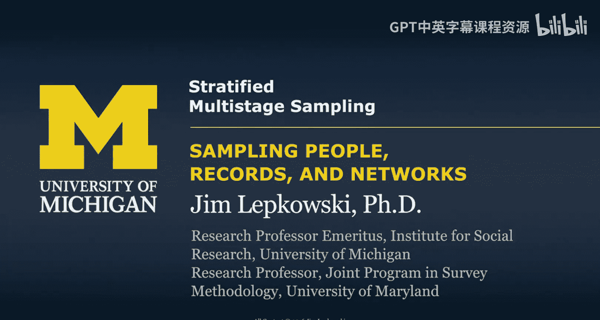
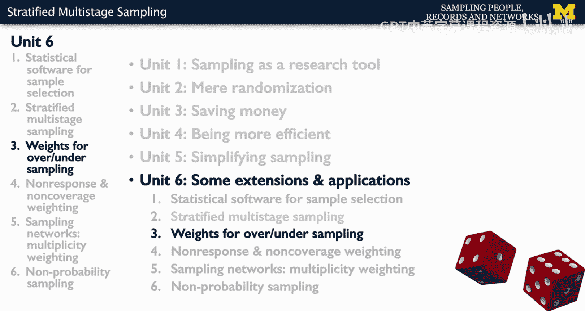

# 密歇根大学《调查数据收集和分析（2-6：方法、社调问卷设计、抽样、缺失数据、分析）｜Survey Data Collection and Analytics》 p118 39_6.2 分层多阶段抽样.zh_en -BV1fw4m1e7Zh_p118-

Up until now in talking about sampling， whether it's people or records or networks。

 we've been dealing with one sampling technique at a time。

But here as we move into the second lecture in unit 6 on some extensions and applications。

 all we're going to do is talk about how to combine our techniques in manners that allow us to address more and more complex frames。

We're going to talk about stratified multi stage sampling that combines our ideas about randomization。

As well as stratification with a whole lot of clustering in our sample selection to address the problem we've referenced before with respect to cluster sampling。

 what do I do when I don't have a list？ What do I do to try and reduce the sampling operation to make it cost feasible for me to get this work done。

When I don't have that list， and we're going to do cluster sampling。

 but we're also going to stratify the clusters， and we're going to make sure that those clusters are selected at random。

 But we're going to do this at several levels。 We're not just going to have one level of clustering。

 but in our particular illustration，2 or three levels of clustering in our selection。

We'll talk about then the first level of cluster selection。

 what we'll call primary sampling units or PUs is our first topic and how we deal with those。

 what they might look like。 and I'm going to take a particular example from the United States。

Just to illustrate this， this is not to say that the sample selection needs to look like this in other settings。

 this is just to illustrate the ideas。And indicate that these are not ideas that are completely foreign。

 difficult for us to apply。 They deal with real materials， as we've been doing all along。

 We'll talk about what happens after we select those units。

 when we still are not at a place where we have a list of our。

 of our elements that we're interested in。 We'll talk about second stage units。

And in our particular case， we'll even move to a third stage unit called housing units。

 So we're going to work our way all the way down for drawing a sample in the United States of housing units。

 The housing units for us may be the object。 they may end up being what we want to study。

 but more likely what they will represent to us is a collection of people who usually reside together in something called a household。

 and it's the people that we're after。 So there may be an additional step of selection with a sample of housing units in order to get to our final elements。

 persons。At the very end， I want to say just a little bit about estimation。

 That's beyond the scope of this course， but we'll mention just a few things about it before we wrap up on this lecture。

So the first thing that one does is think about the sampling units that one's going to have available for a particular application Now many times the applications are such that other people have already done similar work and you can build on their work or borrow from it。

In our particular case， we're going to be looking at drawing a sample of housing units from across the United States。

 and we're going to start by using units that are readily available to us in this particular case。

 nothing to do with housing units specifically， but to land areas。

 we're going to identify though primary sampling units， our starting point。

 something that has a large enough number of those units。

 not just a few of them that we' going to take an even smaller number but a large number of them that we're going to make a selection of them。

 and then we're going to divide the selected primary sampling units up into secondary units。

And then we're going to select those， but only within the selected primary sampling units and within those secondary units。

 et ceter， we're going to select either third level units or housing units。

 however we're going to get there。 and I'm going to take you through just a few illustrations of some of the material that might be used for something like this。

Now， our primary sampling units for our particular application in the United States are subdivisions called counties。

There was a time in which not all the states had counties。 They all had subdivisions。

 but sometimes they were called different kinds of things。 And actually to this day。

 some of them still have those labels。 for example， in Louisiana。

 the counties are referred to as parishes。 but their basic units。

 And this is a map the United States showing the detailed boundaries of all of these counties。

 There are over 3000 of them in the United States and Holla and Hawaii are inserted here。 and they。

 too have these kinds of subdivisions。 They vary enormously in geographic size。

 but we're going to think about these counties now as collections of housing units。

Not a collection of housing units that we can go to and list all of them。

 These counties can have hundreds of thousands， millions of housing units in them， and some can have。

Fewer than 10000。 So there's a lot of variation in size。

 but this is a good place for starting the sample。 We've defined a unit that we're going to use as our primary sampling。

 our first stage selection， knowing that there will be additional steps in the selection stages in the selection clustering to help us get to a point where we can have a list of housing units from which we can draw our sample。

😊，So we've identified those first stage units and what we're going to do with them is stratify them just as we've done before when we dealt with elements。

 we're now going to stratify the primary sampling units。 Stratification was a general purpose tool。

 we used it to assure representation and possibly provide us with gains and precision， as you recall。

 when we did proportionally allocated stratified samples of elements。

When we do that application of stratification to these PSUs in this case counties。

 we're going to follow principles that are similar to those that we used in element stratification but here we're going to use cluster characteristics we're going to stratify the clusters。

 not the elements although implicitly the housing units are getting stratified because they're contained within these PSUs and we're putting the PSUs into groups where they are relatively homogeneous the counties within a group are similar to one another with respect to characteristics that we're interested in with respect to the the nature of the county is it is it an urban or a rural location Does it have high or low rates of unemployment。

 does it have a high fraction of occupied housing units or a low one all sorts of things that we can identify for these primary sampling units。

Our groups will be mutually exclusive and exhaustive， just as we did before。

The stratifying variables， the boundaries， and the other kinds of things follow the same kinds of element sampling stratification principles we talked about before。

 but it's applied just to those units， as I've been saying。

But once we've got that creation of those groupings， those strata。

 then we're going to allocate a sample of clusters across the strata。

We'll figure out how many of these things to use using the kind of approach we talked about before with respect to cluster sampling where we identified the optimum subsample size。

 and thereby the optimum number of primary sampling units so we could select the number of clusters。

We could do the allocation across our strata proportionately。

 We could do it to such an extent that we have only two selections per stratum。

 We could do it so that there's a different number than two。

 but an equal number in each of the strata or other kinds of allocations。

 we mentioned namen or minimum variance kinds of allocations。

 very seldom used with this kind of thing， because there is not much gain available beyond the kinds of things we can do proportionately。

Within each of the groups， within each of the strata， we're going to select our samples。

 and then we are going to， after data collection， compute estimates for each of the strata。

 each of the groups separately， not only the statistic we're interested in。

 let's just say a mean or a proportion， but also the sampling variance of that mean or that proportion within each group。

 and then we're going to combine them。 we're going to use those combining rules we did for stratified sampling。

 but now applying it to the strata for the primary sampling units。Again。

 the stratification is there to control the distribution of the sample to make sure that certain groups are not left out due to randomization and chance result in our sample selection。

 and we have the potential to decrease sampling variance to。

 depending on how we apply our allocation rules。Well。

 how could we do that kind of stratification Well with our PSUs with our primary sampling in itsmean counties。

 here's another map in the United States， I know a slightly different scale and Alaska is now in the upper left and and Hawaii in the lower left and even Puerto Rico is shown here。

 but this is a map showing the counties now， that are metropolitan of two levels very large and all other。

 and they're highlighted in green and then dark green and even a lighter green shading。

 and then the other counties that are in white are those that are non-metropolitan。

So this is a visual way of representing a stratification by taking those counties and dividing them into。

 let's say， four groups， the very large metropolitan areas， the medium size metropolitan areas。

 the smaller size metropolitan areas and the non metropolitan areas。

 all represented in terms of the colors on the graph。 That's the form of stratification。Well。

 there are other kinds of things that can be done。 Usually what we're going to be doing is not looking at a map。

 but a list of the primary sampling units， and this is a partial list of primary sampling units that are counties in one part of the United States that has already been organized for us。

 they've already been grouped into a stum they've got numbers on them we've got their names and for each of them。

 we have size we have even accumulation of the size for them and what we're going to do here is order these not by alphabetic means。

 which it may appear that these are， but geographically。

 we're going to put these counties next to each other that are on the list that are next to each other physically and so we're going to work our way through this particular location and organize our list order our list geographically。

And then draw a sample from it systematically。 That will give us implicit geographic stratification。

 even within our larger strata， where we've explicitly grouped these counties together。

 So we will use combinations here of stratification and clustering， along with randomized selection。

 but we'll even use an implicit stratification through systematic selection with random starts。😊。

That's the selection of the counties， from a geographically ordered list。

What happens then at the second stage now， Suppose we've selected those counties。

 What should we do at that point when we have some decisions to make with respect to sampling units again。

 We're now going to need to look to see， what can I do within this county。

 Can I go right to the housing unit。While most of these counties are way too large for us to do that。

 We would end up listing thousands and thousands of housing units。 and in our sample。

 drawing only a small number， a few hundred。 perhaps。 Well， we've spent a lot of money on listing。

 we wouldn't want to do that。 So we're going to introduce another level of unit there to reduce potentially the amount of listing that we have to do。

 So here， one kind of second stage unit that comes from in the US case。

 the census operations are called census tracts， geographic areas that are defined to be like neighborhoods。

 They're designed to have roughly the same number of housing units in each。

 but there's a lot of variation in size。 They're created for purposes of reporting， Sta reporting。

 so that these areas actually have more detailed data presented for them from the from the census information。

 And here you can see in this particular county。 This is a county that we've zoomed in on。

 We're showing the basic boundaries of the。census tracts， but you can see there's concentrations。

 dense areas where those census tracts are much smaller and others where they're much larger population is more dense in those areas where we have lots and lots of census tracts。

So that's one possible unit for our selection that we would use to select。

An additional location or areas within our our county before we start our listing。

The difficulty with census tract is because that they're fairly large in size。

 We're talking about thousands of housing units in them。

 They are following boundaries that are convenient to follow。 most of the time。

 these are roads that people can follow。 So they're not hard to do。 but they are fairly large for us。

 And so we might seek another unit that's smaller in terms of the number of housing units within it。

 And indeed， there is such a unit called a census block。

 And here's a map of census blocks within that same county。

 And you see the heavy dark lines there to find tracts。 Now， these are tract abbreviations。

 They all start with a 4000。 But these are the tract boundaries。 And within them。

 you can see finer gradations which are census blocks。

 All of the land area within our county is subdivided into not only tracks。

 but even finer gradations blocks。 And this happens to be around the University of Michigan where we're recording these lectures and。

So we have a choice。 Should we use census tracts， larger units and then try and figure out what to do with housing units。

 or should we go right to blocks or should we do tracks and then blocks。

 their decisions to be made on the basis of practical considerations that are a little bit beyond our scope。

 One would make a choice。 In this particular case， we decided that because the census blocks cover all the land area and their group within tracks。

 We may as well'll just use them directly。 It means that our sample may be a little more spread out because we've got blocks all across that county。

 but the travel considerations and other cost considerations indicated that that's not a substantial problem for us to deal with as opposed to having a few fairly large areas called tracks to deal with。

Again， with these secondary sampling units， we can create a list。

 These kinds of materials are readily available in this particular case at the block level。

 Here's a listing of blocks in which we indicate the tract and the block number。

 All the blocks have numbers rather than names。 They have counts of housing units that we can use as measures of size。

 They can be accumulated。 They can be numbered。 and this kind of thing then corresponds to that geographic area in the lower left。

 I'm showing an 18th century map of the city of Detroit。

 One of the oldest cities in the United States。 But even back then。

 it was divided into blocks because the land area was divided geographically for purposes of agricultural production。

And there were housing units located on different tracts of land。

 but those tracts of land often were bounded by roads or in those days dirt tracks。

But that list can again， be used for drawing a sample of blocks from a particular area here。

 for example， within a multi block area in the white unshaded area are a set of three blocks that were selected for our study。

 They were selected together because they were fairly small in size and we decided to link them together to give something sufficient in size for us to work with。

 But nonetheless， that selection， leads us to then the next level， which is the housing unit。 Now。

 are we down to the level where we can actually list housing units and have a small enough number in our list that we will select enough of them to make it worth our while to have listed the housing units。

So here's a magnification of that of that area。 a sketch map that we're going to need to fill in where the housing units are。

 Now， this particular illustration that I'm giving us here comes from a sampling operation in which there were no listed housing units available from any commercial source or any government source。

 So we had to create them ourselves。 So we actually sent someone physically to that block to list the housing units。

 And as they were doing it， they made annotations on the map that we gave them to tell us， look。

 here's where I started。 Look at the X。 And and the arrow indicates which way I went。

 I went in a clockwise fashion around the block。 And by the way。

 there's a public library here on this corner。 There are no housing units over here。

 there's a park in this particular corner。 that kind of thing then will help us orient for after we've selected housing units。

Getting back to those housing unitss， finding them and conducting data collection。

But we don't actually try and list things on that map， but in a separate listing。

 give a list of housing just a list like this。 when a housing unit list of the mapped area showing the address of the housing unit。

 and in some cases， a little more detail when it's not entirely clear that it would be easy to find them。

 It might be an apartment building， It might be a building that was a single family home divided now into apartments we may need some specification that goes with it。

 But that listing there is defining what our housing units are。

 and they're done geographically listed geographically so that we can make a selection that is as implicit stratification by geography by selecting from it systematically again。

 notice， systematic selection gets used in this in this process。

 because from an order listed has valuable properties without us having to form explicit straight up。

All right， So multi stages in that particular case， we started with counties。 We went to blocks。

 and then we went to housing units。 In each case， we thought about stratification， either explicitly。

 formal groupings or implicitly through an ordered list and a systematic selection from it。😊，However。

 we end up doing our final sample， combining our sampling techniques。

 We are still faced with the task of estimation。 In in this case。

 estimation from a stratified multitage sample， iss just beyond the scope of the course。

 it's not that it's going to be unfamiliar with to you in looking at it。

 But you'll find that there's a subsequent course in the specialization that addresses the issues that are there。

 such as computing estimates for complex samples and computing estimates of sampling variances from these complex samples。

 complex samples involving stratification， clustering and randomization in them。

 And then drawing inferences。 How do we calculate from those standard errors。

 comps intervals that take into account the design， what degrees of freedom should we use and so on。

 So estimation would follow from this particular sample design。

 But all of these features are going to be built into the estimation。

 just as they're built into the sample selection that we've just gone through。Okay。

 so it's an extension of what we've been doing， an extension to stratified multistage sampling。

 so as you got some idea about what we mean by this。

 it's done in many different ways across countries around the world depending on the available materials。

 whether they're available from the census or from registry systems。

 but nonetheless it follow those samples would follow very similar kinds of designs。

Let's turn in lecture 3 then to a series of three lectures that willll deal with weighting as part of our extensions and applications。

 because weights are， as we've seen already， problematic in estimation。

 and we want to talk in a little more detail about how weights are created and used in three instances。

 one， having to do with over and under sampling in our next lecture。

 as well as nonresponse and non coverageage adjustments and network sampling。 But our next lecture。

 lecture 3 will be on weights for over and under samplingamp。

 And I look forward to you joining us there as we develop that topic more fully。 Thank you。

