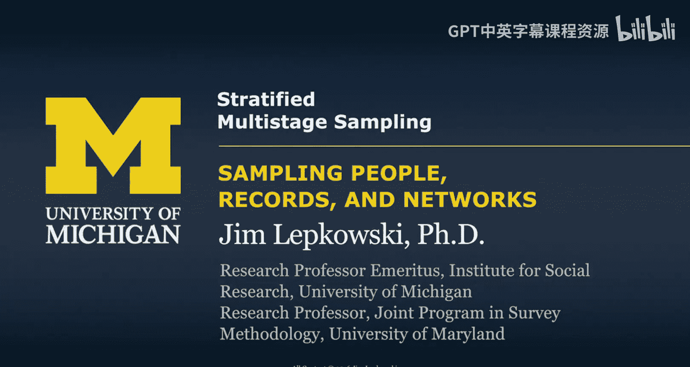
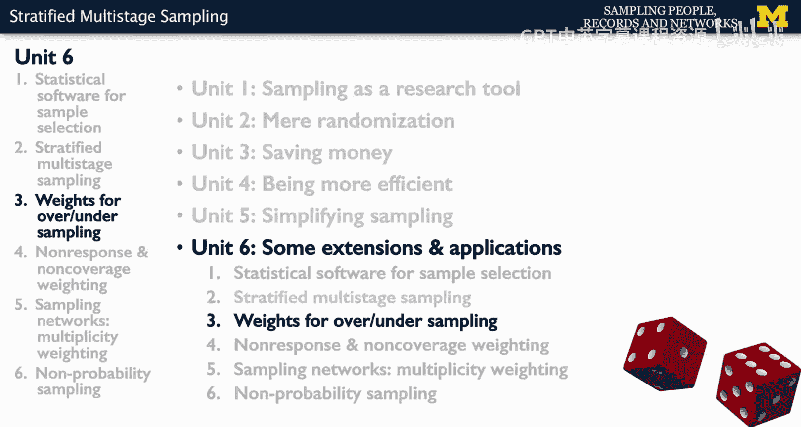

# 调查数据收集与分析：6.2：分层多阶段抽样 🏘️➡️🏠

在本节课中，我们将学习如何将之前介绍过的多种抽样技术结合起来，以应对更复杂的抽样框。我们将重点探讨**分层多阶段抽样**，它结合了随机化、分层以及多级整群抽样的思想，旨在解决没有完整抽样框列表以及降低抽样成本的问题。

---

## 核心概念与流程概述

分层多阶段抽样是一种复杂的抽样设计，它通过多个阶段逐步缩小抽样范围。其核心思想是：
1.  **分层**：将总体划分为内部同质的组（层），以确保样本的代表性并可能提高精度。
2.  **多阶段整群抽样**：在每一阶段，随机抽取“群”（如地理区域），然后在被抽中的群内进行下一阶段的抽样，直至抽到最终的分析单元（如个人）。
3.  **随机化**：在每一阶段的抽样中，都采用随机选择方法。

这种设计的通用流程可以表示为：
**第一阶段**：将总体划分为层 → 从每层中随机抽取**初级抽样单元**。
**第二阶段**：在被抽中的初级抽样单元内，随机抽取**二级抽样单元**。
**后续阶段**：可继续此过程，直至抽到最终的**分析单元**。

接下来，我们将以在美国抽取住房单元样本为例，详细讲解每个步骤。

---

## 第一阶段：选择与分层初级抽样单元

上一节我们回顾了基本的抽样技术。本节中，我们来看看如何构建一个多阶段抽样设计。第一步是确定并分层处理初级抽样单元。

*   **初级抽样单元** 是抽样设计的第一级单位，通常是较大的地理或行政区域。在美国的案例中，我们使用**县**作为初级抽样单元。美国有超过3000个县，它们在面积和人口规模上差异巨大。
*   **对PSU进行分层**：与对元素分层类似，我们对这些县（即“群”）进行分层。分层的依据是县的集群特征，例如：
    *   城市化程度（城市/农村）
    *   失业率高低
    *   住房自有率
    *   其他相关社会经济指标
    目标是让同一层内的县尽可能相似（同质），不同层间的县尽可能不同（异质）。分层能确保样本覆盖所有重要类型，并可能降低抽样方差。

以下是分层的一种可视化方式，例如将县按大都市区规模分层：

*   **层内抽样**：分层完成后，我们需要决定从每层中抽取多少个县（即样本量分配）。可以采用比例分配、等量分配等方法。然后，在每层内随机抽取指定数量的县。

在实际操作中，我们常将初级抽样单元按地理顺序排列，然后进行**系统抽样**。这能在已分好的大层内，实现隐性的地理分层，进一步增强样本的地理代表性。

---

## 第二阶段：选择二级抽样单元

在抽选了县级初级抽样单元后，我们通常还不能直接列出所有住房单元，因为一个县可能包含成千上万个住房单元，全部列出的成本过高。因此，我们需要引入第二级抽样单元。

在被抽中的每个县内，我们需要选择更小的地理区域进行下一步操作。常见的二级抽样单元有：
*   **人口普查区**：类似于“街区”的较大区域，通常包含数千个住房单元，边界明确（如道路）。
*   **人口普查块**：比普查区更小的地理单位，覆盖所有土地面积，包含的住房单元数更少。

选择依据主要是实际操作成本（如旅行、列表成本）。在案例中，由于人口普查块覆盖全面且单元数适中，我们选择直接以**人口普查块**作为二级抽样单元。

我们可以获得所有块的列表，其中包含块编号和住房单元数量（可作为“规模度量”）。然后，在每个被抽中的县内，我们从这个列表中随机抽取一定数量的块。

---

## 最终阶段：列出并选择住房单元

现在，我们到达了被抽中的人口普查块。这一阶段的目标是获得一个可管理的住房单元列表，并从中抽取最终样本。

由于可能没有现成的商业或政府住房列表，调查人员需要实地走访被抽中的块，绘制草图并列出所有住房单元的地址。这个列表是按地理顺序（如顺时针方向）创建的。

列表创建后，我们使用**系统抽样**从这个有序列表中抽取最终的住房单元样本。这种按地理顺序列表进行的系统抽样，再次提供了隐性的地理分层。

**注意**：住房单元本身可能还不是最终的分析元素。如果目标是调查“个人”，我们可能还需要在抽中的住房单元内，再进行一次抽样（例如，随机选择一名成年人），这构成了可能的第四阶段。

---

## 估计与总结

本节课我们一起学习了分层多阶段抽样的设计与执行步骤。这种设计通过结合**分层**、**多阶段整群抽样**和**随机化**，有效解决了大规模调查中缺乏完整列表和成本高昂的问题。

关于从这种复杂样本中进行**统计估计**（如计算均值、比例及其抽样方差、置信区间），其原理是前期分层和整群抽样技术的综合应用，但具体计算更为复杂，通常需要专门的软件和方法，这超出了本课程的范围，会在后续课程中深入探讨。

总而言之，分层多阶段抽样是一种强大且灵活的工具，其具体形式（如使用哪些层级单位）可根据不同国家或地区的可用数据（如人口普查或登记系统）进行调整，但其核心设计逻辑是相通的。

---

接下来，在第三讲中，我们将开始探讨一个在估计中至关重要的话题：**加权**。我们将详细讨论在过度抽样/抽样不足、无回答调整以及网络抽样等情况下，如何构建和使用权重。敬请关注。