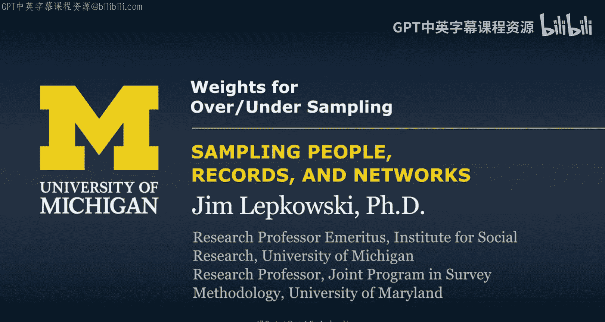
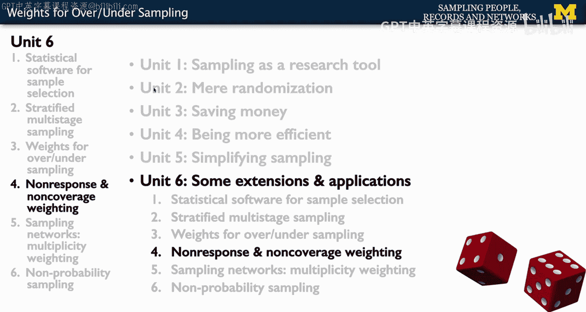

# 密歇根大学《调查数据收集和分析（2-6：方法、社调问卷设计、抽样、缺失数据、分析）｜Survey Data Collection and Analytics》 p119 40_6.3 超-欠抽样权重.zh_en -BV1fw4m1e7Zh_p119-

As we sample。People or records or networks。We often encounter situations in which the frames aren't quite what we want them to be。

 They're cheap， They're convenient， They're accessible。

 but they're not quite what we want them to be。We were lacking something in them。

 or there's some feature of them that that poses brown for us。

 And we find ourselves encountering this issue called weights。

 Wes come up in the survey framework quite often。And what we're going to do in this part of unitt6 in our lecture on。

Weights， but the first of three lectures on weights。

 We're going to talk about weights for a particular problem that we face that we've already looked at。

 But I want to go back through it in more detail and talk about basic principles of weighting。

That way， when you encounter these kinds of things in survey data。

 you'll be a little more comfortable with them， I hope。

 so that you will understand some of the origins of the weights and why they're created and why they may be useful to you as you're analyzing data。

You may also find this useful as a way to think about how you might do waiting for your own survey。

 although this is a bit sketchy， It's a bit brief as a treatment。

 And you really ought to consult someone who's done this before before attempting some of the things I'm going to talk about。

 even though the illustrations here are fairly simple。

So we're going to talk about weights for over or under sampling。

 something we looked at actually with respect to stratified sampling。

And we're going to talk about the framework for waiting， what the basic idea of weighting is about。

 and then weighted estimation， how one computes weighted estimates。

 and then specifically what happens in waiting for under an oversampling or oversampling。

So the basic waiting framework is something like a funnel and undoing a funnel。We start with a frame。

 a population list or a pseudop list， As we know， sometimes the frame is not an exact one to one representation of the population。

With capital N elements。 And we know very little about them。

 So this this blue bar here is meant to represent a long， skinny data file。

 a spreadsheet that has lots and lots of records， but very little information that we know about each。

 And then what we do is apply our funnel， our sampling fraction。

 We're going to take a subset of that population。Through some probability mechanism。

 as we've been talking about it so far to get a sample that is much shorter。

 but the data is much more detailed and much fatter。

 And so that change in the shape of the box is very significant。 fewer lines。

 but a lot of information about each of the elements。 And that's our sample。 a sample of size。

 lowercase N with a sampling fraction， lowercase n over capital and some probability of being selected or being included in the sample that we'll call pi。

But there we're going to compute estimates， as we've seen before。

 That was the fourth step in our operation。 We're going to compute something like a mean。

 And what we want to be able to do is project that to a population。

 And you'll notice that we're actually going backwards now of the population。

 We want to make statements about the capital n elements in the population。 Now。

 we want to create if you will， an artificial box out there。 a projected box。 It's not dark blue。

 It's the light blue。 It is the same number of rows as our original population。

 but the same number of columns as our sample。And there we're going to， in order to do that。

 undo our funnel we're going to push things back out and allow them to flare out to that full population。

 but it's going to be sparsely populated because we only have a limited number of things in the sample that we're going to use for this projection。

 and so we're going to go backwards with a inverse of our sampling rate。

 the capital N over lowercase N is kind of an inflation factor to go from sample to population。

And there， then we can compute things in that artificial population that might involve the original mean of the population。

 We know it's going to be an estimate， and we know that estimate is in error。

And we have a way to calculate what that error is by looking at standard errors and using that。

 then in making statements about the uncertainty of our estimates。

So that's the waiting process that from frame to sample to artificial predicted population upon which we create estimates。

 and we retain information from the sample that will allow us to calculate standard errors。

 estimates of that we can use in making uncertainty statements about our sample estimates for the population。

Now， in an Epssom sampling system， that's one that we've looked at before。

 equal probability of selection method。The sampling。Probability pi subi for each case is the same。

 It's pi。 it's the same for every case。 And it turns out that in many of these circumstances。

 it's the same sampling。 It's the same as the sampling fraction。 lowercase N over capital N。

And suppose that's what we've got。 We have a system then that has equal chances for everyone and we've calculated unweighted estimates。

 We've calculated estimates in which we sum up the value for some characteristic Y across the lowercase n elements in the sample。

 and we divide that sum by the total number of cases in the sample But everything is getting a representation that is the same in the numerator。

 Every case gets its y in the denominator， every case gets counted one time。So， for example。

 if we had a population list of 2000 and we drew a sample of 20 with equal chance so that the chance selection of any given element is 20 from 20001 in 100。

Then we're going to undo that。 not at a global sample or overall sample level。

 we're going to do is undo it case by case。 We're going to take the inverse of that selection probability as a weight。

 Everybody in that sample of 20 will have a weight of 100。

 That is that that weight means that every case has a representation of itself。

And 99 others in the population。 Now， we know that's wrong。

 We know that there are not 99 other people， exactly like each of those 20 cases。

 But that error is what we're going to estimate in our variance estimation and standard error calculation。

But the weighting then is an inflation。 but here， the weights are all the same。

 And so an unweighted estimate is fine because we don't need to worry about that。

 But what we find are that there are circumstances where we have noneppsomamp。

 and we're going to look at a particular case in a moment where those probabilities are not the same across the cases。

 And now， when we go to do our computation We're going to need to take into account the inverse of that sampling rate the inverse of that pi subi for each case。

 as a weighting factor for each case in the numerator in each case and the denominator of our mean。

 so that we have aed mean now。 that's more complicated。

 but we've got software to help us do this calculation where the w subi is the inverse of that probability of selection and the y subi is the same thing we had before。

 It's just that we're multiplying the two together to get a weighted contribution and in the denominator of our mean。

 We sum up not counts of one， but counts that are equivalent。To the weights。All right， this。

Unweightited mean that we just looked at is a special case of this one where all the Ws are the same。

 If they're all equal to 100， they're going to cancel from across numerator and denominator。

 So constant weights cancel our unweighted means is a special case of this one。Again。

 our basic approach then is to weight by one over that selection probability。 That is。

 we're going to count each sample person one over pi sub times。

 That means we've got to keep track for every case of the probability of selection。 Now。

 you should know this only to know that in the background， that's what the sampling statistician。

 the survey folks are doing。 They're keeping track of this kind of thing。

 at least in this particular probability sampling framework。

So let's go through an illustration to look at this weighted estimation and how it works when we do oversampling。

 and I'm going to take a simple example of assuming that we're going to sample 10th grade students in the US。

 The US education system has 12 levels first through through the 12th。

And the 10th graders are two years away from completing the system。

 we might be selecting them for purposes of studying them in terms of test scores。

 we want to understand how well they're doing， we're going to compare them to students in other countries by administering a very similar test across the countries and do some across national comparisons。

Now， this particular layout here is kind of a way of beginning to think about this。

 So we have about there are about 4 million。 it's actually somewhat less than that。

 but just as a round number，4 million 10th grade students in the United States。

And suppose that we've got a sample design that says that we're going to select 12，000 of them。Now。

12000 from 4 million。 That's a complicated kind of rate，12000 divided by 4 million。 Oh。

 I've converted that into a sampling rate that you'll notice in that sampling rate column。 Basically。

 I took 12000 divided by 4000 and divided the numerator by 12000， and the denominator by 12000。

 So the numerator is now  one。 The denominator is 333。3333。That is the selection probability。

 which means that the weight is the inverse of that， 333。33。

 every student in our sample represents themselves and 332 and a third other students in the population。

But with， if we're doing an equal chance selection here， the weight may as well be one。

 It's the same for everybody。 So we're going to need to think about the base weight here and alternative representations because we're going to think about these in two different ways that weight would cancel。

Now。Again， here， we've got our overall population and we could do a simple random sample。

 We don't need to worry about anything else other than randomization。 Oh， no。

 except that we know that we want to stratify。 We want to group them in such a way that we can control the distribution of the sample across dimensions of variables that we know about in advance in our sample selection。

 stratification。 Suppose that what we could do is take our 10th grade students and divide them into two groups。

 Those that have potentially lower incomes and those that have potentially higher。

 except the way we're going to do this is use identification for each of the students about whether or not their school has programs for free or reduced price lunches。

 whether there's a high fraction of the students in their school who receive free or reduce price lunches。

Those schools that have higher fractions of their children receiving free or reduced price lunches。

 subsidized lunches， if you will， tend to have students who come from lower socioeconomic status。

 and those that have low proportions。 those tend to have students coming from higher。

 So we're going to have to keep our highs and lows mixed together。

 A high proportion means lower income， a low proportion means higher income。

 and that's what we're doing in this particular case。

 and we can stratify our population is shown here。 Now we've added two rows。

 we've filled in the table。 The high row， about 20% of our students come from schools with higher fractions of free or reduced price lunches。

 and the low， the 3。2 million， the 80%。 they are coming from schools that have higher incomes among the students。

But there's a sample size now that we draw from each of these。

 Our 12000 are now divided up across these two groups， stratified sampling。 In this particular case。

 what we're doing is doing stratified， proportionally allocated sampling。

 We're using the same sampling rate in each of these。

 And if we apply that overall sampling rate to each of the two groups。 the 800000 and the 3。

2 million。 We get the sample size is shown here。2409600。 Or if we prefer 2400 is 20% of the 12000。

 That's a proportionate representation。 in terms of our miniaturization of our population。

 But nonetheless， the weight within each of the groups is the same。

 It's the inverse of that sampling fraction。 And we can go with that weight or a reduced value for it。

 it's all going to cancel， It's all going to wash out in the estimation in the end anyway。All right。

 so that sample size allocation is a proportionate allocation， 2400 from high，39600 from low。

 2400 from lower income， schools that have a higher proportion of children with lower incomes。

 9600 from those with higher。Okay。And our weights now are the same within our groups。

 And we can either work with a weight that is based on the original probability of selection or a reduced version of it。

 since they're all the same。This is that proportionate allocation that we've looked at before。

 It has equal probabilities of the elements in each of the groups。

 but some investigators may prefer something different。 They may find this constraining。

 They may say， you know， I'm really interested in providing estimates for these two different types of students that are equally precise。

 or I want to compare the two groups。 I want to be able to compare the test scores between these groups and draw some conclusions。

So they may prefer an allocation that looks like this instead of taking。

A proportionate distribution in the sample。 they take an equal number distribution。

 And we've seen this before，6000 from each group。 But now， our sampling fractions are different。

The sampling fraction in the high stratum， the high fraction of reduced price for free lunches。

 has a rate of1 in133， not one in in 333， but one in 133。

 we're sampling at a higher rate by specifying that sample size。 then the overall rate。

 and similarly for the low the 6000 there。 is it a lower rate。

 It's got a larger denominator in in the sampling fraction，1 in 533。33。

The weights as the inverse of those work out to be the same kind of thing that we've seen before。

 Now，133 and 533。 and those weights can be reduced as well。 They can be reduced to a ratio of 4 to1。

 Now， there's no overall weight。 There's no overall weight for weight A or weight B。 But nonetheless。

 we have these different weights for the two different groups。 This is a case of oversampling。

 We have oversled the high group and undersampled thereby the low group。

 That means that we end up with a smaller weight when we want to combine for the high group。

 And a larger weight for the low group to compensate for the over and undersampling respectively。

 Now， remember， again， we did this because our goal was to do a comparison or have equally precise estimates for the two groups。

 But eventually， we will want to combine them to give us an overall estimate。

 And now the weights are necessary， and they will vary。Okay。So the equal allocation。

 we can say if I'm the risk of oversimpling it for comparing two groups。

 the proportion allocation for representing the population combining the groups。Now。

 let's look at the implication of this， the consequences。

 if we look at something like mean test scores among these 10th graders。

And what we're going to do is look at the two different samples。

 the proportionate and the equal allocation。So first starting with the proportionate allocation here now。

 I've stripped some things out。 I've taken out all the population data。

 but the mean test score for the high in the low children are different。

 The high have a lower mean test score than than the low。 The average across both groups。

 now in the population is about 88。 We have a score of 72 for the high group and 92 for the low group。

And again， remember， those correspond to low income and high income。

 And now we have our proportion allocation of 2400 from the high and 9600 from the low。

And because that sample is in the same distribution as the population。If we take those means。

 we end up with the same mean for this particular sample， whether we use the weight of 333 and。

33 or weight of 1， or no weight at all。 But that's implied the weight of  one。

 We get the same mean back。 So it's very good for combining these results without any particular manipulations required to get it。

So those weights are the same as what we've seen before。

 but they're not really necessary in our calculations。But now。

 let's suppose that we look at the disproportionate allocation。

 same mean test scores within the two groups。 But now we're doing 6000 high over sampling the high and under sampling the low。

 And when we do those averaging now across the sample values where they've got a mean test score of 72 for the high and 92 for the low。

 we see that our mean is 82 and 9 88， our mean has been reduced because we have a disproportionately larger number of reduced or free lunches。

And。We've。Draaw the mean down to their lower mean test score。

The weights can be used to compensate for this。 And so the weights that we see here are shown in the next columns and the weights of 1133 and 533 or 4。

1 and 4 can be used to calculate our weighted result。 and we get back to the actual population mean。

 the weights restore， so to speak， the balance。 So in the unweighted case for our disproportionate allocation。

 If we've got 6000 kids with means of 72 and 6000 kids with means of 92。 the overall average is 82。

 But if we apply our weights now of 4 for those children who have scores of 92 and one for those who have scores of 72。

 on average， we end up restoring our mean to 88。 And the same things true。

 whether we use that weight of 4 and1， or we use the weight of 533 and 133。

 We get that same weighted mean that。Our population mean。Okay。

 so this overs and under samplingamp can be compensate used very effectively for certain purposes and compensated to allow us to do not only the over samplingampling under samplingamp for comparisons。

 but also combining。 But we have to be careful with the weights we have to keep track of the probabilities。

 and then take their inverses as weighting factors and use those inverses as weighting factors in our estimation as well。

Well， it turns out that we use these weights in other ways。

 in our sample designs to deal with some deficiencies that arise all the time。

 non response and non coverage。 So in our next lecture。

 what we're going to do is address how waitinging is used there and used on top of the weighting we've just seen in combination to produce a final weight。

 Let's look at that next in in lecture 4 of unit 6。 Thank you。

