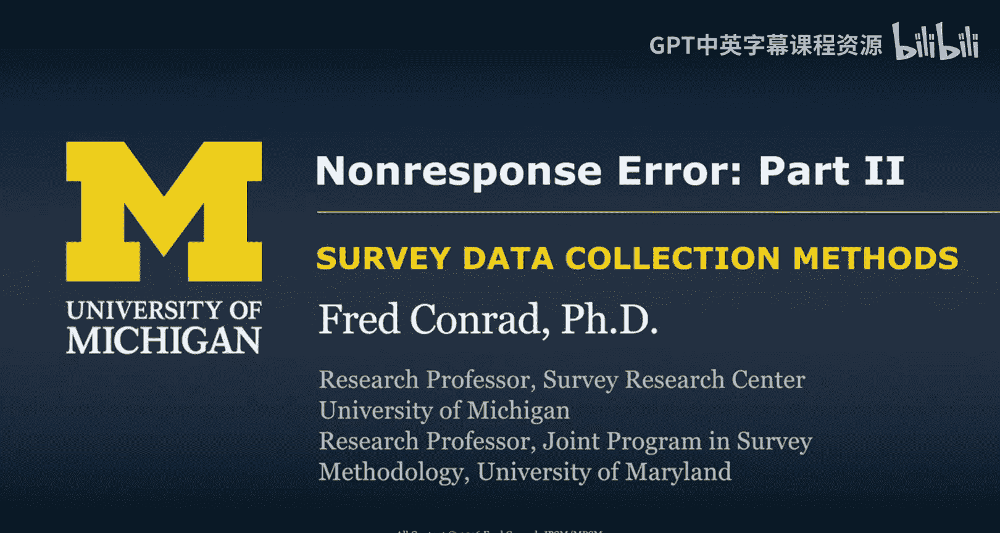
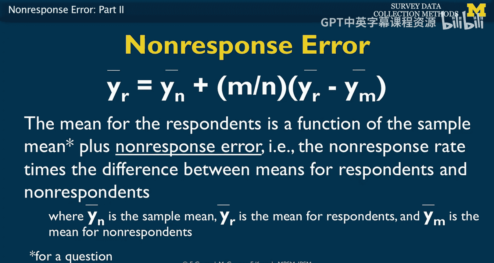
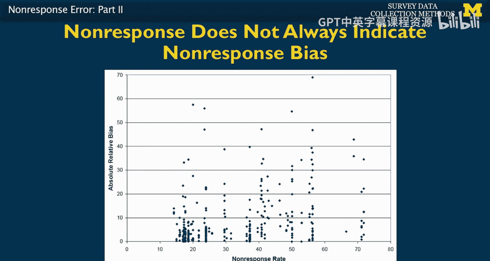
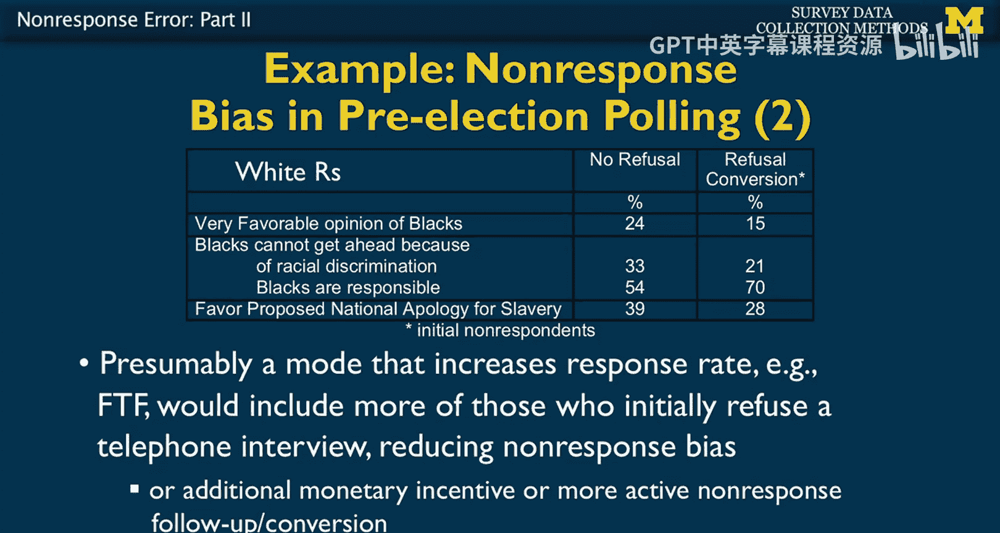

# 密歇根大学《调查数据收集和分析（2-6：方法、社调问卷设计、抽样、缺失数据、分析）｜Survey Data Collection and Analytics》 p12 11_1.5.2 无应答误差.zh_en -BV1fw4m1e7Zh_p12-

Finishing up our discussion of nonresponse we focus on nonresse error and distinguish it from response rate or its complement nonresponse rate nonresponse error can be thought of in the following way if we have a sample mean for respondents as those sample members who have agreed to participate。

 it can be thought of as a function of the mean for the sample that is both respondents and nonresponents。

plus nonresse error now nonres error really has two parts to it， it's the nonresponse rate。

 which is M the number of nonrespondentents over and the number of sample members。

 the difference between the mean for the respondents and mean for the nonresents。

So what this means is that if the respondents are fundamentally giving a fundamentally different answer or the answers are distributed in a fundamentally different way than they are for the nonrespondentents。

 we have a very large difference， that doesn't necessarily lead to a large nonresponse error if the response rate is high or the non-response rate is low so if M over n is a small number then the fact that there's a large difference between the responses and the non-respons isn't as harmful to our estimates。

 but it's not good and if there's a large difference between respondents and non-respondents。

 and if there's a small difference between responds and non-respondents on a particular question。

 but the non-response rate is high is M is large or a lot of non-responents。

 then this relatively small difference between the responds and non-respondents is amplified and so this is。

This is harmful， so it has these two components， the difference between the respondents and non-responents and really the number of nonrespondents。

 so this is why survey researchers strive to make response rates as large as high as possible because it minimizes the risk of nonresponse error。

 but it's not the same thing。I also want to note that nonresse error is calculated at the level of individual questions。

 so you could have high nonresponse error on one question。

 that is the difference between the mean for the respondents and the mean for the non-responents could be large for one question。

 but small for others。The non-response rate or the response rate is calculated at the unit level。

 the household or the organization， the interview， as we saw in the APOR equation。

 so we're combining in a way terms that are calculated at different levels of analysis。

As I said， response rates and nonresponse error or non-response bias are not necessarily the same thing and this insight really occurred in the the first decade of 21st century with a number of studies like this one which is by Robert Groroves in which he demonstrated that non-response rate is really not related in any kind of systematic way to what he call absolute relative bias。

 which is a measure of non-response error， so if you look at this figure。

 there are cases where non-response rate is low， left side of the X axis。

 response rate is high so we'd expect high quality there， and the bias， the nonresponse error is low。

 that's kind of the standard assumption if non-response rate is low， that is response rate is high。

 then we'll have non-response bias or low non-response error。But for every point like that。

 there's one that runs in the opposite direction where nonres rate is low its response rate is high and bias is high。

 nonresse error is high。And similarly， there are cases。

 there are observations in which non response rate is high， which we would。

Conally assumed would lead to lots of bias and there are cases like that。

 like this point in the upper right， but there are also cases where nonresponse is high and bias is low。

 some of these points in the lower right， for example。

So this was one of a number of studies between about 2000 and 2010 that really changed the way survey researchers came to think about response rates。

 so of course response rates， as I said a moment ago can place a kind of limit on non-response error if we have a 100% response rate。

 we have no non-respon error， but they can be quite independent is really the point。

 and so just thinking about response rate is generally not sufficient to characterize the quality of the survey estimates。

Why does nonres sometimes produce bias and sometimes not？Well。

 sometimes the likelihood of being contacted for a survey or the likelihood of cooperating。

 given that a household has been contacted is related to the topic in the question and other times that's not the case。

 so for example， a study by Katherine Abraham and colleagues found that estimates of volunteering。

We're biased by higher response rates among。Sample members who volunteered to take part in the survey。

 so the idea is that what's being measured is related to the process of the decision to participate or not。

 so this study was about volunteerism in society， but those who volunteered to take part in the survey are more likely to volunteer outside the survey and so the estimates of volunteerism are biased in this case by the response process or the decision to respond or the decision not to respond。

Selecting a mode is one of the considerations should be response rates and possibly non-response bias just to reiterate a face- to-face interviews generally lead to the highest response rates because it's really quite socially extreme to close the door on an interviewer without agreeing to participate or at least more likely that a sample members will agree when they're personally face to face when the request is made face to face in person。

 it's easy to hang up the telephone when an interviewer tries to persuade you to participate and it's easiest to not complete a paper questionnaire that might accumulate with other unread mail a table at home。

嗯。But as we said， low response rates do not guarantee nonres errors or the study by Groroves。

 we mentioned there a study by Keer at all， among those that make this point。

 low response rates do increase the vulnerability of estimates to nonres error。

Here's an example of non-response bias in a way that could be related to mode。

 so there have been a number of demonstrations that pre election polls in the United States are known to overestimate the success of black candidates。

So a couple of examples that are now really historical come from a race for the US。

S Senate between a black candidate a Gant and a white candidate helms the polls underestimated the size of the victory by the white candidate helm。

 so they overestimated the success of the black candidate another example is Wilder was the governor of Virginia ran for re-election and the wilder success was the size of his victory。

 he did win but the size of his victory was overestimated by the pre-election polls so what's going on well one possibility is that。

This is attributable to non response bias in the sense that those who don't respond hold fundamentally different attitudes on issues of race。

So this hypothesis was explored by the Pew organization in a 1997 study that found differences between telephone respondents and non respondents who were then converted into respondents so their answers could be compared。

On racial attitudes。 So in this table， you can see that。Among these white respondents。

 the two columns on the right referred to those who responded without any extra effort。

 so they didn't refuse， and then those who did initially refuse but were converted with extra work。

Many follow up phone calls， and so the racial attitudes of these two groups differs fundamentally。

 as you can see that those who hold a very favorable opinion of blacks was 24% for the group that participated without any special effort。

Those that were initial non respondents and were then converted into respondents held a very favorable opinion of blacks for only 15% of the sample members。

Similarly， those who said that who reported that blacks cannot get ahead because of racial discrimination was higher for those who participated without any special work versus those who were initially non-respondentents who only 21% of whom said this was due to racial discrimination。

 or those who said that blacks cannot get ahead because they responsible was larger for the initial nonrespondents than for the respondents。

And then finally， those sample members who were respondents initially。Among those。

 39% favored a proposed national apology for slavery。

 but only 28% of those who were initial non-respondentents favored this apology。

 so a couple of points， presumably a mode that increases response rates for example。

 face to face would include more of those who had initially refused a telephone interview。

 and this would have reduced non-response bias because the idea that those who initially refused the telephone invitation held more racist opinions。

 and so excluding them from the pre-election polls， excluding them from the interviews。

 because they were non-respondents led to this inaccuracy in the pre-election polls。

 this bias in the pre-election polls。

嗯。Or there are other ways in which those initial nonresponents might have been brought into the pool。

 a pool of completed cases， for example， additional monetary incentive or more active nonresponse follow up or conversion。

Another point to make is that this finding is actually different from what's known as the Bradley effect in which the black mayor of Los Angeles。

 Tom Bradley his。呃。Reelection was inaccurately predicted by pre election polls。

The Bradley effect is upon investigation thought to be a measurement error effect in which white respondents。

Told the pollsters， the interviewers that they would vote for the black candidate for Bradley in this case because they felt it was undesirable to say they would not that they would vote for the white candidate。

 but then when election day arrived， they ended up voting for the white candidate。

 and so the poll was accurate for those reasons， this is fundamentally different。

 this is a matter of the answers provided in the interview not reflecting future behavior different than those who were non-responents holding different racial attitudes as in the peew study that we just looked at。

So that concludes our discussion of non response and the difference between non responses and non response error or non responses bias。

And it concludes our introduction to the course。So in the next lesson。

 we will go into more detail on web surveys and automated self administration。

 which are modes we really haven't discussed to the extent we've discussed the more classic modes in this introduction。

So look forward to seeing you in the next lesson。