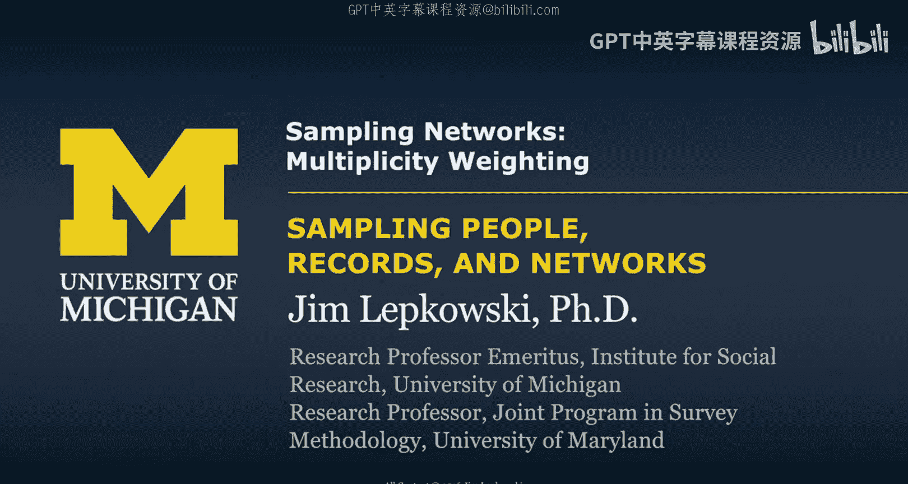
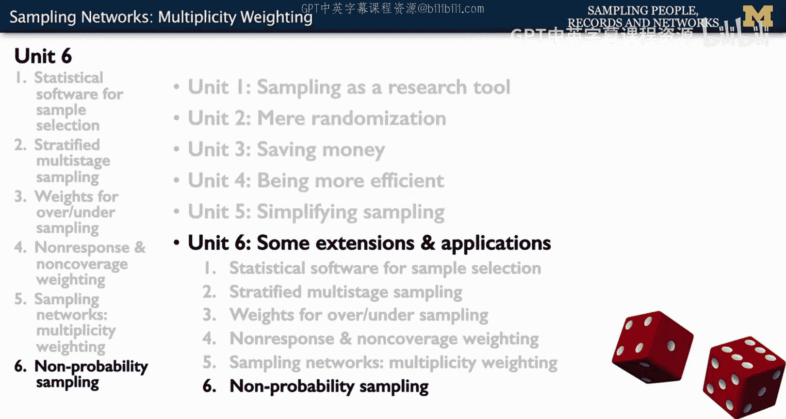

# 密歇根大学《调查数据收集和分析（2-6：方法、社调问卷设计、抽样、缺失数据、分析）｜Survey Data Collection and Analytics》 p121 42_6.5 网络抽样与多重权重.zh_en -BV1fw4m1e7Zh_p121-

Let's talk about sampling network， shall we， We're in unit 6 of our six unit。

series of presentations and we're in the fifth lecture now in which we're talking about sampling networks。

And talking about sampling networks from a couple of perspectives。

 we're going to do two illustrations here， we're going to do two different kinds of networks that arise in the survey literature。

 these are not the only kinds and it doesn't mean that this is the only way to think about doing network sampling。

 certainly the kinds of things that people think about for networks。

 social networks and other kinds of things are have similar kinds of approaches to what we're going to be talking about here。

 but I'm going to talk about two simpler examples， just the basics of what happens when you deal with networks。

Now these networks arise in all sorts of circumstances。

 you may have something that is a network system that is a social network。

 There are groups of people who are socially connected to one another。

 many times those social connections are quite complex。

 they're connected not only to one or two other people， but lots of other people。

 sometimes only a couple of other people and we can get very dense kinds of systems。

 but then having different groupings of these networks。

 different combinations now the basic diagram has as dots there nodes。

 will think about those as persons。The lines are edges。

 they are the connectivity among the units and we're going to think about， as I say。

 people and the edges relationships， but it could be computers and connectivity among them it could be any number of networking kinds of circumstances this network diagram represents one that has cases that are isolated。

 stand alone in these kinds of networks。The networks can be quite distributed。

 They may be centralized around a single individual or even something in which there is a central location that is a node that is unlike the other nodes。

 maybe they're connected through a common organization but not everybody's connected to that organization。

 but they're connected to it indirectly， and so the networks can be generalized to also include not only people but people and collections of people organizational units as well。

 we're going to look at two examples， as I say of this kind of thing。 but before we do that。

 we should recognize that there are different patterns to these networks。

 and what we're going to do is look at something that might be labeled a star pattern。

 something where there's a central collection where that unit may be a person or it could be an organization。

 and then we are also going to look at things that are more fully connected networks。

 that one that's shown in the upper right， even though there are other。of networks here。

 as you pose the problem of drawing samples of the nodes and these kinds of things。

 thinking about how individual elements can be selected， the shape of that network。

 the pattern of that network will dictateate certain kinds of things that influence our estimation。

So let's suppose that we have this kind of a pattern as part of our network。

 Here we have a group of nodes。 the circles there are people。

 and they happen to be connected to one another。 Well， not in all cases。

 Sometimes there's a single circle there。 It's a person that is unconnected to anyone else in our network framing in other cases。

 they're connected to one other person， or two other persons。

 but these are those kinds of mesh networks， they're connected to everybody in their local network。

 but they're disconnected from the others。Now， how could something like this arise？ Well。

 one of the ways that this arises in the survey literature is something that was referred to as multiplicity sampling and multiplicity weighting。

So the idea was that you have a collection of those people available。 and you sample those people。

 And as you do it， our red dots are the sample people， you identify their network。

 What is their network that they're connected to。 So now you see what we've done。

 We've actually taken a sample of people。 And we've asked them what their network is in a particular way。

 Now， this particular network has to do with siblings。 What is your network with respect to siblings。

 Now， Now， these could be siblings that are related to by blood or by adoption or by by marriage。

 we can define it in a variety of ways involving。Half siblings and full siblings and a variety of others。

 But let's just deal with the siblings now that we think about ordinarily in terms of brothers and sisters。

 whether it's by birth or by adoption。 And so now what we've done is draw a sample of people and to find their network for them。

 The networks were unconnected。 In this particular case。

 we didn't draw anybody who was from the same network。 We just happened to get individual networks。

 And so we've drawn a sample of nodes。 And now we're looking at the networks that they comprise。

This has implications for us in terms of sampling， because now we've actually identified a larger number of persons than in our sample。

 The red dots are a little less than half of the total number of persons in our network。

In our as defined by our networks， that would allow us to take the sample that we have and expand its reach to the sample plus all of those who are in the existing networks so we can now talk about the individuals and their siblings。

And that would allow us to possibly collect data about the individuals and the siblings through the single interview and thereby have a larger base sample。

 and potentially a more precise estimate， especially when we're dealing with rare characteristics。

 So suppose that in the sibling network， what we're interested in is a disease condition， a diabetes。

And we know that the frequency of diabetes is low enough that if we just stuck with the red individuals。

 the sampled individuals， we're going to have a fairly small sample and a fairly small number of cases of diabetes in our sample。

 but if we expand to include the entire network， now we're going to have not only those that we selected。

 but also their siblings involved in the sample。 and we will try a data collection in which we attempt to collect data about not only the sample person。

 but ask them about their siblings。Now， there's a measurement problem that arises here。

 How do we measure that characteristic for those that we haven't selected。

But there's also a sampling problem here， and that is that if you happen to be part of a two sibling arrangement。

 you were selected and you have one sibling who was not selected。

And we collect data about you and ask you to about information about your sibling。

 That sibling has two ways of coming in the sample。 Oh， so do you。

 Because you came in because you were selected， but you could also come in because your sibling was selected。

And vice versa， your sibling could come in because they were selected or because you were selected and provided information about them。

 We have then multiple chances of selection， a duplication problem or a tripplication problem or so on。

 We've got more than one opportunity for people to come into the sample。

 And that means that we're going to over represent people in this arrangement who tend to be from smaller networks。

Relative to all of the persons across the networks。We've got a potential for bias。

 an over representation an over sampling of persons coming from certain kinds of smaller networks。

 And in circumstances like that， we would use a weight to compensate for it。

 But we're going to have to calculate， figure out what their sibling network is so that we know how many different ways they could come into the sample。

 And then we factor that into a waitinging factor for our particular case。Well。

 here's a tabular display of what happened for those 10 cases。

 There were actually 10 sample persons there。 Samle person number one。 I didn't number them。

 but sample person number one happened to be living have no living siblings。

 So they're all by themselves。 They're one of those single， singleton dots。 And we asked them。

 have you ever been told by a doctor that you have diabetes by a medical doctor。And they say no。

 okay now there are in the network now， there's no cases of diabetes。

 There's only one represented there。 That person， let's suppose that each person was selected with a probability that we can identify and that person's weight corresponding to that probability was 100。

Their network size was one， so their chance of being in the sample is just based on that that a one in 100 probability that's expressed in terms of the weight of 100。

 They have a network adjusted person weight of 100。

But now let's look at the second person going across the second line。 They have two siblings。

 That's one of those triangles。 They have two living siblings。 Now， none of them。

 not the person who was selected， nor any of the siblings have diabetes。 Now。

 we're going to collect about the siblings from the informant， the sample person。 But again。

 as we look across there， the base probability for that person is one in one100。 a weight of 100。

 There are three people in the network， but their weight now should be smaller。

 They have three times the chance of being selected because they could have been selected alone or through either one of their other siblings。

 So we're going to give them a weight that is one third is large since their probability is three times larger。

Let's try one with person number3。 who comes from a quad， comes from that quad。

 There are four siblings altogether。 We' selected one， and there are three others。

 We haven't selected。 The person we've interviewed does not have diabetes or never has never been told that they have diabetes。

 But one of their siblings does。 Now in our network we've got a contribution of one case of diabetes to what we're doing among the total number of cases。

 The probability of selection in that particular case，1 in 200。 and the network size is 4。

 So the weight has to be adjusted that weight of 200 has to be adjusted by a factor of one in 4。 Now。

 we're assuming that all the elements in the network have the same person weight。

 There are some assumptions going on here。 which you can see how what we're doing is thinking through。

 how does that network， which we're now accessing as a way to increase our sample size。

 How does that influence the chance of our individual being selected and the members of the network being selected。

And how do we compensate for that in our waiting？And so we have now network adjusted person waits that accountss for that。

So the network sampling here is one in which we've used the network to expand through the network connections。

 the number of persons who are in our sample。Let's look at how this adjustment works。

 So we have really two cases of diabetes among the sample persons， among the living siblings。

 there more。 So we've we've。Triple the number of cases of diabetes。 There are 10 sample persons。

 but 27 persons in the networks that weve've identified， including the sample persons。

If we just took the unweighted prevalence among the sample persons， it would be 20%。

And that's perfectly valid， but it's only based on a sample of size 10。

If we take the unweighted prevalence among all the networks， the6 divided by the 27。

 we see that we've got a much lower rate， we're going to need to do a weighted prevalence in that particular case。

But our network adjusted weighted prevalence comes out to be 。256。

 and it's based now on 27 cases properly weighted to account for the multiple chances of selection that are occurring because of the networks and people being in those networks and reporting about other members through those relationships in the network system。

Okay， multiplicity sampling this is not intended to give you full tools on how to do this。

 but to give you the idea about what happens when we sample persons and networks。

There are other kinds of network sampling that occur in the survey realm。 For example。

 this is one in which we have two central node， star patterns， two star patterns。

 which are also connected through one person in each of them。 the outer circles around this。

 this pattern our clients to insurance companies。 They're people who receive health insurance through a company and the central circle in each is the insurance company。

 Now， our goal here was to draw a sample of persons and identify characteristics about them。

 So we've drawn a sample of six persons。 And we we're going to collect data about them。

 but we also want to know about their health insurance companies。 And so what we're going to do is。

Identify the insurance carrier for each sample person。 In this case。

 there are two insurance carriers across the six people。

5 of the people are uniquely associated with only one carrier。 One person's associated with both。

 Now， we're going to have to figure out what is the chance of the insurance carrier are coming into the sample。

 Well， we have to count all of the people who are in the network。

 We're going to need to count on the size of the insurance carrier。

As well as any interconnectivity that goes on， and we would go through and systematically calculate for each of the insurance carriers what their chance of selection was based on the sampling rates we had for the individual persons。

 I won't go through that kind of calculation。 But you can see now how the network is factored into a further expansion of our data collection to include not just more people。

 as in the previous example， but here people as well as an organizational unit that were' very interested in。

 And we're going to combine both in our single data collection through one sample of people。

 and then extract from that information about insurance carriers and their probabilities of selection so that we can properly account for their size contributions to the industry。

All right。Multipicity sampling， network sampling， the principles that we've been dealing with for probabilities。

 the randomized selection， all of that kind of thing can be factored in through a waiting system to allow us to utilize these networks as ways to increase our sample sizes or increase the diversity of our units。

 persons， as well as insurance companies。We have one last topic to talk about our final topic lecture6 on non probability sampling。

 just some thoughts about non probability sampling to wrap up what we've been doing as we look at the last lecture in unit 6 next。

 thank you。

