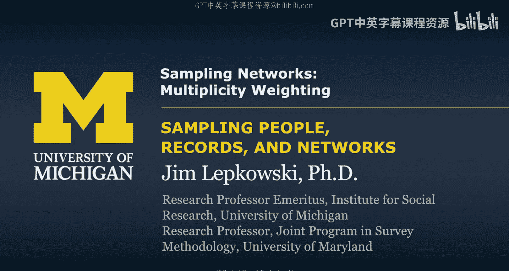
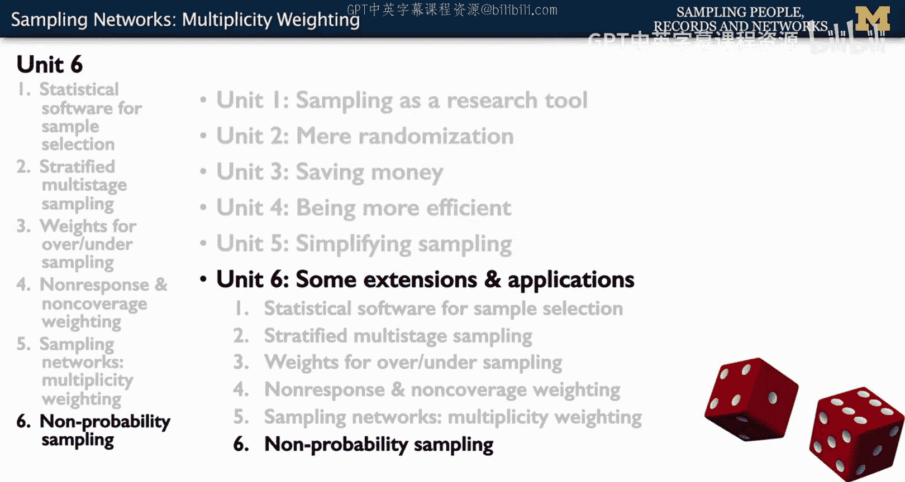

# 调查数据收集与分析：6.5：网络抽样与多重权重 📊

在本节课中，我们将学习网络抽样的基本概念。网络抽样是一种利用个体之间的连接关系来扩大样本范围或获取额外信息的抽样方法。我们将通过两个具体的例子来理解其原理、应用以及如何通过权重调整来处理由此产生的多重选择概率问题。

## 网络抽样简介

上一节我们讨论了传统的抽样方法，本节中我们来看看当抽样单元之间存在连接关系时会发生什么。网络由**节点**（通常代表个体）和**边**（代表节点间的关系）构成。这种结构在社交网络、组织关系等场景中非常常见。

在调查研究中，我们有时会利用这些网络关系来获取更多数据。例如，通过询问被访者关于其家庭成员的信息，我们可以间接了解到未直接抽中的个体的情况。然而，这也会带来新的挑战，即同一个体可能通过不同的网络路径被多次“选中”，从而影响样本的代表性。

## 示例一：兄弟姐妹网络抽样 👨👩👧👦

让我们看第一个例子。假设我们进行一项关于糖尿病患病率的调查。我们从一个总体中随机抽取了一些个体（用红点表示），并询问他们及其所有在世兄弟姐妹的健康状况。

以下是这个抽样过程的关键步骤：
*   **初始抽样**：我们随机抽取了10个个体。
*   **网络识别**：每个被抽中的个体报告其兄弟姐妹网络。这让我们知道了网络中总共包含27个人（包括样本个体本身）。
*   **数据收集**：我们通过样本个体，收集了其本人及其所有兄弟姐妹的糖尿病患病信息。
*   **核心问题**：在这个网络中，一个拥有两个兄弟姐妹的人，其本人被直接抽中的概率是一种进入样本的方式。此外，如果他的任何一个兄弟姐妹被抽中并报告了他的信息，这又提供了额外的进入样本的方式。因此，来自较小网络（如独生子女）的人被代表的机会，相对于来自较大网络（如多子女家庭）的人更少。

为了解决这种“多重入选机会”导致的选择概率不均等问题，我们需要为每个个体计算一个**网络调整权重**。其基本思想是：个体的最终权重应与其被选入样本的总概率成反比。这个总概率与其所在的**网络大小**有关。

### 权重计算示例

以下是一个简化的计算过程展示。我们假设初始抽样赋予每个人的基础权重为 `W_base`，然后根据其网络大小进行调整。

| 样本个体 | 网络大小 | 基础权重 (W_base) | 网络调整权重 (W_adj) | 计算公式 |
| :--- | :--- | :--- | :--- | :--- |
| 1 (无兄弟姐妹) | 1 | 100 | 100 | `W_adj = W_base / 1` |
| 2 (有2个兄弟姐妹) | 3 | 100 | 33.3 | `W_adj = W_base / 3` |
| 3 (有3个兄弟姐妹) | 4 | 200 | 50 | `W_adj = W_base / 4` |

**公式**：`网络调整权重 = 基础权重 / 网络大小`

这个调整确保了，尽管来自大家庭的个体有更多途径进入样本，但他们在最终估计中的贡献会被相应调低，从而保证估计的无偏性。

### 患病率估计对比

通过这个例子，我们可以看到不同估计方法的差异：
*   **仅基于10个样本个体（未加权）**：患病率 = 2/10 = 20%
*   **基于27个网络成员（未加权）**：患病率 = 6/27 ≈ 22.2%（此估计有偏，因为它忽略了多重选择概率）
*   **基于网络调整权重**：患病率 = **25.6%**（这是经过正确加权处理后的无偏估计）

由此可见，利用网络信息显著增加了病例数（从2例增加到6例），提高了估计的精确度，但必须通过权重调整来保证其准确性。

## 示例二：保险公司-客户星型网络 🏢➡️👥

现在，我们来看另一种网络结构。假设我们想研究人们的健康状况，同时也想了解为其提供服务的保险公司的情况。我们抽取了一个人的样本，并询问了他们的健康保险公司信息。

在这个“星型网络”中，保险公司是中心节点，参保客户是周围的节点。我们的样本中，有6个人来自两家保险公司。其中，有一个人同时是两家公司的客户（构成了网络间的连接）。

以下是这个例子的分析：
*   **目标**：通过人员样本，同时估计个人健康指标和保险公司层面的特征。
*   **方法**：识别每个样本个体的保险公司。这样，保险公司被其客户“带入”样本。
*   **权重挑战**：一家保险公司被选入样本的概率，取决于其有多少客户被我们抽中，以及这些客户被抽中的概率。例如，拥有更多客户的公司被选中的机会更大。同时，那家同时服务于两个样本个体的公司，其被选中的概率计算也需要特别考虑。

虽然此处未展示具体的权重计算公式，但原理与第一个例子相通：我们需要为每家保险公司计算一个基于其客户网络和客户抽样概率的权重，以便在分析保险公司数据时进行无偏估计。

## 总结与过渡

本节课中我们一起学习了网络抽样的基本概念。我们通过**兄弟姐妹网络**的例子，理解了如何利用社会关系扩大样本，并通过**网络调整权重**来处理多重入选概率问题。接着，通过**保险公司-客户网络**的例子，我们看到了网络抽样如何帮助我们从人员样本中获取组织层面的信息。

网络抽样是一种强大的工具，它能让我们更高效地收集数据，尤其是针对稀有特征或难以直接抽样的群体。其核心在于，**任何利用网络连接获取额外信息或单元的方法，都必须通过严谨的权重体系来校正由此产生的非等概率选择问题**。

在下一讲，也是本单元的最后一课中，我们将把目光从概率抽样转向**非概率抽样**，探讨其应用场景和需要注意的问题。