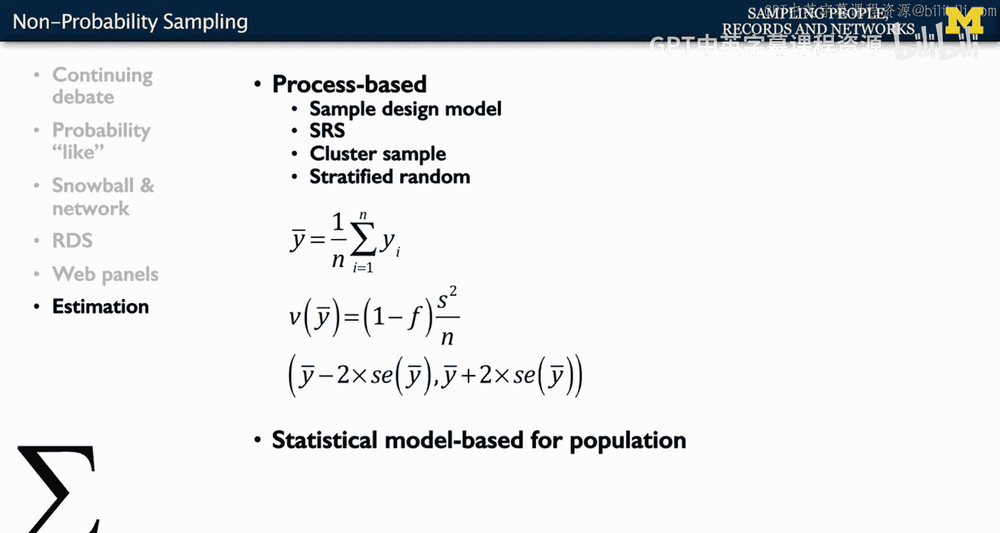

# 密歇根大学《调查数据收集和分析（2-6：方法、社调问卷设计、抽样、缺失数据、分析）｜Survey Data Collection and Analytics》 p122 43_6.6 非概率抽样.zh_en -BV1fw4m1e7Zh_p122-

When talking about sampling people， records and networks so far。

 we've concentrated on samples that involve probabilities of selection， probability sampling。

And here in our final unit， unit 6 on some extensions and applications in our final lecture。

 which will be a non probability sampling， we're going to talk about what happens with the sample designs or what kinds of sample designs you can have where Probabilities of selection are not maintained。

 Probabilities of selection are not recorded。Chance selections are not used。Now。

 sometimes these non probability sampling methods are ones in which they look like probability samples。

Sometimes they look like network samples。There are variations on a theme。

But there are also lots and lots of these samples， these non-pro samples that are not even attempting to resemble an existing sample design。

 but are purely recruiting techniques。 they're hardly sampling in which there's a formal selection and then data collection。

 These are much more along the lines of let's recruit a group of subjects that we're going to interview。

 it's almost as though the sample selection and recruitment are combined in one step but there's no randomization in the selection in what we're going to be talking about。

 or the randomization that we've been dealing with is somehow disrupted by how the samples are done。

Now I'm going to use some materials here that are things that I'm borrowing from my colleague Sunki Lee at the Survey Research Center。

 the University of Michigan and I'm using these with permission。

 but I've sort of mixed in her material with mine， so I just wanted to acknowledge that this does include her contributions as well。

 but I won't be able to explicitly identify them， except for one or two slides that are directly hers when we talk about something calledrespondent driven sampling。

Now， there is a debate about these kinds of things。

 And this debate is one that's gone on a long time。 My little photographs on the lower left。

 famous debates in the United States， political debates about slavery and other kinds of issues between Abraham Lincoln and his opponent in a congressional race in the 1850s of Stephen Douglas and Abraham Lincoln two sides。

 they're arguing that the case back and forth。 And that's what's going on has been going on in the field of sampling for some time。

 So an early discussion about probability sampling by Leslie Kiish。

 though this comesumps from textbook that he published in 1965 in probability sampling。

 every element in a population has a known nonzero chance of being selected。

 There's a selection mechanism that's built on Brown random numbers， as we've talked about them。

And that probability sampling requires that the actual selection be made by a mechanical procedure that decides the desired probabilities。

 randomization is used。William Cochraran， in a later edition of his textbook in 1977 on talking about non- probability samples。

 he says， look， these are not the same kind of thing。

 they're not amenable to the development of sampling theory that we've looked at where we end up with the sampling distribution and a standard error that is the spread of a measure of the spread of the values across all possible samples。

 If there's no random selection involved， we're not able to apply that kind of model free framework。

Even if we've got a method that appears to do well in one sample。

 it's not a guarantee that it will do well in other circumstances and probability sampling provides that for us。

But what's been pointed out many times but I'm using a quote here more recently from Andrew Gellman just a few years ago。

 he says， look， the probability sampling is fine in principle in theory。

 but really no sample is ever really a completely a probability sample。

 and he says or even close to probability sample， I think that's a little bit strong。

 I would disagree with him there， but the point is well taken even when we do careful probability samples。

 non-response is going to interfere and when we do and when we deal with non-response。

 we've already seen with our weighting that we make assumptions about how the non-resse operated and then on the basis of that assumption make adjustments。

And so we're going to use a model in that case， it's a blend of probability selections and a model to adjust for a non probability mechanism that's there。

So。All along， we've really been thinking about。 I've been thinking about models that are probability based。

 but have non probability features。 But there are also these sample designs that are completely non probability based。

 They don't even start with a probability sample。 but there's， there's。

 there's a progression of these kinds of things that we want to talk about briefly。

So let's start with the idea of a probability sample that has nonre。

 There are a variety of ways that these kinds of things deal with the non response。

 but the non response introduce non probability selection。 If there's not a lot of nonre。

 it' not a severe departure。 It's still basically a probability sample。

One way that people often deal with this is to make an adjustment。 They say， well。

 I know that I'm going to lose 20% of the sample due to nonresse。

 So what I'm going to do is start out ahead。 I'm going to start with a larger sample size。

 increase the sample size when I get to the point where I've spent all my resources on data collection。

 and I stop。 I'm going to try and compensate for that loss and nonresse through a weight。

 a weighting mechanism like we've seen before。And those weights， by the way， as we saw。

 I just hinted at it when we talked about logistic regression models for nonre weight。

 Those models are improving on our probability sample， given that it has nonre。

Another approach that actually may be more common。 I'm not sure anyone's cataloged this。

 but it is substitution for a nonres。That is， when we have a nonreing case。

 we're going to obtain another case to substitute for it。 So the nonreent refused。

 We draw another case and use its values instead now。

The substitution can be done in a wide variety of ways。 So， for example。

 it can be done quite purposeively。 The nonresponent had certain characteristics。

 and we use our judgment to select someone else from the frame to substitute for it。

 This kind of thing is sometimes done， especially with primary sampling units。

 You see this kind of thing with school sampling。 We lost the school。

 We lost a cluster because they refuse to participate。

 And now we're looking at other schools and trying to use our judgment as experts in the psychology of the phenomena we're studying or the sociology of it or the public health aspects of it to find something that is as close to possible。

 like that unit。Well we'll back off from that that's very that's much more subjective。

 but we're going to use our expert opinion about this and I'm not saying that we shouldn't do this。

 I'm just saying it's different than what we're talking about with probability sampling。

Another way to do that would be to match。 There are four dimensions that we're going to match on。

 We're going to get another school that has similar size comes from a similar location。

 urban or rural that has a similar level of free or reduced price lunches。

 And is it the in the same state in the same province。

 and we're going to match on that basis and choose one。

 maybe we'll be a blend of our expert opinion about how close we are。

 but we're going to get as close as we can on those those dimensions， matching。😊。

We can also choose to select the substitute completely at random。

 We lost this case while we're going to select another one at random。

 or maybe we're going to do it stratified random。 We lost this case within this particular stratum。

 We're going to select its replacement。 its substitute from the same stratum。

All of those though are departures from the probability sampling scheme and substitution is common in sample designs。

 it is not fully understood in terms of its properties， but it's an adjustment for it。

Okay so these are non probability samples granted， this is in the Gellman spirit of recognizing this。

 but these are minor departures compared to some of the things that we're about to look at。

There are also probability like samples in other dimensions。

 There's quota samples and quota samples that most people think about for this kind of thing involve multistage selection。

 you remember our multist or stratified multistage sample in which we sampled primary sampling units。

 counties， and then we sampled blocks and then we sampled housing units and then possibly we would go on to sample people within them。

 Well the multitage quota sampling might very well draw a sample of counties and then draw a sample of blocks or in political systems。

 something like voting wards or precincts and then within those a quota is specified in terms of the kinds of people that you want in the sample and an interviewer is sent out to that location to collect data that has to be half female。

 you're going to get 10 interviews， five of them should be with females， five with males two of them。

Should be with people who are of African American descent and one of them should be with someone in age 18 to 24。

 quotas are set， but interviewers have discretion。 Now we see a larger departure。 Yes。

 we've got probability sampling at the primary sampling unit and at the second stage sampling unit。

 but at the third stage， it's open to interviewer decision， but they just have to meet a quota。Okay。

 so another departure from these kinds of things。Now there are also webbased sampling kinds of things。

 these are mostly convenient samples， but they're webbased in terms of we're doing some kind of email blast or chat room or instant messaging banner ads。

 social media some way of recruiting people now that's quite a departure from the things we've been talking about till now we're going to expand on these kinds of things because these have become quite a bit more important as the web and social networks and other kinds of access to people through the web have become more common in the last decades。

But as we do that， there are also techniques that bring into the sample selection networks chain referral systems。

 a technique called snowball sampling， starting with a small and increasing and increasing rolling along and increasing the size as we pick up more and more through referrals so we start with a convenient sample of rare group members and then we use insider knowledge to locate more of them inside the network through chain referral sounds a little bit like the things we were dealing with before for multiplicity。

 but this is much less formal than that it's primarily used in qualitative studies to increase sample size of rare group members。

The idea that we were considering before just in a previous lecture involved a formal specification of the network。

 we were much more careful about what that network was。

 and we exploited a connectedness among the people。

 the chain referral but we kept track of accounting rule so that we had a multiplicity we could capitalize on duplicate counts by the creation of weights and we were able to collect data about multiple people in that kind of network。

 so snowball sampling network sampling have a number of overlapping principles。

 but they're structured very differently， one is a less formal system。

 let's get something quickly about a rare group， another one let's focus on a rare group but by doing something that involves much more careful definition of networks and specification and identification and then counting and weights to connect them。

There's also a series of techniques that are referred to as respondent driven sampling。

 it's kind of a blend between these， it exploits social networks of rare populations for sampling purposes。

They make an assumption in this that converts sort of a snowball sample into a random sampling process through a Markov process。

 They assume that the recruitment has certain properties that resemble a stochastic process that allows them to then determine weights for each individual and produce unbiased estimates through that weighting。

 very similar to multiplicity， but the specification of the networks is much less structured。

 There are stronger assumptions involved in these kinds of things。

The network recruitment as well is not done by the investigator。

 it's done by the subjects by the respondents， they drive the sampling process。So for example。

 we may have some seeds a wave one， a group of individuals who we have identified through convenience methods from each of those seeds。

 we then ask them to recruit others now we'll just deal with one of the seeds here we give them a series of recruitment coupons and they distribute those among their connections in in the community and they recruit additional subjects  one。

2，3 and four， providing them with coupons and encouraging them to then contact the investigator to provide data and those in turn are used to then。

Recruit new subjects And when waves 2，3，4 through wave W。

Additional subjects are recruited to fill out the sample size。

Now in these kinds of systems then we repeat this across each of the seeds。

 but within each of these then we're keeping track of the size of the sample as we move along。

 we're using the sample to recruit new sample members much like a snowball sample。

 but not exactly in the same way。And then we make an assumption as we do this about how these recruitment coupons are being used and how effectively we're able to recruit elements of the networks。

 We look at the networks that are actually recruited。And so that what we end up with is for our seed。

 from our recruitment coupons and our collection of individuals。

 a final sample from each of the seeds， and we're going to calculate a probability of selection for each of those under a model that assumes a complex process。

Okay， so seed1 has a recruitment chain， seed2 has a recruitment chain。

 and we make assumptions in order to connect people in that recruitment chain。

 assuming that we're capturing all of the possible networks that are out there and they all have a certain chance of being selected as we add to the recruitment process。

Well， let's deal with just a couple more of these。 There are things in which we do selections that involve judgment judgment about how good the sample design is。

 and these kinds of things arise increasingly with respect to web panels。

 So probability web panels are ones in which we start with a probability sample but we recruit people into a panel that is then used for subsequent interviewing。

The probability samples are subject to nonresponse。

 there's some kind of initial roster that's assembled and then a panel that's collected。

 but these probability web panels， they probability telephone panels as well。

 that start with a probability sample， recruit individuals and then use them repeatedly across studies。

They're non- probability web panels as well， where they don't start with an initial probability sample。

 but some kind of mass mailing， that email blast that we were talking about。

 and so we have now a panel assembled that is going to be queried about our results。

 but these panels are quite large， they can be in the millions。

 and we'll use them across our samples as we do our sample selection each time。

 whether we're going to do it from a base probability sample or from a mass emailing。

Closely related to the non probability Web panels are also something called river samples。

 river samples， which capture subjects continuously。

 rather than collecting them and putting them into a panel that's going to respond。

 We collect the data about them on a continuous basis。 We capture visitors to a website。

 We have banner or pop up ads that people click on and respond to。The sampling frame。

 it's a little hard to define here， isn't it it's visitors of these websites， but who are they。

 why do they click on their volunteers， are they duplicates。

 do they give multiple names for these kinds of things a variety of problems with these kinds of things。

 but it's a recruitment device that is very convenient to do much less expensive and with web can be done very quickly as well。

 and so these have become quite popular， but you can see how far we departing now from probability sampling methods in these techniques。

And these are become more and more like opt in volunteer panels。

 Let's just set up a system where people can opt in and volunteer to participate in our studies。

 We've seen these kinds of things， no doubt， in our television stations where they provide you with a web address where you can go and give your opinion about a subject。

 It's all volunteer。What do we do with these kinds of things when we tryt to do some kind of estimation。

Well， it's model based at this point。 We have to have some kind of a model not maybe a model like we looked at for nonresponse。

 missing at random and some kind of an adjustment based on a weighting cell or some kind of adjustment based on a logistic regression。

 but some kind of model based。 Now， there are two basic model assumptions that appear in these model based approaches。

 One is a sample design model。 My sample selection mechanism， whatever it is。

 I think resemble simple random sampling。 Now notice， I think I'm asserting。

 I'm going to assume it's like simple random sampling。

 or in the case of quo samples that we described， it's like a cluster sample。

 or it's like a stratified the basic designs。 We're going to make that assertion as an assumption。

 and then our estimation procedures follow on the basis of our model assumption for the process。

 So we can calculate our mean in an unbiased way。 we can calculate。

variances and confidences intervals on that basis。 but it all is built around that assumption and is a question of how good is that assumption and what happens when that assumption fails。

 So in non- probability sampling， we now have to deal with assumption failure。

 if we keep the amount of non- probabilityability element such as a probability sample with a non-response and a nonresponse adjustment。

 smaller our assumptions are weaker as opposed to something which we have an opt- in volunteer panel and so that's one approach to it。

 we continue to use the probability samples is a model。

 but we make an assumption that our non- probability sampling mechanism is like one of those。

The other is to use a statistical model for for the population。

 This is more familiar to those of you who've done courses and statistical statistics in which we start with a probability model like a normal distribution or a multivariate normal。

 And we assume that that is the underlying population。

 and now our sample is like a sample from that population drawn with independent and identically distributed random variables。

 In that particular case， there's actually two assumptions there。

 There's an assumption about the distributions of our characteristics in the population。

 bell shaped symmetric。

As well as the sampling mechanism， independent and identically distributed。

 random sampling gives us that same kind of outcome， even simple random sampling。All right。

 so the estimation here depends much more strongly on models than what we've been talking up to now about。

Well， that's as far as we can go with this。 We've covered quite a broad range of samples now。

 we've covered samples from those that are merely randomized to those that are clustered to those that are stratified to those that are simplified through systematic selection。

 we've looked at combinations of sampling， we've looked at sample selection methods for through statistical software we've looked at in our last lectures here。

 weights and adjustments and even non-prob samples， quite a wide range of things。

 and we've only scratched the surface， but we've gotten enough of a background for you that we think that you now have a better understanding ought to have a better understanding about how survey samples work and this important foundation that often provides an area for debate that continues to today about our foundations。

 are foundations based on probabilities or are they based on recruitment strategies and if they're based on recruitment strategies。

What kinds of models can we use that make them look like these other things that we understand more thoroughly in a theoretical sense？

I hope this has been beneficial to you and that you found this useful and that you will find it useful in the future as you try to do sampling of people。

 records， networks that you'll be able to refer back to this for those kinds of applications in your future work。

Thank you very much。