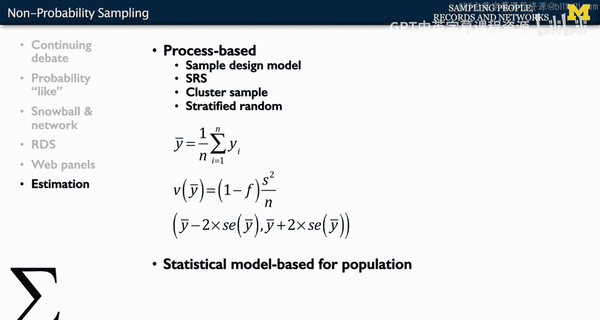

# 调查数据收集和分析：6.6：非概率抽样 📊

在本节课中，我们将要学习概率抽样之外的另一种抽样方法——非概率抽样。我们将探讨其定义、常见类型、与概率抽样的区别，以及在实际应用中的考量。

到目前为止，在讨论对人员、记录和网络的抽样时，我们主要集中于涉及选择概率的样本，即概率抽样。

在我们最后一个单元（单元6）的最后一讲中，我们将讨论非概率抽样。我们将探讨当选择概率未被维持、未被记录或未使用随机选择时，可以有哪些样本设计。

有时，这些非概率抽样方法看起来像概率样本。有时它们看起来像网络样本。它们有各种变体。但也有大量非概率样本甚至不试图模仿现有的样本设计，而纯粹是招募技术。它们几乎算不上是包含正式选择和后续数据收集的“抽样”。这更像是“让我们招募一组要访谈的对象”，样本选择和招募几乎合为一步，但在我们将要讨论的内容中，选择过程没有随机化，或者我们一直处理的随机化因样本的获取方式而被破坏。

我将使用一些来自密歇根大学调查研究中心同事Sunki Lee的材料（已获许可），并已将其与我自己的材料混合。因此，我想说明这包含了她的贡献，但我无法明确标识，除了在讨论“受访者驱动抽样”时有一两张直接来自她的幻灯片。

关于这类方法存在一场辩论，且已持续很长时间。左下角的小照片展示了美国历史上著名的辩论，例如19世纪50年代亚伯拉罕·林肯与其国会竞选对手斯蒂芬·道格拉斯关于奴隶制等问题的辩论，双方反复争论。抽样领域也一直存在类似的争论。

莱斯利·基什在1965年出版的教科书中对概率抽样进行了早期讨论：在概率抽样中，总体中的每个元素都有一个已知的非零被选机会。选择机制建立在随机数基础上。概率抽样要求实际选择由决定所需概率的机械程序完成，即使用随机化。

威廉·科克伦在1977年其教科书的后续版本中谈到非概率样本时指出，它们不是同一种东西。它们不适用于我们之前探讨的抽样理论的发展，即最终得到抽样分布和标准误（衡量所有可能样本间值离散程度的指标）。如果没有涉及随机选择，我们就无法应用那种无模型框架。即使某种方法在一个样本中表现良好，也不能保证它在其他情况下也能表现良好，而概率抽样为我们提供了这种保证。

但正如多次指出的那样（这里引用安德鲁·格尔曼近年的观点），概率抽样在原则和理论上是好的，但实际上没有任何样本是真正完全的概率样本，他甚至说“甚至不接近概率样本”。我认为这有点言过其实，我不同意这一点，但他的观点有其道理：即使我们进行仔细的概率抽样，无应答也会干扰；当我们处理无应答时，我们已经通过加权看到，我们对无应答的运作方式做出假设，然后基于该假设进行调整。因此，在那种情况下，我们将使用一个模型，它是概率选择和用于调整非概率机制的模型的混合。

所以，一直以来，我们实际上一直在思考（我也一直在思考）那些基于概率但具有非概率特征的模型。但也存在完全基于非概率的样本设计。它们甚至不是从概率样本开始的。我们想简要讨论一下这些方法的演进过程。

## 从概率样本到非概率调整

首先，让我们从具有无应答的概率样本这个概念开始。无应答引入了非概率选择。有多种方式处理这种无应答，但如果无应答不多，就不是严重的偏离，它基本上仍然是概率样本。

一种常见的处理方法是进行调整。例如，知道由于无应答将损失20%的样本，那么可以在一开始就扩大样本量。当数据收集资源耗尽时停止，试图通过加权机制（如我们之前所见）来补偿无应答损失。顺便提一下，正如我们之前讨论无应答加权的逻辑回归模型时暗示的那样，这些模型在给定无应答的情况下改进了我们的概率样本。

另一种可能更常见的方法是**替代无应答者**。即，当我们有一个无应答案例时，我们将获取另一个案例来替代它。无应答者拒绝了，我们就抽取另一个案例并使用其值。

替代可以通过多种方式进行。例如，可以非常有目的性地进行。无应答者具有某些特征，我们运用判断从抽样框中选择另一个人来替代。这种情况有时会发生，尤其是在初级抽样单位中。在学校抽样中可以看到这种情况：我们失去了一个学校（一个群），因为他们拒绝参与。现在我们查看其他学校，并试图利用我们作为所研究现象（心理学、社会学或公共卫生方面）专家的判断，来找到一个尽可能接近那个单位的学校。

我们会退一步说，这非常主观，但我们将运用我们对此的专家意见。我并不是说我们不应该这样做，我只是说这与我们讨论的概率抽样不同。

另一种替代方法是**匹配**。例如，我们将匹配四个维度：找到另一所规模相似、地理位置（城市或农村）相似、免费或减价午餐水平相似、并且位于同一州/省的学校。我们将在此基础上进行匹配并选择一个，也许还会结合我们对匹配接近程度的专家意见，但我们将尽可能在这些维度上接近。

我们也可以选择完全随机地选择替代者。我们失去了这个案例，我们将随机选择另一个。或者，我们可能进行分层随机选择：我们在特定层内失去了这个案例，我们将从同一层中选择其替代者。

然而，所有这些都偏离了概率抽样方案。替代在样本设计中很常见，但其性质并未被完全理解，不过它是一种调整方法。

这些是非概率样本。诚然，这是在格尔曼承认这一点的精神下，但与我们即将看到的一些方法相比，这些是轻微的偏离。

## 其他类型的非概率样本

也存在其他维度上类似概率的样本，例如**配额样本**。大多数人想到的配额样本涉及多阶段选择。回想一下我们的分层多阶段样本：我们抽取初级抽样单位（县），然后抽取街区，然后抽取住房单元，然后可能继续抽取其中的人员。多阶段配额抽样很可能抽取县的样本，然后抽取街区（或在政治体系中类似投票区或选区）的样本，然后在其中指定样本中所需人员类型的配额。访员被派往该地点收集数据，要求一半为女性，进行10次访谈，其中5次应为女性，5次应为男性，其中2次应为非裔美国人，1次应为18至24岁的人。配额已设定，但访员有决定权。现在我们看到了更大的偏离。是的，我们在初级抽样单位和第二阶段抽样单位进行了概率抽样，但在第三阶段，它向访员的决定开放，他们只需要满足配额。这是另一种偏离。

现在还有**基于网络的抽样**。这些大多是方便样本，但就我们进行某种电子邮件群发、聊天室、即时消息、横幅广告、社交媒体招募人员而言，它们是“基于网络”的。这与我们迄今为止讨论的内容有很大不同。我们将扩展讨论这些方法，因为在过去几十年中，随着网络、社交网络以及其他通过网络接触人的方式变得更加普遍，这些方法已变得相当重要。

但当我们这样做时，也有一些技术将网络、链式推荐系统引入样本选择。一种称为**滚雪球抽样**的技术，从一个小样本开始，通过推荐不断增加规模。我们从稀有群体成员的方便样本开始，然后利用内部知识，通过链式推荐在网络内定位更多成员。这听起来有点像我们之前处理多重计数时的情况，但这比那随意得多。它主要用于定性研究，以增加稀有群体成员的样本量。

我们之前考虑的想法涉及对网络的正式规范，我们对网络是什么更加谨慎，并利用了人与人之间的连接性（链式推荐），但我们通过权重来利用重复计数，并且我们能够在该类网络中收集多个人的数据。因此，滚雪球抽样和网络抽样有一些重叠的原则，但它们的结构非常不同：一个是不太正式的系统，旨在快速获取关于稀有群体的信息；另一个也关注稀有群体，但通过更仔细地定义网络、规范、识别，然后进行计数和加权来连接它们。

还有一系列被称为**受访者驱动抽样**的技术。它介于这两者之间，利用稀有群体的社交网络进行抽样。它通过一个马尔可夫过程假设，将滚雪球样本转化为随机抽样过程。他们假设招募具有某些类似于随机过程的特性，从而允许他们为每个个体确定权重，并通过该加权产生无偏估计。这与多重计数非常相似，但对网络的规范结构化程度较低。这类方法涉及更强的假设。网络招募也不是由调查者完成的，而是由受试者（受访者）完成的，他们驱动抽样过程。

例如，我们可能有一些“种子”（第一波），这些个体是我们通过方便方法识别的。然后，我们要求他们招募其他人。我们给他们一系列招募券，他们分发给社区中的联系人，招募额外的受试者（1、2、3、4），并提供给他们招募券，鼓励他们联系调查者提供数据。这些新受试者又依次被用来招募新的受试者。当进行第2、3、4波直至第W波时，会招募额外的受试者以填满样本量。

在这些系统中，我们对每个种子重复此过程，但在每个种子内部，我们会跟踪样本量的增长。我们使用样本来招募新的样本成员，很像滚雪球抽样，但不完全相同。然后，我们对此过程做出假设：这些招募券如何使用，我们多有效地招募到网络中的元素。我们查看实际被招募的网络。最终，对于每个种子，从其招募券和收集的个体中，我们得到一个最终样本。我们将在一个假设了复杂过程的模型下，计算其中每个个体的选择概率。

种子1有一个招募链，种子2有一个招募链。我们做出假设以连接该招募链中的人员，假设我们捕获了所有可能存在的网络，并且随着招募过程的进行，它们都有一定的被选机会。

## 网络面板与模型假设

让我们再讨论几种情况。有些选择涉及对样本设计好坏的判断，这类情况在网络面板中日益增多。

**概率网络面板**是指我们从概率样本开始，但将人们招募到一个面板中，然后用于后续访谈。概率样本受无应答影响，会组装某种初始名册，然后收集一个面板。这些概率网络面板（以及概率电话面板）从概率样本开始，招募个人，然后在多项研究中重复使用他们。

也有**非概率网络面板**，它们不是从初始概率样本开始，而是通过某种大规模邮件（我们之前提到的电子邮件群发）来组装的。因此，我们现在组成了一个面板，将用于查询我们的结果。但这些面板可能非常庞大，可达数百万。我们将在每次样本选择时使用它们，无论我们是从基础概率样本还是从大规模电子邮件中选取。

与非概率网络面板密切相关的是**河流样本**。河流样本持续地捕获受试者，而不是将他们收集起来放入一个将作出回应的面板中。我们持续收集关于他们的数据。我们捕获网站访问者，我们有横幅广告或弹出广告，人们点击并回应。这里的抽样框很难定义，是这些网站的访问者吗？他们是谁？为什么点击？他们是志愿者吗？有重复吗？他们会为这类事情提供多个名字吗？这类方法存在各种问题，但它是一种非常方便、成本低得多且通过网络可以快速完成的招募设备。因此，这些方法变得相当流行，但你可以看到我们现在离概率抽样方法有多远。

这些变得越来越像**自愿加入小组**。只是建立一个系统，让人们可以选择加入并自愿参与我们的研究。我们无疑在电视台见过这类事情，他们提供一个网址，你可以去那里就某个主题发表意见。这完全是自愿的。当我们试图进行某种估计时，如何处理这类样本呢？

在这一点上，它是基于模型的。我们必须有某种模型，可能不像我们看待无应答时的那种模型（随机缺失和基于加权单元格或逻辑回归的调整），而是某种基于模型的调整。现在，在这些基于模型的方法中，出现了两种基本的模型假设。

一种是**样本设计模型**。我的样本选择机制，无论它是什么，我认为它类似于简单随机抽样。注意，我是断言，我将假设它像简单随机抽样。或者，在我们描述的配额样本情况下，它像一个整群样本，或像一个分层的基本设计。我们将把该断言作为一个假设，然后我们的估计程序基于对该过程的模型假设进行。因此，我们可以以无偏的方式计算均值，可以在此基础上计算方差和置信区间。但这一切都建立在该假设之上，问题在于该假设有多好，以及当该假设失败时会发生什么。因此，在非概率抽样中，我们现在必须处理假设失败的问题。如果我们保持非概率元素的数量较少（例如，具有无应答和无应答调整的概率样本），我们的假设就较弱；相反，如果我们有一个自愿加入小组，假设就较强。这是一种处理方法：我们继续使用概率样本作为一个模型，但我们假设我们的非概率抽样机制类似于其中之一。

另一种是使用**总体的统计模型**。这对那些学过统计学课程的人来说更熟悉，我们从概率模型（如正态分布或多元正态分布）开始。我们假设那是基础总体，现在我们的样本就像是从该总体中抽取的、具有独立同分布随机变量的样本。在那种特定情况下，实际上有两个假设：一个是关于总体中特征分布的假设（钟形、对称），另一个是关于抽样机制的假设（独立同分布）。随机抽样（即使是简单随机抽样）也给我们带来相同的结果。

因此，这里的估计比我们到目前为止讨论的更依赖于模型。

## 总结

我们关于抽样的讨论到此为止。我们现在涵盖了相当广泛的样本类型：从仅仅随机化的样本，到整群的、分层的、通过系统选择简化的样本。我们研究了抽样的组合，通过统计软件研究了样本选择方法，在最近的讲座中还研究了加权、调整甚至非概率样本。涵盖范围很广，我们只是浅尝辄止，但我们已经为你提供了足够的背景知识，我们认为你现在应该对调查样本如何工作有了更好的理解，并且理解了这一重要的基础，它常常为延续至今的辩论提供领域：我们的基础是基于概率，还是基于招募策略？如果基于招募策略，我们可以使用哪些模型使它们看起来更像我们在理论上更透彻理解的其他东西？

希望这对你有所帮助，并且你将来在对人员、记录、网络进行抽样时，会发现它有用，能够为未来工作中的这些应用提供参考。

非常感谢。