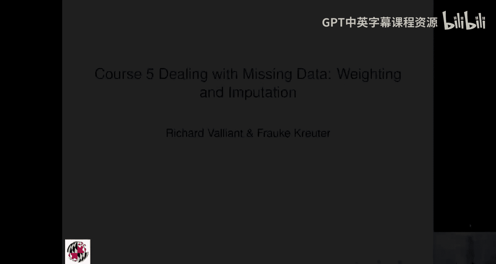
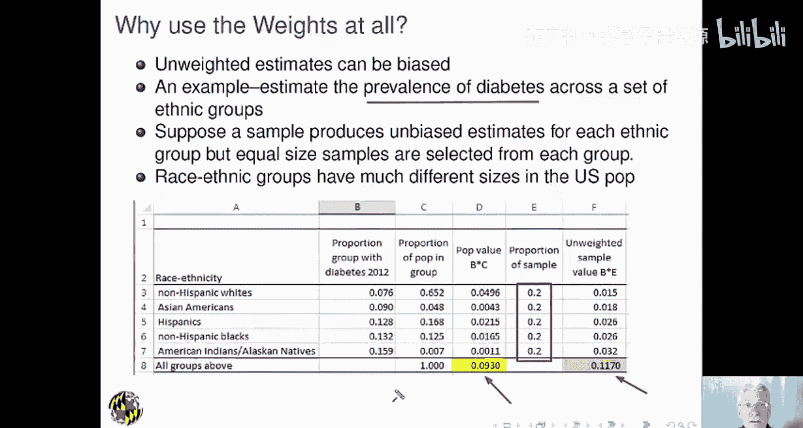

# 密歇根大学《调查数据收集和分析（2-6：方法、社调问卷设计、抽样、缺失数据、分析）｜Survey Data Collection and Analytics》 p123 0_导论.zh_en -BV1fw4m1e7Zh_p123-

Welcome to Cour five on dealing with missing Data， waitinging and Iutation or the topics that we'll cover here。

My name is Richard Vallliant， I'm a research professor at the Uni of Michigan and Maryland。

There were also contributions to this course from Frcker Croiter。

 who's a professor at the University of Maryland。We've got four modules that we'll cover in this course。

 One is general steps in waiting。The idea in waiting is to expand a sample to the finite population and we'll talk about how to do that。

Module 2， gives you the specific steps involved in doing that。

Module 3 will tell you how to implement the steps and。

 and there's an emphasis on software examples there and。In particular。

 our software that can be used for this。And then module4 is waiting for missing items。

 which is an important part of many surveys， so we'll cover all those as we go along。Now， the first。

Part of this module is just an introduction to waiting， which we'll cover now。

Now what are the purposes of weights， the general purpose is just to expand a sample to the full finite population。

 so we've got this small world， the sample that we're trying to blow up to a larger world。

 the population， and we use weights to do that。And we'll talk about the purposes or particular things that are being accomplished by waiting。

 One of them is to correct for coverage problems in a sample or a frame。

 many times you've got a defined universe。 But the frame that you're able to draw the sample from is not the same size or same coverage as the desired universe。

 So we need to adjust for that in some way。And then another important step in waiting is using auxiliary data if we've got any to create unbiased and more precise estimators。

So first， let's look at。A picture of the situation。We've got here in this grayish ellipse。

 the universe U that we're trying to make inferences for。

 and then in this rectangular shape is the frame that's what we're able to draw the sample from。

 So you can see that we've got two areas here， that are not overlapping。 there's this one right here。

 which is the part of the universe that's not actually in the frame。

 so we're not able to draw a sample from this part for various reasons。You know。

 suppose we're surveying businesses and our business list is out of date。

 There have been some new ones created that didn't get on to our offering。Now。

 the other area that's problem is this F minus U section of the picture。

 This consists of units down here that are in our frame， but they're not part of the universe。

 this gray ellipse。 So I draw my sample。 that's in the orange ellipse here。

 And you can see it overlaps with both the universe here and the part of the frame that's not in the universe。

 So when I make inferences， I'm going to have to get rid of this little section of units down here that are ineligible they're not going to be useful to me to make inferences about the rest of the universe。

I will have to take the section of the sample that overlaps with the universe and expand it both to the area that is in the frame here as。

Super see。That is not in the sample， but also to the area out here that is in the universe。

 but not covered by my sample。 So there are big assumptions that。Need to be。

Present for this expansion to make sense， but it's standard procedure to attempt to blow these units up to the full universe。

 even though my sample may not have covered all of them。

Now weights and estimators are intimately linked。The scale of weights can vary。

One way to scale the weights is so that they estimate finite population totals。

Another way to scale the weights is just to force them to sum up to the sample size。

 You'll see both of these methods used。Weights that are scaled to sum up to the sample size are called normalized weights。

And partly this is a holdover from the days when software for analyzing survey data was not readily available。

The idea there was that if you report。Or you' do an analysis that uses degrees of freedom。

 the software， the old software would tend to report that as the sum of the weights minus P。

 the number of parameters in a model or something。Something like that。This sum of the weights。

 if these things were scaled to estimate finite population totals would be enormous know in a country like the United States。

 this sum of weights would be over 300 million if we're talking about people so you certainly don't have 300 million degrees of freedom if you get a sample。

 what's the size 1000， say so if you normalize the weights。

 though this sum of the weights minus P it will be a more sensible number。

 itll be the sample size minus P。 So that was the general idea in doing it。

What we're going to deal with here in this course are weights that are scaled to estimate population totals。

That's the standard approach in most federal government agencies where finite population totals like total number of people unemployed are of major importance in the survey。

Now， why use the weights at all？This is a little example just to illustrate what the issue is。

One way to。Do this if you have a sample from a finite population。

 is just ignore the whites entirely and hope that things come out all right。So in this example。

 we're going to estimate the prevalence of diabetes across a set of ethnic groups。

And suppose a sample produces unbiased estimates for each ethnic group。

 but equal sized samples are selected from each group。

And that the groups themselves are different sizes and this is referring to the US population。

 but the same sort of thinking applies to other countries， so I've got several race ethnicities here。

 non- Hispanic whites， Asian Americans， Hispanic non-hipanic blacks。

 and then American Indians and Alaskan natives， which are a very small group in the US。

So among those groups， let's suppose that our proportion with diabetes is found to be these numbers here。

 so I've got about 0。076 or 7。6% in non-hipanic whites up to a high of 15。9% or 0。

159 for American Indians and Alaska natives， and here the population proportions in those groups。

So I've got 65% non Hispanic whites， which is the biggest group in this table and then as you can see。

 American Indians， Alaska natives are a very small proportion of the total。

 even though their rate of diabetes is relatively high。So if I take。

Column B times column C that gives me a population value of 。0496。 I add all those up in my。

Preance of diabetes in the population is 0。0930。9。3%。Now， let's suppose further that the。Populations。

 evenly divided。Among these groups， so that's in column E here and I've got two tenths or 20% of my population in each of those groups。

 you know， you can draw samples in that way， you just have to find the people and equalize the sample sizes。

If I take an unweighted。Sample value， that would be b times E。And sum those up。

 that's the equivalent of doing unweighted analysis in this case。The answer that I get。

 if I do the unweighted analysis is。117 or 11。7% prevalence of diabetes in the population。

 but the actual population value， assuming that these proportions are really population values and that my sample estimates those exactly right these prevalences。

Is 9。3% so i'm you know quite ways off if I do the unweighted analysis so that that's the reason to use weights if you've got a sample that's disproportionately distributed among groups that matter in the population and they matter in this case because the。

Rate or prevalence of diabetes， which we're estimating is much different in the groups。

If you ignore the weights in a case like that， then you'll be getting biased estimates。So that's why。

We do these ways and in later sections， we'll talk about the details of how to compute them。

