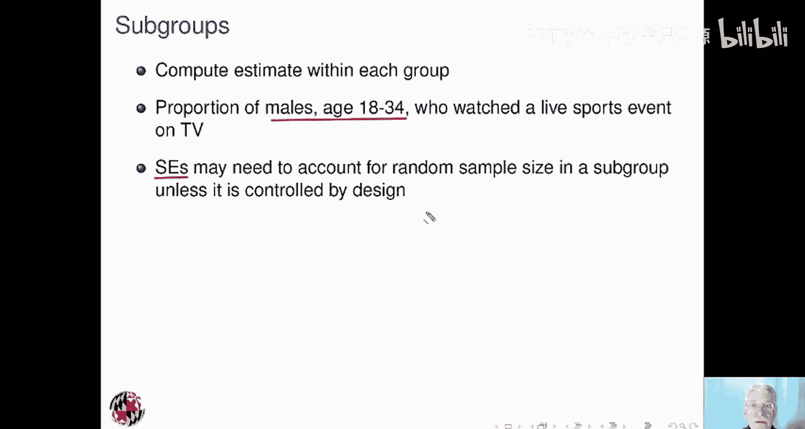

# 密歇根大学《调查数据收集和分析（2-6：方法、社调问卷设计、抽样、缺失数据、分析）｜Survey Data Collection and Analytics》 p124 1_待估参数.zh_en -BV1fw4m1e7Zh_p124-

In the second part of module 1， of Co 5， we'll look at quantities that we can estimate using survey weights。

Some of the most important things or basic things are totals。So we。

Might want to estimate the total number of persons on a public assistance program。

 the total number of days that people have spent without jobs in some economy。

 the number of visits to a doctor in the last year。

All those are things that may be of interest in different kinds of surveys。

One thing that makes this somewhat easy to think about is that we can write a population total in the following way。

Weve。😔，Got the sample units that we observed。 We don't have to estimate anything for them。

 We observe the data for them。 so we sum those values up。This notation here。

 I an element of S means I sum over the units， I that are in the set S and S stands for the sample units。

So I sum those up and then the second part of the population total are the things that I did not see。

 I've got the seen part in the sample， the unseen part in the non sampleamp。

 so little R stands for the remainder or the non sample units。

And our job in estimating a total is pretty straightforward。

 we need to predict this sum for the non sample units， and there are various ways of doing that。

Usually， an estimated total has got this form right here。 We sum up the units in the sample。

 We take the weight that we assign them times their data value。 and assuming again。

 that these weights are scaled to estimate population totals。

 then we'll get a legitimate estimate of the finite population total。We can estimate other things。

Means are interesting quantities we might want to estimate the average income。

 the average number of years of schooling per person students average test score on some standardized test the standard way of doing that is to take。

An estimate of the total。 that's this first piece， the sum over the sample of the weights times the data。

 and then divide by the sum of the weights。So you can see that this scales things in about the right way。

 but the one thing to note here the way that weights are normally calculated。

 the sum of the weights is going to be an the estimate。Of the number of units in a population。

Sometimes it's exactly equal to the number of units in the population。

 it depends on how we calculate the weights and what type of sample was drawn。In general， though。

 it's an estimate。 if we sum over a subset， a subgroup， say just over the men or the women。

 that's going to be an estimate of the number of units in that subgroup。So it's a。

know useful characteristic of at least probability samples in the way that we calculate weights there。

 that the sum of the weights is an estimate of account of units for whatever group that we do the summing over。

Now we can estimate other things， some of the important things that surveys usually put out are proportions or percentages。

For example， the percentage of persons who plan to vote for a candidate or the unemployment rate。

 those are proportions。We can estimate quantile like medians in the first and third quartile。

For example， median household income， median age at first marriage。

 we could estimate the 95th and a half percentile of blood lead level in children age one to five。

Which happens to be a percentile that public health people are interested in。

So here's the algorithm for estimating a quantile the first thing you do is。

Sort file from low to high on the y value that you're talking about。

 so it could be blood lead content， for example。And then you accumulate the weights until the desired per cent of total weight is reached。

 So 50 per cent for the median， for example。 So now notice， when I accumulate weights。

 that's summing over a subgroup。 If I sum to the half weight point。

That's an estimate of the number of people whose y value is。50% is equal to that y value or less。

 And if I sum to the halfway point， that's the 50th percentile or the median。

So I record the value of y for that unit that I've summed up to。

 and that's my sample estimate of the median or whatever quantile that I'm interested in。

And we can also estimate things like ratios。 We could estimate。

 say that the ratio of women's average income to men's average income。

 which might be an interesting quantity。 We can estimate odds ratios in a two by two table。

 For example， the ratio， the odds of having diabetes for African Americans to the odds for all others。

And we can also estimate regression model parameters with。Wed estimates。Now。

Important thing that occurs in these situations is that many of the things that I've talked about。

 like ratios or odds ratios or proportions。Means。Are all functions of estimated totals。

So if we understand how to estimate totals， we're a long way along toward the problem of understanding how to estimate many other things in populations。

Another thing that is。Critical in most surveys is to make estimates for subgroup。 So， for example。

 if I wanted the proportion of males aged 18 to 34 who watched a live sports event on television。

That's a subgroup。If I did a cross tab of。Gender by a number of age groups。

In each cell in that cross tail， if I estimate this proportion of people who watch the sporting event。

Those are subgroup estimates， or domain estimates。So it's common， you know。

 every time you do a cross table in from survey data， you're making domain or subgroup estimates。

Now one thing that needs to be accounted for in many cases is the effect on standard errors of the fact that we may not control the sample size in every cell。

 in a table that we do， so you can account for that randomness in a specific way。Sometimes。

The cells are straight to where we control the sample size， and in that case。

 we contribute to this fixed， but otherwise what showed up in our sample is random and typically we try to account for that。

So in the next section， we'll talk about some more of the goals of estimation。

