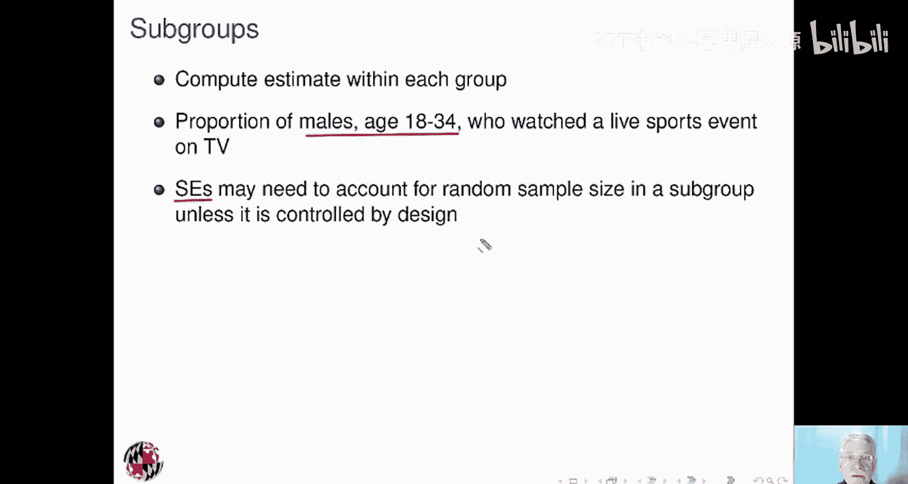

# 密歇根大学《调查数据收集和分析》：1.2：使用调查权重估计的量 📊

在本节中，我们将学习如何使用调查权重来估计总体中的各种重要量。我们将从最基本的总数估计开始，逐步扩展到均值、比例、分位数等更复杂的统计量，并了解它们之间的内在联系。

## 概述：我们可以估计什么？

在调查数据分析中，我们经常需要估计总体参数。一些最基本且重要的量是**总数**。例如，我们可能希望估计：
*   接受公共援助计划的总人数。
*   经济体中人们失业的总天数。
*   去年人们看医生的总次数。

这些都是在各类调查中可能感兴趣的目标。

## 估计总体总数

思考总数估计的一个简便方法是，我们可以将总体总数写作以下形式：

**总体总数 = Σ(样本中观测到的值) + Σ(非样本单元的值)**

用符号表示：
*   `Σ_{i ∈ S} y_i`：对属于样本集合 **S** 的所有单元 **i** 的观测值 `y_i` 求和。
*   `Σ_{i ∈ R} y_i`：对属于剩余部分（即非样本）集合 **R** 的所有单元的值求和。

我们的任务是直截了当的：需要预测非样本单元部分的总和。通常，一个估计的总数具有以下形式：

**估计的总数 = Σ_{i ∈ S} (w_i * y_i)**

这里，`w_i` 是分配给样本单元 **i** 的权重。假设这些权重经过缩放，可以用于估计总体总数，那么上述公式就能给出一个有效的有限总体总数估计值。

## 估计均值

均值是我们可能希望估计的另一类有趣量，例如：
*   平均收入。
*   人均平均受教育年限。
*   学生在某项标准化测试中的平均分数。

标准的估计方法是，先获得一个总数的估计值，再除以权重的总和：

**估计的均值 = (Σ_{i ∈ S} (w_i * y_i)) / (Σ_{i ∈ S} w_i)**

这个公式以恰当的方式进行了缩放。需要注意的一点是，在通常的权重计算方式下，**权重的总和 `Σ w_i` 本身就是对总体（或子组）中单元数量的一个估计**。有时它恰好等于总体单元数，这取决于权重的计算方法和抽样设计。但一般而言，它是一个估计值。如果我们对某个子组（例如仅男性或仅女性）求和，那么得到的就是该子组单元数量的估计值。这是概率抽样及其权重计算方式的一个有用特性。

## 估计比例与分位数

调查通常发布的重要结果还包括**比例或百分比**，例如计划投票给某位候选人的选民比例或失业率。

我们也可以估计**分位数**，如中位数、第一和第三四分位数。例如：
*   家庭收入中位数。
*   初婚年龄中位数。
*   1至5岁儿童血铅水平的第95百分位数（公共卫生领域关注的一个指标）。

以下是估计分位数的算法：
1.  首先，根据你关注的变量 **y**（例如血铅含量）的值，将数据文件从低到高排序。
2.  然后，**累积权重**，直到达到总权重的所需百分比（例如，中位数对应50%）。
3.  记录累积到该点时对应单元的 **y** 值，这就是样本对中位数或其他所需分位数的估计。

请注意，当我们累积权重时，实际上是在对一个子组求和。如果求和到总权重的一半，那就是对 **y** 值小于或等于该点的估计人数。

## 估计比率与回归参数

我们还可以估计**比率**，例如女性平均收入与男性平均收入的比率。在2x2列联表中，我们可以估计**比值比**，例如非裔美国人患糖尿病的几率与其他所有人患糖尿病的几率之比。

此外，我们可以使用**加权估计**来估计**回归模型参数**。

## 子组（域）估计

大多数调查中的一个关键环节是进行**子组估计**。例如，如果我们想估计18至34岁男性中通过电视观看过现场体育赛事比例，这就是一个子组（或称为“域”）估计。每当你根据调查数据制作交叉表时，表中的每个单元格都是在进行域或子组估计。

在许多情况下，需要考虑一个事实对标准误差的影响：我们可能无法控制所制作表格中每个单元格的样本量。这种随机性需要以特定方式加以考虑。有时，单元格的样本量是我们直接控制的（固定），但通常情况下，样本中出现的情况是随机的，我们通常试图对此进行解释。

## 总结

本节课中，我们一起学习了如何使用调查权重来估计总体中的各种参数。核心在于，许多我们关心的量——如比率、比值比、比例和均值——**都是估计总数的函数**。因此，只要理解了如何估计总数，就在理解如何估计总体中许多其他量的道路上迈进了一大步。下一节，我们将探讨估计的更多目标。