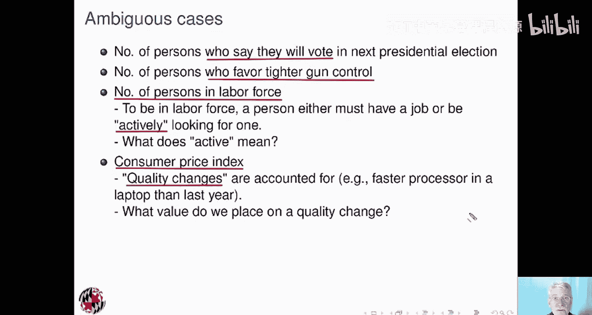

# 密歇根大学《调查数据收集和分析（2-6：方法、社调问卷设计、抽样、缺失数据、分析）｜Survey Data Collection and Analytics》 p125 2_估计目标.zh_en -BV1fw4m1e7Zh_p125-

In this video， we'll look a bit more about the goals of estimation in a finite population。

So one useful thing to do。In describing what you're doing to clients or the people you're working with is to think about。

活 it。Is that my sample is estimating。If instead of a sample， I had the entire population in my hands。

So the population value is the value that would be obtained if we do a census。

 so these are sometimes referred to as census values。Now。

Why does describing what we would get if we had a census？Why is that a useful thing？

It forces you to think about what the target population is is the key feature of it。

 and it also excludes all those complexities of sample and you know how did you design the sample。

 how did you select it， how did you collect the data。

 just getting people to do this thought experiment about what if I had every unit in the population。

 I observed their values correctly。 how would I put those together to create the quantity I want to estimate for。

That makes you think about among other things。Can your sample cover the whole population。

That I'm interested in。And is there any ambiguity about how I might measure the quantities that I'm interested in？

Even with the senses。There may be some slippage in what a population value really means because of management issues。

So we'll look at some examples about where。Measurement may or may not be a problem。

So this slide gives some examples where。Things are unambiguuous。

 And I put them maybe in parentheses here because there's always the chance for some。

Imbiguity in defining things。So， for instance， the number of persons living in Washington， D。

 on January 1， 2015， you know that seems pretty clear， Ka。If you think hard about it though。

 I mean people will move in and out on January the1t， you know， what time of the day did they move。

 do you count them as living in DC or not， issues like that might come up。

Another case that seems straightforward is number of persons with high diastolic blood pressure greater than 90 milligrams of mercury。

This seems clear as long as you can measure blood pressure correctly。Now， you know。

 it depends on what sort of machine you're using to actually。Do that。

 And some machines may be calibrated better than others。

Another potentially unambiguous case is number of full time employees。During the week。

 that includes the 12 September 2015， this is the sort of definition that the。

Breau of Labor Statistics in the US uses to collect some kinds of employment data。Now。

 ambiguous cases are some examples here may make it clear。

Suppose we say we want to estimate the number of people who will vote in the next election well。

 you've got to ask them。In advance the election， will they vote？If they say yes。

 they may or them may not vote， some people who say no may actually end up voting。

 so that's a difficult one。And in fact， in polling， this。Likely voter。

Issue is a big problem for pollsters these days。Another thing that might be ambiguous is number of persons who favor tighter gun control。

 This also is a big issue in the United States。What does it mean， tighter gun control。

 There are different levels at which you might think about regulating different types of guns。

 the usage of the guns that that could be an ambiguous concept there。Something else that。

The federal governments tend to want to estimate our number of persons in the labor force。 You know。

 that's part of a good economic statistics program that to estimate something like that。

So to be in the labor force， a person either must have a job or be actively looking for one。

You have to tell people what you mean by actively looking。

 and they have to interpret what you tell them correctly。

 So there's a chance for some ambiguity there。Another key economic statistic for most economies is the consumer price index。

 usuallyas called the inflation rate since prices tend to go up。One thing that makes this。

Quite ambiguous and how you best can measure it are things called quality changes。You know。

 there are other economics。Issues that have to be dealt with too， but quality change is a big one。

 for example， if you buy a computer last year and you buy a computer this year。

 you're going to get a much better computer this year， probably for the same money。

Because the processor is faster， the storage capacity is bigger， the Ram is larger。

 A lot of things improve over a year's time。Now economists try to adjust for that。 You know。

 you're getting more for your money。But exactly how you do that is not altogether clear。

So these are some of the measurement kinds of issues， but in summary。

 it's a good thing to think about。What would I do with these data if I had a cus and what quantity would I construct。

Given information on every unit in the population。

