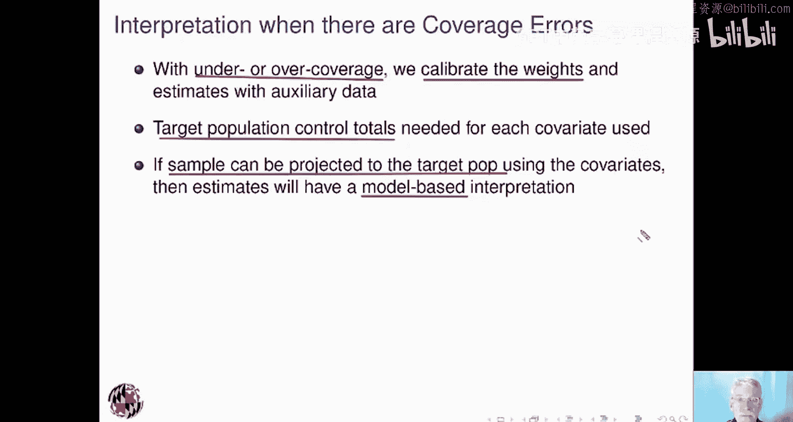

# 密歇根大学《调查数据收集和分析（2-6：方法、社调问卷设计、抽样、缺失数据、分析）｜Survey Data Collection and Analytics》 p126 3_估计量的统计解释.zh_en -BV1fw4m1e7Zh_p126-

In this section， we'll talk about the statistical interpretation of estimators from finite population samples。

One thing that needs to be true is that a weighted estimate needs to have a statistical interpretation in order to be justified。

Now what do we mean by that。With respect to some sort of random mechanism。

You can say that the estimates you've created represent the full population。

So the interpretation can be in terms of repeated sampling， in other words。

 if we drew the sample over and over and over in the way that we did for a particular sample。

 particular probability sample that we drew。We made an estimate from each one。

 and we looked at that ensemble of estimates。 Then they would make sense。 I mean。

 they would average out to the population value， for example。The interpretation can。

 on the other hand， be in terms of models。 and we have to do this And for non probability samples。

 because we don't have this repeated sampling。Mechanism to fall back on a repeated sampling mechanism that we are under control of。

嗯。The modeling consists of either modeling。How units show up in the sample。

 which could be in some kind of quasi randomization way。

 or in terms of the structure of the Y values that we're measuring the population。

 either one of those is a possibility for modeling。Now， in probability sampling。

 we say an estimator is unbiased。 If overall all the random samples that could be selected。

 the values we compute from each of those samples averages out to the census value。

Another important concept is consistency。So an estimator is said to be consistent if as the sample size gets big。

The estimator gets closer and closer to the census value。

 This is actually a more desirable property than unbiasedness。This is saying that。

As the sample size increases， we get closer and closer to what we're trying to estimate。

Unbiasedness can hold even if here's the population value。

 if our estimates bounce all around it by quite a large distance。

 you can still be unbiased as long as you're above and below about the same number of times。

Consistency means that as the sample size gets bigger。

 we bounce in a shorter and shorter area around the true value。And we want these things to be true。

 even for complicated statistics， like medians and quartiles。没有。On probability samples。

 we've met various kinds in course 4， which was about sampling people and records。

Some examples that you learned about there， simple random sampling， stratified。

 simple random sampling， stratified， systematic random sampling。Two stage sampling。

 multi stage sampling。 We can sample with probabilities proportional to some measure of size。

 This is often done for businesses or institutions。

All those are possibilities and all those properly done will allow us to make these repeated sampling interpretations。

Now， on the other hand， non probability samples are often used to make inference。

 and we've got to think clearly about what we're doing there。As I said a minute ago。

 the unbiasedness and consistency properties have to be with some sort of a model。

And we need to be able to estimate the population model from the sample。So， in that sense our。

Our sample has to be projectable to the full population。

 even though we didn't obtain it in a random way。So if a sample has serious holes in coverage。

Then it's hard to justify saying their estimators are。Aiming at the right thing， you know。

 they may be biased。They may be estimators， but not of the full population that we might be interested in。

For example， if we've got a volunteer web panel。And it has no African American women over 70 years old。

 Well， if those are an important part of the population and they behave differently According to whatever we're measuring。

 than the rest of the population， then we got trouble。You know。

 you can't estimate for them if that's the case。Now， what types of non probability samples are there。

 There are many。 I've just listed some three general categories here。

 One might be a convenient sample。For example， if you take all your students in an introductory psychology course and you experiment them on them in some way。

That's a convenient sample。 Those students don't represent the entire population of a country。

Or even of。You， subset of a country。AQuta sample is another possibility。

If you recruited people door to door until you obtained a specified number of persons in a set of age groups。

Those would be quotas。YouThey may or may not be good representation of the whole population。

If we recruit persons from those who visit particular websites or a particular website。

 that's another way of doing it， you know， a pop up ad comes up and says。

 do you want to be part of a survey， you click say yes and you do it。That would be a volunteer panel。

A little more。Organized way of doing that is called a river sample where you post your ads on some。

carefullyrefully selected set of websites where people may visit and ask them if they want to be part of a panel that does surveys。

And they go through some steps to actually get in the panel。

But these are not random samples or probability samples of an entire finite population because the sampler doesn't have control over who shows up。

On the other hand， there are probability samples that really suffer from non response。In fact。

 they may have such a huge amount of it that you begin to wonder。

 should we even treat them as probability samples， For example。

 if you do an overnight election poll these days in the US by telephone。

And it doesn't matter if you include。Landlines and cell phones。

 you'll still get the same sort of phenomenon。 You'll only get about 5% of people to actually answer the phone and cooperate with you。

Well， a 5% response rate is hardly what you'd call a good sample。

And it's hardly what you would be willing to defend as a probability sample。Now。

 even if we draw a probability sample， we may have coverage errors。

 but certainly we can will have coverage errors and non probability samples。

Could be under or over coverage， depending on the frame that we're drawing from。

What we try to do to combat that is do something called calibrating the weights with auxiliary data。

So what we need is target population control totals。That。We know。

For not necessarily for every individual in the population。

 but at least we know grand totals for the population。

 and we can adjust our sample weights so that weighted estimates of these control variables。

Will match the。Population or census cans。So if we do that。

 then what we hope is that the sample can be projected to the target population using those covariates。

And we typically had to put a model based interpretation on that。So for example。

 some of the covariates might be counts if you were doing persons。Human population counts by age。

 race， ethnicity， and gender might be used as calibrating variable。

So the units we've gotten our sample have to。Be expanded using weights。

To represent the full population， and at least we can do in such a way that the weights will reproduce the population control totals。

Doesn't necessarily mean that we do it for all those other Y variables we're trying to estimate。

 but if we can do it for the control totals， then that's a step in the right direction。

So we'll learn more how to do that in later。

