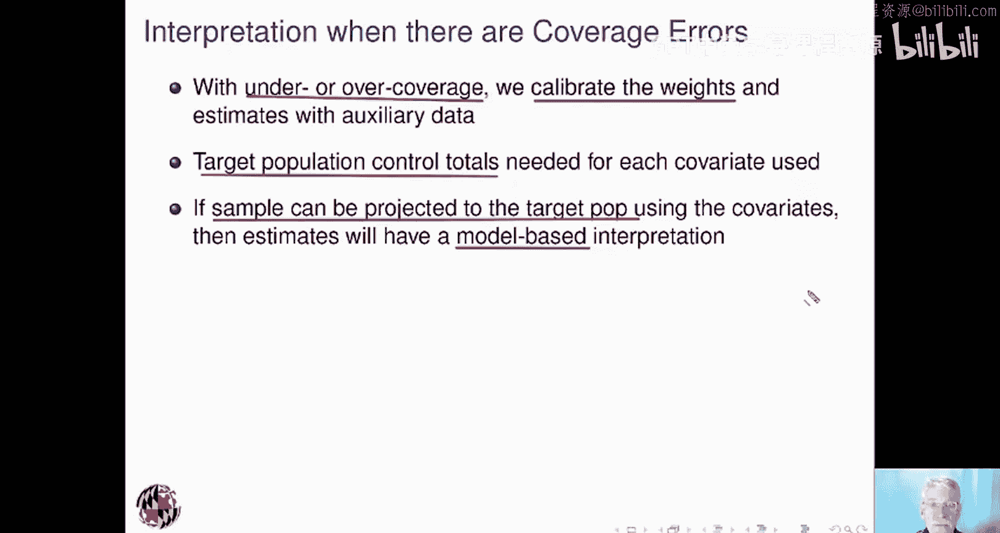

# 调查数据收集与分析：3：估计量的统计解释 📊

在本节中，我们将讨论从有限总体样本中得出的估计量的统计解释。我们将学习概率抽样与非概率抽样下估计量的性质，以及如何评估和调整估计量以确保其有效性。

---

## 概述

为了证明加权估计的合理性，它必须具有统计解释。这意味着估计量需要基于某种随机机制，能够代表总体。解释可以基于重复抽样，也可以基于模型。本节将详细探讨这两种解释方式，并介绍无偏性和一致性等重要概念。

---

## 概率抽样中的统计解释

上一节我们介绍了估计量需要统计解释。在概率抽样中，这种解释通常基于重复抽样的思想。

具体而言，如果我们按照特定的概率抽样设计（例如简单随机抽样）反复抽取样本，并对每个样本计算估计值，那么这一系列估计值的平均值应等于总体真值。这就是**无偏性**的含义。

一个估计量被称为**无偏的**，如果所有可能被抽中的随机样本的估计值的期望值等于普查值（总体真值）。用公式表示如下：

\[
E(\hat{\theta}) = \theta
\]

其中，\(\hat{\theta}\) 是估计量，\(\theta\) 是总体参数。

然而，无偏性并不保证估计的精确度。即使估计值在真值上下大幅波动，只要平均下来等于真值，它仍然是无偏的。

---

## 一致性与模型解释

比无偏性更理想的性质是**一致性**。

一个估计量被称为**一致的**，如果随着样本量增大，估计值越来越接近普查值。这意味着我们的估计会随着信息增加而变得更精确。用极限形式表示：

\[
\hat{\theta} \xrightarrow{P} \theta \quad \text{当} \quad n \to \infty
\]

对于非概率样本，我们无法依赖由抽样设计控制的重复抽样机制。因此，我们必须转向基于模型的解释。

建模可以有两种方式：
1.  对单元如何进入样本进行建模（例如，某种准随机化方式）。
2.  对我们所测量的总体Y值的结构进行建模。

无论哪种方式，目标都是使我们的样本能够“投射”到目标总体，即使样本不是随机获得的。

---

## 概率抽样的类型

在之前的课程中，我们已经接触过多种概率抽样方法。以下是几种常见的类型：

*   **简单随机抽样**：每个样本被选中的概率相同。
*   **分层简单随机抽样**：将总体分成层，在每层内进行简单随机抽样。
*   **系统随机抽样**：按某种系统规则（如每隔k个单元）抽取样本。
*   **两阶段/多阶段抽样**：先抽取初级单元，再从中抽取次级单元。
*   **与规模大小成比例的概率抽样**：常用于对企业或机构的抽样，规模越大，被抽中的概率越高。

所有这些方法，如果正确执行，都允许我们进行重复抽样解释。

---

## 非概率抽样的挑战与类型

另一方面，非概率样本也常被用于推断，但我们必须清楚其局限性。

正如之前提到的，对于非概率样本，无偏性和一致性等性质必须依赖于某种模型。我们的样本必须能够代表总体，即使它不是随机获得的。如果样本在覆盖面上存在严重缺陷（例如，缺少某个重要子群体），那么就很难证明估计量是针对我们感兴趣的总体。

以下是几种常见的非概率样本类型：

*   **方便样本**：例如，使用心理学导论课的所有学生作为实验对象。这些学生并不能代表国家甚至某个子群体的总体。
*   **配额样本**：例如，挨家挨户招募，直到获得指定数量的各年龄段人员。这可能无法很好地代表总体。
*   **志愿者面板/河流样本**：通过网站弹窗广告或特定网站招募志愿者。抽样者无法控制谁会出现在样本中。

---

## 响应与覆盖误差的影响

即使是概率样本，也可能因为无回答而面临严重问题。例如，在美国通过电话进行选举民调，可能只有约5%的响应率。如此低的响应率很难被视为一个良好的概率样本，并可能引入偏差。

此外，无论是概率还是非概率抽样，都可能存在覆盖误差（即抽样框未能完整覆盖目标总体）。覆盖可能不足或过度。

为了应对这些问题，我们采用一种称为**利用辅助数据进行权重校准**的方法。

---

## 权重校准

校准的目标是使用已知的总体辅助信息来调整样本权重。

我们需要的是目标总体的**控制总量**。我们可能不知道总体中每个个体的信息，但至少知道某些变量的总体总计（例如，全国分年龄、种族、性别的人口数）。

我们可以调整样本权重，使得这些控制变量的加权估计值与已知的总体普查值相匹配。用公式表示校准约束：

\[
\sum_{i \in s} w_i x_{ki} = X_k \quad \text{对于所有控制变量} k
\]

其中，\(w_i\) 是第i个样本单元的校准后权重，\(x_{ki}\) 是其第k个控制变量的值，\(X_k\) 是该变量的总体总量。

例如，对于人口调查，可以使用年龄、种族、民族和性别的普查计数作为校准变量。通过校准，我们希望样本能通过这些协变量投射到目标总体。这通常需要基于模型的解释。

校准后的权重至少能再现总体的控制总量，这是朝着正确方向迈出的一步，尽管不能保证对所有其他待估的Y变量都有效。

我们将在后续课程中学习如何具体进行权重校准。

---

## 总结

本节课中，我们一起学习了估计量的统计解释。我们了解到，在概率抽样中，解释基于重复抽样，并引入了无偏性和一致性的概念。对于非概率抽样，则必须依赖模型进行解释。我们还探讨了不同类型抽样的特点，以及响应误差和覆盖误差带来的挑战。最后，我们介绍了通过辅助数据校准权重这一重要技术，以改善样本对总体的代表性，为进行有效的统计推断奠定基础。