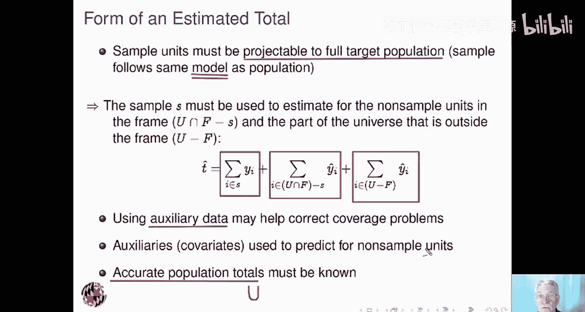

# 密歇根大学《调查数据收集和分析（2-6：方法、社调问卷设计、抽样、缺失数据、分析）｜Survey Data Collection and Analytics》 p127 4_覆盖问题.zh_en -BV1fw4m1e7Zh_p127-

Coverage problems are such a big issue in surveys that it's worth saying a few more things about them。

 just so we'll have the idea locked in。You can have either under or over coverage。

 and we need to do something about both those。So here are some examples of overcoverage。

 which we've given earlier， you can have a frame of businesses that includes out of business units。

So it's overcover in the sense that you're including units that are not really part of the current universe。

You could have a list of organization members that contain some people who've dropped out。

So that those would also be ineligible and the standard way of handling those is just drop them from the sample once you determine that they are ineligible。

Certainly drop them from estimates that are used in the sample。

And the other problem in the other direction is undercover。So we may have， for example。

 a volunteer web panel that omits elderly women。We could have a business frame that does not include recently formed businesses。

You know，There are a lot of businesses that are pretty volatile。

 like restaurants go in and out of business quite rapidly。

 So it's hard to keep an up to date business frame。Consequently， this is a pretty common problem。

 depending on the universe that you're sampling。So。In these examples， you can do one of two things。

 You could redefine the target universe to say what you're representing are just the units。

 the types of units that I was able to cover。Or you can make a statistical adjustment to expand the covered。

Population。That is the one you do the sample from to the target population， which may be larger。

Think about those Venin diagrams that we looked at earlier。So it's worth revisiting those pictures。

 which is what I'll do here。Population total that we're interested in estimating has got really two parts。

If I look at the universe intersecting frame， that's this area down here that is。

The gray universe intersected with this rectangular frame。So， that's one。啊。

Part that I actually drew the sample from。The u minus F part。Over here。Is。😔，The said。

From which I drew no Sam。But I need to project for those if I'm really claiming that those are part of my universe。

 So that's the inference problem。How do I do that projection？

Now it's useful to look at the form of an estimated total again， to see how we go about that。

In order for the sample to be projectable to the full target population。

The sample needs to follow the same model as the full population， in some sense。

So we'll look at particular ways of doing that。That's just a statistical way of saying that the sample needs to represent the population that you're after。

And the representation is in this model sense that we'll look at in more detail。So， my estimator。

In concept， he's got three pieces。A。if got the scene part what's in my sample。I just add those up。

To get there part of the total， then I've got the part of the universe that my frame covers。

Excluding the sample。 and I project for those。 So I call the my projected values Y hat for each element I。

 And then down here， I've got the part of the universe that was outside the frame。

So I need to cook up。Predictions implicit or explicitly for those units that I was not able to cover in the sample。

 And that's。Where statistical estimation comes in。Usually， we use auxiliary data。

 as I mentioned earlier， we need covariates。That。Are useful。

 they're related to both coverage and to what we're trying to measure。

And then we need accurate population totals for in population in this case means the U in the diagram that we looked at。

So that's the general layout of the goals that we're trying to。

Accomplish here。